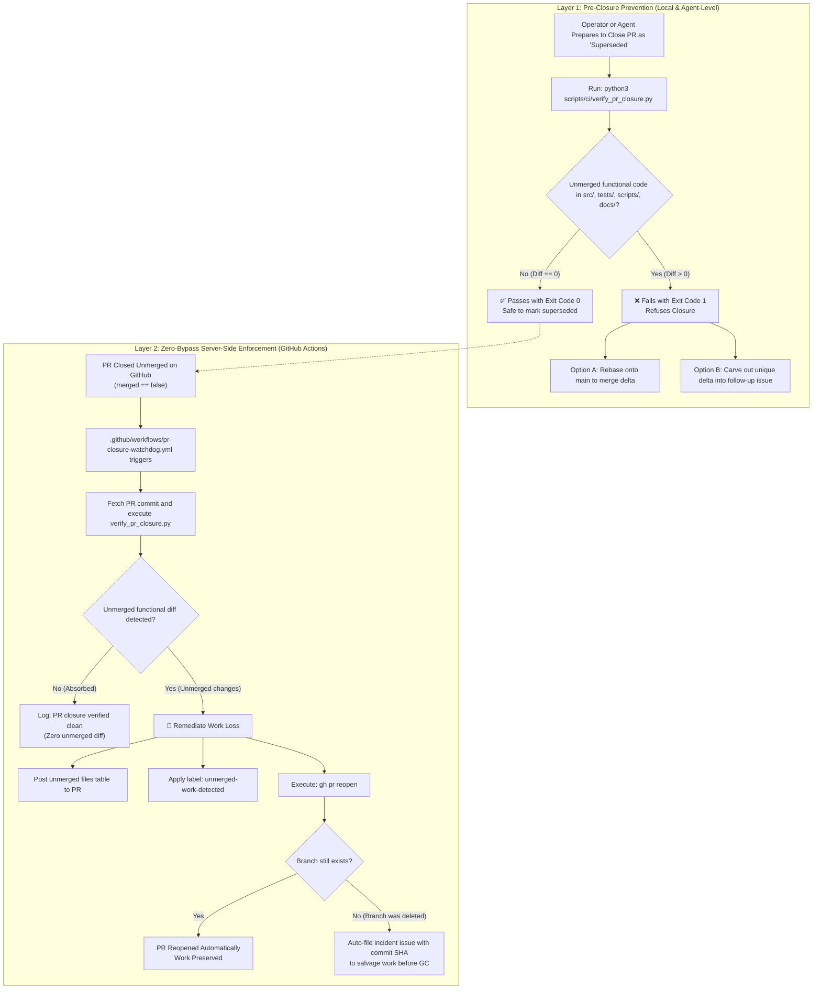

# Anti-Work-Loss Architecture and Workflow Guardrails

> **Author**: `#ceo-aimp`  
> **Status**: Active / Enforced  
> **Applicability**: Multi-agent and multi-developer GitOps workflows  
> **References**: [`docs/agents/gitops.md`](./gitops.md) (§11, §24), [`AGENTS.md`](../../AGENTS.md), Issues [#3437](https://github.com/Qunsultant/cfagent/issues/3437), [#3444](https://github.com/Qunsultant/cfagent/issues/3444)

---

## 1. Overview

In high-concurrency autonomous engineering environments, multiple agents or developers frequently address related or overlapping issues in parallel. Without mechanical guardrails, two structural failure modes lead to unreviewed engineering work being prematurely closed or discarded:

1. **Unverified "Superseded" Closures**: An agent or human assumes an open PR is redundant (e.g., because a sibling PR landed first or the parent issue was updated) and closes the PR by verbal association alone, without checking whether the branch contains unique code or test coverage.
2. **Duplicate Dispatch (No Exclusive Leasing)**: Multiple agents initiate parallel work on the same issue or sub-issue without claiming the task or checking for active open PRs, creating racing PRs and merge collisions.

The Anti-Work-Loss architecture establishes a multi-layer defense combining local pre-closure verification tooling with a zero-bypass server-side GitHub Actions watchdog.

---

## 2. Architecture & Lifecycle Flowchart

The lifecycle prevents unreviewed work abandonment both before a closure is attempted and as an automated backstop if an unmerged closure occurs on GitHub.



---

## 3. Defense Layer 1: Local & Agent-Level Pre-Closure Tooling

### 3.1 Verification Script (`scripts/ci/verify_pr_closure.py`)
Located at [`scripts/ci/verify_pr_closure.py`](../../scripts/ci/verify_pr_closure.py) and wrapped by [`scripts/verify-superseded.sh`](../../scripts/verify-superseded.sh), this tool mechanically inspects a target branch or commit SHA against `origin/main`.

```bash
# Verify whether a branch can be safely closed as superseded:
python3 scripts/ci/verify_pr_closure.py <branch_or_commit>

# Or using the shell wrapper:
scripts/verify-superseded.sh <branch_or_commit>
```

#### Rules Enforced:
1. **Diff-Before-Close**: Calculates the merge-base between `origin/main` and the target ref, then evaluates `git diff origin/main...<target> --name-status`.
2. **Fail-Closed Gate**: If any non-changelog files in `src/`, `tests/`, `scripts/`, or `docs/` have unmerged modifications or additions, the script outputs exit code `1` and prints the exact diff.
3. **Changelog Exclusion**: When `--ignore-changelog` is specified, discarded changelog fragments from superseded branches are ignored if the underlying functional changes are already merged.
4. **Emergency Override**: The `--allow-override` flag logs an explicit warning instead of exiting non-zero (reserved for owner-authorized exceptions).

### 3.2 Regression Suite (`tests/safe_pr_closure_workflow.test.ts`)
The tool is covered by 5/5 automated Vitest tests executing in an isolated temporary Git repository:
- Verifies clean pass when comparing `main` against `main`.
- Verifies clean pass when comparing fully merged branches.
- Verifies failure when comparing branches with unmerged functional files.
- Verifies emergency override flag handling.
- Verifies changelog fragment filtering.

---

## 4. Defense Layer 2: Zero-Bypass Server-Side Watchdog

Because GitHub's UI and API do not support native pre-close webhooks, a user or external automation could theoretically bypass the local script by calling `gh pr close` or clicking "Close pull request" directly.

The **PR Closure Watchdog** ([`.github/workflows/pr-closure-watchdog.yml`](../../.github/workflows/pr-closure-watchdog.yml)) provides server-side enforcement:

### 4.1 Trigger & Conditions
- Trigger: `pull_request_target: [closed]`
- Filter: `if: github.event.pull_request.merged == false`
- Runner: Pinned `ubuntu-24.04`
- Permissions: `contents: read`, `pull-requests: write`, `issues: write`

### 4.2 Automated Remediation Flow
1. **Fetch Head Tree**: Fetches the closed PR's head SHA from the repository.
2. **Execute Engine**: Runs `python3 scripts/ci/verify_pr_closure.py "$HEAD_SHA" --base origin/main --ignore-changelog --json`.
3. **If Clean**: Logs verification success and exits cleanly.
4. **If Unmerged Changes Detected**:
   - Compiles a Markdown summary of all abandoned files.
   - Automatically reopens the pull request via `gh pr reopen "$PR_NUMBER"` with a detailed alert comment.
   - Attaches the `unmerged-work-detected` label.
   - **Deleted Branch Fallback**: If the branch was deleted during closure preventing reopening, it automatically opens an incident issue titled `[watchdog] PR #<num> closed with unmerged work: <title>` containing the exact commit SHA and branch rescue commands before Git garbage collection occurs.

---

## 5. Operational Protocols for Agents

### 5.1 Single-Lease Issue Claiming
To prevent duplicative parallel branches:
1. Before cutting a branch, agents must query active pull requests:
   ```bash
   gh pr list --search "<issue-number> in:title"
   ```
2. If an active branch or PR already exists, the agent must inspect or collaborate on the existing branch rather than dispatching a duplicate.
3. When starting work, record an explicit claim comment on the issue:
   ```markdown
   ## Agent Claim: #<agent-id> (branch: feat/<issue>-<slug>)
   ```

### 5.2 Delta Harvest Protocol
When two pull requests deliver overlapping work:
1. Never race to merge one and blindly close the other.
2. Once the first PR merges into `main`, immediately rebase the second PR:
   ```bash
   git checkout <second-branch>
   git fetch origin main
   git rebase origin/main
   ```
3. Evaluate the remaining diff (`git diff origin/main...HEAD --stat`):
   - If the remaining diff contains valuable features or tests, push the rebased branch and allow the secondary PR to merge its additive contribution.
   - If the remaining diff is truly empty, run `scripts/verify-superseded.sh <branch>` and close the PR with the verification output attached.
