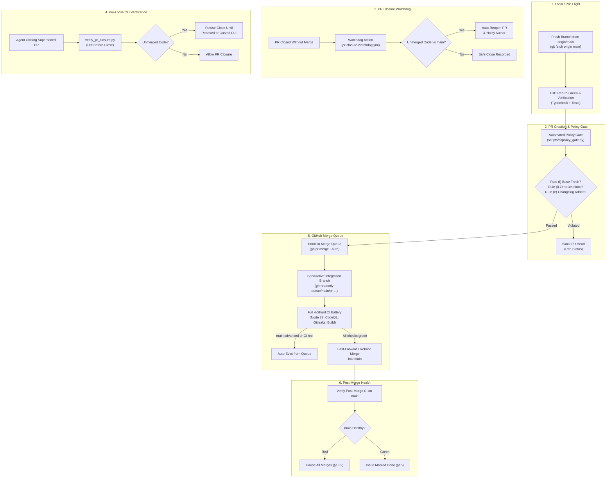

# GitOps Anti-Stale & Work-Loss Prevention Checklist

> **Authority**: Governed by [`docs/agents/gitops.md`](gitops.md) (§11, §18, §22, §24) and [`AGENTS.md`](../../AGENTS.md).
> **Purpose**: Ensure that stale code, outdated PR branches, and discarded commits cannot be replayed or silently regress `main`, while guaranteeing zero work-loss on abandoned or superseded pull requests.

---

## 1. Multi-Layer Defense Architecture

The cfagent platform enforces six continuous layers of defense across development, pre-flight, pull request validation, queue admission, and post-merge monitoring:



---

## 2. The 6 Automated Controls & Gates

### Control 1: Automated Policy Gate (`scripts/ci/policy_gate.py`)
- **Stale Base Detection (Rule `f`)**: Compares the PR merge base against `origin/main`. If the branch attempts to re-introduce older states or commits superseded by subsequent work on `main`, the gate fails.
- **Zero Deletions (Rule `i` / §22)**: Replaying old PRs that dropped files or lack recent additions is strictly forbidden. Files can only be deprecated in place naming their successor module.
- **Changelog Fragment (Rule `e`)**: Every functional PR must include a `changelog.d/<issue>.<type>.md` fragment documenting what changed.

### Control 2: GitHub Merge Queue (`gh-readonly-queue/main/pr-...`)
- **Speculative Head Testing**: PRs are never tested in isolation. The Merge Queue rebases the PR onto the current tip of `main` (along with preceding queued PRs) into a transient branch before executing the full suite.
- **Auto-Eviction on Race**: If `main` advances while tests run, the queued PR is automatically evicted, rebased, and re-tested, eliminating race-condition regressions.

### Control 3: Pre-Close Verification (`scripts/ci/verify_pr_closure.py` & `scripts/verify-superseded.sh`)
- **Diff-Before-Close Rule (§11, §24)**: Before an agent or developer closes any PR as "superseded" or "duplicate", they must run:
  ```bash
  python3 scripts/ci/verify_pr_closure.py <branch>
  ```
- If the semantic diff against `main` contains unmerged functional code, closing without rebasing or carving out the delta into an issue is prohibited.

### Control 4: Automated GitHub Actions Closure Watchdog (`.github/workflows/pr-closure-watchdog.yml`)
- Triggered automatically on all `pull_request_target: [closed]` events across the repository.
- If a PR is closed without merge while its branch contains unmerged functional code, the watchdog posts an unmerged code report and **immediately auto-reopens the PR**.

### Control 5: Post-Merge CI Health Freeze (GitOps §18.2)
- Merging onto an unhealthy `main` is strictly prohibited.
- If post-merge CI on `main` turns red, all merges are immediately paused until `main` is restored to green.

### Control 6: Linear History & Strategy Flags Prohibition
- Always use `gh pr merge --auto` without strategy flags (`--rebase`, `--squash`, or `--merge`). The Merge Queue ruleset manages the rebase merge method.

---

## 3. Developer & Agent Verification Checklist

Use this checklist before opening, closing, or merging any branch:

| Step | Action | Command / Check |
| :--- | :--- | :--- |
| **1. Fresh Base** | Ensure branch is cut from current `main` | `git fetch origin main && git rebase origin/main` |
| **2. TDD & Types** | Red-to-green tests and type safety | `npx tsc --noEmit && npm test` |
| **3. Policy Check** | Run local diff-only policy gate | `python3 scripts/ci/policy_gate.py --base origin/main --head HEAD --diff-only` |
| **4. Zero Deletions**| Confirm no files are deleted | `git diff --cached --diff-filter=D --summary` (must be empty) |
| **5. Changelog** | Confirm fragment exists | `changelog.d/<issue>.<type>.md` |
| **6. Auto-Merge** | Enroll in merge queue | `gh pr merge <pr_number> --auto` |
| **7. Close Verify** | Before closing unmerged PRs | `python3 scripts/ci/verify_pr_closure.py <branch>` |
| **8. Post-Merge** | Confirm main is green | `gh run list --branch main --limit 3` |
