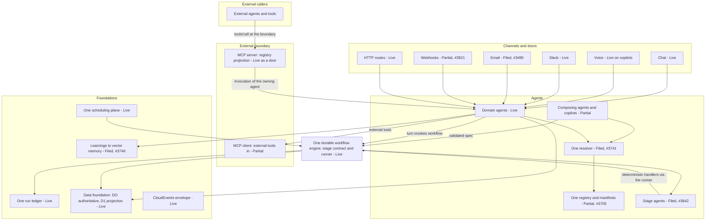
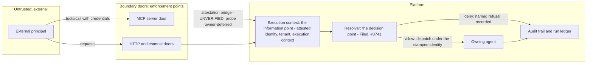

# Agents, Workflows, Schedules, Queues, Platforms, Lifecycle — the target architecture

**This document is the one account of how the platform's agents,
workflows, schedules, and queues fit together**: the target
architecture in simple terms, the mechanism as it exists in the code
today, and the honest distance between the two — each element with
its status and its tracking issue.

It is linked from the Architecture and Design Document
([ADD](../ADD.md), Agentic Architecture section). It links and
duplicates nothing: the capability-level account is
[agent-capabilities](./agent-capabilities.md); the invocation model
of record (channels, turns, doors) is
[doors-and-layers](./doors-and-layers.md); the pipeline engine's own
mechanics are [job-system](./job-system.md); the stage contract and
its two executors are
[multi-turn-agentic-workflows](./multi-turn-agentic-workflows.md);
the schedule catalogue and staged scheduling are
[social-delivery-and-scheduled-pipelines](./social-delivery-and-scheduled-pipelines.md).
Where those documents carry a mechanism, this one states the
conclusion and points.

**Source and status discipline.** The target stated here is the
2026-11-09 owner discussion, recorded in full on issue #3842 — the
governing tracker for the composition programme this document
describes; the architecture record itself is filed as #3844. Every
current-state entry carries the folder's status vocabulary: **Live**
(built, deployed, and exercised through its real surface),
**Partial** (a real part exists; the named remainder is filed), or
**Filed** (a tracked build issue exists; nothing is built yet). A
filed item is never described as built. Statuses are as of
2026-11-09; the tracking issue beside each entry is where its
current state lives. Mechanism claims about today's code name the
module they were surveyed from.

## 1. Governing principle: one of everything, full reuse

Owner direction (2026-11-09, recorded on #3842): "we just need one
of everything and full reuse."

Every capability exists **once** — one implementation, one
definition, one registry entry — and every surface consumes that one
thing by **invocation**. Full reuse means the same code called,
never a pattern re-implemented beside it. Anything that exists twice
is a defect to be converged, not a variant to be maintained.
Concretely, for this architecture:

- **One unit of capability: the tool** (an agent-owned capability,
  §3). A capability is defined once in the one registry. Workflow
  stages, HTTP routes, MCP tools, and chat doors are *projections*
  of that one definition, not separate wrappings with their own glue
  over the service layer.
- **One orchestration: the Generic workflow engine** (§4). Turn-time
  composition, per-family hand-rolled stage machines, and the
  generic stage runner converge to the runner; a stage *is* a tool
  invocation.
- **One resolver** (§3.2): channels, runtimes, tools, models, and
  choices resolve through a single resolver at the most granular
  scope.
- **One of each foundation:** one data foundation (the ORM line —
  no parallel persistence), one scheduling plane (§5), one runs
  ledger (§6), one message envelope, one send path per surface.

**The acceptance test.** For any new surface or family, the review
question is: *what existing one thing does this invoke?* A proposal
that adds a second implementation of an existing capability —
service, wrapper, stage machine, registry, or resolver — fails this
bar regardless of whether it works. Pattern reuse is labelled as
such and never reported as code reuse; §7.2 records the measured
example of why the distinction is load-bearing.

## 2. The target architecture in simple terms

In one sentence: many small agents, each owning a few capabilities
and describing them in a registry; anything can invoke anything
through one tool-shaped contract; multi-step work runs as a
workflow on one durable engine — the graph authored in code when it
must be predictable, composed at runtime by an agent when it must
be flexible; MCP exists only at the outer edge, for outsiders.

1. **Agents are the only building block.** Each capability (feed,
   screening, trading, payments, browser…) is owned by exactly one
   agent with an identity, a manifest, memory, and settings. No
   orphan services, no second implementations — one of everything.
2. **One way of calling.** Invoking a capability always looks like
   a tool call: name, typed arguments, typed result — whether the
   caller is a user in a chat, another agent, a workflow stage, or
   an external system.
3. **Two transports, chosen by the border.** Inside the platform,
   agents call agents natively. At the outer edge, the same
   contract is carried by MCP — our server for external callers in,
   our client for external tools in. MCP is the border, not the
   internal bus.
4. **One durable workflow engine.** Any multi-step program —
   however it was composed — executes on the one engine: journaled
   steps, checkpoints, replay that never re-executes completed
   steps, approvals as stages, one run ledger. (Industry: durable
   execution.)
5. **Two ways to compose, one graph format.** Deterministic
   workflows are authored in code. Agentic workflows are composed
   at runtime by an agent or copilot from the registry, as a
   validated data-only spec. Same spec, same engine, same records.
   (Industry: the workflows-vs-agents distinction — predefined
   paths where predictability matters, dynamic direction where
   flexibility does.)
6. **One resolver and one identity.** A central policy layer
   decides what each agent may call, per tenant and per run, and
   every call carries an attested execution context. Discretion
   lives only inside conversational turns; obligation lives in
   specs; guards (approvals, fail-closed refusals) are named and
   visible.
7. **One foundation.** One data layer (ports/adapters, Durable
   Object authoritative, D1 as its read projection), one
   scheduler, one envelope, learnings written back to memory
   (the learnings-to-memory capability, filed as #3746) so
   composition improves over time.

**Why this is both "best practice" and "most agentic."** The
skeleton is the industry's settled patterns composed — hexagonal
ports/adapters, an edge protocol, a policy engine, durable
execution, a service registry. The agentic part is what sits on
top: runtime composition (the system can create new programs from
its registry without a code deploy, inside validation and
approval), discovery over prompt-hardcoding, symmetric
self-invocation (agents orchestrating agents recursively), and a
learning loop. Autonomy inside declared guardrails — not autonomy
instead of them.

### 2.1 The target architecture, drawn

Element labels carry their status as of 2026-11-09 (§7.4 is the
tabular form). The external boundary is drawn as a boundary:
nothing crosses it except through the MCP server projection
(in) and the MCP client (out).

## 3. Agents and the one invocation contract

### 3.1 Agent-as-a-tool is the invariant; MCP is its external presentation

Pinned vocabulary (2026-11-09, #3842):

- **Agent-as-a-tool is a relationship, not a protocol:** agent A
  invokes agent B through a tool-shaped interface (name, typed
  arguments, typed result) — B appears in A's capability set the
  way a tool does. It says nothing about wire or session.
- **MCP is a protocol and a boundary:** the standard wire
  (tools/list, tools/call, sessions, external auth) for crossing
  between separate systems.

Therefore every agent exposed externally is presented as an MCP
tool — at the boundary, agent-as-a-tool is carried by MCP, and the
agent is an "MCP agent" in that sense. Internally, the same
relationship is realized natively: identical contract shape, no
MCP session or wire. If "MCP agent" is defined as "an agent whose
capabilities are invocable as tools under the one contract," then
every agent in the fleet is one by construction, because the one
contract is MCP-shaped (§3.5). What the word "MCP" must keep
marking is the boundary crossing, because that is where things
actually differ: external-principal attestation into an execution
context, session semantics, and trust. One-line form: **agent-as-a-
tool everywhere; MCP where the caller is external.**

### 3.2 Availability, obligation, discretion

Three separate questions, never to be conflated (2026-11-09,
#3842):

- **Availability — "may A call B at all?"** Decided by declaration
  and resolution, never by the caller in the moment: B declares the
  capability in its manifest; A's resolved capability set (the one
  resolver, #3741 — most-granular layering, operator pins)
  determines whether B appears among A's tools. Off means absent
  or refusing by name — identically in turns and workflows.
- **Obligation — "must the call happen?"** Only a **workflow spec**
  makes a call obligatory. In a composed workflow (code-authored
  or copilot-composed), the stage graph names the agent-tool; when
  a run reaches that stage, the engine invokes it — no runtime
  discretion. It goes uncalled only for structural reasons: a
  branch not taken, an upstream stage failed or stopped, a
  resolver-disabled stage refusing by name, an approval stage not
  approved.
- **Discretion — "does A call B now?"** In a **conversational
  turn**, entirely the calling model's discretion: an agent-as-a-
  tool in a turn's tool list may be called, called twice, or never,
  with model-chosen arguments. Availability is not invocation.

The named middle state is the **guard**: a capability can refuse an
out-of-order or unapproved discretionary call (the
preview→confirmation→place legs of an order; entry⇒exit pairing).
Guards constrain discretion; they do not remove it. If a call must
happen, it belongs in a spec. One-line form: **the resolver decides
availability; the spec decides obligation; the model decides only
inside a turn.**

### 3.3 MCP is the external boundary; internal agents call agents

Owner rule (2026-11-09, #3842): MCP tools are for external agents;
internal agents just call agents.

**It is an option today.** The mesh (Agent Mesh programme #2225)
has five invocation surfaces: chat turn, HTTP routes, MCP, A2A, and
agent-as-a-tool. Nothing in the agent port forces an internal call
through the MCP tool layer; direct agent-to-agent invocation
(agent-as-a-tool door, A2A, object-level calls under the mesh's
execution-context discipline) is a sanctioned surface. The
agent-as-a-tool and A2A doors are **Live** on a transitional shared
token (agent-capabilities §1); the per-surface secrets rollout is
operator-deferred.

**Why it is not the lived reality: build order, not requirement.**
The internal capability catalog was implemented once as MCP command
classes (`src/mcps/openaimp/*Commands.ts`, the `IMcpToolCommand`
layer) serving two consumers — the external MCP server it was
designed for, and internal agent tool-calling, whose callers were
pointed at the layer because it existed. The conflation hardened:
internal calls are recorded as "MCP tool runs" (§7.1), external
protocol semantics leak into internal composition, and one word —
"MCP" — ended up naming the contract, the server, and the wire.

**The rule going forward** (binding on the #3842 build):

- MCP is the external boundary in both directions: our MCP server
  (#3702) is the projection of the capability registry for external
  agents and clients; our MCP client (#2496, product track #3703)
  is how external servers' tools enter. External only.
- Internal composition is agent-to-agent: the capability contract
  is the agent's manifest declaration, not an MCP tool definition.
  The command implementations underneath are the same code; what
  changes is the door internal callers use, and the MCP server
  becomes a pure external projection of the one registry.
- The execution-contract track (#3743) is read subject to this:
  its "MCP default" names the contract shape at the external
  boundary; internally the same contract is invoked natively.
- **Direct is not undisciplined:** internal calls still carry
  execution-context identity, resolver checks (a capability that
  is off refuses by name), audit, and a ledger record. What
  disappears is the external protocol shape around internal calls.

Conformance recorded on #3842: an internal agent→agent invocation
produces an agent-invocation run record (not an MCP tool run); MCP
tool run records are produced only at the external MCP server
boundary.

### 3.4 MCP tools are agents at the boundary

Owner refinement (2026-11-09, #3842): an external agent invoking
one of our MCP tools actually invokes our agent.

- **Every capability is owned by exactly one agent.** The MCP
  server's tool list is the external directory of agent-owned
  capabilities: the tool is the *external name* of a capability
  whose owner is an internal agent.
- **An external tool call is an agent invocation.** The MCP server
  (the external door, #3702) translates tools/call at the boundary
  into an invocation of the owning agent — the same
  agent-as-a-tool invocation an internal caller would make, with
  the external principal attested into an execution context. One
  registry underneath: capability → owning agent; the MCP catalog
  is a generated projection of it, not a hand-maintained parallel
  layer.
- **Granularity is ownership, not one agent per tool.** The
  current catalog (118 tools at last count) maps onto the fleet's
  domain and stage agents — each agent owns many capabilities.
- **Same determinism rule as stage agents (§4.3):** invoking the
  owning agent executes the capability's deterministic handler
  under its ownership; a model-driven turn happens only where
  that capability's declaration says so.

Why it is not so today — three blockers, none of them principled
(detail in §7.3): the catalog was built service-first and the MCP
server *terminates* calls under its own context instead of routing
to an owner; no capability→owner registry exists yet (that is
#3741 / the registry-and-manifests track #3705); and the
external→internal attestation bridge is unverified (the
authenticated external MCP session has never been verified
end-to-end — an owner-deferred probe on the #1078 line).

### 3.5 Transport: the MCP contract, not by default the MCP wire

Design point (2026-11-09, #3842), answering "will stages call
tools over MCP?":

- **Contract: yes.** A stage invokes a tool through the same
  command/contract layer the MCP server exposes — the #3743
  machinery (MCP the default contract for every command family,
  REST selectable, selection in the manifest/resolver layer). One
  invocation path, MCP-shaped: schema, permissions, attestation,
  modes.
- **Transport: in-process when the tool is local.** A stage
  running in the engine resolves a locally hosted tool through
  that contract layer directly — no protocol hop inside a
  journaled stage. The stage outcome is a journaled step result;
  **replay never re-calls the tool**, whichever transport first
  execution used.
- **The wire appears only across a real boundary:** another agent
  invoked through the agent-as-a-tool door across a boundary, or
  an external MCP server — carried by the platform MCP client.
  Same contract; transport selected by where the tool lives,
  invisible to the workflow spec.

Why not wire-always: (1) determinism — stage outcomes must be
journaled step results, not live protocol calls; (2) failure
surface — a network hop per stage manufactures more stuck,
no-end-recorded runs, the exact symptom that opened this topic
(§7.1); (3) one-of-everything — wire-always would create a second
invocation path beside the in-process contract path. Conformance
recorded on #3842: a local tool invocation and a remote (MCP
client) invocation produce indistinguishable stage records in the
runs ledger.

### 3.6 Interaction shapes and agent classes

Two interaction shapes run on the one contract, and they
interleave:

- **Multi-turn** — conversational, stateful turns: the Think
  turn, including the dual-mode agentic loop in which the model
  composes tool calls across turns. The mechanism account is
  the multi-turn workflows document in this folder; this
  document records the architectural place: discretion lives
  here, and only here (§3.2). **Live.**
- **Multi-step** — stage-graph execution on the durable runner
  (§4): obligation lives here. **Live** for code-authored
  graphs; runtime-composed graphs are **Filed** (#3842).
- **The interleave** is the normal case, not an exception: a
  turn invokes a workflow (the copilot proposes, the program
  executes — §7.1), and a workflow stage invokes an agent (the
  stage agents of §4.3, invoked through the same contract,
  journaled as steps).

The fleet, read against the four agent classes of the target
taxonomy:

| Class | Definition in this architecture | Fleet today | Status |
| --- | --- | --- | --- |
| Domain agents | Own a business or platform domain's capabilities behind the contract | The twelve Think classes behind the one agent port (orchestrator, trading, screener, scheduled, research, payments, and the channel and platform agents) | Live |
| Deep agents | Long-horizon, multi-step planning and execution toward a goal, over many invocations | The shape exists in the research machinery and goal chains; no fleet class is declared as a deep agent, and the taxonomy is not a fleet factoring today | Partial |
| Meta-agents | Agents that create, configure, compose, or orchestrate other agents | Turn-level tool composition in the copilots (Live); the generic composer base under declaration-driven composition and runtime workflow composition (Filed, #3741 / #3842) | Partial |
| Micro-agents | Single-capability agents: one owned capability, invoked as a tool | The stage agents of §4.3 (Filed, #3842); today's nearest form is the single-capability command class of §3.4 — a command, not yet an agent | Filed |

### 3.7 Tools: the two classes, accounted by category

The catalog holds 118 tools (counted from the code and
reconciled in the MCP server inventory document of this folder,
which is the per-tool account together with the tools
inventory, #3518; per §1 this document accounts by category and
does not re-list tools). In the target state every entry is a
projection of an agent-owned capability (§3.4); today they are
the command classes of §7.2.

Business tools (68):

| Category | Count | Status |
| --- | --- | --- |
| Screening and pipeline jobs | 28 | Live |
| Broker and market-data families | 18 | Partial — broker neutrality across the families is the #3739 closeout |
| Trading proposals, approvals, and report assets | 10 | Partial — paper execution Live; live-money execution is a separate owner decision |
| Payments (incl. agentic payments) | 9 | Partial — §12.2 |
| Goals and chains | 3 | Partial |

Technical and platform tools (50):

| Category | Count | Status |
| --- | --- | --- |
| Platform, knowledge, async-job, and admin | 13 | Live |
| Platform agent capabilities (browser, sandbox, search, validation, durable execution) | 9 | Partial — the sandbox capability is Unavailable pending an operator step |
| Data reads | 5 | Live |
| Mesh doors (browser and messaging) and scheduled goals | 7 | Live |
| Copilot operations | 5 | Live |
| Web fetch and web search | 2 | Partial — fetch Live; search Partial (provider-key decision outstanding, #3501) |
| Deprecated alias family | 9 | Filed — removal is a follow-up on the alias issue line (#1906) |

### 3.8 Channels: the full set

Channels are how callers reach agents; the capability
manifest's channel vocabulary is chat, voice, email, Slack,
and webhooks, and the mesh doors (MCP, agent-to-agent,
agent-as-a-tool) complete the set architecturally. The
capabilities document's channel table owns the per-channel
mechanism account; here each channel is one line of mechanism
plus its status:

| Channel | Mechanism in one line | Status |
| --- | --- | --- |
| Chat | The conversational turn on the orchestrator, one conversation across copilot registrations | Live |
| Voice | The chat turn spoken: browser speech or the model backend behind the per-registration switch (the capabilities document's voice account owns the mechanism) | Live on copilots; generalizing the backend switch to other surfaces is Filed (#3796) |
| Slack | A fleet agent owns the messaging channel; approvals and dispatches ride it | Live |
| Email | Channel ingress for agent mail | Filed (S2, #3490) — not live, and not implied live anywhere in this document |
| Webhooks | Signed HTTP ingress dispatched as channel turns; fail-closed on signature (§10) | Partial — ingress Live; the production signing secret's sync is in flight (#3821) |
| MCP (as a door) | The external boundary of §3.3 | Live |
| Agent-to-agent / agent-as-a-tool | The mesh invocation surfaces of §3.1 | Live — on the transitional shared token until the S16 rollout (§10) |

## 4. Workflows: one durable engine

### 4.1 How stages are called today (surveyed)

The engine is the stage contract plus its drivers:
`src/workflows/stageRunnerPorts.ts` (the contract), 
`src/workflows/stageRunnerPlan.ts` (pure plan decisions), and
`src/services/jobPipelineEngine.ts` (the `JobPipelineControl`
driver). The mechanics:

- **A run starts as a data plan.** A `StageRunnerPlan` freezes the
  stages in canonical order — the vocabulary stages **feed →
  gather → analysis → store → serve → deliver** (the messaging
  stage vocabulary; the run-ledger rows name the analysis stage
  "generate"), or, for configured pipeline jobs, job stages
  `job:<nodePath>` in the job definition's declared order. One
  plan, one stage family; a plan that cannot be executed as
  declared is refused loudly, never repaired or reordered.
- **One driver walks the plan.** `JobPipelineControl` compiles
  each node of the configured job tree to a one-stage plan and
  executes under the runner's decisions: a completed unit is
  never re-run; fan-out is capped per stage and the deferred tail
  is named (`fanout_cap_exceeded`), not truncated; retry budgets
  resolve once from the pipeline policy (acquisition for
  provider-facing stages, report for compute and artifacts,
  delivery for channel sends); units carry pacing tiers
  (`fast` / `slow` / `crawl` — the demoted tiers are queued under
  provider pressure, never retried tightly).
- **The journal wrap is the only thing that varies by host** —
  the contract's invocation modes
  (`StageRunnerInvocation` in `stageRunnerPorts.ts`):
  - `sync` — the journal is the identity function; stage handlers
    are awaited directly in the host's context. This is how the
    ScheduledAgent's pipeline host runs it
    (`src/agents/scheduledTasksPipeline.ts` builds its control
    with `invocation: "sync"` over the host's own storage).
    **Live.**
  - `workflow-shard` — the journal is the workflow substrate's
    step mechanism (`step.do`), making each stage call journaled
    and replay-safe. Used by the pipeline workflow residency
    (`src/workflows/jobPipelineWorkflow.ts`, a `ThinkWorkflow`
    over the shared D1 stores) and by the screener workflow flow's
    shard planning. **Live.**
  - `async-alarm` — declared in the contract; **no production
    driver stamps plans with it today** (its only other occurrence
    in the tree is a test fixture). The contract's own header
    names the async-jobs alarm scheduler (§6.1) as the seam this
    kind is for — one of the #2601 follow-on seams that move onto
    the shared plan decisions one slice at a time. Recorded here
    as declared-not-driven, not as a running mode.
- **Between stages:** a unit's output is persisted *before* its
  checkpoint entry completes, and the transition is published
  after — persist → checkpoint → publish. Checkpoints are
  `StageRunnerCheckpoint`s through the checkpoint-store port: on
  the screen substrate the store projects the run ledger's stage
  rows (one unit store — no second unit table); on the pipeline
  substrate it persists on the job instance record. Stage outputs
  pass forward as the next stage's input under the stage-message
  contract (`src/workflows/stageMessage.ts`: run id, stage id,
  persisted artifact keys, owning login, and an idempotency key of
  runId + stageId claimed before a consumer acts — exactly-once
  effect, not exactly-once delivery). Stop and pause are
  cooperative and recorded (a stopped unit keeps its intra-unit
  progress on its checkpoint and is resumable, never recorded as
  failed); cancel is terminal.
- **Inside a stage, handlers call ports and services directly.**
  The pipeline family modules — the feed / enrich / analyze /
  generate / deliver `*PipelineJobs` step modules and their
  `*Jobs` registries, plus the chain family module — register handlers
  that take a step context and call dependency ports —
  `deps.provider.getQuotesBatch(...)`,
  `deps.datasetStore.store(...)` is the representative form.
  There is no tool layer anywhere in this path (§7.2).

Uniform stage control — run / re-run / stop / resume / cancel /
schedule / re-schedule at (run, stage) granularity, with the
meanings above — is the #3549 contract (absorbing #3069); the
control plane is the one management surface the UX and the copilot
doors consume. The engine's own full account is
[job-system](./job-system.md); the stage contract's two executors
(deterministic, and the multi-turn loop behind the same contract)
are [multi-turn-agentic-workflows](./multi-turn-agentic-workflows.md).

### 4.2 Two composition modes, one graph format

A workflow is a graph of tool invocations. It is authored two
ways, and both forms execute on the one engine with the same
journaled lifecycle:

- **Deterministic (code-authored).** The family ships its graph
  in code. This is the only mode that exists today (§7).
- **Agentic (runtime-composed)** — **Filed**, governing issue
  #3842. A copilot (or another agent) composes a workflow at
  runtime from the registry. A composed workflow is a **data-only
  spec** — a stage graph over registry tools, inputs and outputs
  wired by the spec, no arbitrary code — validated against the
  tool registry allowlist and the stage contracts before it can
  run, with human approval gating registration. This is the
  discipline of the blueprint's prompt-driven workflow generation
  (spec → deterministic validation → approval), extended to
  runtime composition. The registry a copilot composes from is
  the resolver's capability set *for that agent* (§3.2) — it
  cannot compose a capability its resolver says is off.
  Money-path stages keep their gates inside the workflow:
  approval waits as stages, fail-closed refusals by name;
  composition never bypasses a tool's own safety guarantees.
  Replay of a composed run never re-composes: the spec is the
  artifact.

Recorded conformance for the build (#3842): a copilot-composed
spec executes through the stage runner with journaled stage
outcomes; program-shaped copilot actions (order placement)
produce exactly one multi-stage run record, not orphaned
one-stage rows; deterministic and composed workflows are
indistinguishable to the engine, the stage-control surface, and
the runs ledger.

### 4.3 An agent per stage: agents all the way down

Owner articulation (2026-11-09, #3842): there should be an agent
for each stage, and that agent can be a tool the other agents
call — a screener agent calling feed, enrich, and the rest as
agents, composed as a workflow, each agent executing through the
generic workflow stages. This is how the agentic workflow is
implemented.

- **An agent per stage capability.** Feed, enrich, analyze,
  generate, deliver are each an agent (a ThinkAgent behind the
  port) that owns that capability — its implementation, its
  manifest declaration, its settings.
- **Agents are tools to other agents** (§3.1): a composing agent
  invokes stage agents through the agent-as-a-tool door, over
  the contract of §3.5.
- **Composition is a workflow:** the composing agent's invocation
  graph over stage agents *is* the workflow — authored in code
  for deterministic families, composed at runtime under §4.2 —
  and **each stage agent executes its deterministic work through
  the stage runner** (journaled step, checkpoint, ledger record).
  Two layers, one of each: agents own and compose; the engine
  executes.
- **Worked example — the stock screener.** Today the screener is
  two halves: a ScreenerAgent (an agent class hosting doors) and
  separately a ScreenerScreenWorkflow (the execution). Under this
  model there is one **StockScreenerAgent**: it invokes FeedAgent
  → EnrichAgent → AnalyzeAgent → GenerateAgent → DeliverAgent as
  its tools in the screen's stage order; each of those executes
  via the stage runner. No parallel new class beside the existing
  ScreenerAgent — it evolves into this (one of everything). The
  stock-screens adoption (#3550, §4.4) is re-read in this light:
  the target is not merely "stages onto the runner" but "the
  screener as a composing agent over stage agents, on the
  runner." Stage-agent factorization reuses the existing stage
  handler implementations (the §4.1 family job modules) as the
  agents' execution cores — evolution, not parallel code.
- **The one design rule that keeps it sound:** "agent" names the
  unit of **ownership, identity, capability declaration, and
  invocability** — not an LLM conversation per stage. A stage
  agent invoked as a tool with a typed input executes its
  deterministic handler through the runner; model involvement
  happens only where that agent's own design declares it (for
  example non-deterministic-mode criteria generation, as a
  validated data-only artifact). Without this rule, per-shard
  agent turns would break money/screening determinism and
  multiply cost; with it, stage agents are exactly as
  deterministic as today's handlers — the handler code moves into
  the agent; it is not rewritten.

Why it is not so today (recorded honestly on #3842): (1) the
platform was built bottom-up from workflows — stages were
abstracted from workflow step-functions during the pipeline
build, so the engine's unit is a handler function in a registry,
while the fleet's agents were factored by domain surface and
stages by function; the two factorizations never met. (2) The
agent-as-a-tool door was wired only at agent level (the
orchestrator delegating to domain agents), never down to stage
capabilities. (3) Sequencing, not rejection: the adoptions that
would force the unification (§4.4) are filed but unstarted, and
the one-resolver build (#3741) has not run. Status: **Filed** —
the factorization is #3842 scope, sequenced inside the #3741
cluster and consumed by the independent copilot agent track
(#3744).

### 4.4 The Generic workflow capability, and the families not yet on it

The engine as a shared platform product is the **Generic workflow
capability** — issue #3700, a Technology Platform product
(platforms.md §3: generic workflow execution belongs to the
Technology Platform's shared runtime, not to any one lane's
platform). **Partial**: the engine is Live in pipeline use
(§4.1); the product registration and the family adoptions below
are Filed.

Onboarding a family means its stages execute on the one engine
under §4.3's reading. **Onboarding retires the bespoke
implementation, never the capability**: the screen, its schedule,
and its reports continue unchanged for their users; the separate
stage machine under them is what goes away. The pipeline chain
built by the J-sequence (§4.5) is in substance a stock screen but
is *not* the production stock screen, which still runs on its own
path; the two converge only at #3550.

| Family | Bespoke implementation today | Adoption | Status |
|---|---|---|---|
| Stock screens | the screener workflow family | #3550 | **Filed** — open, unstarted |
| Options screens | the options screen workflows | #3551 | **Filed** — open, unstarted |
| Goal + strategy screens | the goal/strategy screen paths | #3552 | **Filed** — open, unstarted |
| Trading | the trading workflow family | #3553 | **Filed** — open, unstarted |
| Payment | the payment workflow family | #3554 | **Filed** — open, unstarted |
| Saga | the cross-domain saga workflow | #3555 | **Filed** — open, unstarted |

The adoption tracker is #3549 (one engine: re-base on the stage
runner + uniform stage control). Until a family's row moves, that
family's workflows do not have stages in the §4.1 sense at all:
each runs its own workflow substrate with its own step code —
exactly the duplication the adoptions retire.

### 4.5 What this changes for the pipeline J-sequence (J1–J7)

Assessment recorded on #3842 (2026-11-09). J1–J7 (#3534–#3540,
all landed and closed) built the pipeline family on the engine.

- **Unchanged.** J1–J7 stays landed, closed, and running. The
  engine half of its work stands as this programme's foundation —
  the one stage contract and runner it rides, the ORM-foundation
  persistence, the stage vocabulary. Nothing is reopened or
  ripped out; this architecture builds on the engine J proved. J
  complied with the doctrine as stated when it was built (one
  engine, one data foundation).
- **Half-converged against the new bar.** The doctrine of §1
  raises the bar one level up — from one engine to one *unit of
  capability* — and J's stages are code-authored job registries
  calling ports and services directly (§4.1, §7.2). Under "a
  stage is a tool invocation," each J capability (feed pull,
  enrich, analyze, generate, deliver) must gain a **registry
  definition**, so the one implementation is invocable as a tool,
  composable by a copilot, and runnable by the deterministic
  chain — three projections of one thing, where today only the
  third exists.
- **The J chain becomes the reference deterministic
  composition:** a code-authored workflow spec over tools — the
  canonical example a copilot composition must be able to
  reproduce. Its bespoke step-registry wiring converges toward
  the one spec format of §4.2.
- **One boundary needs care:** the feed stage touches the
  provider feed/pull programme owned by the data lane (#3530 —
  the provider pull contract, captures, and persisted copies).
  The feed capability's single definition must be agreed across
  that boundary, not defined twice on either side of it.
- **New work implied** (tracked on #3842, built in the #3741
  cluster sequence): a "J stages onto the registry" slice —
  re-expressing the J stage capabilities as registry tools and
  the chain as a spec over them. The closed J issues are not
  reopened; the pipeline family becomes in effect the first
  adoption executed under the one-of-everything bar. The J7
  follow-ups (#3681, #3682, #3683, #3686) remain as filed and are
  read against this framing.

### 4.6 The runtime, end to end

One runtime story holds the sections together. Agents are
Think classes on Durable Objects behind the one agent port;
the adapter boots lifecycle, resolves capabilities, and runs
turns (§9). Durable execution runs on the workflow substrate
(ThinkWorkflow over the platform's workflow service) with the
stage runner of §4.1 executing inside it in workflow-shard
mode, or in-process in sync mode on the scheduling plane's
host. Every execution carries the attested execution context
of §10. State lives in durable-object storage (authoritative),
the relational projection, and vector memory (§2 area 7);
work moves between executions on the queue substrates of §6.
The invocation modes are the runtime's three gears — sync for
control-plane immediacy, workflow-shard for durable programs,
async-alarm declared as the third gear's seam (§4.1) — and the
target state adds no fourth: runtime-composed workflows run on
the same substrate, in the same modes, under the same context.

## 5. Schedules (surveyed)

### 5.1 The one plane: the ScheduledAgent

Product-visible schedules exist on exactly one plane: the
**ScheduledAgent** (a port-backed agent class,
`src/agents/scheduled-agent.ts`), which is also the pipeline
control-plane host (`src/agents/scheduledTasksPipeline.ts` — the
host decision recorded there: the ScheduledAgent manages and
controls the pipeline; the orchestrator's doors are invoking
surfaces over the same control plane). Two firing mechanisms live
on the plane:

- **Catalogue firing — Worker cron → `onCron()`.** The schedule
  catalogue (production: the hourly stock and options market
  screens, and the synthesized goal schedules) is user-visible
  domain data, stored as agent state and managed through the
  doors. Ticks arrive as Worker cron triggers over the object RPC
  boundary into `ScheduledAgent.onCron()`, which evaluates due
  goals and dispatches work. For this path the class registers no
  SDK schedule callbacks at all. A firing has no caller, so
  identity comes from the schedule itself: the owner's login it
  was created under, or the platform's named service identity for
  unattended work, fail-closed when unset. The catalogue account
  is [doors-and-layers](./doors-and-layers.md) §4; scheduled
  pipelines are
  [social-delivery-and-scheduled-pipelines](./social-delivery-and-scheduled-pipelines.md).
- **Pipeline declarations — one scheduled task per registered
  (job, node).** The agent's scheduled-task contribution
  (`getScheduledTasks()`) is exactly the pipeline's declarations:
  the control plane's `registerSchedules` output over a recording
  schedule host becomes one Think scheduled task per registered
  (job, node), reconciled by task id + schedule on every boot.
  Each declaration's handler dispatches
  `runJob(jobId, { trigger: "scheduled", scopePath })` — the same
  dispatch the UX and copilot doors make, onto the §4.1 control
  (driven `sync` on this host, or started as a workflow instance
  on the workflow-shard path; the definition is mirrored into the
  workflow residency first, because a workflow has no host object
  to read it from).

Schedule shape is externalized configuration, per (job, node) and
per stage: enabled, plus a cron expression or an interval grammar
string (e.g. "every 30 minutes"); scheduling through the control
plane records a registration identity and a reason at creation and
surfaces them on the run, and the control plane offers per-stage
schedule / re-schedule as part of uniform stage control (§4.1).

### 5.2 Machinery scheduling: instance-internal, never a product surface

Independently of the plane, any agent instance can schedule its
own work through the SDK scheduler on the instance —
`schedule(...)` / `scheduleEvery(...)`, fired as object alarms.
The runtime capability is **Live** fleet-wide
(agent-capabilities §2). Its production uses are machinery, not
product: the async-jobs executor arms its own execution callbacks
this way (§6.1), the copilot's autonomous cycle runs on an
instance interval, escalation reminders and per-login
housekeeping ride it. These are an agent's internal affairs:
they are not listed in the schedule catalogue, are not managed
through the schedules surface, and create no user-visible
schedule.

### 5.3 Target-state reading

Under the target architecture the split above is doctrine, not
accident (the #3741 scheduling alignment, recorded in the
2026-11-08 capability-standard decisions and carried by #3842):

- Product-visible schedules exist **only** through the
  ScheduledAgent plane — a new product schedule is a catalogue or
  pipeline declaration on the plane, never a second surface on
  some other agent.
- Instance scheduling remains what it is today: per-instance
  housekeeping mechanism, invisible as a product surface.
- Under §4.3, a schedule fires a composing agent's workflow
  through the same plane and the same dispatch; scheduling does
  not gain a second path for composed workflows. One scheduling
  plane — a §1 foundation.

## 6. Queues (surveyed)

Three distinct mechanisms carry queued work today. They are not
interchangeable, and none of them is a general stage bus — stating
which is which is most of this section.

### 6.1 The async-jobs ledger: a table-backed work queue

The platform's async work queue is a **table**, not a queue
product: run records (the `mas_async_jobs` rows) in the
orchestrator's durable storage, served through async-job ports
over the ORM foundation (Queue / Read / Maintenance roles;
`src/agents/orchestrator/asyncJobs.ts`, extracted from the
orchestrator with the domain logic — submission, claim
orchestration, capability dispatch, follow-up planning — kept in
the module). Mechanics:

- **Submit.** `submitAsyncJob` writes a queued row stamped with
  its capability, trigger, provenance, and — for chained work —
  its stage and chain id. Submission arms execution through the
  instance scheduler (§5.2) for the job's run-at time.
- **Execute.** The execution callback claims the row with a
  guarded update — claim if and only if still queued (a recorded
  audit ruling: the claim is deliberately not transaction-wrapped;
  serialization, the guard, and the rows-written verification are
  the mechanism). A deferred job whose alarm fired early is
  re-armed for the remainder, never claimed early. The executor
  then dispatches by **capability**: HTTP request jobs, natural-
  language-query execution, report follow-ups (report / deliver /
  notify), feed snapshots, shard execution (§6.2) — and MCP tool
  jobs (§7.1).
- **Recover and sweep.** After a restart, queued rows are
  re-armed (`recoverQueuedAsyncJobs`) — a restart loses nothing.
  A stale sweep plus a stuck-running alert (threshold
  externalized) name rows that claimed but never finished; a
  "Stuck" row in the runs surface is this machinery reporting,
  not a separate detector.

These rows are also the run records behind the Workflow Runs
surface for job-shaped work: one row per job, with its stage
column naming the pipeline stage for chained rows (the stage
vocabulary mapping of §4.1).

### 6.2 Shard chains: fan-out on the same rails

Sharded scheduled screens run on the async-jobs rails, with no
parallel job model (`src/services/shardJobs.ts`, #1355): a shard
*is* a run-ledger row (capability `shard.execute`, carrying its
stage, chain id, and parent job id). The chain planner is
completion-hook-driven — each completion submits the next hop,
exactly as report follow-ups do — with a completeness gate
(assembly runs only when every feed shard is complete, and names
every blocking shard), staggered start times inside a stage (the
not-before field), and a failed shard stopping its chain by name.
Per-stage retry buckets derive from the stage contract (the
shard module imports the canonical stage order and retry-bucket
table from `stageRunnerPorts.ts`) — an existing, concrete point
of contract reuse between the bespoke screen machinery and the
generic engine's vocabulary, at the level of shared constants and
policy rather than shared execution (§7.2 states the boundary of
that claim precisely).

### 6.3 Real queues: two substrates, narrow jobs

- **The screener-events queues** (producer bindings for the
  events queue and its delivery sibling, each with a dead-letter
  queue) carry exactly one stage message today:
  **analysis-done** for the stock-screen family, via the queue
  transport (`src/workflows/stageQueueTransport.ts`, #2869 slice
  1). After the canonical report row lands, the analysis-done
  stage message is published; the consumer is the existing report
  consumer, reached from the server's queue handler through the
  owning screener agent. Durable stage claims (keyed by the
  message's idempotency key) make the normal path
  duplicate-suppressed — the in-process generation leg has
  usually claimed first — so the queued consume is the transport
  *and* the recovery path: when the in-process leg failed and
  released its claim, the queued consume can still generate from
  persisted data. Failure discipline follows the stage-message
  contract: poison (wrong stage, missing keys) is dead-lettered
  and acked, never retried; over-budget is dead-lettered and
  acked; a missing persisted input throws, so the platform
  retries up to the budget and then dead-letters — loudly, never
  silently dropped. A publish failure never fails the run.
  **The remaining #2869 slices are still open**: one stage
  message per stage boundary is not built; the other stages of
  the screen still run in-process. Status: **Partial**.
- **The pipeline events queue** (`JOB_PIPELINE_EVENTS`, with its
  dead-letter queue) is the J pipeline's publish/subscribe
  substrate (`src/messaging/createJobPipelineMessaging.ts`): the
  engine publishes stage and job status events through the
  messaging ports; per-subscriber queues fan out from it as
  stages wire their subscriptions. It carries *status*, not
  stage work. Its absence is a named state, not a silent
  fallback: unconfigured, the messaging ports are null, runs
  proceed, status publication is skipped, and the instance store
  remains the durable truth — a provider queue is never silently
  replaced by an in-memory one in production.

Everything else stage-to-stage today moves in-process (within a
workflow or a host) or through the §6.1 table — not over a queue.
Any account claiming a general queue-carried stage bus would be
inventing one.

### 6.4 Target-state reading

Queues under the target are transport and recovery machinery
under the one engine, not a second orchestration: stage messages
ride the queue substrates per the stage contract as the remaining
stage-message slices land; the run ledger stays one (the §6.1
rows and their projections); pacing tiers and fan-out deferral
(§4.1) remain the contract's provider-pressure answer, expressed
through whichever substrate carries the unit. No queue per
family, no queue per surface — a §1 foundation. The one change
the target makes to §6.1's records is taxonomic: internal
agent→agent invocations record as agent invocations (§3.3), so
the ledger stops describing internal work in external-protocol
terms.

## 7. Current state vs target

### 7.1 The origin observation, and turns vs programs

This topic opened with a symptom (2026-11-09, #3842): the
Workflow Runs surface showed copilot/agent activity as
single-stage **"MCP tool runs"** — a trade-proposal call, an
order-preview call, quote calls, a place-order call — each
"Running / In progress" with **no end recorded**, and the
place-order run, hours old, already flagged **Stuck**. Those rows
are §6.1 ledger rows of capability `mcp.tool` (display-named
`MCP: <tool name>`), executed by the async-jobs executor through
the MCP command layer with the acting identity stamped at queue
time and re-supplied at execution. The owner asked why the
copilot calls tools instead of calling a workflow. The analysis
the discussion settled:

- **Why the copilot calls tools today.** A chat copilot is a
  model-driven *turn* on the orchestrator agent; tools are the
  only composition unit a turn has. A workflow is invoked as a
  whole, its stage graph fixed in advance; there is no
  pre-compiled workflow for "whatever the user asks next," so
  turn↔tools is structurally right for the *interactive* half.
  It was also the reuse-first MVP path: the tool catalog and the
  MCP doors existed when the copilot was built; the engine's
  family adoptions did not.
- **Where that shape is wrong.** The in-turn trade sequence
  (evaluate → size → propose → approve → place → confirm) is a
  recurring, fixed *program* on the money path — by doctrine
  deterministic, journaled, approval-gated — yet it is
  re-assembled by a model per turn, with no lifecycle owner. The
  stuck, end-less rows are the visible cost. The copilot's
  autonomous loop has the same program character. §4.2 is the
  fix: program-shaped work becomes a workflow invocation (or a
  runtime composition), and the engine owns its completion;
  turns keep tools for reads, lookups, and dialogue.

### 7.2 Measured gaps (verified on main, 2026-11-09)

- **Zero code reuse between the generic engine and the bespoke
  workflows — in both directions.** The engine core (~1,320
  lines: the stage-runner port, plan, and checkpoint modules,
  the stage-message contract, the pipeline policy) imports **no**
  bespoke workflow module, and no bespoke workflow imports the
  stage runner. What the engine takes from the bespoke families
  is their *pattern* — the stage vocabulary and the per-stage
  lifecycle — generalized into a fresh implementation riding
  shared platform machinery (the run ledger, the messaging
  ports). That is pattern reuse, labelled as such under §1 —
  and it is why §4.4's adoptions are real migrations, not switch
  flips. (The one counterpoint, stated precisely: the shard
  machinery of §6.2 does import the contract's stage-order and
  retry-bucket constants — shared vocabulary and policy, not
  shared execution.)
- **Stages never call tools today.** Zero references to the tool
  catalog from the workflow tree, the stage runner, the chain
  planner, or the pipeline job registries: stages call ports and
  services directly (§4.1). The two stacks — agent-facing tools,
  workflow-facing services — were built to never meet.
- **Duplication map.** Capability *implementations* mostly exist
  once, at the service/port layer (one screen-execution broker
  seam is shared by routes, services, and scheduled tasks; one
  ORM foundation under persistence). But each capability is then
  **wrapped separately per door** — an MCP command class, an HTTP
  route, and a workflow stage/job each carry their own glue over
  the same services — and *orchestration exists three times*:
  unjournaled turn-time tool composition, each bespoke family's
  hand-rolled stage machine, and the generic stage runner. There
  is no single artifact where a capability is defined once and
  exposed as tool + stage + route. §1 names the convergence;
  #3741 and #3700 are the filed moves toward "one"; #3842 names
  the missing unification — composition itself.

### 7.3 The boundary blockers, in detail

For §3.4's end-state (an external tool call invoking the owning
agent), the three blockers recorded on #3842:

1. **The catalog was built service-first.** The MCP command
   classes are stateless handlers over services, and the MCP
   server *terminates* calls itself — it runs the command under
   the server's context instead of routing to an owner. The
   ownership model postdates the layer.
2. **No capability→owner registry exists yet.** Nothing in the
   code maps a tool name to the agent that owns it. That registry
   is the one-resolver / registry-and-manifests work (#3741,
   #3705); the MCP projection can only be generated once it
   exists.
3. **The external→internal context bridge is unverified.** An
   external principal must be attested into an internal execution
   context (#1078 line) before an agent can act on its behalf;
   the authenticated external MCP session has never been verified
   end-to-end (the owner-deferred probe). Until that bridge is
   proven, routing external calls into agents would be assertion,
   not architecture.

### 7.4 Status table

| Element | Status | Tracking issue |
|---|---|---|
| Governing composition + unification programme | **Filed** | #3842 |
| Stage contract + runner, pipeline family (§4.1) | **Live** | J1–J7 #3534–#3540 (closed); tracker #3549 |
| Generic workflow capability as a platform product | **Partial** — engine Live in pipeline use; product registration Filed | #3700 |
| Family adoptions: stock / options / goal+strategy / trading / payment / saga | **Filed** — all open, unstarted | #3550 / #3551 / #3552 / #3553 / #3554 / #3555 |
| Runtime (copilot/agent) workflow composition | **Filed** | #3842 |
| Agent-per-stage factorization (§4.3) | **Filed** | #3842, consumed by #3744 |
| One resolver (channels, runtimes, tools, choices) | **Filed** | #3741 |
| Per-agent model externalization (resolver scope) | **Filed** | #3772 (under #3741) |
| Execution contract in the manifest, MCP default (§3.3 reading) | **Filed** | #3743 |
| Capability→owner registry (manifests) | **Filed** | #3705 under #3741 |
| MCP server as the registry's external projection | **Filed** — the server itself is **Live** as a door (today it terminates command classes, §3.4) | #3702 |
| MCP client as a product | **Partial** — Live on the orchestrator (#2496); product track filed | #3703 |
| Independent StockCopilotAgent (the consuming copilot track) | **Filed** | #3744 |
| Execution context / external attestation bridge | **Partial** — service identity landed (#1185); enforcement flip owner-sequenced; authenticated external session unverified (owner-deferred probe) | #1078 |
| Scheduling plane (§5) | **Live** | ScheduledAgent; alignment doctrine #3741 |
| Async-jobs ledger + shard chains (§6.1–6.2) | **Live** | #992 / #2358 / #1355 lines |
| Stage messages on queues (§6.3) | **Partial** — one message of the stage set; remaining slices open | #2869 |
| Pipeline events substrate (§6.3) | **Live** | #3534 |

## 8. Discussion and decisions (2026-11-09)

The owner discussion that produced this document, exchange by
exchange, each with its decision. Substance lives in the sections
cited; this section is the audit trail. All of it is recorded on
#3842.

1. **The runs surface.** The owner pasted the Workflow Runs rows
   of §7.1 and asked whether the underlying programs go away once
   stock screens are onboarded onto the Generic workflow.
   *Decision:* no — those rows are tool-call records, not screen
   programs; and onboarding retires the bespoke *implementation*,
   never the capability (§4.4). The stuck, end-less rows were
   named as a separate ledger-lifecycle symptom, not something
   onboarding fixes (§7.1).
2. **Tools vs workflow.** "Why is the copilot calling tools —
   shouldn't it be calling the workflow?" *Settled:* turns
   compose tools (structurally right for the interactive half);
   program-shaped sequences — the trade leg above all — belong
   in workflow invocations (§7.1).
3. **The directive.** "The copilot must be able to compose a
   workflow from tools, just like a deterministic workflow does —
   that's the goal; create a sub-issue to track this, with all
   the discussion." *Done:* #3842 filed under #3744 (§4.2). In
   the same exchange the owner asked why workflows are not
   calling tools, whether tools/APIs/stages/services are
   duplicated, and where "one of everything" is — answered from
   the code in §7.2.
4. **The consolidation.** "We just need one of everything and
   full reuse." *Adopted as the governing principle* (§1) and as
   a scope amendment to #3842: composition, door-projection
   convergence, and duplicate-orchestration retirement in one
   track.
5. **J1–J7.** "How does this change J1–J7?" *Assessment:* §4.5 —
   unchanged as landed work; half-converged against the new bar;
   a "J stages onto the registry" follow-on tracked on #3842.
6. **Stages over MCP.** "Will workflow stages call tools over
   MCP?" *Design point:* over the MCP contract, not by default
   over the MCP wire (§3.5).
7. **How stages are called today.** Answered from the code:
   §4.1 (plan, driver, journal modes, checkpoints, direct port
   calls).
8. **An agent per stage.** The owner's articulation — a
   StockScreenerAgent calling feed/enrich/etc. as agents,
   composed as a workflow, each agent executing through the
   generic stages — *adopted as the model* (§4.3), with the
   determinism design rule and the honest account of why it is
   not so today.
9. **MCP's place.** "MCP tools are for external agents; internal
   agents can just call agents — is that an option, if not why
   not?" *Ruled:* it is an option (the surfaces exist); the
   conflation is build order; MCP is the external boundary
   (§3.3), and #3743 is read subject to it.
10. **Tools as agents at the boundary.** "Why can't MCP tools be
    agents — so an external agent invoking a tool actually
    invokes our agent?" *Adopted as the end-state* (§3.4), with
    ownership granularity and the three blockers (§7.3) recorded
    against it.
11. **Terminology.** "When we say agent-as-a-tool, isn't it an
    MCP agent by default?" *Pinned:* agent-as-a-tool is the
    invariant relationship; MCP is its external presentation
    (§3.1).
12. **Discretion.** "Are tool calls hardcoded, or at the caller's
    discretion — it might be called or not?" *Pinned semantics:*
    availability / obligation / discretion (§3.2).
13. **The synthesis.** At the owner's request ("in simple terms,
    what's the best architecture per industry best practices and
    the most agentic one?"), the seven-area synthesis of §2 was
    recorded, and this document was commissioned to carry the
    whole discussion.

## 9. Lifecycle

Lifecycle is one of the architecture's subjects in its own right:
agents, workflows, and schedules each have a lifecycle, and the
target state manages all three through the same declaration and
resolution machinery.

- **Agent lifecycle — Partial.** Creation and registration run
  through the fleet registry (`src/agents/registry.ts`) and the
  capability manifest machinery (#3489, landed); copilot
  registrations resolve their channels per turn through the
  landed channel resolver. The Think adapter boots the SDK
  lifecycle explicitly on every turn path (`lifecycle.start()`,
  idempotent; the native RPC path bypasses lifecycle startup, so
  the adapter starts it before turns run). Lifecycle hooks and
  transition logging exist on the substrate fleet-wide; making
  the logging and surfacing uniform is S6 under #3488 —
  **Partial**. Tenant instantiation of agents and jobs is
  **Filed** (#3687 programme). Under the target state, capability
  resolution is part of the lifecycle: what an instance may do is
  re-resolved per turn by the one resolver (#3741, **Filed**),
  and state OFF means the instance lives ephemerally — created,
  run, and gone with no durable writes.
- **Workflow and stage lifecycle — Live in mechanism, Partial in
  uniformity.** A run's life is: plan built → units queued →
  running → checkpointed transitions → one of completed /
  failed / timed_out / stopped / cancelled, with units that
  never ran recorded as never-attempted rather than silently
  absent. Uniform stage control (the same transitions from every
  surface) is the #3069 line folded into #3549 — **Partial**.
  The stuck state is a lifecycle state with its own detection:
  the staleness sweep and the stuck-running alert (#2567,
  landed), with the alert threshold externalized in
  configuration.
- **Schedule lifecycle — Live.** A schedule's life is:
  declaration (catalogue entry or pipeline declaration) →
  reconciliation against the plane's recorded tasks on boot →
  firing with a recorded registration identity and reason →
  outcome recorded against the run it started. The enabled flag
  and the firing identity are part of the declaration, not of
  the firing code (§5).
- **The lifecycle surface — Filed.** Events, traces, and
  workflows are one of the seven operator Studios (#3774, §12):
  the Lifecycle Studio is the filed management surface over
  exactly these three lifecycles and the run ledger beneath
  them.

## 10. Security

The security reading of this architecture: one attested identity
travels with every call (§2, area 6), one resolver decides what
may be called, and every door enforces. Direct internal
invocation is not undisciplined invocation (§3.3): identity,
resolver checks, audit, and the ledger record apply on the
native path exactly as at the boundary.

- **Execution-context identity — Partial.** The validated
  server-side execution context (#1078 line) is the passport:
  S1 landed under the security programme (#945); the
  observe-mode wiring to enforcement flip remains open and
  owner-sequenced. Background work runs under an explicit
  service identity (the static shared identity was removed);
  dispatch decisions are enforced by named checks with named
  denial reasons (`src/security/serviceDispatch.ts`), and
  identity-gated tools fail closed when the acting identity is
  not stamped on the queued record.
- **Agent identity and attestation — Partial.** Agents carry a
  DID document and attestation proofs (`src/agents/did.ts`:
  an agent DID registry, DID document resolution, content-label
  and HMAC verification proof types). Per-surface secrets for
  the agent-to-agent surfaces are **not yet set in production**:
  every surface still runs on the shared transitional token, and
  the per-surface rollout (S16) is operator-deferred; when the
  per-surface secrets are set, each surface accepts only its
  own.
- **Resolver as policy point — Filed.** In the identity-and-
  access vocabulary the operator surface uses (#3774's Sec
  Studio: IAAA with PIP / PDP / PAP / PEP), the #3741 resolver
  is the policy decision point, the invocation doors are the
  enforcement points, and the attested execution context is the
  policy information the decision reads. Tenant membership
  context is the decision's input set today. The IAAA PDP
  architecture account is the security folder's own document
  (§13); this document records the mapping, not the mechanism.
- **Access models — Filed / TBD.** No named RBAC or TBAC
  mechanism exists in the source today: access control is
  membership and role checks plus dispatch enforcement. RBAC
  and TBAC appear as named models in the Sec Studio scope
  (#3774) and in architecture assessments; as mechanisms they
  are **Filed/TBD**, and this document does not describe them
  as built.
- **Fail-closed rules — Live.** The pattern repeats across the
  surveyed machinery and is a rule of the target state: the
  webhook channel refuses unconfigured (503) and badly signed
  (401) before any body is parsed; the pipeline events substrate
  reports a named not-configured state rather than silently
  substituting an in-memory queue in production; approval gates
  on the money path are stages that must complete, not prompts
  that may be skipped (§4.2).
- **The boundary gap — named.** The authenticated external
  session end-to-end (external caller → attested execution
  context → owning agent) has never been verified; only the
  unauthenticated refusal is proven. This is blocker 3 of §3.4
  and stays a named gap until the owner-deferred probe runs.

## 11. Observability

Observability reads the same records the architecture writes;
there is no second telemetry world.

- **The run ledger as the primary surface — Live.** Every run,
  stage, and invocation lands in the one ledger (§6a), and the
  Workflow Runs surface reads it. The origin observation of
  this whole discussion (§8.1) was an observability finding:
  the ledger faithfully showed calls with no end recorded, and
  the stuck-run alert (#2567) exists because the ledger is the
  surface operators watch.
- **Audit — Live.** An audit history endpoint serves the
  recorded decision and action trail; capability flips under
  the target state are audited at the resolver (§3.2), and
  dispatch denials are recorded with their named reasons (§10).
- **Traces — Partial.** Trace context propagates as W3C
  traceparent through the mesh trace machinery, and async-job
  execution hops are recorded when the job payload carries a
  stamped trace context. A job submitted without one executes
  untraced — the recorded break in the chain. Structured
  logging runs through one seam (a structured logger plus an
  observability sink) used across modules.
- **The observability capability — Partial.** Emission exists
  in parts (audit history, activity feeds, the ledger, traces);
  the uniform emission and surfacing contract is S15 (#3499)
  under #3488, and the observability product is #3715 (§12).
  The Lifecycle Studio (#3774, §12) is the filed operator
  surface over events, traces, and workflows together.

## 12. Platforms and products

### 12.1 The platform model (platforms.md)

`docs/agentic-org/platforms.md` is the owning account of the
platform model; this section conforms to it and cites it rather
than restating it. In its terms: the enterprise is a federation
of executive-owned domain platforms over a shared enterprise
architecture and control plane. The nine domain platforms are
Organization & strategy (CEO), Business architecture &
commercial (CBO), Product & experience (CPO), Operations &
service delivery (COO), Technology & engineering (CTO), Data &
knowledge (CDO), AI, agent & improvement (CAIO), Finance &
capital (CFO), and Legal & obligation (CLO). Seven further
functions are named (Investment & portfolio; Research;
Enterprise, investment & model risk; Security & trust;
Compliance & market integrity; independent Quality &
Evaluation; People & Workforce) — the source document is a
proposal and notes those functions do not all need separate
executive agents initially.

Shared provision (§3 of that document): the Technology
Platform provides shared runtime and engineering
infrastructure; the Data Platform provides shared data and
knowledge services; the Agentic Platform (CAIO) provides shared
agent lifecycle and evaluation infrastructure. That is why the
Generic workflow capability (#3700) is a Technology Platform
product and the products of §12.2's second table are Agentic
Platform products. Each platform carries the same common layers
(domain interface, domain knowledge, agent reasoning, workflow
execution, domain services, control plane, evidence plane,
improvement plane). The document's definition of agentic: "A
platform can interpret approved goals, gather authorized
evidence, plan and delegate bounded work, use tools, evaluate
outcomes, and propose its next action—while deterministic
systems enforce authority and exact rules."

**TBD (flagged, not resolved).** platforms.md is a proposal
document. This document treats filed issues as the operative
record of what exists; whether and when the proposal itself is
adopted as ratified is the owner's to state — **TBD**.

### 12.2 Product inventory

Every product of the platforms this architecture touches, with
its status as of 2026-11-09. Platforms with no filed products
carry explicit TBD rows: absence is visible, never omitted.

Technology Platform (owner: CTO):

| Product | Purpose | Status | Tracking |
| --- | --- | --- | --- |
| Generic workflow capability | The one durable workflow engine as a tenant-configurable platform product | Partial — engine Live in pipeline use; the product itself Filed | #3700 |
| Generic scheduling capability | The scheduling plane as a technology-platform product | Filed | #3709 |
| Tenant-instantiable pipeline capability | Platform-tenant instantiation of the pipeline, aligned to the platform model | Filed | #3692 (under #3687) |

Agentic Platform (owner: CAIO; parent product issue #3701):

| Product | Purpose | Status | Tracking |
| --- | --- | --- | --- |
| MCP server | The external projection of the registry: agent capabilities as tools for external callers | Live as a door; the generated-projection form Filed | #3702 |
| MCP client | External tools in: discovery and invocation of external servers' tools | Partial — live on the orchestrator | #3703 |
| Copilots | The uniform copilot capability across registrations | Live | #3704 |
| Registry and manifests | The one registry every capability is declared in | Partial — manifest machinery landed; the capability-to-owner registry Filed | #3705 |
| Invocation doors | Chat, HTTP, MCP, agent-to-agent, agent-as-a-tool, channel ingresses | Partial — the five mesh doors Live; the email channel ingress Filed | #3707 |
| Lifecycle and scheduling | Agent lifecycle plus the one scheduling plane's agentic surface | Partial — scheduler Live fleet-wide; uniform lifecycle surfacing Partial (S6) | #3708 |
| Evaluation and improvement | Golden-task evaluation and the governed improvement loop | Partial — the evaluation harness landed; promotion machinery Filed | #3711 |
| Knowledge and retrieval | Agent memory and document retrieval | Partial — vector memory Live; AI Search live for new reports; the journaled indexing stage and historical backfill not built | #3712 |
| Agent tools | The tool capabilities agents invoke | Partial — workspace, browser, and web fetch Live; web search Partial (provider key decision outstanding); sandbox Unavailable pending an operator step | #3713 |
| Agent payments | Agent-initiated payments on the deterministic money path | Partial — the payment series landed; activation gated on catalogue price approval | #3714 |
| Observability | Uniform events, traces, audit, and run surfacing | Partial | #3715 (S15, #3499) |

Platform of Platforms (operator surface, #3774):

| Product | Purpose | Status | Tracking |
| --- | --- | --- | --- |
| Platform dashboard | One pattern for every platform and sub-platform: Overview, Metrics, Settings | Filed | #3774 |
| Agent Studio | Manage agents: registry, manifests, lifecycle | Filed | #3774 |
| MCP Studio | Manage the MCP server and client surfaces | Filed | #3774 |
| API Studio | Manage the invocation doors and API surface | Filed | #3774 |
| Data Studio | Manage the data foundation and knowledge services | Filed | #3774 |
| Sec Studio | IAAA management: PIP / PDP / PAP / PEP, RBAC, TBAC, agent DID | Filed | #3774 |
| Lifecycle Studio | Events, traces, workflows: the three lifecycles of §9 on one surface | Filed | #3774 |
| Fin Studio | Platform cost and service cost, per agent and per workflow | Filed | #3774 |

Isolated admin and settings surfaces exist today (platform
admin, engine tuning); the one-pattern dashboard and the seven
Studios are **Filed**, not built, and are not described here as
anything else. Each Studio operates over architecture areas
already defined in this document: Sec Studio over §10's
resolver-as-decision-point reading and agent DID attestation;
Lifecycle Studio over §9 and §11; Fin Studio over per-agent and
per-workflow cost attribution (a **TBD** attribution model —
no cost-attribution mechanism is defined yet); Agent Studio
over §3's registry and §9's agent lifecycle; MCP Studio over
§3.3–§3.4's boundary; API Studio over the invocation doors;
Data Studio over §2 area 7's foundation and §12.2's knowledge
product.

**TBD (flagged, not resolved).** The dashboard-and-Studios
layer is defined by #3774, not by platforms.md. Whether the
platform model document gains the operator-surface layer, or
the layer stays issue-defined, is a decision to record —
**TBD**.

Security & trust Platform (owner: CISO):

The Security and trust platform covers threat analysis,
permission assessment, suspicious-agent detection,
authorized containment coordination, and security-control
validation — platforms.md §2: NIST CSF; ISO/IEC 27001;
zero-trust architecture; threat modeling; secure
development practices. Standing rule: security findings
cannot be overruled by an agent seeking release or
increased autonomy.

| Product | Purpose | Status | Tracking |
| --- | --- | --- | --- |
| IAAA platform | End-to-end identity, authentication, authorization, and audit: stable identities, federated login, sessions, step-up, membership, RBAC+FGA, delegation, audit | Partial — Q3–Q9 closed and merged; Q10–Q12 open | #945 |
| Policy decision & enforcement (PDP / PEP / PIP / PAP) + obligations | The policy decision point, route PEP, attribute provider, approval-gated PAP editor, and the frozen obligation channel | Partial — PDP/PEP/PIP/PAP built; per-route PDP enforcement for token callers lands with #945 wiring (fail-closed until then) | #1755, #1751, #2838 |
| Service tokens | Tenant-bound service credentials (svc_token) with provisioning, rotation, and revocation | Partial — token capability live; orchestrator migration against live production is an owner step | #2681 |
| Role grants | Platform- and tenant-admin role assignment with a single ALL_ROLES model and route-level self-grant refusal | Live | #2688 |
| Logged-in users | Active login sessions per user with revoke, on IAAA Admin Overview | Live — login counts are retained-audit-events counts, never lifetime totals; role-aware breakdown Filed under #3114 | #2836 |
| Session caps | Per-user cap of 10 concurrent active sessions, oldest-out, with cross-login visibility | Live | #2840 |
| Request quotas | One per-user pool for report runs (daily / weekly / monthly) enforced at submission | Partial — enforcement live; tier values PENDING CBO/owner decision | #2842 |
| Audit & observability | One event schema, Analytics Engine adapter, audit gate enforcing in payments, tamper-response runbook and alert | Partial — retention and tamper policy is proposed, not settled | #1743, #3156 |
| Incident substrate reliability | The #3781 family's repairs: price-provenance guardrail, stuck-run sweep, schedule watchdog, screener-chain repair, runs provenance, job telemetry | Live — all merged and deployed | #3781 |
| Detection & response | Suspicious-agent detection, alerting, and containment | Filed | #3765 |
| Agentic security management | A governed security agent for IAAA administration (propose → approve → apply → audit) | Filed | #3114 |
| SessionStore resource governance | Rollup, cap-alert, and dashboard-comparison goals over Durable Objects usage | Partial — instrumentation live; activation owner-gated | #1819 |

Note: #3785's chat-links implementation came via PR #3824
(the #3785 branch was stood down); #3810 and #3811 were
auto-closed by #3813's merge and their implementations then
merged as #3826 and #3843; #3781 itself was auto-closed by
#3824's merge. The Emergency-Authority Register is a draft
artifact, not a product: DRAFT, not adopted, owner decisions
D1–D13 pending
(`docs/architecture/security/emergency-authority-register.md`).
The operator surface over these products is Sec Studio,
defined in the Platform of Platforms table above (Filed,
#3774).

Product & experience (CPO; parent programme #3695):

| Product | Purpose | Status | Tracking |
| --- | --- | --- | --- |
| Side-bar (left-nav) | The one navigation surface: every menu, sub-menu, tab, and sub-tab with its own URL | Partial — preset-following Filed | #3696 (S1) |
| Top-bar | The one top chrome: six Tier-1 controls at one size, one shared class | Partial — uniformity landed; preset-following Filed | #3696 (S1); #3825 |
| Presets | Named UX configurations (all / traderFocus / minimal) applied across surfaces | Partial — presets Live; "None" Filed | #3696 (S1); #3697 (S2) |
| Dynamic menu (configuration product) | The settings surface as a product: every control configurable, nothing hand-inserted | Partial — surface Live; product spec Filed | #3828 (S6) |
| Feature flags (surfacing product) | Per-class surfacing: a capability exists once and is surfaced identically everywhere | Partial — global on/off Live; per-class surfacing Filed | #3827 (S5) |
| Shell chrome (PageShell / PageTemplate) | One conformant shell for every page: title, scope note, sections, states, chrome hosts | Partial — shells Live; migrations in progress | #3046; #3050; #2150 |
| Scaffold generator | New pages generated conformant (shell, nav, gate, pin test) instead of hand-built | Live; evolution Filed | #3080 (closed); #3834 (S11) |
| Primitives + tokens | The one component system and the one token scale every surface builds from | Partial — Live; tier discipline + Rule of Three + anti-drift CI Filed | #3047; #3048; #3833 (S10) |
| Toast / Notice feedback | One transient-feedback primitive (Toast) and one persistent-state primitive (Notice) | Live | #2283 (closed) |
| Chat + workspace surfaces | Chat, voice, and Slack as primary interfaces with one agentic interaction system | Partial — agent-assisted Live; agentic UX Filed | #3082; #3142; #3836 (S13) |
| Generative UI artifacts | Agent-composed UI as declarative data, rendered by the shell — never agent-emitted code | Filed | #3831 (S8) |
| Ticker tape | The one market tape: one agent, one symbol list, frozen-not-hidden when auto-refresh is off | Live | #2230; #2312; #2689 |
| Approvals queue / HITL door | The one door for money: every execution approved, every draft stamped with its broker | Live | #3086 (closed) |
| Nav admin UI | Navigation as configuration: menus, routes, and deep links administered, not hard-coded | Filed | #3053 |
| Standards checklist gate | The UX standards checklist as a gate: a surface ships only when it conforms | Filed | #3837 (S14) |
| WCAG 2.2 AA | Accessibility conformance as a product requirement, not a review note | Filed | #3830 (S7) |
| OWASP agentic safety | Agentic safety (prompt injection, excessive agency, tool misuse) as a product requirement | Filed | #3832 (S9) |
| Declarative schema-driven views | Views declared as schema and rendered by the shell — one view definition, every surface | Filed | #3835 (S12) |

Finance & capital (CFO; parent programme #2528):

| Product | Purpose | Status | Tracking |
| --- | --- | --- | --- |
| CFO operating plan & COBIT balanced scorecard | The one-page CFO operating plan and the COBIT balanced scorecard (Financial perspective) over the platform's cost drivers | Partial — scorecard Live on main (Financial perspective only); paid-service costs GAP until billing actuals are recorded; #2474 closed but not Done | #2474; #2475 |
| Options Screener product programme | Options Screener as a product with its own sub-menu and page, per-sub-product flags, and a human-approved product-mix review loop | Partial — product line Live (flags, nav, product-mix review); remaining slices Filed | #2528 |
| Broker & provider neutrality | The tenant's broker and data-provider selections governing every run, job, and message — no silent E*TRADE fallback | Partial — order page and scheduled jobs merged; remaining slices Filed | #3460; #3216 |
| Cost attribution (FinOps) | Per-agent and per-workflow cost attribution; paid-service billing actuals | Filed — no cost-attribution mechanism defined yet; paid-service costs GAP | #2474 |

Data & knowledge (CDO):

The Data and knowledge platform provides the shared data and
knowledge services every other platform builds on — platforms.md
§2: DAMA-DMBOK as the foundation; data contracts; domain-oriented
data products; provenance and semantic modelling; platforms.md §3
names the Data Platform as the shared provision. The platform
leads data acquisition and normalization in the trading value
stream and is measured on freshness, completeness, reconciliation
accuracy, provenance coverage, and retrieval correctness. The
operational account of these products lives in
`docs/operations/data/`; this table is the inventory entry.

| Product | Purpose | Status | Tracking |
| --- | --- | --- | --- |
| Data-provider platform | One plugin DataProvider contract and registry: capability routing that composes providers per data element in a single run, declared gap-fill, per-element provenance, raw + normalized capture per run, and a conformance kit as the drop-in replacement gate | Live — programme complete; capture story complete on all known stock-screen legs | #1116 |
| Feed jobs | One scheduled feed job per market-data source (Yahoo, E*TRADE, Alpaca, Nasdaq, Public.com): persisted local copies, stored operator-editable schedules, status UX in the Data Providers panel, run outcomes in the Autopilot Job outcomes feed, and Copilot schedule commands | Live — programme closed | #3530 |
| Publish stage | Document publishing as its own reusable stage (`publishDocument`): corpus sync and report indexing ride the stage, registered as scheduled jobs with run records instead of riding an unrelated tick | Live — extraction complete | #3527 |
| Knowledge corpus and retrieval | The curated knowledge corpus (margin, options-risk, and order-semantics references) plus AI Search over the corpus and indexed reports: R2-backed instance `screener-search` reached only through the binding, per-login filtering on report results, provenance-tagged answers | Partial — binding, report indexing, and the corpus items-API bridge Live; the closing probe waits on the seed uploads, and the public endpoint's disable is the owner's step after it | #1169; #3345; #3323 |
| Data foundation (data access) | One data-access layer behind ports: per-aggregate ports with per-store adapters (Drizzle on the D1 plane, Durable Object SQLite behind the same interfaces), a shrink-only SQL census pin, and a per-port conformance suite | Live — programme closed; mechanism harmonization and the substrate remainder Filed as their own issues | #1976; #3260; #3251 |
| Provider taxonomy and neutrality | The provider census and taxonomy (universe, quote, technical, sentiment, fundamental, chain providers by capability) and broker/provider neutrality: no broker-specific surface in the platform layer, provider names only behind the ports, locked by a shrink-only census pin | Partial — neutrality programme closed and pinned; taxonomy recorded with universe integration (index memberships via the existing port) and ProviderIdentity Filed, not built | #3667; #3525; #3751 |
| Screening data products | The unified stock + options screening data path: one request schema as the single definition site, all screening executing through the provider layer with per-run provenance, results persisted and downloadable | Live — consolidation closed | #958 |
| Data lifecycle administration | The Platform Admin data lifecycle surface: clean-state reset, platform bootstrap, and tenant bootstrap over the data foundation | Live | #3250 |
| Evidence and audit substrate | Append-only, hash-chained audit evidence in the SessionStore Durable Object (capacity-bounded, refusal on full), the substrate the platform's provenance claims rest on | Partial — append and chaining Live; the chain-verification caller is Filed with ownership unassigned; the Q7 retention policy is half-ratified (CDO signed, CISO outstanding) | #1976; #2437 |

The operator surface over these products is Data Studio,
defined in the Platform of Platforms table above (Filed,
#3774). The corpus's seed uploads are the user's own action;
the #1169 sequence (uploads → probe → owner disables the public
endpoint → close) is recorded on #1169, not restated here.

Legal & obligation (CLO):

The Legal & obligation platform covers legal-operations
coordination, legal issue identification, contract and
obligation analysis, legal research support, and the governed
improvement of legal-support processes — platforms.md §2: CLOC
Core 12 for legal operations; contract lifecycle management;
matter management; jurisdiction-specific legal playbooks;
preservation and information-governance procedures. Standing
rule: the RSI-CLO is not licensed counsel; it does not sign
agreements, submit filings, settle matters, or communicate
external legal positions — those require a human with legal
authority. It reports to the Human General Counsel, CLO, or
designated legal-accountable executive.

| Product | Purpose | Status | Tracking |
| --- | --- | --- | --- |
| FINRA/SEC applicability assessment and NextGenTP legal platform | The applicability-first FINRA/SEC assessment (area-level register distinguishing law, contract, policy, interpretation, and unresolved questions) and the legal platform's registers: legal intake, matter register, contract & obligation register, verified research, approvals, preservation records, deadlines | Partial — applicability register in code (`src/workflows/legalApplicability.ts`, 4 area-level entries: 3 unresolved, 1 does-not-apply; all counselReview not-reviewed; no compliance field); platform registers are record shapes + validation only, not persisted; no intake/matter/contract surface; completion gated on a named human legal authority and qualified counsel review | #2772 |
| Legal intake | Structured legal intake per clo.md §4.1 (requesting function, matter owner, entities/jurisdictions, facts, decision required, deadline, classification, reviewer) | TBD — no filed product issue defines it as a standalone §12.2 product; within #2772's programme scope | — |
| Contract & obligation analysis | Contract lifecycle support and obligation extraction per clo.md §4.3 (template selection, comparison, issue identification, obligation tracking) and §15 register 4 | TBD — no filed product issue defines it as a standalone §12.2 product; within #2772's programme scope | — |
| Legal research support | Research with recorded question, jurisdiction, provenance, conflicting authorities, and verification status per clo.md §4.2 | TBD — no filed product issue defines it as a standalone §12.2 product; within #2772's programme scope | — |
| Governed legal-process improvement | The closed legal-process improvement cycle (L1–L3) and the improvement portfolio per clo.md §2, §12, and §15 | TBD — no filed product issue defines it as a standalone §12.2 product | — |

All other platforms — products not yet defined (**TBD**
placeholder rows; no filed product issues were found for these
platforms in the 2026-11-09 survey):

| Platform | Product status |
| --- | --- |
| Organization & strategy (CEO) | TBD — products to be defined by the owning platform |
| Business architecture & commercial (CBO) | TBD — products to be defined by the owning platform |
| Operations & service delivery (COO) | TBD — products to be defined by the owning platform |
| Investment & portfolio (CIO function) | TBD — products to be defined |
| Research (Chief Research Officer / Chief Scientist function) | TBD — products to be defined |
| Enterprise, investment & model risk (CRO function) | TBD — products to be defined |
| Compliance & market integrity (CCO function) | TBD — products to be defined |
| Quality & Evaluation (independent assurance function) | TBD — products to be defined (the evaluation product row above is the Agentic Platform's; this function's own products are separate and undefined) |
| People & Workforce (human–agent workforce function) | TBD — products to be defined |

## 13. Conformance

### 13.1 This document's place (ADD)

This document is a member of the architecture document set
indexed by `docs/architecture/ADD.md`: it is linked from the
ADD's Agentic Architecture material in the same pattern as the
capabilities account, and the ADD remains the index — this
document duplicates nothing the ADD states. Where this document
and the ADD's own sections overlap (portfolio and platform
context), the ADD's account governs and this document's §12
conforms to the platform model document it cites.

### 13.2 The governing standards file

The standards file this document conforms to is
`docs/architecture/standards/standards.md` (Master Enterprise &
Agentic SaaS Architecture Standards, Approved Standard
v1.0.0). (Other standards-shaped files exist — agent
tech-standards, per-topic code-standard volumes — and are noted
where they own a topic below; the master file governs
architecture and documentation.) Conformance points that apply:

- **Documentation levels (§1.1).** The standard documents
  architecture at C4 levels 1–3 with Level 4 in code-linked
  mechanism documents. This document operates at Levels 1–3;
  the Level-4 mechanism accounts are the linked sibling
  documents of §13.4.
- **Architecture decisions (§1.1).** The standard requires
  major architectural shifts to be recorded as architecture
  decision records. The 2026-11-09 decisions are recorded on
  #3842 and carried in §8 of this document. **TBD (flagged,
  not resolved):** whether the #3842 decisions must also be
  minted as decision records in the ADR set is a decision to
  record, not one this document makes.
- **Capability mapping (§1.2).** The standard's capability-
  mapping discipline aligns with the platform model's
  metamodel (objective → value stream → capability →
  product/service → process → agent/tool → data → control →
  evidence → decision → outcome); §12's inventory is written
  in that grain.
- **Identity and authorization (§4.1).** IAAA with attribute-
  based access control behind a central policy decision point
  is the standard's model; §10 records the resolver /
  door / context mapping onto it, with short-lived credentials
  and an immutable audit trail as standing requirements the
  S16 rollout (§10) works toward.
- **Excessive agency (§4.2).** The standard's LLM06 control —
  least privilege plus human approval gates for high-impact
  actions — is §3.2's guard rule and §4.2's approval-stage
  rule, stated there in this architecture's terms.
- **Storage hierarchy (§5.1).** Durable-object transactional
  storage, blob artifacts, vector memory held separate, cache
  tier — the shape §2 area 7 records, with the durable object
  authoritative and the relational store its projection.
- **Durable execution (§6.1, §6.4).** Durable state machines
  with step caps, and human-in-the-loop circuit breakers
  (pause, persist, notify, await approval) — the engine
  properties of §4.1 and the approval-stage rule of §4.2.
- **Tool and agent protocols (§6.3).** MCP as the standardized
  tool-exposure protocol and agent-to-agent typed messaging
  with correlation identifiers and capability discovery — read
  subject to §3.3's boundary rule: the standard governs the
  protocols' shape; where each protocol runs is this
  architecture's decision, recorded in §8.
- **Ports, adapters, events (§7.1).** Hexagonal ports and
  adapters, and the rule that structured events are
  CloudEvents-compliant — the messaging envelope contract in
  code is CloudEvents v1.0, and §2 area 7 records it.
- **Observability (§2.2).** Structured JSON logs with mandatory
  attributes and W3C traceparent propagation — §11 records the
  current partial state against exactly this bar.
- **Status vocabulary.** The standards file defines maturity
  levels and severity classes, not document status words; the
  status vocabulary of this document set (Live / Partial /
  Filed, per the capabilities account) governs status language
  here. The two instruments measure different things; no
  conflict is smoothed over — this note is the record.

### 13.3 RSI / ASI and agentic evolution

The definitions are the role charters' and the platform
model's, cited by name; this document invents no expansion of
either term.

- **RSI** is "bounded, evaluated improvement — not unrestricted
  learning or self-modification" (the "RSI and ASI boundary"
  section of each executive role charter in
  `docs/agentic-org/`). **ASI** is "a research aspiration, not
  an acceptance criterion, capability claim, or reason to
  weaken governance" (same sections; the collaboration rules
  state it as: ASI remains a research aspiration, not a
  permission to bypass controls).
- **The governed protocol** is §5 of the platform model:
  observation → diagnosis → hypothesis → bounded candidate →
  isolated evaluation → independent challenge → authorized
  promotion → monitored adoption → retain / revise / reverse /
  retire, across three change classes — execution adaptation,
  reusable capability improvement, and governance-or-evaluation
  change, the third requiring a separate human-governed
  approval path. An agent must not improve its reported
  performance by changing how success is judged. The RSI
  control plane's candidate classes (parameters and
  configuration; prompts, models, routing; tools and
  workflows; architecture and code; improvement policies) are
  catalogued in the agentic-org architecture account (§12
  there). The platform model also records that no architecture,
  agent count, framework adoption, or backtest establishes
  future profitability or ASI.
- **Conformance of this architecture.** Runtime composition
  (§4.2) is not self-modification: a composed workflow is a
  bounded candidate executed inside declared guardrails, and
  any change it implies to capabilities, governance, or
  evaluation travels the protocol above — evaluated,
  challenged, and promoted under authorization, with
  governance-or-evaluation changes human-governed. Learnings
  to memory (§2 area 7, #3746) are evidence inputs to the
  improvement plane, not a promotion path. Agentic evolution
  in this document means growth along the platform model's own
  frame — its definition of agentic (§12.1) and its phased
  implementation (§7 there, ending in cross-platform RSI) —
  and nothing in §§1–12 claims a capability beyond the
  statuses recorded there.

### 13.4 Source documents across docs/

The 2026-11-09 survey covered the whole `docs/` tree. What
governs or materially describes this document's subjects is
either incorporated above or linked here as the owning account
(duplicating nothing); everything else in the tree is out of
this document's scope. The owning accounts, by subject:

- **Agents and doors:** the agentic folder's mechanism
  documents — job-system, doors-and-layers, multi-turn agentic
  workflows, agent-as-a-service, the SDK conformance matrix,
  the MCP server inventory, think-or-DO, the scheduled-
  pipelines account, and the copilots evolution account — plus
  the prior target-architecture account in `docs/agents/` and
  the Think conformance account there.
- **Workflows and stages:** the ADR set's stage-runner contract
  decision (0027), the workflow-port decision (0017), the
  messaging-port decision (0003), and the durable-turn decision
  (0024); the business folder's stage-runner contract and its
  replay-vs-regenerate account; the operations folder's
  jobs-workflows-stages account.
- **Schedules:** the scheduling inventory under
  `docs/architecture/scheduling/`, the agents folder's
  scheduling-and-tuning account, the security folder's
  schedule-systems account, and the workflow-runs account in
  `docs/agents/`.
- **Queues:** the operations runbooks for stuck runs and DLQ
  replay (operational accounts of §6's machinery), and the
  async-capabilities account at the docs root.
- **Security:** the security folder's IAAA PDP architecture,
  MCP security, service identity, workflow security, and
  secrets inventory accounts; the MCP tool-permissions decision
  (0012); the code standards' security-and-tenancy volume.
- **Data foundation:** the data-foundation decisions (0002,
  0022), the topology decision (0020), and the code standards'
  data-access volume — the foundation §2 area 7 builds on.
- **Resolvers and context:** the code standards' resolvers-and-
  context volume is the operational standard the #3741 resolver
  is built under; the architecture-boundaries and agentic-SaaS
  volumes of the same set govern structure and platform shape.
- **Observability:** the docs-root observability account and
  the observability-analytics decision (0011).
- **One-of-everything evidence:** the compliance folder's
  multiple-implementations account and duplicates scan are the
  recorded evidence base for §1's principle; the deprecations
  ledger is where retirements under §1 are recorded.
- **RSI:** the Stock Copilot RSI account in this folder, the
  agents folder's RSI accounts, and the security folder's RSI
  governance account stand under §13.3's charter definitions.
- **Delivery and surfaces:** the gitops policy governs how
  changes to everything above are delivered; the UX
  architecture governs the surfaces §12's Studios will be
  built as.

## 14. Per-area: current state, future state, roadmap

Every area of this document, in the same three parts. Roadmaps
are the filed issue chains in sequence; a step with no filed
issue is a TBD placeholder, never an invented initiative.
Owner-gated steps are marked as such — they sequence on the
owner's word, not on this document.

### 14.1 Agents

- **Current:** twelve domain classes Live behind one port; the
  tool catalog conflates the internal and external layers
  (§7.2); composition is turn-level only.
- **Future:** one registry of agent-owned capabilities; stage
  agents and a composing meta-agent class (§3.6, §4.3); tools
  are projections (§3.4).
- **Roadmap:** #3741 resolver and registry (with #3772 model
  externalization) → #3746 learnings seam → #3842 (stage agents
  and composed workflows, inside #3744) → #3744 independent
  StockCopilotAgent → #3745 removal from the orchestrator
  (owner's explicit go). Tool-catalog migration by family runs
  inside the #3488 slices; per-family tracking issues beyond
  the cluster are **TBD**.

### 14.2 Workflows

- **Current:** the generic engine Live in pipeline use; six
  bespoke families unadopted; 0% code reuse between the engine
  and the bespoke workflows (§7.2).
- **Future:** one engine executing both composition modes over
  one spec format (§4.2); every family onboarded (§4.4).
- **Roadmap:** #3700 product definition → #3842's J-stages-onto-
  the-registry slice (in the #3741 cluster sequence) → family
  adoptions #3550 (stock), #3551 (options), #3552 (goal and
  strategy), #3553 (trading, bound into the cluster), #3554
  (payment), #3555 (saga), tracked by #3549. **TBD (flagged):**
  the record binds #3553 into the cluster but does not order
  the other adoptions against it; that ordering is a decision
  to record, not one this document makes.

### 14.3 Schedules

- **Current:** the ScheduledAgent plane Live — catalogue firing
  and pipeline declarations (§5); instance scheduling as
  housekeeping.
- **Future:** product-visible schedules only through the plane;
  scheduling as a platform product (§12.2).
- **Roadmap:** #3709 scheduling product → tenant instantiation
  chain #3688 → #3689 / #3690 / #3691 (under #3687) for
  per-tenant schedule surfaces.

### 14.4 Queues

- **Current:** the table-backed ledger queue Live; shard chains
  Live; two real queue substrates carrying narrow traffic
  (§6.3); the stage transport at slice 1 of 3.
- **Future:** one message per stage boundary on the transport;
  the ledger remaining the truth in all cases (§6.4).
- **Roadmap:** the transport's remaining slices are scoped on
  its own issue line (#2869, per the module header); separate
  tracking issues for slices 2 and 3 are **TBD**.

### 14.5 Lifecycle

- **Current:** §9 — substrate Live, uniform surfacing Partial,
  tenant instantiation Filed.
- **Future:** lifecycle resolved and surfaced uniformly,
  managed from the Lifecycle Studio.
- **Roadmap:** the uniform lifecycle line (S6 under #3488; its
  own tracking issue is **TBD** — to be filed when sequenced)
  → #3708 lifecycle and scheduling product → #3774 Lifecycle
  Studio.

### 14.6 Security

- **Current:** §10 — identity Partial, per-surface secrets not
  set, the attestation bridge unverified, RBAC/TBAC unbuilt.
- **Future:** the resolver as the one decision point, doors as
  enforcement points, per-surface credentials, a verified
  bridge.
- **Roadmap:** #3741 (the decision point) → the S16 per-surface
  secrets rollout (operator step, owner-deferred) → the
  authenticated external-session probe (owner-deferred) →
  #1078's observe-to-enforcement flip (owner-sequenced).
  Named RBAC/TBAC mechanisms: **TBD** beyond the Sec Studio
  scope line in #3774.

### 14.7 Observability

- **Current:** §11 — ledger and audit Live, traces Partial.
- **Future:** uniform emission and surfacing; events, traces,
  and workflows on one operator surface.
- **Roadmap:** S15 (#3499) → #3715 observability product →
  #3774 Lifecycle Studio.

### 14.8 Platforms and products

- **Current:** §12.2's inventory — the Technology, Agentic,
  Security & trust, Product & experience (CPO), Finance &
  capital (CFO), Data & knowledge (CDO), and Legal &
  obligation (CLO) platform products
  filed or partial; all other
  platforms' products undefined.
- **Future:** every platform productized under the platform
  model, each product registered and statused like §12.2's
  rows.
- **Roadmap:** #3700 and #3709 (Technology Platform); the
  eleven #3701 children (Agentic Platform — filed; their build
  sequence is **TBD**); #3687's chain for tenant instantiation;
  the Security & trust platform's products defined in §12.2
  (this issue, #3851); the Product & experience (CPO)
  platform's products defined in §12.2 (this issue, #3856);
  the Finance & capital (CFO) platform's products defined in
  §12.2 (this issue, #3862); the Data & knowledge (CDO)
  platform's products defined in §12.2 (this issue, #3864);
  the Legal & obligation (CLO) platform's products defined in
  §12.2 (this issue, #3867);
  product definition for the
  remaining platforms is **TBD**, owned by each platform.

### 14.9 Operator surface: dashboards and Studios

- **Current:** isolated admin and settings surfaces; no
  one-pattern dashboard; no Studios.
- **Future:** Overview / Metrics / Settings for every platform
  and sub-platform, and the seven Studios of §12.2.
- **Roadmap:** #3774 as filed; its breakdown into per-Studio
  tracking issues is **TBD**.

## Agent

#CAIO-quns
