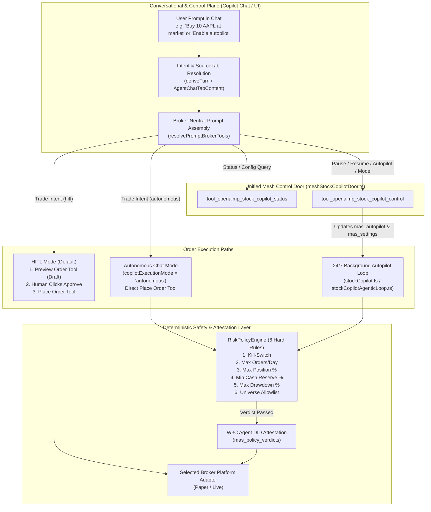

# Copilot & Autopilot Architecture: Interactive HITL vs. 24/7 Autonomous Execution

> **Status:** Active Architecture Specification (Issue #3846)  
> **Owners:** OrchestratorAgent, Stock Copilot, Autopilot Risk Policy Engine  
> **Primary Modules:**
> - [`src/agents/chatPrompt.ts`](../../../src/agents/chatPrompt.ts)
> - [`src/agents/prompts/stockCopilotPrompt.ts`](../../../src/agents/prompts/stockCopilotPrompt.ts)
> - [`src/agents/orchestrator/autopilot.ts`](../../../src/agents/orchestrator/autopilot.ts)
> - [`src/agents/orchestrator/meshStockCopilotDoor.ts`](../../../src/agents/orchestrator/meshStockCopilotDoor.ts)
> - [`src/services/riskPolicyEngine.ts`](../../../src/services/riskPolicyEngine.ts)
> - [`src/services/stockCopilot.ts`](../../../src/services/stockCopilot.ts)
> - [`src/services/stockCopilotAgenticLoop.ts`](../../../src/services/stockCopilotAgenticLoop.ts)

---

## 1. Executive Summary: Two Complementary Execution Surfaces

Multi-Agent Studio separates **conversational trading assistance** from **around-the-clock autonomous trading**, while bridging both through a unified control plane, shared Durable Object SQLite state, and deterministic risk guardrails:

| Dimension | Interactive Chat Copilot (`hitl` default) | Interactive Chat Copilot (`autonomous` mode) | 24/7 Autonomous Autopilot Loop |
| :--- | :--- | :--- | :--- |
| **Trigger Mechanism** | User chat message in UI / voice transcript | User chat message in UI / voice transcript | Durable Object scheduled alarm / cron tick (`ScheduledTasksService`) |
| **Per-Trade Human Confirmation** | **Required** (generates preview card first; executes only on explicit approval) | **Bypassed** (executes immediately via active broker's placement tool within risk envelope) | **Not required** (executes around the clock without human intervention) |
| **Safety Gate** | Human-in-the-Loop (HITL) preview + Agent DID draft signature | Deterministic `RiskPolicyEngine` + live quote price provenance | Deterministic `RiskPolicyEngine` (6 hard rules) + Kill-Switch + W3C Agent DID Verifiable Credential |
| **Broker & Mode Selection** | Driven dynamically by selected broker & mode (`COPILOT_BROKER_ID` / Paper by default) | Driven dynamically by selected broker & mode (`COPILOT_BROKER_ID` / Paper by default) | Driven dynamically by `resolveCopilotTradingSelection` (`COPILOT_BROKER_ID` / Paper by default) |
| **Session Coverage** | On-demand whenever user chats | On-demand whenever user chats | 24/5 or 24/7 across `pre_market`, `regular`, `after_hours`, and `exto` (overnight) |

---

## 2. How the 24/7 Autonomous Loop Operates Around the Clock

The background autonomous loop (`runStockCopilotPaperCycle` in [`src/services/stockCopilot.ts`](../../../src/services/stockCopilot.ts) and `runAgenticStockCopilotCycle` in [`src/services/stockCopilotAgenticLoop.ts`](../../../src/services/stockCopilotAgenticLoop.ts)) is designed to run continuously without waiting for human confirmation on each trade.

### 2.1 Multi-Session Around-the-Clock Schedule
The session clock ([`src/services/stockCopilotSessions.ts`](../../../src/services/stockCopilotSessions.ts)) partitions the trading day into four US Eastern Time sessions:
- **`pre_market`**: `04:00` – `09:30 ET` (extended-hours limit orders).
- **`regular`**: `09:30` – `16:00 ET` (regular market hours; market or limit orders).
- **`after_hours`**: `16:00` – `20:00 ET` (extended-hours limit orders).
- **`exto`**: `20:00` – `04:00 ET` (24/5 overnight extended trading session; limit orders).

When all four sessions are enabled (`enabledSessions: ["pre_market", "regular", "after_hours", "exto"]`), `isAroundTheClock` resolves to `true` and the loop executes continuously across session boundaries on its configured cadence (`every 5 minutes` to `every 1 hour`).

### 2.2 Autonomous Cycle Pipeline (Perceive $\rightarrow$ Plan $\rightarrow$ Critic $\rightarrow$ Execute $\rightarrow$ Learn)
On every scheduled tick (`scheduledTasksCopilot.ts`):
1. **Gate & Selection Check**:
   - Verifies `isStockCopilotPaperEnabled(env)`, checks that the loop is not `paused` in `stock_copilot_control`, and resolves the active broker and mode via `resolveCopilotTradingSelection` (defaulting to `COPILOT_BROKER_ID` in `paper` mode).
2. **Exit Evaluation (Stop-Loss & Take-Profit)**:
   - Inspects all open positions in `copilot_positions`.
   - Fetches live market bars for each held symbol.
   - If the latest price breaches `stopPrice` (`-2%` default) or reaches `targetPrice` (`+4%` default), submits an immediate closing order via `platform.placeOrderRemote(...)` with `priceSource: { kind: "market-data" }` and records the closed position.
3. **Entry Evaluation & Critic Reflection**:
   - Scans the configured watch universe (`universe`, e.g., `AAPL`, `MSFT`, `NVDA`, `AMZN`, `META`, `GOOGL`, `TSLA`, `AMD`, `AVGO`, `NFLX`) against active quantitative strategies (`sma_crossover`, `mean_reversion`, `rsi_rebound`, `breakout`).
   - In **`agentic` execution mode**, runs the 4-stage agentic pipeline:
     - **Perceive**: Computes regime, volatility, and momentum telemetry across the watch universe.
     - **Plan**: Ranks candidate entries with calculated bracket levels (`entryPrice`, `stopPrice = entryPrice * 0.98`, `targetPrice = entryPrice * 1.04`).
     - **Critic**: Audits each candidate against historical strategy win-rate learnings stored in `stock_copilot_learnings` and concentration limits.
     - **Execute**: Submits approved orders directly via `platform.placeOrderRemote(...)` without human confirmation, persisting the open bracket position to `copilot_positions`.
     - **Learn**: Distills post-cycle reflections and critic verdicts into `stock_copilot_learnings`.

---

## 3. Deterministic Risk Policy Envelope (`RiskPolicyEngine`)

Why can the autonomous loop and autonomous chat mode execute without human confirmation? Because **human confirmation is replaced by a deterministic, pre-execution cryptographic policy gate** ([`src/services/riskPolicyEngine.ts`](../../../src/services/riskPolicyEngine.ts) and [`src/agents/orchestrator/autopilot.ts`](../../../src/agents/orchestrator/autopilot.ts)).

### 3.1 The Six Hard Guardrails
Before any autonomous order is allowed to execute, `evaluatePolicy` evaluates six ordered, fail-closed rules:

| Priority | Rule ID | Default Limit | Fail-Closed Behavior |
| :---: | :--- | :--- | :--- |
| **1** | `kill_switch` | `killSwitch: false` | Immediately blocks all autonomous execution when `killSwitch === true`. |
| **2** | `max_orders_per_day` | `10` orders / UTC day | Blocks execution when `ordersToday + 1 > maxOrdersPerDay`. |
| **3** | `max_position_pct` | `20%` of account equity | Blocks BUY orders if post-trade symbol exposure exceeds `maxPositionPct` (or if account equity / symbol notional is unknown). |
| **4** | `min_cash_reserve_pct` | `25%` of account equity | Blocks BUY orders if post-trade cash reserve falls below `minCashReservePct` (or if cash balance is unavailable). |
| **5** | `drawdown_alert_pct` | `8%` from peak equity | Blocks execution if current account drawdown from tracked `peakEquity` exceeds `drawdownAlertPct`. |
| **6** | `universe_allowlist` | Configured ticker list | Blocks execution if the symbol is not in `universeAllowlist` (when non-empty). |

### 3.2 Cryptographic W3C Agent DID Attestation
Every policy evaluation produces a `PolicyVerdict` signed via HMAC-SHA256 (`attestVerdict`) and persisted in `mas_policy_verdicts`:
- When `autopilot.running === true` and all 6 rules pass:
  - `mode`: `"autonomous"`
  - `executionAllowed`: `true`
  - `requiresApproval`: `false`
  - `proposerDid`: `did:agent:openaimp:trading`
  - `authorizerDid`: `did:agent:openaimp:orchestrator`
- When `autopilot.running === false` (HITL mode) and all 6 rules pass:
  - `mode`: `"hitl"`
  - `executionAllowed`: `true`
  - `requiresApproval`: `true`
  - `authorizerDid`: `did:user:pending-human-authorization`

---

## 4. Managing Autopilot & Execution Mode via Copilot Chat

Operators can inspect and control both the **Stock Copilot loop** and the **Autopilot Risk Policy envelope** directly from chat using the two mesh door commands in [`src/agents/orchestrator/meshStockCopilotDoor.ts`](../../../src/agents/orchestrator/meshStockCopilotDoor.ts):

### 4.1 Inspecting Live State (`tool_openaimp_stock_copilot_status`)
Returns a unified snapshot containing:
- `status`, `paused`, `activeBroker`, `activeMode`, `currentSession`, `enabledSessions`, `cadence`, `executionMode` (`"deterministic"` | `"agentic"`), `rsiMode` (`"governed"` | `"self"`).
- `copilotExecutionMode`: `"hitl"` | `"autonomous"` — whether interactive Chat Copilot trade commands require human preview approval (`"hitl"`) or execute immediately (`"autonomous"`).
- `autopilot`:
  - `running`: `boolean` — whether the Autopilot policy envelope is in `"autonomous"` mode.
  - `killSwitch`: `boolean` — whether the emergency kill-switch is engaged.
  - `killSwitchReason`: `string | null`
  - `mode`: `"autonomous"` | `"hitl"`
  - `ordersToday`: `number`
  - `limits`: `{ maxPositionPct, minCashReservePct, maxOrdersPerDay, drawdownAlertPct, universeAllowlist }`
- `openPositions`, `closedPositions`, `activity`, `lastCycle`.

### 4.2 Controlling Loop & Autopilot (`tool_openaimp_stock_copilot_control`)
Accepts any combination of the following control parameters in a single call:
- `paused?: boolean` — Pause (`true`) or resume (`false`) the scheduled Stock Copilot loop.
- `autopilotRunning?: boolean` — Enable (`true`) or disable (`false`) the autonomous Autopilot envelope in `mas_autopilot`.
- `copilotExecutionMode?: "hitl" | "autonomous"` — Switch interactive chat order execution between HITL preview mode (`"hitl"`) and direct autonomous placement (`"autonomous"`).
- `killSwitch?: boolean` — Engage (`true`) or clear (`false`) the emergency Autopilot kill-switch.
- `killSwitchReason?: string` — Audit reason recorded when engaging the kill-switch.
- `autopilotLimits?: { maxPositionPct?: number; minCashReservePct?: number; maxOrdersPerDay?: number; drawdownAlertPct?: number; universeAllowlist?: string[] }` — Update the deterministic risk limits in `mas_autopilot`.
- `cadence?: string` — Update loop interval (e.g., `"every 15 minutes"`, `"every 1 hour"`).
- `sessions?: Array<"pre_market" | "regular" | "after_hours" | "exto">` — Configure active trading sessions (pass all 4 for 24/7 around-the-clock operation).
- `universe?: string | string[]` — Update watch universe symbols or preset.
- `strategies?: string | string[]` — Update active quantitative strategies.
- `executionMode?: "deterministic" | "agentic"` — Switch background cycle engine mode.
- `rsiMode?: "governed" | "self"` — Switch Recursive Self-Improvement mode.

---

## 5. Broker-Neutral, Selected-Broker/Mode Driven Prompt Architecture

### 5.1 Root Cause of Legacy Broker Bleed-Through (Fixed in #3846)
Previously, when a user typed a stock trading prompt (such as *"Draft a limit buy order for 10 AAPL with +4% take-profit and -2% stop-loss bracket exits"*) while on the default General Chat tab (`sourceTab: "Chat & Agents"`):
1. The turn did not activate Stock Copilot steering because `sourceTab` was `"Chat & Agents"` instead of `"Stock Copilot"`.
2. The fallback prompt in [`src/agents/chatPrompt.ts`](../../../src/agents/chatPrompt.ts) hardcoded legacy broker tool names in its capability list and Rule 6, causing the LLM to mention OAuth authentication and ask the user which broker preview tool to use.

### 5.2 Architectural Invariants (#3846)
1. **Broker-Neutral Prompt Builder (`resolvePromptBrokerTools`)**:
   - Both [`src/agents/chatPrompt.ts`](../../../src/agents/chatPrompt.ts) and [`src/agents/prompts/stockCopilotPrompt.ts`](../../../src/agents/prompts/stockCopilotPrompt.ts) resolve their quote, preview, and execution tool bindings dynamically from `{ activeBroker, activeMode, copilotExecutionMode }`.
   - When no broker override is supplied, `resolvePromptBrokerTools` defaults to the platform's Stock Copilot broker (`COPILOT_BROKER_ID`, Paper mode) and `copilotExecutionMode: "hitl"`.
   - Neither prompt asks the user to choose between brokers; the model always routes quotes, previews, and executions to the resolved active broker.
2. **Automatic Stock Copilot Intent Elevation**:
   - Both `deriveTurn` ([`src/agents/orchestrator/chatTurnHelpers.ts`](../../../src/agents/orchestrator/chatTurnHelpers.ts)) and the chat composer ([`src/client/chat/AgentChatTabContent.tsx`](../../../src/client/chat/AgentChatTabContent.tsx)) detect stock order, bracket exit (`+4% take-profit`, `-2% stop-loss`), and autopilot management intents on general chat turns and automatically elevate `sourceTab` to `"Stock Copilot"`.
3. **Interactive Autonomous Mode (`copilotExecutionMode: "autonomous"`)**:
   - When `copilotExecutionMode === "autonomous"` (set via `tool_openaimp_stock_copilot_control` or when Autopilot is enabled for chat), Rule 6 instructs the model to execute trade orders directly via the active broker's order placement tool (with live quote price provenance and percentage bracket parameters `take_profit_pct` / `stop_loss_pct` when requested) and return the live execution receipt immediately without waiting for human confirmation.
