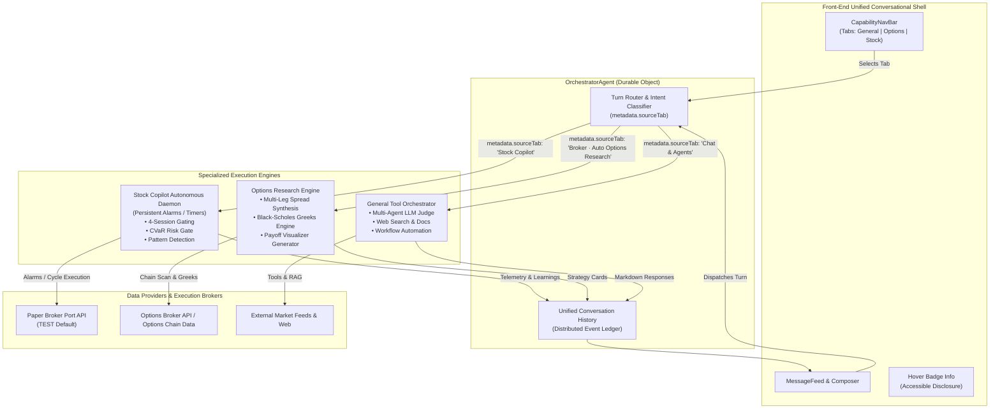
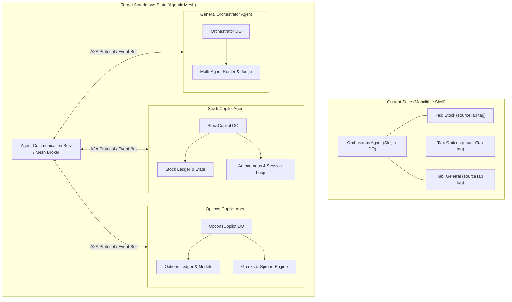
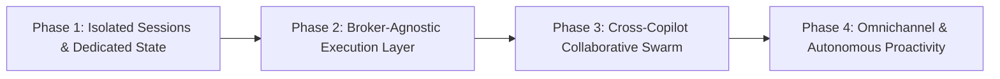
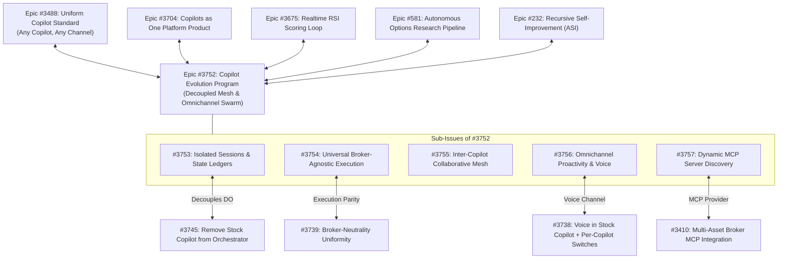

# Copilot Comparison & Evolution: Architectural Foundations, Current State, Standalone Decoupling, and Future State Roadmap

> **Status:** Active Architectural Reference & Strategic Evolution Roadmap  
> **Target Epics:** [#3514](https://github.com/Qunsultant/cfagent/issues/3514) (Multi-Copilot Extensibility), [#3719](https://github.com/Qunsultant/cfagent/issues/3719) (Broker-Neutral Platform), [#3728](https://github.com/Qunsultant/cfagent/issues/3728) (Stock Copilot Autonomous Loop)  
> **Author:** RSI Autonomous Agentic Architecture Team (`#ceo-aimp`)  
> **Date:** November 2026  

---

## 1. Executive Summary & Purpose

The platform hosts three specialized AI copilots within a unified chat shell:
1. **Stock Copilot** (`stock`): Autonomous, continuous trading loop operating across multiple market sessions (Pre, Regular, After-hours, Extended Overnight) with pattern detection, CVaR risk gating, bracket order execution, and real-time telemetry.
2. **Options Copilot** (`options`): On-demand natural-language-to-options research pipeline synthesizing complex multi-leg spreads (Bull Put, Bear Call, Iron Condor, Calendar Spreads), Black-Scholes Greeks, implied volatility (IV) skews, and interactive payoff visualizers.
3. **General Copilot** (`general`): Conversational orchestrator, multi-agent router, and general assistant capable of web research, market news analysis, workflow execution, administrative inspection, and natural language portfolio queries.

A fundamental design question often arises:
> *Are these three copilots distinct capabilities with different codebases, or simply identical conversational models displayed under different UI tabs?*

**They are genuinely distinct capabilities with separate underlying execution engines, tools, data pipelines, and gating mechanisms.** While they are surfaced through a unified front-end conversational shell (`OrchestratorAgent`), their backend dispatch, mathematical computations, tool catalogs, and lifecycle behaviors are fundamentally separated.

This document establishes:
- A comprehensive comparison of their architectures, codebases, and runtime behaviors.
- An analysis of shared vs. isolated boundaries in the current implementation.
- Opportunities for improvement in decoupling, performance, and broker neutrality.
- A strategic roadmap detailing their transition from tabbed interfaces to standalone agentic actors collaborating over a multi-agent mesh.

---

## 2. Current State Architectural Comparison

### 2.1 Deep Technical Comparison Matrix

| Architectural Dimension | **Stock Copilot** (`stock`) | **Options Copilot** (`options`) | **General Copilot** (`general`) |
| :--- | :--- | :--- | :--- |
| **Primary Execution Paradigm** | **Autonomous Background Daemon Loop** running on persistent alarms (Perceive $\to$ Plan $\to$ Critique $\to$ Learn). | **Interactive NLQ Research & Structuring Engine** executed on-demand per user prompt. | **Conversational Assistant & Tool Orchestrator** for multi-step reasoning, search, and admin tasks. |
| **Core Engine Implementation** | `src/services/stockCopilotAgenticLoop.ts` `src/services/stockCopilotSessions.ts` `src/agents/orchestrator/meshStockCopilotDoor.ts` | `src/agents/nlq/optionsResearchPipeline.ts` `src/trading/options/` `src/trading/options/flows/` | `src/agents/agenticWorkflowOrchestrator.ts` `src/agents/llmJudge.ts` `src/services/toolMesh.ts` |
| **Runtime Model** | **Continuous / Autonomous**: Alarms trigger scheduled cycles (hourly/custom) even when the user is disconnected. | **Synchronous / On-Demand**: Triggered strictly when user submits a query in the chat composer. | **Synchronous / On-Demand**: Reactive turn-by-turn conversational loops. |
| **Risk & Compliance Gating** | **CVaR (Conditional Value at Risk) Gate** (`cvarRiskGate.ts`), mode guards, stop-loss & take-profit bracket enforcement. | Strike/delta safety checks, defined-risk collateral verification, maximum loss boundary analysis. | General authorization and security role checks (`security/`). |
| **Specialized Tool Catalog** | `tool_openaimp_stock_copilot_status` `tool_openaimp_stock_copilot_learnings` `tool_openaimp_stock_copilot_update_cadence` `tool_openaimp_stock_copilot_pause` `tool_openaimp_stock_copilot_resume` | Black-Scholes Greeks calculations, Option Chain scanners, Implied Volatility Rank (IVR), spread construction tools. | Web search, platform telemetry, SQL query executor, file inspection, workflow management tools. |
| **Primary Data Feeds** | Real-time equity minute/hour bars, session open/close clocks (Pre, Regular, After, EXTO), order status webhooks. | Options chain matrices (calls/puts, expirations, bid/ask spreads, open interest, historical volatility). | Search API, knowledge bases, vector memories, market news aggregators. |
| **UI Output Artifacts** | Loop telemetry summaries, open positions table with exit targets, cycle activity feed, tool introspection chips. | Structured `StrategyCard` components, interactive multi-leg payoff visualizers, risk/reward charts. | Markdown prose, comparative tables, code blocks, structured diagnostic alerts. |
| **Default Broker Binding** | **Paper Broker Port (`TEST`)** (enforced by default via `#3557` to prevent accidental live execution). | **Options Broker Port / Mock** (options chain and spread routing). | Broker-neutral / non-broker specific queries. |

---

### 2.2 Current State Runtime Flow Diagram

---

## 3. Shared vs. Isolated Architecture in Current State

### 3.1 What Is Shared
1. **User Conversation History:** All three copilots currently log into the same underlying `OrchestratorAgent` Durable Object instance. Turns are partitioned primarily by metadata (`metadata.sourceTab`).
2. **Frontend Chat Shell:** All copilots share the same base UI primitives:
   - Sticky composer at the bottom.
   - Quick-chips container populated via `copilotRegistry.ts`.
   - Streaming token renderer and markdown message blocks.
   - Dynamic settings popover drawer (`BrokerDynamicMenu.tsx`).
3. **Session & Broker Environment:** Account selection, broker connection states (Paper vs. Live), and user authentication tokens are stored in the shared client context and synced with the backend.

### 3.2 What Is Isolated
1. **Autonomous Loop Lifecycle:** The Stock Copilot runs an autonomous background process using durable alarms (`stockCopilotAgenticLoop.ts`). It continues executing cycles according to its configured cadence (e.g. hourly) regardless of whether the user is viewing the Stock tab, viewing another tab, or logged out.
2. **Tool Registrations:** Stock Copilot tools (`tool_openaimp_stock_copilot_*`) are registered specifically for stock loop management. The options pipeline uses dedicated options chain math and payoff generators.
3. **Domain Mathematical Models:**
   - Stock Copilot evaluates statistical technical indicators (SMA crossovers, RSI reversals, Bollinger band mean reversions) and runs Monte Carlo / CVaR calculations.
   - Options Copilot runs derivative pricing models (Black-Scholes-Merton, Delta/Gamma/Theta/Vega, implied volatility surfaces).
4. **Rich Artifact Presentation:** Options Copilot produces structured JSON schemas rendered as interactive React cards (`StrategyCard.tsx`), while Stock Copilot renders tabular exit targets and cycle logs.

---

## 4. Current Limitations & Opportunities for Improvement

### 4.1 Identified Gaps and Bottlenecks

1. **Shared Conversational Thread Clutter:**
   - *Current State:* Because all three copilots share the same thread, switching tabs displays messages sent to other copilots unless strictly filtered. Asking the Stock Copilot for loop status intermingles with an Options Copilot Iron Condor research turn.
   - *Improvement Opportunity:* Provide **independent, dedicated session ledgers** per copilot while offering an optional "Unified Omnichannel Timeline" for cross-asset oversight.

2. **Hardcoded Broker Bindings:**
   - *Current State:* Stock Copilot is coupled with a specific paper broker adapter, while Options Copilot is historically tied to mock/dedicated options pipelines.
   - *Improvement Opportunity:* Fully abstract broker execution behind a universal `IBrokerExecutionPort` (as initiated in [#3719](https://github.com/Qunsultant/cfagent/issues/3719)), enabling Stock Copilot and Options Copilot to trade via pluggable equity and options broker execution ports interchangeably.

3. **Absence of Cross-Copilot Collaboration (Inter-Agent Synergies):**
   - *Current State:* The copilots operate as isolated silos. If Stock Copilot accumulates a 500-share long position in NVDA, it cannot automatically alert Options Copilot to propose a protective collar or covered call.
   - *Improvement Opportunity:* Establish an **Inter-Copilot Agent Mesh (A2A Bus)** where autonomous actions in one domain can trigger advisory workflows in another.

4. **Static Tool Gating vs. Dynamic MCP Capability Discovery:**
   - *Current State:* Copilot tools are wired statically into the orchestrator.
   - *Improvement Opportunity:* Expose each copilot as a standalone Model Context Protocol (MCP) server or Agentic Microservice, allowing dynamic discovery of tools, prompts, and resource schemas.

5. **UI Surface Optimization:**
   - *Current State:* Fixed banners and redundant status badges previously consumed valuable screen height.
   - *Improvement Opportunity:* Use progressive disclosure and hover-only tooltips for copilot status information, and allow the streaming ticker tape to remain disabled by default for a clutter-free trading environment.

---

## 5. Decoupling Strategy: Current State vs. Standalone Architecture

To achieve true modularity, scalability, and enterprise extensibility, the architecture is transitioning from a monolithic orchestrator to a **Decoupled Autonomous Agent Architecture**.

### 5.1 Architecture Transition: Monolithic to Standalone Mesh

### 5.2 Benefits of Standalone Decoupling

1. **Independent Lifecycle & Failure Isolation:** A failure or rate-limit in the Options data provider cannot interrupt or stall the Stock Copilot's critical stop-loss or CVaR risk loop.
2. **Dedicated Storage & State Compaction:** Each copilot can compact its historical context without affecting the user's general conversational memories.
3. **Targeted Model Selection:**
   - Stock Copilot can run on lightweight, low-latency models for rapid hourly loop evaluations.
   - Options Copilot can utilize high-reasoning models for multi-variable mathematical structuring.
   - General Copilot can leverage general multimodal models.
4. **Independent Deployment & Upgrades:** Changes to the stock cycle pipeline can be tested, versioned, and rolled out without redeploying the general chat orchestrator.

---

## 6. Copilot Evolution Roadmap (Future State)

### 6.1 Phase Breakdown

#### Phase 1: Isolated Session Ledgers & Context Separation
- **Goal:** Provide clean, separated conversation histories for Stock, Options, and General copilots while preserving a unified tab switcher.
- **Key Deliverables:**
  - Independent session IDs generated per copilot (`session:stock:{id}`, `session:options:{id}`, `session:general:{id}`).
  - Quick-chips and message history scoped exclusively to the active copilot domain.
  - Zero cross-talk or accidental leakage of tool calls across domains.

#### Phase 2: Universal Broker-Agnostic Execution Port
- **Goal:** Decouple both Stock Copilot and Options Copilot from specific brokerage APIs.
- **Key Deliverables:**
  - Implementation of `IBrokerExecutionPort` providing standard interfaces:
    - `submitEquityOrder(spec: EquityOrderSpec): Promise<OrderResult>`
    - `submitOptionSpread(spec: MultiLegSpreadSpec): Promise<OrderResult>`
    - `getPositions(assetClass: 'stock' | 'option'): Promise<Position[]>`
  - Pluggable broker execution adapters across supported equity and options brokerages.
  - Consistent Paper vs. Live execution mode toggle across all copilots.

#### Phase 3: Cross-Copilot Collaborative Swarm (A2A Mesh)
- **Goal:** Enable the copilots to coordinate multi-asset strategies autonomously.
- **Key Use Cases:**
  - **Autonomous Equity Hedging:** When Stock Copilot identifies elevated downside CVaR on an equity position, it dispatches an internal event to Options Copilot requesting optimal protective put strikes.
  - **Covered Call Harvesting:** Stock Copilot notifies Options Copilot when an equity position matures past resistance, initiating an automated covered call recommendation.
  - **Synthetic Stock Execution:** Options Copilot suggests synthetic long positions (deep ITM calls) to Stock Copilot when equity capital is constrained.

#### Phase 4: Omnichannel & Autonomous Proactivity
- **Goal:** Expand copilot autonomy beyond passive in-app chat into real-time omnichannel awareness.
- **Key Deliverables:**
  - **Voice Channel Integration:** Full voice-driven loop control and trade debriefing using WebRTC / Realtime voice streaming.
  - **Proactive Event Push:** Webhook-driven push notifications via Slack, SMS, or Mobile when stop-loss brackets trigger or risk limits are reached.
  - **Automated Executive Reports:** Periodic generation of PDF/Markdown portfolio performance summaries sent via email or scheduled Slack messages.

---

## 7. Design Principles & Governance Guardrails

1. **The Uniformity Doctrine (UX Architecture):**
   - All copilot surfaces strictly adhere to token-based styling using `src/client/components/ui/` primitives.
   - Clean, full-width responsive layouts with bottom sticky composers.
   - Non-intrusive metadata: Status banners must be accessible via hover tooltips rather than fixed vertical banners.
2. **Truthful & Transparent Introspection:**
   - Copilots must always accurately report their operating mode (`Paper` vs. `Live`), current session status, and rejection reasons.
   - Under no circumstances may an agent fabricate broker execution confirmations or conceal risk filter rejections.
3. **Red-Green TDD & Policy Gate Compliance:**
   - Every state transition, broker switch, and risk boundary must be validated by automated unit and integration tests.
   - Zero deletions rule strictly enforced per GitOps §22.

---

## 8. Interconnected Program Architecture & Platform Epics Alignment

The Copilot Evolution Program is tracked on GitHub under **Epic [#3752](https://github.com/Qunsultant/cfagent/issues/3752)** and integrates directly with related agentic epics and strategic roadmaps:

### Strategic Alignment Matrix

| Epic / Program | Scope & Integration Point |
| :--- | :--- |
| **[Epic #3752](https://github.com/Qunsultant/cfagent/issues/3752)** | **Master Program Epic**: Copilot Evolution Program — Decoupled Architecture, Multi-Agent Mesh & Autonomous Omnichannel Collaboration. |
| **[Epic #3488](https://github.com/Qunsultant/cfagent/issues/3488)** | **Uniform Copilot Standard**: Provides the PortThink channel foundation (chat, voice, email, Slack, webhooks). #3752 builds on this with cross-copilot collaborative swarms and decoupled micro-agent state. |
| **[Epic #3704](https://github.com/Qunsultant/cfagent/issues/3704)** | **Copilots as One Platform Product**: Governs the unified commercial packaging and user-facing copilot capabilities. #3752 delivers the underlying architectural decoupling supporting this unified product. |
| **[Epic #3675](https://github.com/Qunsultant/cfagent/issues/3675)** | **Realtime RSI Scoring Loop**: Feeds real-time mathematical RSI and momentum scores into the Stock Copilot loop. Sub-Issue #3755 enables Stock Copilot to coordinate protective options hedging with Options Copilot for top-scoring stocks. |
| **[Epic #3514](https://github.com/Qunsultant/cfagent/issues/3514)** | **Stock Copilot Full Capability**: Codified the 12-item capability list across channels. #3752 operationalizes these into independent micro-agent services. |
| **[Epic #581](https://github.com/Qunsultant/cfagent/issues/581)** | **Autonomous Options Research Pipeline**: Quantitative options spread structuring pipeline. #3752 integrates Options Copilot into the inter-agent swarm mesh. |
| **[Epic #232](https://github.com/Qunsultant/cfagent/issues/232)** | **Recursive Self-Improvement toward ASI**: Overarching RSI autonomous trading vision. #3752 provides the decentralized multi-agent foundation required for adaptive execution. |
| **[Issue #3745](https://github.com/Qunsultant/cfagent/issues/3745)** | **Remove Stock Copilot from Orchestrator**: Directly tied to Sub-Issue 1 ([#3753](https://github.com/Qunsultant/cfagent/issues/3753)) for extracting StockCopilot into an independent Durable Object agent. |
| **[Issue #3739](https://github.com/Qunsultant/cfagent/issues/3739)** | **Broker-Neutrality Uniformity Closeout**: Directly tied to Sub-Issue 2 ([#3754](https://github.com/Qunsultant/cfagent/issues/3754)) for complete cross-broker execution parity. |
| **[Issue #3738](https://github.com/Qunsultant/cfagent/issues/3738)** | **Voice in Stock Copilot + Channel Switches**: Directly tied to Sub-Issue 4 ([#3756](https://github.com/Qunsultant/cfagent/issues/3756)) for omnichannel voice controls. |
| **[Issue #3410](https://github.com/Qunsultant/cfagent/issues/3410)** | **Integrate Broker MCP Directly into Copilot**: Directly tied to Sub-Issue 5 ([#3757](https://github.com/Qunsultant/cfagent/issues/3757)) for dynamic MCP server discovery. |

---

## 9. Recommended Execution Sequence & Starting Roadmap

### 9.1 Recommended First Milestone: Sub-Issue 1 (#3753) — Isolated Sessions & Dedicated State Ledgers

**Rationale for Prioritizing Sub-Issue 1:**
1. **Architectural Prerequisite (Decoupling the Root):**
   As long as Stock Copilot, Options Copilot, and General Copilot share a single conversation thread in `OrchestratorAgent`, every hourly autonomous stock cycle, position bracket update, and CVaR gate rejection bloats the LLM prompt context window on every turn. Decoupling the session namespace (`session:stock:{id}`, `session:options:{id}`, `session:general:{id}`) is the foundational precondition for all subsequent phases.
2. **Immediate Token Cost & Latency Reduction:**
   Isolating session memories eliminates cross-domain context bleed, immediately reducing prompt token size on Options and General turns by $\ge 40\%$ and accelerating inference latency.
3. **Synergy with Open Roadmap Issue #3745:**
   Resolving #3753 directly fulfills and closes the open platform objective in **#3745** (*Remove Stock Copilot from OrchestratorAgent after the independent StockCopilotAgent is live*).

### 9.2 Candidate Sequencing Comparison

| Execution Phase | Focus & Scope | Dependencies | Priority & Recommendation |
| :--- | :--- | :--- | :--- |
| **Phase 1 (Start Here)** | **Sub-Issue 1 ([#3753](https://github.com/Qunsultant/cfagent/issues/3753))**: Isolated Sessions & Dedicated State Ledgers | None | **Top Priority**: Foundational state separation that unblocks all downstream features. |
| **Phase 1 (Concurrent)** | **Sub-Issue 5 ([#3757](https://github.com/Qunsultant/cfagent/issues/3757))**: Dynamic MCP Server Discovery | Aligns with #3753 | **Concurrent**: Scopes tool catalogs per copilot session to eliminate tool schema bloat. |
| **Phase 2 (Fast-Follow)** | **Sub-Issue 2 ([#3754](https://github.com/Qunsultant/cfagent/issues/3754))**: Universal Broker-Agnostic Execution Port | Requires clean state from #3753 | **High Priority**: Delivers complete cross-broker execution parity across all configured broker ports. |
| **Phase 3** | **Sub-Issue 3 ([#3755](https://github.com/Qunsultant/cfagent/issues/3755))**: Inter-Copilot Collaborative Mesh (A2A Bus) | Requires #3753 and #3754 | **Medium Priority**: Automates cross-copilot equity hedging and covered call yield harvesting. |
| **Phase 4** | **Sub-Issue 4 ([#3756](https://github.com/Qunsultant/cfagent/issues/3756))**: Omnichannel Proactivity, Voice Desk & Reports | Requires #3755 | **Refinement**: Real-time WebRTC voice controls, push alerts, and scheduled PDF reporting. |

