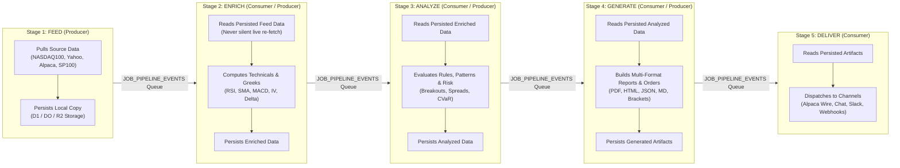
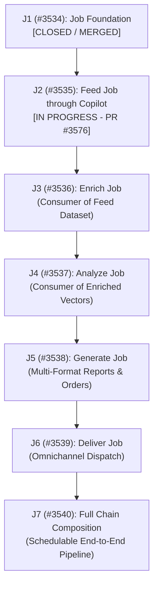

# The Job System & 5-Stage Pipeline Engine Architecture

> **Status:** Active Platform Architecture Specification  
> **Target Epic:** [#3533](https://github.com/Qunsultant/cfagent/issues/3533) — Copilot Job Pipeline: Feed → Enrich → Analyze → Generate → Deliver  
> **Related Epics:** [#3530](https://github.com/Qunsultant/cfagent/issues/3530) (Standalone Feed Jobs), [#3549](https://github.com/Qunsultant/cfagent/issues/3549) (One Workflow Engine Convergence), [#3514](https://github.com/Qunsultant/cfagent/issues/3514) (Omnichannel Capabilities)  
> **Author:** RSI Autonomous Development Team (`#ceo-aimp`)  
> **Date:** November 2026  

---

## 1. Executive Summary & Directive

The **Job System** is the unified workflow substrate for all automated, scheduled, and on-demand data processing across the platform. It establishes a standardized five-stage pipeline:

$$\text{Feed} \longrightarrow \text{Enrich} \longrightarrow \text{Analyze} \longrightarrow \text{Generate} \longrightarrow \text{Deliver}$$

Every stage is a **producer/consumer job over persisted data**, published onward through message queues.

### 1.1 The One-Engine Consolidation Doctrine (#3549)
Historically, background tasks in the platform were fragmented across disparate execution models:
- Stock screening ran as a dedicated monolithic workflow (`ScreenerScreenWorkflow`).
- Options screening ran as a separate engine path (`OptionsStrategyWorkflow`).
- Data provider syncs ran as ad-hoc interval tasks.
- Stock Copilot ran inside a single Think scheduled cycle step (`runStockCopilotCycle`).

**Resolution:**
The platform converges onto **one single workflow engine**—the stage contract and stage runner (`StageRunnerPlan`, `StageRunnerCheckpoint`)—for every workflow. What the engine lacks is added to the engine; parallel implementations are rejected as drift.

---

## 2. The 5 Pipeline Jobs & Producer/Consumer Contract

### Stage Contracts:
1. **Feed (J2):** Pulls a provider source's dataset and **persists** it as the platform's authoritative local copy. Publishes completion event with dataset URI.
2. **Enrich (J3):** Consumes feed dataset from storage (never a live re-fetch by default), computes mathematical/analytical indicators, and **persists** enriched feature vectors.
3. **Analyze (J4):** Consumes enriched vectors, applies configured screening rules, pattern recognition, and mathematical risk bounds (CVaR optimization), and **persists** candidate scorings.
4. **Generate (J5):** Consumes analysis outputs, compiles **multi-format reports** (PDF, interactive HTML, JSON, Markdown) and order intents (limit orders + bracket exit plans), and **persists** the generated results.
5. **Deliver (J6):** Consumes generated reports and orders, dispatching them to configured external channels (Alpaca trading API, Chat UI stream, Slack alerts, Webhooks, Email).

---

## 3. The Uniform Job Contract

Every job, sub-job, stage, and sub-stage honors eight immutable rules:

1. **Individually Schedulable:** Each stage registers in the platform scheduler on its own cadence (e.g., Feed every 4 hours, Enrich hourly, Analyze on tick) and can also run on demand.
2. **Individually Configurable (AOP):** All configuration is externalized in tenant settings (`mas_settings`) and `deployment.yaml`. Zero code constants.
3. **Persisted Hand-offs:** Stages communicate strictly through **persisted datasets and queue messages**, never ephemeral in-memory state. In-memory processing is an opt-in toggle (`inMemoryHandOff: true`), never the default.
4. **Every Execution Mode Configurable:**
   - Sequential vs. Parallel
   - Batch vs. Online
   - Sync vs. Async
   - Monolith vs. Sharded (partitioned by ticker hash or symbol ranges)
5. **Manageable Control Plane:** Every job supports 6 canonical management operations:
   - `run`: Start execution.
   - `pause`: Temporarily halt processing at the next boundary.
   - `resume`: Continue from the stored checkpoint cursor.
   - `cancel`: Terminate active run cleanly without orphan state.
   - `retry`: Re-execute a failed run from the last valid checkpoint or zero.
   - `configure`: Adjust parameters for paused or upcoming runs.
6. **Durable Checkpointing:** Jobs checkpoint progress at item-level or partition-level granularity into Durable Object SQLite storage. Resuming picks up from the cursor, never from scratch.
7. **CloudEvents Status Publication:** Every lifecycle transition (`queued`, `running`, `paused`, `checkpointed`, `completed`, `failed`, `cancelled`) is published as a CloudEvent to `JOB_PIPELINE_EVENTS`.
8. **15-Factor & Tech Standards Compliant:** Structured logging, coded error messages, telemetry metrics, and fail-closed security.

---

## 4. Multi-Domain Applicability Matrix

The 5-stage pipeline substrate is polymorphic across all platform workflows:

| Stage | Stock Screening | Options Screening | Stock Copilot Loop | Report Automation |
|---|---|---|---|---|
| **Feed (J2)** | Pulls quotes/fundamentals for NASDAQ-100 / S&P-100. | Ingests option chains, strikes, bid/ask spreads. | Fetches live market bars for configured universe. | Queries audit ledgers & execution history. |
| **Enrich (J3)** | Computes SMA, RSI, MACD, Bollinger Bands, ATR. | Calculates Greeks (Delta, Gamma, Theta, Vega, IV). | Computes multi-factor indicator matrix & signal state. | Aggregates trade PnL, win rate, Sharpe ratio, drawdown. |
| **Analyze (J4)** | Filters criteria (e.g., Bullish Breakouts, Oversold). | Evaluates multi-leg spreads (Bull Put, Iron Condors). | Runs pattern evaluators + CVaR risk sizing. | Evaluates strategy benchmark alpha vs. buy-and-hold. |
| **Generate (J5)** | Builds candidate stock tables & thesis summaries. | Builds structured options orders & payoff charts. | Creates atomic parent limit order + TP/SL bracket exits. | Compiles PDF, HTML, JSON, and Markdown documents. |
| **Deliver (J6)** | Emits candidate lists to Chat UI, Slack, or email. | Emits interactive cards to Options Research desks. | Routes orders to Alpaca Paper; updates live telemetry. | Dispatches artifacts to S3/R2, Slack, or webhooks. |

---

## 5. Foundations Reused (Anti-Reinvention)

The Job System intentionally composes existing platform infrastructure:

1. **Provider Capture Machinery (`src/data/`):**
   `providerCapturePorts` (raw + normalized, run-linked captures) and `feedSnapshotPorts` / `feedSnapshotStore` (#1236 seam). **No parallel stores.**
2. **Run Records Machinery:**
   `JobRunRecordStore` (#3527 run-record store, system `job-pipeline`).
3. **Workflow Layer:**
   `ThinkWorkflow` journaled stages (`step.do`) for durable execution and resumable state machines.
4. **Queue Pub/Sub:**
   Cloudflare Queues binding `JOB_PIPELINE_EVENTS` with Dead Letter Queue (`job-pipeline-events-dlq`).
5. **Uniform Copilot Doors (#3514):**
   Exposed through `meshStockCopilotDoor.ts` and Platform MCP tools (`run_feed_job`, `get_feed_job_status`, `list_feed_jobs`, `manage_feed_job`).

---

## 6. Sub-Issues Breakdown & Implementation Status (Epic #3533)

### Detailed Sub-Issue Roadmap:
- **J1 ([#3534](https://github.com/Qunsultant/cfagent/issues/3534)) — MERGED (PR #3545):**
  Job foundation: model, externalized configuration, 12/16 execution modes supported, CloudEvents status publisher, `JOB_PIPELINE_EVENTS` queue binding, and stage runner re-basing ([#3549](https://github.com/Qunsultant/cfagent/issues/3549)).
- **J2 ([#3535](https://github.com/Qunsultant/cfagent/issues/3535)) — IN PROGRESS (PR #3576):**
  Feed job through Stock Copilot: Per-source feed jobs (`yahoo-nasdaq100-quotes`, `alpaca-nasdaq100-quotes`, `yahoo-nasdaq100-fundamentals`, `nasdaq-nasdaq100-universe`) over persisted local datasets, status in Data Providers UX, and Copilot tools.
- **J3 ([#3536](https://github.com/Qunsultant/cfagent/issues/3536)):**
  Enrich job: Consumes persisted feed dataset, calculates technicals/Greeks, checkpoints, publishes enriched reference to queue.
- **J4 ([#3537](https://github.com/Qunsultant/cfagent/issues/3537)):**
  Analyze job: Consumes enriched data, runs pattern evaluators and CVaR risk sizing, checkpoints, publishes analysis reference.
- **J5 ([#3538](https://github.com/Qunsultant/cfagent/issues/3538)):**
  Generate job: Consumes analysis output, compiles multi-format reports (PDF, HTML, JSON, MD) and order shapes, persists artifacts.
- **J6 ([#3539](https://github.com/Qunsultant/cfagent/issues/3539)):**
  Deliver job: Consumes generated artifacts, delivers to configured channels (Alpaca Paper, Chat SSE stream, Slack, Webhooks).
- **J7 ([#3540](https://github.com/Qunsultant/cfagent/issues/3540)):**
  Full chain composition: Links all 5 stages end-to-end as one schedulable, manageable pipeline with unified end-to-end status.

---

## 7. Execution Modes & Refusal Behavior

The Job System dynamically resolves execution modes per job configuration:

| Mode Dimension | Supported Combinations | Refusal Behavior |
|---|---|---|
| **Sequential vs. Parallel** | Both supported across all 5 stages. | Supported on all environments. |
| **Batch vs. Online** | Batch supported for all stages. Online supported for streaming ingest. | **Online × Sync is refused by name** (`ONLINE_SYNC_NOT_SUPPORTED`). |
| **Sync vs. Async** | Async supported via Queue pub/sub. Sync supported for on-demand inspection. | Sync execution over heavy batch sizes refuses with `SYNC_EXECUTION_OVER_LIMIT`. |
| **Monolith vs. Sharded** | Sharded partitions dataset by symbol hash or range across parallel workers. | **Sharded without defined shard keys refuses by name** (`SHARDED_WITHOUT_SHARD_KEYS`). |

---

## 8. Summary of Architectural Guarantees

1. **No Data Loss:** Every stage hand-off is durably written to disk/database before queue emission.
2. **Deterministic Re-runs:** A resumed or retried job continues from its exact checkpoint cursor rather than repeating work.
3. **Zero Untracked Execution:** Every run creates a `JobRunRecord` with timestamps, row counts, shard identities, and exit codes.
4. **Omnichannel Invocability:** Every job can be run, paused, resumed, or inspected via Web Chat, Scheduled Tasks, REST API, or Platform MCP tools.
