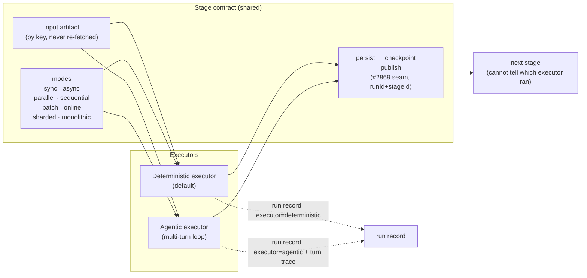
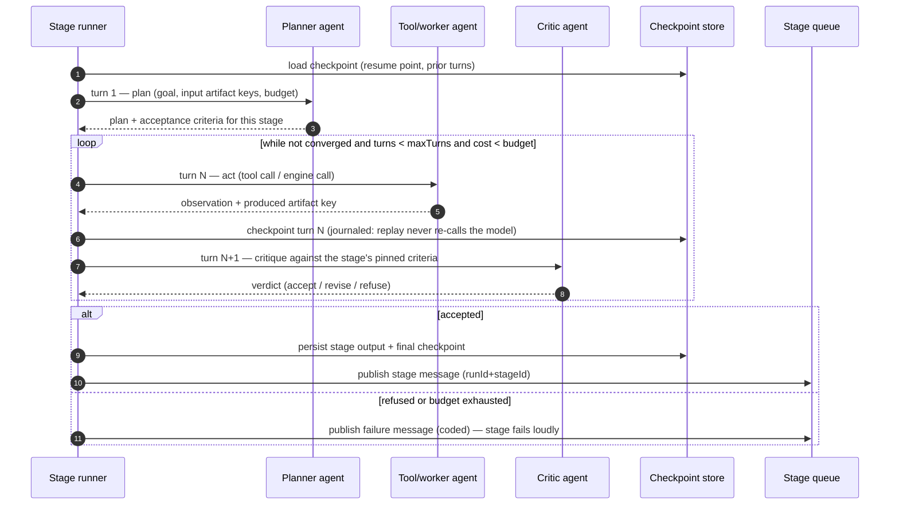
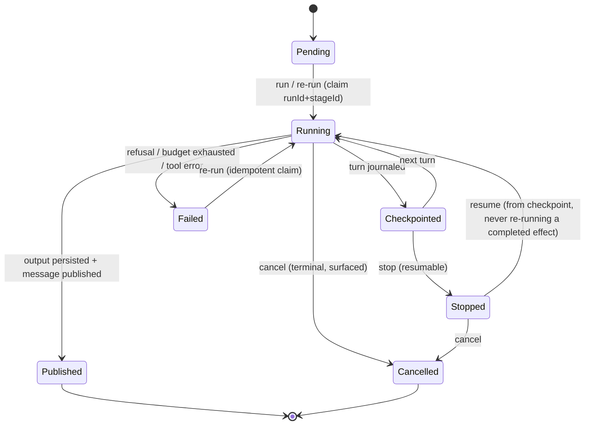
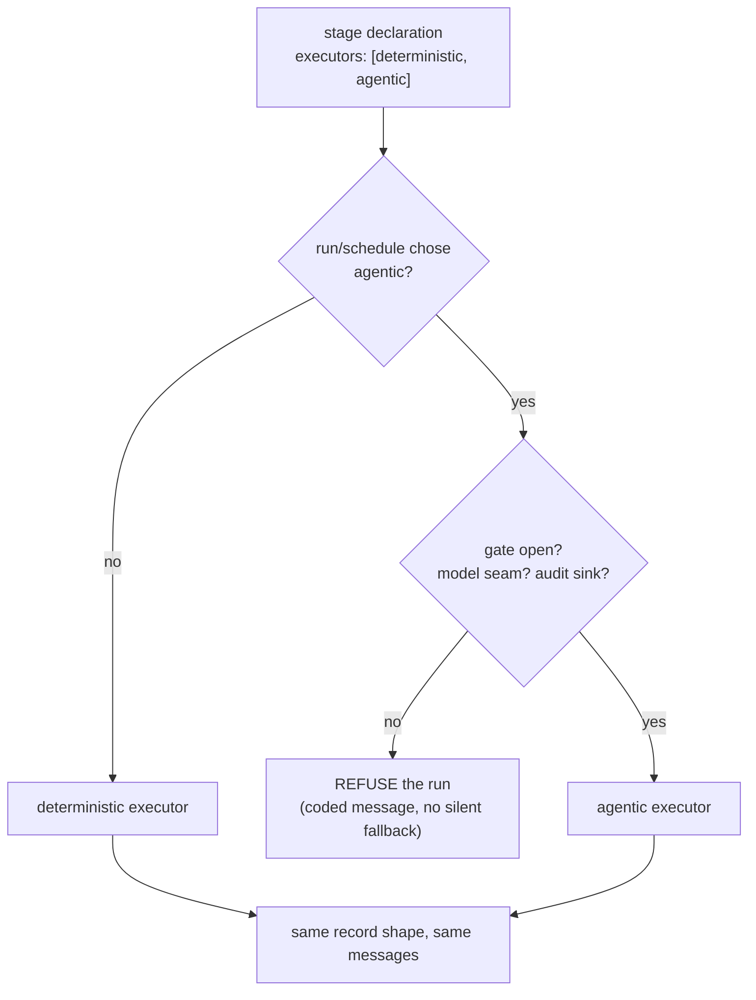

# Multi-turn agentic workflows: one stage contract, two executors

**Status:** design note for #3069 requirement **R9** (agentic execution of every stage).
**Related:** #3069 (uniform stage control + R1–R9), #2869 (stage contract: persist-then-publish,
stage messages), #2601/#3027/#3028 (stage-runner contract, checkpoint projection, resume),
#2530 (the non-deterministic gate precedent), ADR 0017 (the pipeline is not a DAG),
`docs/agentic-org/mission.md` §5 (the governed improvement loop).

## 1. The model in one paragraph

A stage is a **contract**: a persisted input, a produced artifact, a published message, a
checkpoint, a retry bucket and a set of mode axes. Today every stage is executed by a
**deterministic executor** — pure functions, engine calls, pinned predicates. R9 adds a second
executor behind the same contract: a **multi-turn agent loop**, where each turn is an agent
invocation with its own role, its own budget and its own record. A downstream stage cannot tell
which executor produced its input; only the run record names the executor and the turn trace.
Selection is explicit (per stage declaration, per run/schedule), defaults to deterministic, and
is gated exactly like #2530: gate closed, no model seam or no audit sink means the run is
**refused**, never quietly downgraded.

## 2. One contract, two executors

The contract is the one from #2869/#2601: a stage reads only its persisted input, writes its
output, checkpoints, and announces. Everything the contract guarantees — idempotency on
`runId + stageId`, poison dead-lettering, retry budgets from `pipelinePolicy`, resume from the
checkpoint — holds identically for both executors.

## 3. The multi-turn loop

Each turn is an agent. Turns are composed by the stage, not by one monolithic agent: a planner
turn, tool turns, an analysis turn, a critique turn, a conclusion turn. The loop is bounded three
ways — turns, steps, cost — and every bound is configuration, never a constant in a call site.

Two properties make this safe to run next to the deterministic path:

1. **Journaled turns.** Each turn's inputs and outputs are step outputs (the workflow/checkpoint
   journal), so a replay returns the journaled turn instead of calling the model again — the
   same discipline #2530 uses for the interpretation artifact.
2. **The critic is not the actor.** The turn that produces work never decides whether the work is
   acceptable; acceptance is a separate turn against pinned criteria, and the final verdict is
   recorded either way.

## 4. Stage and turn lifecycle

The states are the ones #3069 defines for control (`run`, `re-run`, `stop`, `resume`, `cancel`,
`schedule`, `re-schedule`) applied to the agentic executor; a stopped agentic stage resumes from
its journal rather than from a fresh plan.

## 5. What stays deterministic, always

| Concern | Executor |
|---|---|
| Calculations, risk limits, position sizing | **code only** — an agent may propose, never compute the authoritative number |
| Authorization, approvals, spend | **code only** — no turn can expand a permission or skip an approval |
| Schema validation, persistence ordering, idempotency keys | **code only** |
| Planning, retrieval strategy, interpretation, critique | agent turns (bounded) |
| Acceptance of a stage's output | pinned deterministic criteria + an independent critic turn; never the actor's own claim |
| Promotion of a candidate improvement | human-governed, outside the run (mission §5) |

The never-list is absolute: no adaptive behaviour may expand permissions, remove approvals, raise
spend, rewrite evaluation criteria, change production config, deploy, or place an order.

## 6. Selection, gating and failure

- Default: deterministic. The agentic path is an explicit choice per run/schedule, exactly as
  #2530's mode is.
- A missing model seam, a closed gate or a missing audit sink is a **refusal**, not a downgrade —
  a run must never silently become a different run than the one requested.
- The run record carries `executor`, the turn trace, the budgets consumed, and the critic's
  verdict; the UI renders all four (R5/R8).

## 7. Configuration (externalized) and messages (coded)

| Configuration | Where it resolves |
|---|---|
| `stage.<id>.executor` default | operator settings map (`pipeline.*` pattern) |
| `stage.<id>.maxTurns` | settings, per stage |
| `stage.<id>.maxStepsPerTurn` | settings (the Judge step cap) |
| `stage.<id>.costBudget` | settings + budget port |
| gate (`*_ND_MODE` precedent) | env flag, fail-closed |

Every turn and stage outcome is a coded message through the one resolver
(`src/outcomes/outcomeCatalog.json` + `resolveOutcome`) — no literal strings in the loop, in the
route, or in the panel. AOP runs through the existing join points: one span per turn, one outcome
per stage, the breaker around tool calls — no second aspect framework.

## 8. Non-goals

- Not a second stage model: the contract, the messages and the checkpoint are the existing ones.
- Not DAG execution (ADR 0017): the pipeline order is fixed; what changes is *who* executes a stage.
- Not autonomous promotion: the agent may propose a stage change; an independent, human-governed
  step promotes it, against the pinned deterministic baseline.
- Not a replacement for the deterministic path: it stays the default, the reference and the
  fallback for evaluation.
