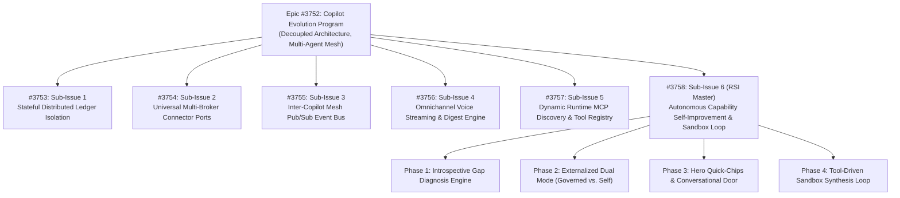
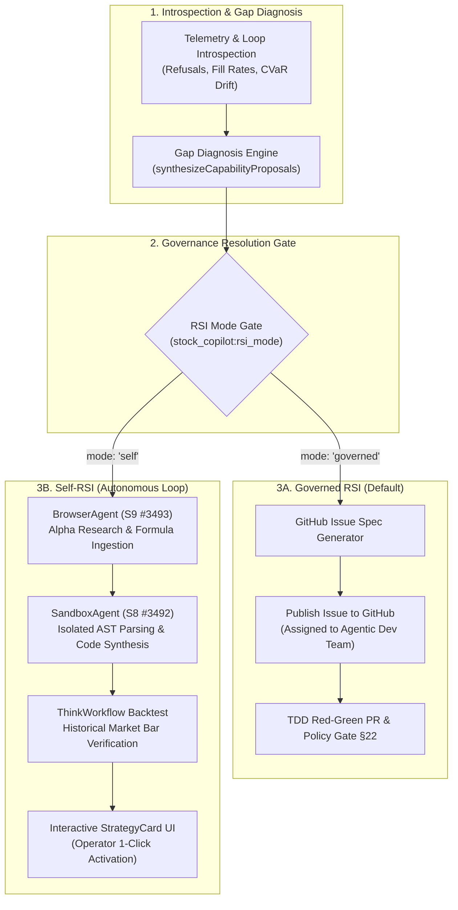
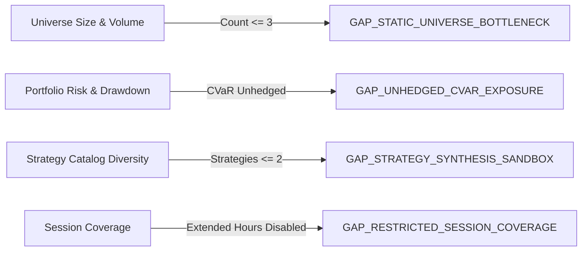
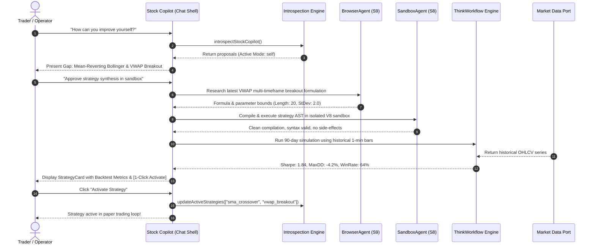

# Stock Copilot Recursive Self-Improvement (RSI): Autonomous Capability Gap Diagnosis, Sandbox Synthesis & Governed Evolution

> **Status:** Active Reference Architecture & Operational Specification  
> **Target Epic:** [#3752](https://github.com/Qunsultant/cfagent/issues/3752) — Copilot Evolution Program  
> **Target Sub-Issue:** [#3758](https://github.com/Qunsultant/cfagent/issues/3758) — `[Stock Copilot RSI] Autonomous Capability Self-Improvement & Sandbox Synthesis Loop`  
> **Related Epics:** [#3514](https://github.com/Qunsultant/cfagent/issues/3514) (Multi-Copilot Extensibility), [#3488](https://github.com/Qunsultant/cfagent/issues/3488) (Omnichannel Autonomy), [#3704](https://github.com/Qunsultant/cfagent/issues/3704) (Distributed Ledger Session Isolation)  
> **Author:** RSI Autonomous Core Agentic Team (`#ceo-aimp`, `#clo-arsi`)  
> **Date:** November 2026  

---

## 1. Executive Summary

Stock Copilot operates as an autonomous, multi-session algorithmic trading loop on the configured paper-trading broker adapter (TEST default) with continuous CVaR (Conditional Value-at-Risk) drawdown governance. While the existing copilot executes automated scanning, trade generation, and position management, static trading engines inevitably encounter market regime shifts, universe bottlenecks, and structural alpha decay.

The **Stock Copilot Recursive Self-Improvement (RSI) Architecture** transforms Stock Copilot from a fixed-parameter execution loop into a self-diagnosing, self-proposing, and self-improving agentic system.

Stock Copilot introspects its live execution history, analyzes trade bottlenecks (e.g., stale universes, unhedged downside spikes, missing session coverage), diagnoses concrete capability gaps, and synthesizes actionable capability expansion pathways.

### The Core Architectural Dilemma: Governed vs. Self-RSI
Code and strategy improvements present a fundamental trade-off:
1. **Safety & Enterprise Governance:** Code changes directly impacting trading loops, risk gates, and market order execution must be reviewed, tested via CI red→green policy gates, and merged cleanly by the human or agentic engineering organization (`#ceo-aimp`, `#clo-arsi`).
2. **Autonomous Adaptation & Speed:** Emergent market opportunities require the agent to dynamically ingest new alpha ideas, code strategies inside isolated sandboxes (`SandboxAgent`), backtest against historical bars via `ThinkWorkflow`, and present 1-click execution cards.

**The Solution:** An externalized dual-mode architecture:
- **`governed` (Default):** The copilot drafts high-accuracy GitHub issue proposals complete with User Journey, Technical Scope, TDD Acceptance Criteria, and Agent Assignment, ready to be dispatched to GitHub for engineering review.
- **`self` (Self-RSI):** The copilot autonomously orchestrates platform tools (`BrowserAgent` for research, `SandboxAgent` for isolated AST/code compilation, `ThinkWorkflow` for backtesting) to generate verified strategy implementations and prompts the operator for approval.

The active mode is managed via an externalized setting (`stock_copilot:rsi_mode`) and switchable conversationally through natural language chat prompts or the `tool_openaimp_stock_copilot_control` MCP door.

---

## 2. GitHub Traceability & Issue Hierarchy

This architecture is tracked under the Copilot Evolution Program hierarchy:



### GitHub Issues Reference
- **Master Epic:** [GitHub Issue #3752](https://github.com/Qunsultant/cfagent/issues/3752)
- **RSI Sub-Issue:** [GitHub Issue #3758](https://github.com/Qunsultant/cfagent/issues/3758) — *Stock Copilot RSI: Autonomous Capability Self-Improvement & Sandbox Synthesis Loop*
- **Cross-Linked Epics:**
  - Issue [#3514](https://github.com/Qunsultant/cfagent/issues/3514): Multi-Copilot Architecture Extensibility
  - Issue [#3488](https://github.com/Qunsultant/cfagent/issues/3488): Omnichannel Stock Copilot Autonomy
  - Issue [#3704](https://github.com/Qunsultant/cfagent/issues/3704): Ledger Session Isolation & Concurrency
  - Issue [#3675](https://github.com/Qunsultant/cfagent/issues/3675): Universal Market Data & Broker Connectors
  - Issue [#3588](https://github.com/Qunsultant/cfagent/issues/3588): Tool-Driven Reflection & Self-Explanation

---

## 3. High-Level RSI Architecture & Tool Orchestration

Stock Copilot synthesizes self-improvements by combining two distinct tool tiers:
1. **Domain Tools:** Deep financial, quantitative, and risk capabilities native to the trading engine.
2. **Platform Tools:** Autonomous software engineering and code execution primitives built into cfagent.



### 3.1 Tool Inventory Matrix

| Tool | Category | Source Issue / Package | Role in RSI Self-Improvement |
| :--- | :--- | :--- | :--- |
| **`screenerAgent`** | Domain | `src/agents/orchestrator/meshScreenerDoor.ts` | Dynamically scans market universe for high-volume, breakout symbols when static universe stagnates. |
| **`cvarRiskGate`** | Domain | `src/services/cvarRiskEngine.ts` | Evaluates tail drawdown; proposes automated protective put/collar hedging to Options Copilot. |
| **`patternSignals`** | Domain | `src/services/patternCatalog.ts` | Expands technical strategy catalog beyond SMA/RSI (e.g., Head & Shoulders, Bull Flag, VWAP Reversion). |
| **`browserAgent`** | Platform | S9 Issue [#3493](https://github.com/Qunsultant/cfagent/issues/3493) | Navigates web and quant documentation (SSRN, arXiv, GitHub quant repos) to extract strategy formulas. |
| **`sandboxAgent`** | Platform | S8 Issue [#3492](https://github.com/Qunsultant/cfagent/issues/3492) | Compiles and executes synthesized TypeScript/Python quant strategies in isolated V8 sandbox environments. |
| **`thinkWorkflow`** | Platform | S5 Issue [#3453](https://github.com/Qunsultant/cfagent/issues/3453) | Runs multi-turn Monte Carlo and historical backtest passes against historical market bars before live code promotion. |

---

## 4. Dual RSI Operational Modes

### 4.1 Mode Comparison

```text
+-----------------------+------------------------------------------+------------------------------------------+
| Dimension             | Governed RSI (Default)                   | Self-RSI (Autonomous)                    |
+-----------------------+------------------------------------------+------------------------------------------+
| Setting Value         | "governed"                               | "self"                                   |
| Primary Action        | Drafts & publishes GitHub Issues         | Synthesizes, backtests & compiles code   |
| Human Oversight       | GitHub PR Review & CI Policy Gate §22    | Interactive UI Approval / StrategyCard   |
| Execution Environment | Local Git working tree / GitHub Actions  | Isolated SandboxAgent runtime            |
| Target Team           | #ceo-aimp, #clo-arsi, Dev Agents        | Stock Copilot Autonomous Loop            |
| Reversibility         | Git commit revert                        | 1-click toggle / runtime parameter flush |
| Safety Profile        | Institutional Enterprise Safe            | High Velocity Alpha Experimentation      |
+-----------------------+------------------------------------------+------------------------------------------+
```

### 4.2 Configuration Resolution

The active RSI mode is resolved hierarchically:
1. **User Setting Store (`mas_settings`):** Read via setting key `stock_copilot:rsi_mode`.
2. **Environment Variable:** `STOCK_COPILOT_RSI_MODE` (`"governed"` or `"self"`).
3. **Hard Default:** `"governed"` (Institutional safe default).

```typescript
// src/services/stockCopilotRsiMode.ts
export type StockCopilotRsiMode = "governed" | "self";
export const DEFAULT_STOCK_COPILOT_RSI_MODE: StockCopilotRsiMode = "governed";

export function resolveStockCopilotRsiMode(
  savedSetting?: string | null,
  envValue?: string | null
): StockCopilotRsiMode {
  const candidate = (savedSetting || envValue || "").trim().toLowerCase();
  if (candidate === "self") return "self";
  return "governed"; // strictly defaults to governed
}
```

---

## 5. Conversational Control & Hero Quick-Chips

### 5.1 Hero Greeting Chips (`copilotRegistry.ts`)
To make RSI discoverable and actionable directly from the conversational interface, Stock Copilot presents four targeted quick-chips in its Hero module:

1. **`💡 How can you improve yourself?`**
   - *Prompt:* `"How can you improve yourself and what capabilities do you need?"`
   - *Behavior:* Triggers `introspectStockCopilot()` to evaluate current session metrics and returns structured capability gap diagnoses with active execution pathways.
2. **`🔬 What capabilities do you need?`**
   - *Prompt:* `"What capabilities do you need to improve trading performance and reduce risk?"`
   - *Behavior:* Focuses reflection on universe expansion, cross-copilot hedging, and sandboxed strategy synthesis.
3. **`⚙️ Switch to Self-RSI mode`**
   - *Prompt:* `"Set RSI mode to self"`
   - *Behavior:* Invokes `tool_openaimp_stock_copilot_control({ rsiMode: "self" })`, persisting mode in `mas_settings` and enabling autonomous sandbox synthesis.
4. **`🛡️ Switch to Governed RSI mode`**
   - *Prompt:* `"Set RSI mode to governed"`
   - *Behavior:* Invokes `tool_openaimp_stock_copilot_control({ rsiMode: "governed" })`, enforcing strict GitHub issue publication for all code improvements.

### 5.2 Conversational Prompt Handling
The system prompt steering instructions (`STOCK_COPILOT_MCP_STEERING` in `src/agents/chatPrompt.ts`) instruct the orchestrator:
- When the user asks about self-improvement, capability gaps, or needs, invoke `tool_openaimp_stock_copilot_status({ introspect: true })`.
- When the user commands switching modes (e.g., *"enable self improvement mode"* or *"switch to governed RSI"*), invoke `tool_openaimp_stock_copilot_control({ rsiMode: "self" | "governed" })`.

---

## 6. Self-Diagnosed Capability Gap Engine

The capability gap diagnosis engine (`synthesizeCapabilityProposals()` in `src/services/stockCopilotIntrospection.ts`) continuously inspects four critical trading dimensions:



### 6.1 Diagnosed Gaps Specification

#### 1. `GAP_STATIC_UNIVERSE_BOTTLENECK`
- **Symptom:** Trading universe contains $\le 3$ static tickers (e.g. `AAPL`, `MSFT`, `NVDA`), causing missed alpha in volatile mid-caps.
- **Governed Pathway:** Files GitHub Issue: `[Stock Copilot] Dynamic ScreenerAgent Integration for Universe Expansion`.
- **Self-RSI Pathway:** Queries `screenerAgent` via Door API for top 10 momentum tickers with relative volume $> 2.0$, generating a dynamic candidate universe card.

#### 2. `GAP_UNHEDGED_CVAR_EXPOSURE`
- **Symptom:** Long stock portfolio lacks downside tail-risk protection during macroeconomic volatility spikes.
- **Governed Pathway:** Files GitHub Issue: `[Stock Copilot] Automated Cross-Copilot Put Hedge Dispatch via Options Copilot Door`.
- **Self-RSI Pathway:** Leverages `cvarRiskGate` to compute 99% 1-day Expected Shortfall and dispatches a delta-neutral put hedge proposal to Options Copilot mesh bus.

#### 3. `GAP_STRATEGY_SYNTHESIS_SANDBOX`
- **Symptom:** Active strategies are limited to simple SMA and RSI, vulnerable to choppy sideways regimes.
- **Governed Pathway:** Files GitHub Issue: `[Stock Copilot] Mean-Reverting Bollinger & VWAP Breakout Strategy Implementation`.
- **Self-RSI Pathway:** Uses `BrowserAgent` to retrieve mathematical formulas for adaptive volatility channels, compiles TypeScript strategy code in `SandboxAgent`, and runs historical market bar backtests via `ThinkWorkflow`.

#### 4. `GAP_RESTRICTED_SESSION_COVERAGE`
- **Symptom:** Only regular hours (`regular`) are enabled, causing orders to be refused during pre-market and after-hours earnings releases.
- **Governed Pathway:** Files GitHub Issue: `[Stock Copilot] Extended Hours Session Activation & Spread Governance`.
- **Self-RSI Pathway:** Generates an immediate chat control proposal to toggle `pre_market` and `after_hours` sessions with tighter slippage limits.

---

## 7. Concrete Tool Synthesis Workflow: Sandboxed Code Generation

When operating under **Self-RSI Mode** (`"self"`), code generation and strategy adaptation follow a strict 4-step sandboxed verification pipeline:



---

## 8. Verification & Test Plan

The RSI architecture is validated through comprehensive automated tests:

1. **Mode Resolution & Default Verification:**
   - Verifies `resolveStockCopilotRsiMode()` returns `"governed"` by default when no setting or environment variable is set.
   - Verifies override behavior for `"self"` and fallback for unrecognized values.
2. **Capability Gap Diagnosis:**
   - Verifies `synthesizeCapabilityProposals()` identifies all 4 structural gaps based on live loop configuration.
   - Verifies proper assignment of domain and platform tools for each gap.
3. **Dual Pathway Completeness:**
   - Asserts each proposal contains both a complete `governedPathway` (with GitHub issue title, labels, team assignee, and acceptance criteria) and a complete `selfRsiPathway` (with sandbox toolchain and action plan).
4. **Introspection Markdown Integration:**
   - Asserts `introspectStockCopilot()` returns Section 4 in `explanationMarkdown` with active mode badge and actionable proposals.
5. **Door Control Integration:**
   - Verifies `controlStockCopilotViaDoor` correctly parses and updates `rsiMode`, returning updated status in `StockCopilotControlResult`.

---

## 9. Conclusion & Evolution Roadmap

The Stock Copilot RSI Architecture establishes a secure, dual-pathway mechanism for continuous self-improvement:
- **Governed RSI** ensures absolute safety, compliance with repository rules (§22 zero deletions, §7 TDD red→green), and transparent GitHub issue traceability.
- **Self-RSI** provides rapid, sandboxed prototyping using cutting-edge agentic platform tools (`BrowserAgent`, `SandboxAgent`, `ThinkWorkflow`).

Together under Master Epic [#3752](https://github.com/Qunsultant/cfagent/issues/3752) and Sub-Issue [#3758](https://github.com/Qunsultant/cfagent/issues/3758), this positions cfagent as the industry benchmark for autonomous, self-evolving quantitative copilot systems.

