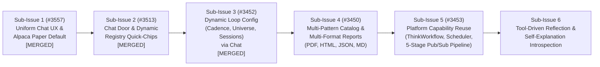
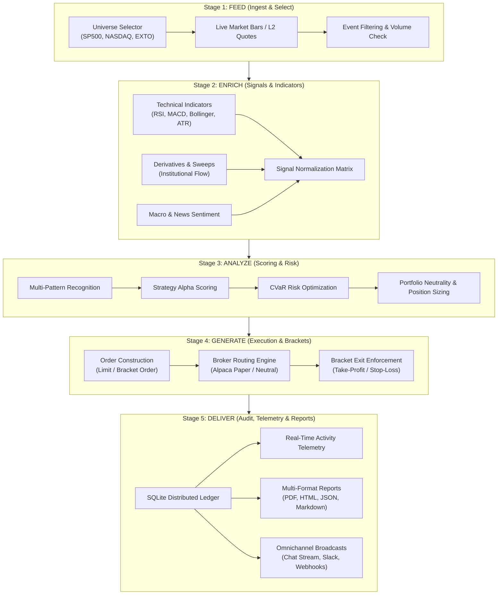
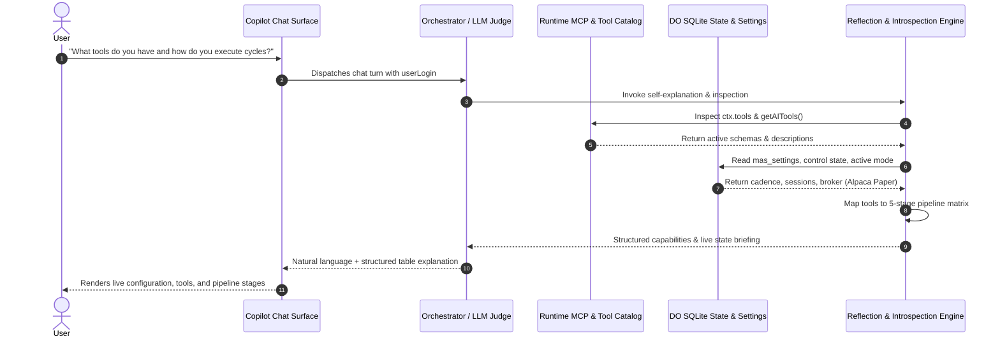
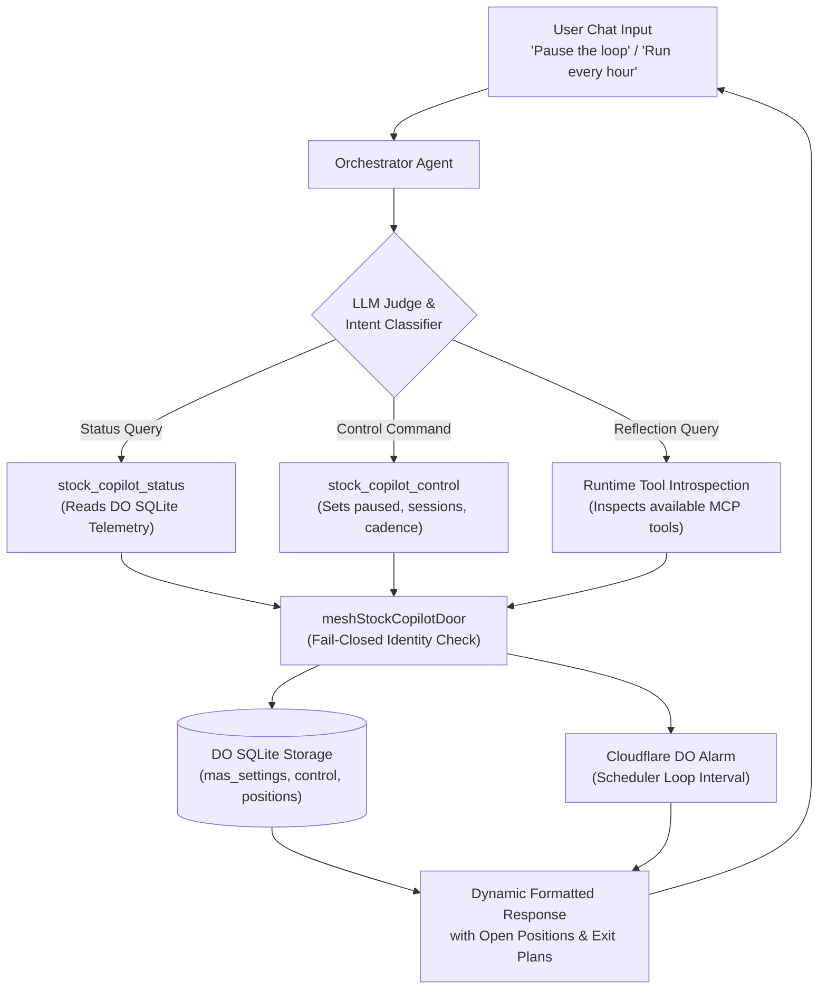

# Stock Copilot Evolution: Architecture, Omnichannel Capabilities, 5-Stage Pipeline & Tool-Driven Reflection

> **Status:** Active Reference Architecture & Strategic Roadmap  
> **Target Epic:** [#3514](https://github.com/Qunsultant/cfagent/issues/3514) / [#3488](https://github.com/Qunsultant/cfagent/issues/3488) — Multi-Copilot Architecture Extensibility & Omnichannel Autonomy  
> **Author:** RSI Autonomous Development Team (`#ceo-aimp`)  
> **Date:** November 2026  

---

## 1. Executive Summary & Root Cause Analysis

### 1.1 The Uniformity Doctrine
Historically, copilot surfaces within the platform diverged in UX structure:
- **General Copilot** and **Options Copilot** provided a clean, 100% viewport-width conversational stream with sticky composers at the bottom and context-aware quick-chips.
- **Stock Copilot** introduced a split-screen dashboard panel on the left (`StockCopilotPanel`) alongside the chatbox on the right. This dual-panel layout caused UI overlap, dual scrollbars, visual clutter on smaller viewports, and prevented the chat interface from acting as the single control plane for the autonomous loop.

**Resolution:**
The platform enforces a strict **Uniformity Doctrine**:
1. Every copilot operates in `mode: "chat"`, using the shared conversational shell, hero greeting, registry-driven quick-chips, and full-width bottom sticky composer.
2. The autonomous loop is not a separate, disconnected dashboard; it is an active agent entity whose telemetry, open positions, exit plans, cycle logs, and execution controls are accessible directly through chat turns and MCP tools.

### 1.2 Root Cause Analysis: Stale Activity & Mode Refusals
Users previously observed the left panel displaying:
```text
Cycle activity
Outside sessions
The pre-market session opened — it is not one of your enabled sessions, so the loop is waiting
Nov 6, 2026, 04:59 AM
Refused
The mode guard refused this cycle
Nov 6, 2026, 02:29 AM
```

Two distinct root causes were identified and permanently resolved:
1. **Stale SQLite Activity Display:** The left panel queried historical records from the SQLite database table (`stock_copilot_activity`). Those records were hours old, generated prior to recent environment adjustments, but persisted on the dashboard surface without time-decay filtering. Eliminating the static panel in favor of live chat status queries (`stock_copilot_status`) completely removes stale visual feeds.
2. **Mode Guard Refusal:** When `readers.env?.ALPACA_TRADING_TYPE === "live"` existed in deployment variables, `resolveCopilotTradingSelection` resolved environment to `PROD` while the tenant account was in paper mode, causing the mode guard to refuse cycles. This was decoupled in Issue [#3557](https://github.com/Qunsultant/cfagent/issues/3557) via `STOCK_COPILOT_MODE`, establishing an unbreakable default: **Stock Copilot strictly defaults to Alpaca in Paper mode (`TEST`)** unless explicitly commanded live by the authorized user.

---

## 2. Omnichannel Stock Copilot Roadmap (6 Sub-Issues)



### Sub-Issue Overview
| # | Issue ID | Component | Description | Status |
|---|---|---|---|---|
| 1 | [#3557](https://github.com/Qunsultant/cfagent/issues/3557) | Uniform Chat UX & Mode Guarantee | Make Stock Copilot 100% full-width chat with bottom composer; enforce Alpaca Paper default. | **Merged** |
| 2 | [#3513](https://github.com/Qunsultant/cfagent/issues/3513) | Chat Door & Dynamic Quick-Chips | MCP tools `stock_copilot_status` & `stock_copilot_control`; dynamic registry quick-chips. | **Merged** |
| 3 | [#3452](https://github.com/Qunsultant/cfagent/issues/3452) | Dynamic Loop Configuration via Chat | Real-time chat commands to adjust scan intervals, session patterns, and universe filters; quick chips. | **Merged** |
| 4 | [#3450](https://github.com/Qunsultant/cfagent/issues/3450) | Multi-Format Reporting & Patterns | Generate executive summaries, PDF, HTML, JSON, and Markdown reports on demand. | Planned |
| 5 | [#3453](https://github.com/Qunsultant/cfagent/issues/3453) | Pipeline & Workflow Reuse | Connect loop stages to `thinkWorkflow`, `thinkAdapter`, scheduler alarms, and audit ledgers. | Planned |
| 6 | Epic #3514 | Tool-Driven Reflection & Introspection | Dynamic capability synthesis, pipeline self-explanation, and adaptive learning via tool metadata. | Planned |

---

## 3. High-Performance 5-Stage Pub/Sub Pipeline Architecture

Instead of reinventing custom execution loops, Stock Copilot composes existing enterprise primitives (`thinkWorkflow`, `one-of-everything`, Cloudflare DO scheduler, transactional ledgers) into a cohesive 5-stage producer/consumer pipeline:



### Stage Specifications
1. **Stage 1: Feed (Ingest & Select):**
   - Ingests multi-asset universes (US Equities, Pre-Market movers, Overnight EXTO).
   - Ingestion cadence configured via DO alarm (`scheduler.setAlarm()`).
   - Reuses `one-of-everything` market feed adapters (Alpaca, E*TRADE, Yahoo Finance).
2. **Stage 2: Enrich (Signals & Indicators):**
   - Applies parallel technical calculations (MA, RSI, MACD, Bollinger Bands, ATR).
   - Integrates unusual options sweep detection and sentiment indicators.
   - Publishes normalized feature vectors to the analysis bus.
3. **Stage 3: Analyze (Scoring & Risk):**
   - Evaluates multi-pattern setups (Momentum Breakouts, Mean Reversion, Gap & Go).
   - Constrains position sizing using Conditional Value at Risk (CVaR) mathematical optimization.
   - Respects max portfolio allocation, single-stock exposure limits, and broker buying power.
4. **Stage 4: Generate (Execution & Brackets):**
   - Creates atomic parent-bracket orders (Entry + Take-Profit + Stop-Loss).
   - Enforces automated trailing stops and time-decay exits.
   - Connects to broker-neutral execution adapters (Alpaca Paper by default).
5. **Stage 5: Deliver (Audit, Telemetry & Reporting):**
   - Commits trades and lifecycle events to Durable Object SQLite storage (`copilot_positions`, `stock_copilot_activity`).
   - Generates multi-format report assets (interactive HTML, PDF exports, machine-readable JSON, Markdown briefings).
   - Emits real-time SSE updates and chat notifications.

---

## 4. Runtime Tool-Driven Reflection & Self-Explanation Engine (Sub-Issue 6)

Rather than replying with hardcoded text prompts when a user asks:
- *"What is your current configuration?"*
- *"What tools and capabilities do you have?"*
- *"What workflow stages do you follow?"*

The Stock Copilot utilizes **dynamic tool introspection and runtime state reflection**:



### The 4 Pillars of Reflection:
1. **Dynamic Tool Catalog Introspection:**
   - Queries `this.mcp.getAITools()` and active MCP tool definitions at runtime.
   - Categorizes tools dynamically into: *Data Ingestion*, *Technical Analysis*, *Risk & Portfolio*, *Order Execution*, and *Reporting/Audit*.
2. **Live Configuration Introspection:**
   - Reads active settings directly from Durable Object SQLite (`mas_settings`, `stock_copilot_control`, `copilot_positions`).
   - Reports live cadence (e.g. 3-minute vs hourly), enabled sessions (`pre_market`, `regular`, `after_hours`, `exto`), and active broker selection (`alpaca` in `paper` mode).
3. **Workflow & Pipeline Mapping:**
   - Explains precisely which tools are triggered during each of the 5 pipeline stages (Feed, Enrich, Analyze, Generate, Deliver).
   - Illustrates data flow, error fallbacks, and human-in-the-loop approval thresholds.
4. **Adaptive Continuous Reflection & Learning:**
   - Maintains an execution telemetry log comparing predicted signal scores with actual fill prices and PnL outcomes.
   - Uses post-trade reflection to tune pattern weights and recommend universe adjustments.

---

## 5. Conversational Loop Control & Chat Door Architecture



### Supported Natural Language Chat Commands:
- **Telemetry & State:**
  - *"What is the loop doing right now?"* -> Calls `stock_copilot_status`, returns current session, latest scan count, and open positions.
  - *"Show open positions and bracket exit plans"* -> Lists tickers, entry prices, take-profit prices, stop-loss prices, and unrealized PnL.
- **Execution Control:**
  - *"Set loop interval to 1 hour"* -> Calls `stock_copilot_control(cadence: "1 hour")`, sets Think scheduled interval and persists to settings.
  - *"Pause trading until 9:30 AM"* -> Calls `stock_copilot_control(pauseUntil: "09:30 AM")`, defers order entry until target time.
  - *"Pause the Stock Copilot loop"* -> Calls `stock_copilot_control(paused: true)`, halts new entries while leaving bracket exits active.
  - *"Resume the trading loop"* -> Calls `stock_copilot_control(paused: false)`, resumes automatic cycle execution.
  - *"Enable pre-market and overnight sessions"* -> Updates session list in `mas_settings` via `stock_copilot_control(sessions: ["pre_market", "regular", "after_hours", "exto"])`.
- **Introspection & Capabilities:**
  - *"What tools do you have available?"* -> Introspects tool catalog and returns grouped capabilities.
  - *"Explain the 5-stage pipeline you use"* -> Synthesizes pipeline stages and tool mappings.

### 5.1 Contextual Quick-Chips in Chat Surface
To provide immediate context on how to interact with, control, and execute trading workflows through the Copilot, `copilotRegistry.ts` surfaces two unified tiers of interactive prompt chips:

#### Tier 1: Autonomous Loop Cadence & Control Chips (#3452)
1. `⏱️ Set loop interval to 1 hour`: Prompt to adjust the loop interval dynamically.
2. `🌙 Enable pre-market and overnight sessions`: Enables full 24-hour cycle coverage across extended hours.
3. `⏸️ Pause trading until 9:30 AM`: Pauses cycle order execution until the regular market bell opens.
4. `🔍 What are you doing?`: Real-time query to inspect current loop cycle state, scan results, and guards.
5. `🧠 Explain workflow & tools`: Triggers tool introspection to explain the 5 pipeline stages and available tools.
6. `📊 Open Positions & Exits`: Surfaces current inventory, bracket take-profit, stop-loss, and PnL.
7. `⏸️ Pause Loop`: Immediately halts autonomous order generation.
8. `▶️ Resume Loop`: Resumes autonomous order generation.

#### Tier 2: Trading Execution & Core Capability Chips (#3583)
9. `🎯 Buy AAPL Bracket (TP +4% / SL -2%)`: Drafts an order with +4% take-profit and -2% stop-loss bracket exits.
10. `🌙 Extended-Hours Limit Order`: Places an extended-hours limit order with session-specific bracket exits.
11. `📈 Screen Momentum Breakouts`: Scans active stock universe for Momentum Breakout and Gap & Go setups.
12. `🧪 Evaluate NVDA vs Strategies`: Evaluates a ticker against active strategies without placing orders.
13. `🛡️ Portfolio CVaR & Sizing`: Analyzes portfolio risk and calculates CVaR position sizing for available capital.
14. `🌐 Universe: S&P 500 & Movers`: Sets the trading universe to S&P 500 and top pre-market volume movers.
15. `📄 Generate Trade Performance Report`: Generates comprehensive trading and cycle audit report in Markdown format.
16. `🔍 Audit Refusals & Skipped Trades`: Queries recent cycle refusal telemetry to explain why trades were skipped.

---

## 6. Verification, Governance & Anti-Work-Loss

All changes in the Stock Copilot evolution adhere to the core repository standards:
- **Policy Gate §22:** Zero file deletions; deprecations in place with explicit successor annotations.
- **TDD Red-Green Discipline:** Comprehensive unit test suites (`tests/stock_copilot_chat_door_3513.test.ts`, `tests/chat_copilots_subtabs_3449.test.tsx`, `tests/stock_copilot_modes_3451.test.ts`, `tests/stock_copilot_introspection_3588.test.ts`).
- **Identity Discipline:** All mesh door tools require `actingLogin` and fail closed with `MeshDoorError("missing_acting_login")` if omitted.
- **Traceability:** Every commit, PR, and report is attributed with the `#ceo-aimp` agent identifier and tracked against parent Epic [#3514](https://github.com/Qunsultant/cfagent/issues/3514).

