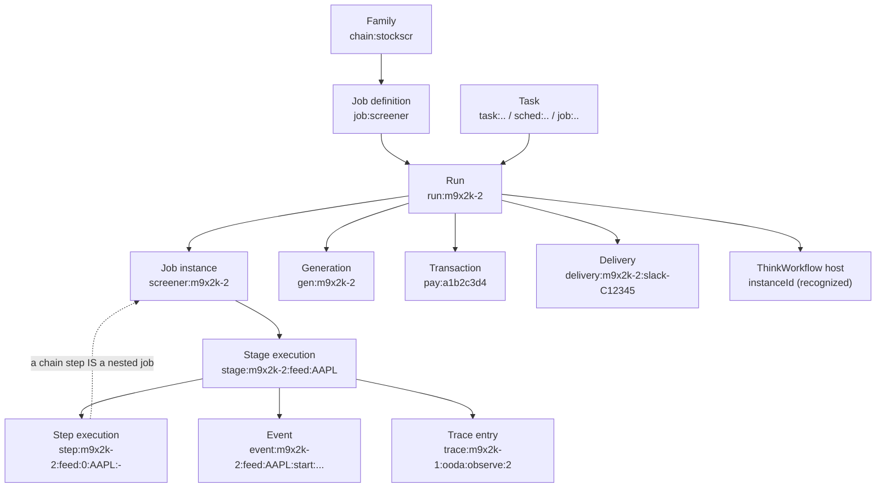
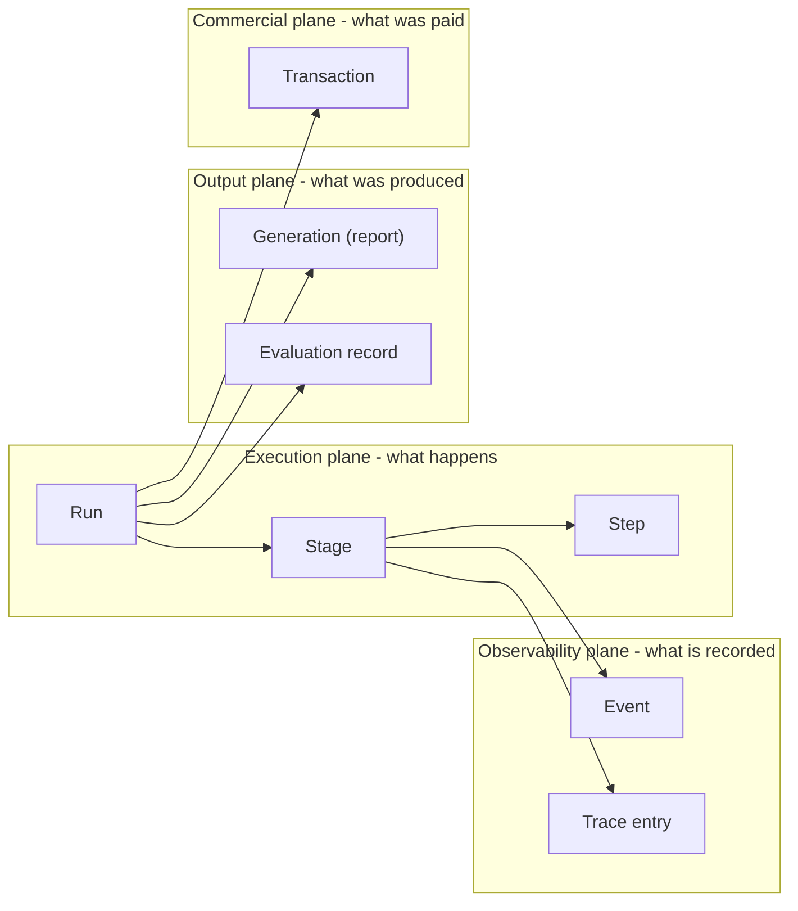
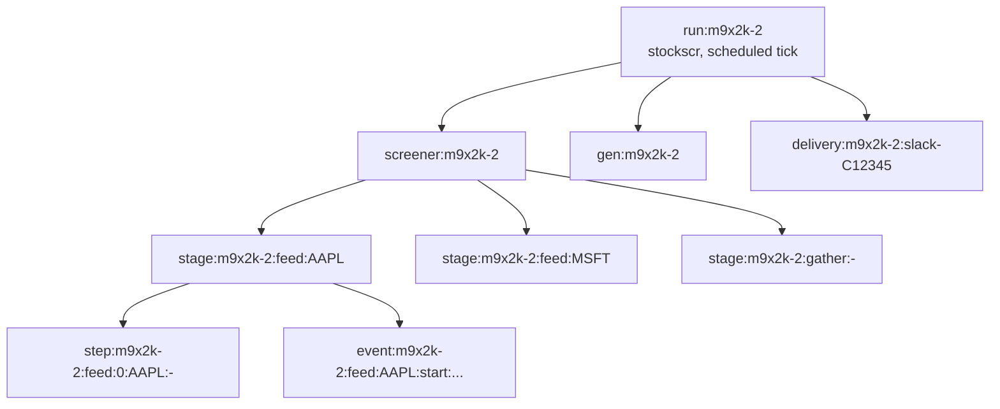

# Execution model: one tree, one id convention

**Location:** `docs/architecture/application/execution-model.md`
**Status:** PROPOSED — the terminology collapse (§1) remains proposed; the uniform id convention (§5) was ADOPTED 2026-11-17. Verified facts (code on main, ruled short ids) are marked as such; everything else is proposed.
**Related:** #5175 (standardize run/transaction ids — the design record), #4774 (chain short ids; PR #5173 implements the pre-uniform shapes), #5109 (research onto the engine), #4808 (per-node execution tree), `docs/architecture/data/data-model.md` (the data model), `docs/architecture/application/screener.md` (the screener capability), `docs/architecture/application/api-mcp.md` (the API/MCP surface).

---

## 1. Why so many terms — and the collapse

The platform grew five words for one thing. Each lane and feature named its own thing — the options chain, the feed pipeline, ThinkWorkflow, the job definition — and nobody collapsed them. The catalog, the engine, and the hosts each kept their own vocabulary. The result is bloat: a reader must learn five terms before they can ask what a run is.

The collapse: **there are only two things in the flow — a Job (a definition) and a Run (an execution).** Everything else is a shape of a job, a grouping of jobs, or the host a run executes on.

| Term (as used) | What it actually is | Survives? | Use instead |
|---|---|---|---|
| Job | A job definition: a unit of work the engine executes (`defineJob` + `runJob`), with a stage vocabulary and a node tree. | Yes | — |
| Chain | A job whose steps are jobs (nested / composed). The options chain and the feed chain are jobs of this shape. | No, as a separate entity | "chain job" (a shape of job) |
| Pipeline | A job that moves data through stages. A feed pipeline is a job in the feed chain; the research pipeline is a job. | No, as a separate entity | "pipeline job" (a shape of job) |
| Workflow (the flow) | The execution flow of a job. | No | "job" |
| Workflow (the family) | A catalog family. | No | "family" |
| Workflow (the host) | A ThinkWorkflow durable host instance (`ScreenerScreenWorkflow`, `JobPipelineWorkflow`, …). | Yes, as "ThinkWorkflow host" | Never bare "workflow" |
| Run | One execution instance of a job. | Yes | — |
| Family | A catalog grouping of job definitions (`stock-screener`, `options-screener`, …). | Yes | — |
| Stage | A phase of a job (`feed`, `gather`, `analysis`, `store`, `serve`, `deliver`). Coarse-grained. | Yes | — |
| Step | A journaled unit of work within a stage — a node in the job definition's node tree. Fine-grained; the exactly-once key lives here. | Yes | — |
| Task | An invocation that *causes* a run: a scheduled tick, a manual Run now, a Copilot call, a goal-leg invocation. | Yes | — (it sits outside the tree, see §2) |
| Generation | A report generation produced by a run. | Yes, as an output | — (not a phase, see §3) |
| Transaction | A payment / ledger entry caused by a run. | Yes, as a record | — (not a phase, see §3) |
| Evaluation | The word names two things: the `evaluate-later` stage AND the evaluation record it produces. | Split | Stage: `evaluate-later`. Artifact: "evaluation record" |
| Event | A CloudEvents record of a stage action (start / end). The trail, not the work. | Yes | — |
| Trace entry | One iteration of a loop (e.g. OODA per candidate) inside a stage. | Yes | — |
| Delivery | One delivery of a run's output to a destination. | Yes | — |
| Unit | One shard of a sharded stage (one symbol). | Yes, as a coordinate | Not a minted id — it is a segment of a stage id |
| Level | A node kind in the tree (`chain`, `pipe`, `wf`, `job`, `stage`, `unit`, `task`, `run`, `txn`). | Yes, as the taxonomy | — |

**Rule: never say "workflow" bare.** Always "ThinkWorkflow host", "job", or "family". The word has three historical meanings and every bare use is ambiguous.

**Stage vs step vs task, in one line:** a stage is a *phase* (coarse), a step is a *journaled work unit* inside a stage (fine), a task is the *cause* of a run (outside the tree). They are three different levels, not three words for one thing.

---

## 2. The model — one execution tree per run

One tree per run. The run is the root; everything else hangs off it or causes it.

| Entity | Id | What it is | Parent | Children |
|---|---|---|---|---|
| Family | `chain:<family>` | A workflow family: `stockscr`, `optionsscr`, `goalscr`, `strategyscr`, `feedsrc`, `resrch` (ruled 2026-11-17 — OODA is one type of research within the family; Holly etc. later), `tradrun` (ruled 2026-11-17), `payrun` (ruled 2026-11-17), `sagarun` (ruled 2026-11-17). | — | Job definitions |
| JobDefinition | `job:<spec>` / `pipe:<feed>-<dataset>` | A job spec with a stage vocabulary and a node tree. | Family | Stages (vocabulary), nodes |
| Task | `task:<uuid8>` / `sched:<uuid>` (proposed) / `job:<uuid>` | An invocation that causes a run. | — | Runs |
| Run | `run:<time>-<counter>` | ONE execution instance of one job definition, caused by one task. The root. | Task, JobDefinition | Stage executions, generations, transactions, deliveries |
| StageExecution | `stage:<runBody>:<stage>:<unit>` | One execution of one stage within a run — one per shard unit when sharded. | Run | Step executions, events, trace entries |
| StepExecution | `step:<runBody>:<node>:<index>:<shard>:<item>` | One journaled unit of work; the exactly-once key. For chains, a step may BE a nested job. | StageExecution | Nested job (chains) |
| Event | `event:<runBody>:<stage>:<unit>:<action>:<at>:<suffix>` | One CloudEvents record of a stage action. | StageExecution | — |
| TraceEntry | `trace:<runBody>:<loop>:<step>:<index>` | One iteration of a loop (e.g. OODA per candidate) inside a stage. | StageExecution | — |
| Generation | `gen:<runBody>` | One report generation produced by a run. | Run | Report row (`mas_reports`) |
| Transaction | `pay:<uuid8>` (etc.) | One payment / ledger entry caused by a run. | Run | Ledger row (`mas_transactions`) |
| Delivery | `delivery:<runBody>:<destination>` | One delivery of a run's output to a destination. | Run | — |
| ThinkWorkflow host | Cloudflare `instanceId` (recognized, not generated) | The durable host a run executes on, when durable. Inline runs have no host. | — | — |

Notes:

- **OODA is one type of research.** The research family's short id is `resrch` (ruled 2026-11-17). OODA is one *type* of research within the family — not the family itself. The research family contains research types; OODA (the nightly run) is one of them for now; Holly and others come later. Its stages are the 8 pipeline stages. The OODA *loop* (observe/orient/decide/act) is a cycle *inside* the analyze stage (`analyze.ooda`, #5118), one iteration per candidate — its instances are trace entries, not stage executions. That is why the same words appeared at two levels: the run-level stage `stage:<runBody>:observe:-` vs the candidate-level iteration `trace:<runBody>:ooda:observe:2`. The hierarchy scopes them, so the separate `respipe:` namespace retires (confirmed 2026-11-17; it was the #4774 workaround for a flat namespace).
- **Trading (order execution) is one family** (`tradrun`, ruled 2026-11-17): one catalog family, one `TradingTradeWorkflow` host, one shared stage vocabulary. Stocks and options are screening families, not trading — they are not part of the trading family, and there is no "stock trading" vs "options trading" split.
- **A unit is a coordinate, not an id.** A sharded stage has one stage-execution id per unit (`stage:m9x2k-2:feed:AAPL`, `stage:m9x2k-2:feed:MSFT`); no separate `unit:` id is minted.
- **A chain is a job whose steps are jobs.** That is the recursion in the diagram: the options chain job's feed/assemble/generate/store/serve/deliver nodes are themselves jobs. A **pipe** is a feed-pipeline job inside the feed chain.

---

## 3. Why generation, transaction, and evaluation are not stages

Stages are phases of execution — *when* and *what happens*. Generations, transactions, and evaluation records are outputs and records — *what was produced* — in their own planes, with their own stores and lifecycles. Mixing them into the stage sequence would mix the planes.

- **Generation.** The `generate` stage *produces* a generation; the generation is the artifact. The stage is the work, the generation is the report row (`mas_reports`) that persists after the run as the archive. Confusing them is confusing cooking with the meal.
- **Transaction.** A financial record in the ledger. Its lifecycle (draft → confirmed → completed / rejected) is independent of the run's lifecycle — a run may complete while its transaction is still pending, or a transaction may fail while the run succeeded. A run *causes* a transaction; the transaction references the run id (provenance), never its stages. Putting it in the stage sequence would put the commercial plane inside the execution plane.
- **Evaluation.** The word splits. `evaluate-later` **is** a stage (research workflow stage 8). An evaluation record is an artifact that stage produces (judge scores, track-record updates), stored in its own tables. The stage judges; the artifact is the verdict.
- **Events.** The trail. A stage execution *emits* events (start / end); events record work, they do not do it. Events are also the audit chain (`mas_events`) — the integrity record. A trace is a curated sequence of trace entries for a run (`oodaTrace` / `stageTrace` on the report).
- **How transactions relate, in full:** Run → causes → Transaction → recorded in → ledger (`mas_transactions`); Transaction → references → Run id (provenance). The transaction never contains stage ids, and the run never contains the ledger's state.

---

## 4. Relationship table

| From | Relationship | To | The link (id / field) | Notes |
|---|---|---|---|---|
| Family | has | JobDefinition | Family id in the job definition's catalog entry | A family usually has one job definition; `feedsrc` has many (one per feed pipeline) |
| JobDefinition | has (vocabulary) | Stage | Stage names in the definition | Stock 13, options/strategy 8 shared, research 8, payment 14, saga 5 (verified counts) |
| JobDefinition | has (nodes) | Step (node) | `nodePath` in the definition | The node tree; a chain job's nodes are jobs |
| Task | causes | Run | Task id in the run's registry row (the cause) | Scheduled tick / manual Run now / Copilot call / goal-leg invocation |
| Run | executes | Job (instance) | Job id `<kind>:<runBody>` | One run executes one job |
| Run | runs on (when durable) | ThinkWorkflow host | `instanceId` (recognized) | Inline runs have no host |
| Job (instance) | has | StageExecution | Stage id contains the run body | One per stage that executes; one per shard unit when sharded |
| StageExecution | has | StepExecution | Step id contains run body + node path | The exactly-once key |
| StageExecution | emits | Event | Event id contains run body + stage + unit | Start / end (and other actions) |
| StageExecution | records | TraceEntry | Trace id contains run body + loop + step + index | One per loop iteration per candidate |
| Run | produces | Generation | Generation id `gen:<runBody>` | The report row (`mas_reports`) |
| Run | causes | Transaction | Transaction id; the transaction row references the run id | The ledger row (`mas_transactions`) |
| Run | sends | Delivery | Delivery id `delivery:<runBody>:<destination>` | The suppression key is (`runId`, `destination`) |
| StepExecution (chain) | is | Job (nested) | The nested job's id | A chain job's steps are jobs — the recursion |

**Linking rules (how ids correlate):** every derived id embeds its ancestors' bodies — a stage id contains the run body, a step id contains the run body + node path, an event id contains the run body + stage + unit. Given any id, parse the segments → the run body → resolve the run → its job, family, and task. Given a run id, the registry (`mas_runs` + child links, #5175) lists its stages, steps, generations, transactions, and deliveries. Correlation is by construction (substring) *and* by query (the resolver API / MCP `resolve_id`, #5175).

---

## 5. The id convention

**One rule: every generated id is colon-separated segments. The first segment is the type. No body ever contains `:`.** Composite ids are fixed-position segment lists; each part is a *body* (never a full id), so splitting is always unambiguous.

The short id and the system id are not two ids: the short id is the **body** (the name part, e.g. `stockscr`); the system id is the **full `<type>:<body>`** (e.g. `chain:stockscr`). One id per thing; the short form is its body.

**Colon rule — fixed arity per type.** The segment count is declared in the authority; the parser rejects any id whose count does not match its type. The count is the id's depth: each segment after the type names one coordinate on the path from the run (the root) to the node.

| Id | Segments | Colons |
|---|---|---|
| `chain:stockscr`, `run:m9x2k-1`, `pay:a1b2c3d4`, `research:m9x2k-1`, `gen:m9x2k-1` | 2 | 1 |
| `node:screener:root`, `delivery:m9x2k-1:slack-C12345` | 3 | 2 |
| `stage:m9x2k-1:feed:-` | 4 | 3 |
| `trace:m9x2k-1:ooda:observe:2` | 5 | 4 |
| `step:m9x2k-1:root:0:-:-` | 6 | 5 |
| `event:m9x2k-1:feed:-:start:1763419200000:abc123` | 7 | 6 (the maximum in the current set) |

| Entity | Id form | Example | Minted or derived | What a reader learns |
|---|---|---|---|---|
| Family | `chain:<family>` | `chain:stockscr` | Declared (ruled) | What family this is |
| Level | `lvl:<level>` | `lvl:run` | Declared | What kind of node this is |
| OODA step | `ooda:<step>` | `ooda:observe` | Declared | Which loop step (candidate level) |
| Research stage | `respipe:<stage>` | `respipe:observe` | Retired (confirmed 2026-11-17) | Which run-level stage (legacy namespace) |
| Job definition | `job:<spec>` | `job:screener` | Declared | Which job spec |
| Feed pipeline job | `pipe:<feed>-<dataset>` | `pipe:yahoo-nasdaq100-quotes` | Declared | Which feed pipeline |
| Job-definition node | `node:<spec>:<nodePath>` | `node:screener:root` | Declared | Which node of which job |
| Run | `run:<time36>-<counter36>` | `run:m9x2k-1` | Minted (one per run) | Which run; when (mint time in the body) |
| Async job | `job:<uuid>` | `job:550e8400-…` | Minted | Which async job / MCP receipt |
| Payment draft | `pay:<uuid8>` | `pay:a1b2c3d4` | Minted | Which payment (= its ledger row) |
| Task proposal | `task:<uuid8>` | `task:a1b2c3d4` | Minted | Which task proposal |
| Local order | `ord:<uuid8>` | `ord:a1b2c3d4` | Minted | Which local order |
| DID proof | `proof:<uuid12>` | `proof:a1b2c3d4e5f6` | Minted | Which payment-authorization proof |
| Goal record | `goal:<time>-<rand6>` | `goal:m9x2k-ab12cd` | Minted (prefix unverified — #5175 gap G12) | Which goal record |
| D1 row (platform-facing) | `<rowkind>:<uuid>` | `report:550e8400-…` | Minted | Which stored row |
| Job instance | `<kind>:<runBody>` | `research:m9x2k-1`, `options-chain:m9x2k-1` | Derived from the run body | Which job of which run |
| Stage execution | `stage:<runBody>:<stage>:<unit>` | `stage:m9x2k-1:feed:-` | Derived | Which stage of which run, which shard |
| Step execution | `step:<runBody>:<node>:<index>:<shard>:<item>` | `step:m9x2k-1:root:0:-:-` | Derived (deterministic — the exactly-once key) | Which journaled step |
| Stage-action event | `event:<runBody>:<stage>:<unit>:<action>:<atMillis>:<suffix>` | `event:m9x2k-1:feed:-:start:1763419200000:abc123` | Derived + random suffix | Which action, when (epoch millis) |
| Trace-step instance | `trace:<runBody>:<loop>:<step>:<index>` | `trace:m9x2k-1:ooda:observe:2` | Derived (not stored) | Which loop iteration |
| Generation | `gen:<runBody>` | `gen:m9x2k-1` | Derived | Which run's report |
| Delivery | `delivery:<runBody>:<destination>` | `delivery:m9x2k-1:slack-C12345` | Derived | Which run, to whom |

**What an id tells a reader:** the first segment says *what* it is; the remaining segments say *which run* and *where in the tree*; the run body embeds the mint time and the event id embeds epoch millis, so *when* is in the id; every registry row also records `created_at`. *Why* comes from the registry row — the run's task (scheduled tick, manual Run now, Copilot call, goal-leg invocation) and its job kind. The id carries what / which / when / where; one resolve call adds why.

**Deliberately outside the convention:** external ids (`gateway_ref`, `order_ref`, Cloudflare `instanceId`) — assigned by others, stored as-is, declared in the registry by source. OTEL `traceId` / `spanId` — must stay bare hex for W3C traceparent compatibility. `session_id` — a scope key, not an instance id. DB-internal surrogate keys (AUTOINCREMENT rowids) — storage, not identity; they must never leak out as platform ids. Legacy formats — kept as aliases → canonical, never minted again.

**What the convention renames (the cost):** `run-…` → `run:…`; `job-stage:` → `stage:`; `job-step:` → `step:`; stage-action events → `event:`; `pay_` / `task_` / `ord_` / `rsr_` separators unify to `:`. PR #5173 (#4774) implemented the pre-uniform shapes — the rework to the uniform convention is in flight (ruled 2026-11-17: rework now).

---

## 6. Worked example — one stockscreen

Family `stockscr`, job `screener`, all 13 runtime stages execute, a 3-symbol universe, feed sharded per symbol, stages emit start + end events, 1 generation, 1 delivery, free run, caused by a scheduled tick.

| Ids | Count | Examples |
|---|---|---|
| Run | 1 | `run:m9x2k-2` |
| Job | 1 | `screener:m9x2k-2` |
| Stage executions | 15 | 12 unsharded (`stage:m9x2k-2:gather:-`) + feed × 3 (`stage:m9x2k-2:feed:AAPL` …) |
| Step executions | 16 | Root 1 + 12 unsharded stages + 3 feed shards (`step:m9x2k-2:feed:0:AAPL:-` …) |
| Events | 30 | 2 per stage execution (`event:m9x2k-2:feed:AAPL:start:…` …) |
| Generation | 1 | `gen:m9x2k-2` |
| Delivery | 1 | `delivery:m9x2k-2:slack-C12345` |
| Cause (schedule) | 1 | `sched:550e8400-…` (proposed) |
| **Total** | **66** | |

The count depends on the job definition and the universe size: total = 1 (run) + 1 (job) + S (stage executions) + P (step executions) + 2S (events) + G + D (+ cause). **But only 2–3 are minted with fresh entropy** (the run body, the cause id, a payment id if paid). The other ~63 are deterministic paths derived from the run body + coordinates — the system mints ONE id per run; everything else is computed from it. Correlation: every one of the 66 contains the run body `m9x2k-2`, so a substring search finds them all; the registry makes it a query; the display form is `stockscr · run-m9x2k-2`.

---

## 7. Open rulings

- Enumerate the research types beyond OODA (Holly etc. — later).
- Generation id canonical shape (settled by the uniform convention: `gen:<runBody>`).
- Goal record id prefix (gap G12 — unverified on main).
