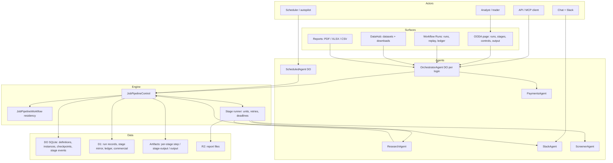
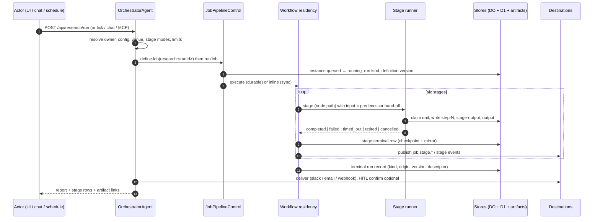
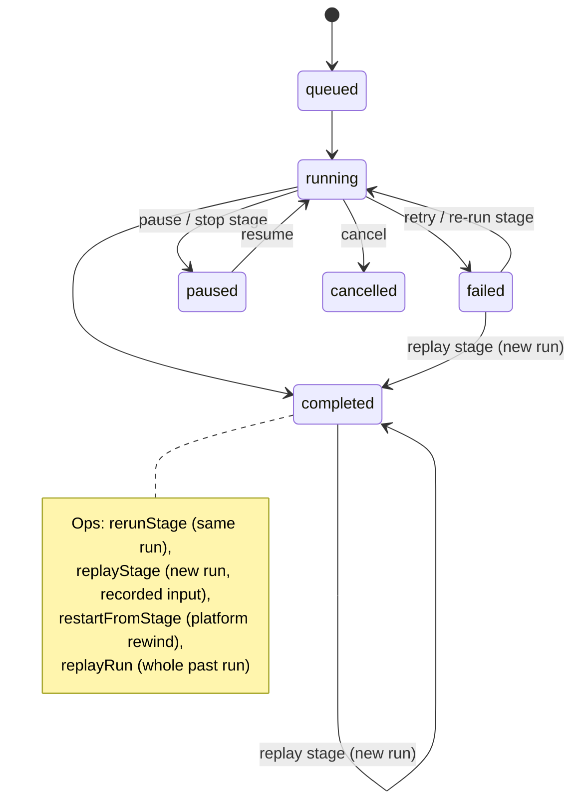

# OODA — end-to-end assessment: what it is today, what it must become

**Status:** assessment · **Date:** 2026-11-26 · **Owner lane:** #autoclaw-001 · **Scope:** the nightly OODA research product (`[5109]`), end to end: agents, engine, stages, data, UX, channels, commercial, dispatch and execution modes, and the strategy to win.

**Companion:** the executive roadmap derived from this assessment is [ooda-roadmap.md](ooda-roadmap.md).

**How to read the confidence labels used here**

- **[code]** — verified in this repository at `437372aa5` (file/line or test named).
- **[issue]** — a tracked open issue in this repo; the gap is recorded, not inferred.
- **[inference]** — reasoned from code, not directly asserted by it.
- **[verify]** — believed true but not confirmed in this pass; do not quote externally before checking.

> **What this document is not.** It is not a survey of the market with fresh pricing: the competitive section is a qualitative positioning scan and every price there is marked **[verify]**. It is not a plan-of-record either: the roadmap names *candidate* horizons and maps them onto existing issues; the owner decides sequence.

---

## 1. Executive summary

OODA is a **six-stage research pipeline** (feed → enrich → analyze → generate → deliver → evaluate) that runs on the platform's own workflow engine, produces an options-research report (ideas, structures, pricing, risk) in three formats, and delivers it to a person or a channel. Around it sits a genuine commercial system (plans, credits, quotas, refunds, referrals) and a chat/Copilot surface.

**Its real differentiator is not the report. It is that the report is reproducible.** Every run pins the definition version it executed, records a terminal row per stage, persists each stage's hand-off, and can be replayed whole or stage-by-stage from the recorded configuration and input. Almost nothing in the consumer research market can say "here is exactly how this conclusion was produced, re-run it yourself." That is the moat to build on — and today it is **latent**: the machinery exists, the product does not surface it, and several paths that should prove it are broken ([#6398](https://github.com/Qunsultant/cfagent/issues/6398), [#6399](https://github.com/Qunsultant/cfagent/issues/6399), [#6401](https://github.com/Qunsultant/cfagent/issues/6401)).

**The three findings that matter most**

1. **The research loop is not reliably running its own stages.** Stages record `not_configured` in 0 ms because the job definition drops `userLogin` from their step params ([#6355](https://github.com/Qunsultant/cfagent/issues/6355)). Everything downstream — controls, provenance, trust — is noise until that is fixed. **This is the #1 engineering item.**
2. **There are seven ways to start an OODA run and no single one of them is the canonical path** ([#6380](https://github.com/Qunsultant/cfagent/issues/6380)). Schedule, Copilot, autopilot, API, MCP, workflow page, manual route each carry their own glue. That is a correctness and a cost problem, and it caps how fast the product can improve.
3. **The product's value is invisible at the moment of decision.** A user sees a report; they do not see *why* — which feed, which filters, which model, which thresholds, what was excluded. The data to show it exists (artifacts + stage rows + provenance); the surface does not ([#6356](https://github.com/Qunsultant/cfagent/issues/6356), [#6378](https://github.com/Qunsultant/cfagent/issues/6378)).

**The strategic bet.** Make OODA the **auditable research desk**: every claim traceable to a stage, every stage re-runnable, every run comparable over time — for options first, because that is where generic AI tools are weakest and where this repo's domain depth (structures, greeks, DTE windows, fit gates) is deepest. Compete on *trust and reproducibility*, not on being another chat box over prices.

---

## 2. What an OODA run is today

### 2.1 The six stages

| Stage | What it does | Produces | Failure shape |
|---|---|---|---|
| **feed** | Pulls the universe's market data for the run's as-of moment | quotes / dataset hand-off | provider down, partial symbols, stale data |
| **enrich** | Adds per-symbol context (fundamentals, options chain, attractiveness inputs) | `bySymbol` map + carried feed | partial coverage, chain fetch failure |
| **analyze** | The OODA loop: observations → ideas, with structures priced and gated | `ResearchReport` (ideas, structures, risk) | OODA budget exhausted, owner missing, input missing |
| **generate** | Turns the report into deliverables | PDF / XLSX / CSV artifact keys | render failure (e.g. WinAnsi, [#6264](https://github.com/Qunsultant/cfagent/issues/6264)) |
| **deliver** | Sends to the destinations, HITL-confirmable | delivery record: slack / email / webhook + reasons | channel failure, recipient not allowed |
| **evaluate** | Scores the run's outcome for the RSI loop | evaluation record | never runs today ([#6417](https://github.com/Qunsultant/cfagent/issues/6417)) |

Stage identity in the engine is a **node path** (`""` root, `"0"…"5"` children); the display id is `job:<path>`; the research wrapper addresses stages by **kind** (`feed`…`evaluate`) and resolves kind → path. **[code]**

### 2.2 How many agents are involved — and which ones

The repo hosts **13 agent classes** (`src/agents/*agent.ts` + `orchestrator.ts`). An OODA run does **not** use all of them; participation depends on the dispatch path. The honest answer:

| Agent | Role in an OODA run | In every run? |
|---|---|---|
| **OrchestratorAgent** (per-login DO) | Owns the run: hosts the research routes, holds the per-tenant stores, owns `runResearchAndPublish`, runs the stage runtimes the workflow calls back into | **Yes** |
| **ResearchAgent** | The analyze brain — the OODA reasoning turn that turns observations into ideas | **Yes** (analyze) |
| **ScheduledAgent** | Fires the scheduled tick and exposes the pipeline control door for job runs | Only **scheduled** dispatch |
| **SlackAgent** | Channel surface: receives chat commands, delivers results to Slack | Only when the channel is used |
| **PaymentsAgent** | Plans, credits, quotas, checkout, refunds — the commercial gate in front of paid runs | Only for paid/gated paths |
| **ScreenerAgent** | Options-chain / screen data that enrichment and analysis consume | When the run reads screened data |
| **TradingAgent** | The *destination* of a research idea — proposals, approvals, orders | Never inside OODA; downstream of it |
| Others (aiSearch, browser, sandbox, social, ticker, report-asset) | Support: document search, browser automation, sandboxed code, social rewards, ticker data, report assets | No — invoked by specific stages/tools |

**In one line:** an OODA run is **orchestrator + research + (scheduled | slack | payments | screener) depending on path** — the engine is the spine, the agents are the organs. **[code]**

### 2.3 The runtime spine

**[code]** for every edge: routes are mounted on the orchestrator's request router; the engine writes instances/stage events to the DO, mirrors run records and stage rows to D1, keeps artifacts per run, and the deliver leg hands files to channels.

### 2.4 One run, end to end (sequence)

### 2.5 The stage/run state machine (what an operator can do)

**[code]** — `kind` is `original | re-run | resume | replay`; every run pins the definition version it executed; a replay refuses rather than substituting a close version.

### 2.6 Execution modes (the axes that make stages real)

| Axis | Values | Meaning | Why it matters commercially |
|---|---|---|---|
| **shape** | monolith / sharded | one unit vs N shard keys | sharded = parallel coverage (more symbols per window) |
| **concurrency** | sequential / parallel | stage units vs sibling children | parallel = wall-clock, at the cost of provider pressure |
| **pacing** | batch / online | all items, or per-item as they arrive | online = streaming feel for long chains |
| **delivery** | sync / async | awaits outcome, or returns a handle | async is required for long OODA turns |
| **durability** | optional | platform workflow residency | survives eviction; the basis of "it always finishes" |

Mode is set per job and **overridable per stage**; a combination that cannot run is refused by name, and the matrix is pinned ([#6336](https://github.com/Qunsultant/cfagent/issues/6336)). **[code]**

### 2.7 Dispatch modes — seven doors to the same room

| Path | Entry | Today |
|---|---|---|
| Manual (web) | `POST /api/research/run` from the OODA page | works; the reference path |
| Scheduled | research tick on the 21:00/21:30 fold ([#6298](https://github.com/Qunsultant/cfagent/issues/6298)) | exists; historically fragile ([#6319](https://github.com/Qunsultant/cfagent/issues/6319)) |
| Chat / Copilot | chat turn → orchestrator | exists ([#6349](https://github.com/Qunsultant/cfagent/issues/6349)) |
| Autopilot | autonomous loop | exists ([#6350](https://github.com/Qunsultant/cfagent/issues/6350)) |
| API | external client | exists ([#6351](https://github.com/Qunsultant/cfagent/issues/6351)) |
| MCP | `run_research_job` tool | exists ([#6353](https://github.com/Qunsultant/cfagent/issues/6353)) |
| Workflow page | define + run from the catalog | partially ([#6347](https://github.com/Qunsultant/cfagent/issues/6347)) |

Seven paths is a strategic liability: seven glue points to keep correct, seven sets of defaults, seven ways for the same run to behave differently ([#6380](https://github.com/Qunsultant/cfagent/issues/6380)). **One dispatch seam, seven thin adapters** is the target.

### 2.8 Data, artifacts and provenance

- **Definitions** are versioned; every run pins the version it executed. **[code]**
- **Instances/checkpoints** live in the per-login DO; **run records** and **stage terminal rows** mirror to D1 so a settled run still reads after its checkpoint is gone. **[code]**
- **Artifacts**: per-step (`step-N`), per-stage hand-off (`stage-output`), and node output (`output`); presence is now answered by key, so a genuinely `null` hand-off is input, not a gap. **[code, #6362]**
- **Provenance on the report exists** (venue, mode, dataset, source list — [#6356](https://github.com/Qunsultant/cfagent/issues/6356) asks to *surface* it); **[issue]**
- **Report files** PDF/XLSX/CSV, delivered with per-channel reasons. **[code]**

### 2.9 UX, channels, commercial

- **OODA page**: runs, six stage rows with status/duration/attempt/output toggle, per-stage **Run / Re-run / Replay / Stop / Resume / Cancel** (Replay added by [#6617](https://github.com/Qunsultant/cfagent/pull/6617)). **[code]**
- **Workflow Runs**: per-run ledger, Replay, stage controls; the operator's debugging surface. **[code]**
- **Channels**: Slack, email, webhook — with an allowlist on recipients and a HITL confirmation path. **[code]**
- **Commercial**: plans and subscriptions, credits, runs packs, approved-free quotas (families `stock|goal|options|strategy`), refunds, referrals, social rewards; Stripe plus an x402 rail. Research has **no dedicated quota family** today — its monetisation is the subscription itself. **[code, verify]**
- **Brokers/data**: two first-class broker integrations (one paper/live gated), a legacy broker path, and a secondary quote provider as a fallback for some legs. Research correctness depends on which venue the run names. **[code]**

---

## 3. Value: what it is worth, to whom

### 3.1 Value chain

| Layer | Value created | Who feels it |
|---|---|---|
| Data | Universe + chain + fundamentals, as-of the run's moment | analyst (time saved) |
| Structure | Options structures priced with greeks, max loss/gain, breakevens | trader (decision-ready) |
| Judgement | Ideas filtered by regimes, theses, fit gates | PM (attention saved) |
| **Reproducibility** | Every stage re-runnable, every input recorded | **compliance-minded pro, and the product team itself** |
| Delivery | Report where the work happens (Slack/email/web/API) | team (distribution) |
| Loop | Evaluation feeds selection weights | the product (compounding quality) |

### 3.2 Who pays, and for what

Three plausible buyers, in order of willingness to pay:

1. **The serious options trader** — pays for *decision-ready structures with risk defined*, not for another screener. Values: fewer, better ideas; defined loss; reproducibility when a trade goes wrong.
2. **The small advisory/PM** — pays for *evidence they can hand to a client*: a report with provenance, and the ability to re-run it on request.
3. **The builder/quant-curious** — pays for *API + MCP access* to the same pipeline, and for the ability to change the rules.

The product today mostly serves (1), speaks to (2) only via the report, and barely serves (3) — while its architecture is strongest exactly for (2) and (3).

### 3.3 Unit economics (structure, not numbers)

Costs per run: data calls (per symbol/chain), model tokens (analyze is the dominant term), compute (workflow steps), and delivery. Levers already in the code: per-stage timeouts, retry buckets, fan-out caps, sharding, checkpoint interval, model/loop budget (`oodaBudgetMs`). **[code]** The commercial system meters runs for four families; research is **not** one of them — so today a heavy research run has no price signal attached. **[inference]**

---

## 4. User journeys (today)

**J1 — "What should I trade this week?" (trader, manual)**
OODA page → Run → watch six stages → read report → open ideas. Friction: stage rows have said `not_configured` for real runs ([#6355](https://github.com/Qunsultant/cfagent/issues/6355)); when the run is slow the page cannot say which stage is working; the report does not link each idea back to the observation that produced it.

**J2 — "Prove it" (analyst/PM, after the fact)**
Workflow Runs → find the run → Replay / re-run a stage. Friction: the job-level Replay 404s for research runs ([#6398](https://github.com/Qunsultant/cfagent/issues/6398)); a stage re-run can rebuild a default definition ([#6401](https://github.com/Qunsultant/cfagent/issues/6401)); no side-by-side run comparison.

**J3 — "Every morning, before the open" (scheduled)**
Tick fires → run executes → report lands in Slack/email. Friction: the trigger has failed silently before ([#6319](https://github.com/Qunsultant/cfagent/issues/6319)); a failed run's *reason* is not in the message.

**J4 — "Ask in chat" (Copilot)**
"Run research on semis" → run → summary. Friction: the chat path and the page path can disagree; the tool surface is a pinned contract that lags the engine ([#6353](https://github.com/Qunsultant/cfagent/issues/6353)).

---

## 5. Assessment of today

### 5.1 What is genuinely strong

1. **One engine for every family**, with real durability semantics: checkpointing, resume, retries, deadlines, replay, stage control. Most competitors outsource this to nothing at all.
2. **Recorded configuration per run** — the definition version pin is the seed of an audit story nobody else offers.
3. **Options depth** — structures priced and gated, not free-text suggestions.
4. **A complete commercial spine** — plans, credits, quotas, refunds, referrals; unusually mature for a research product.
5. **A single control vocabulary** — run/re-run/replay/stop/resume/cancel per stage, now including past-run replay.

### 5.2 What is fragile (each one is a tracked issue)

| Gap | Issue | Business consequence |
|---|---|---|
| Stages run `not_configured` in 0 ms | [#6355](https://github.com/Qunsultant/cfagent/issues/6355) | The product can report a "successful" run that did nothing |
| Evaluate stage never runs | [#6417](https://github.com/Qunsultant/cfagent/issues/6417) | No learning loop; quality cannot compound |
| Seven dispatch paths, no canonical one | [#6380](https://github.com/Qunsultant/cfagent/issues/6380) | Inconsistent behaviour, 7× maintenance |
| Who orchestrates the stages is ambiguous | [#6375](https://github.com/Qunsultant/cfagent/issues/6375) | Every fix must answer "which owner?" first |
| Job replay 404s for research (residency) | [#6398](https://github.com/Qunsultant/cfagent/issues/6398) | The headline "reproduce it" promise fails on click |
| No eviction re-entry for research | [#6399](https://github.com/Qunsultant/cfagent/issues/6399) | Long runs can die with no recovery |
| Stage re-run can rebuild defaults | [#6401](https://github.com/Qunsultant/cfagent/issues/6401) | A re-run may silently use a different configuration |
| No job-level pause/cancel used by OODA | [#6390](https://github.com/Qunsultant/cfagent/issues/6390) | A runaway analyze turn cannot be stopped cleanly |
| Ledger diverges from the page | [#6369](https://github.com/Qunsultant/cfagent/issues/6369), [#6416](https://github.com/Qunsultant/cfagent/issues/6416) | Two truths about one run |
| Provenance not surfaced | [#6356](https://github.com/Qunsultant/cfagent/issues/6356), [#6357](https://github.com/Qunsultant/cfagent/issues/6357) | The differentiator is invisible |
| Report contradicts itself | [#6354](https://github.com/Qunsultant/cfagent/issues/6354) | Trust loss at the worst moment |
| PDF render crash on a glyph | [#6264](https://github.com/Qunsultant/cfagent/issues/6264) | Deliverable fails on real text |
| Sync dispatch for a long turn | [#6381](https://github.com/Qunsultant/cfagent/issues/6381) | Timeouts on the richest runs |
| No research quota family | [#inference], verify | Heavy runs have no price signal |

### 5.3 Risk register

| Risk | Type | Why it bites | Mitigation direction |
|---|---|---|---|
| **Overclaiming a run's health** | product/trust | a green row over a no-op is worse than a red one | fix #6355 first; make "no-op" a visible state |
| **Irreproducible research** | regulatory/reputational | advice you cannot reconstruct is a liability | surface provenance; make replay work end to end (#6398/#6401) |
| **Data licensing** | legal/commercial | vendor terms for chain/fundamental redistribution | record source per artifact; keep the source field on the report |
| **Model cost per run** | unit economics | analyze dominates cost; heavy universes explode it | per-stage budgets, sharding caps, cached enrich, tier gating |
| **Provider fragility** | reliability | one provider 400 blocks the run ([#6320](https://github.com/Qunsultant/cfagent/issues/6320)) | breaker + fallback policy per leg ([#6328](https://github.com/Qunsultant/cfagent/issues/6328)) |
| **Tenant isolation in the engine** | security | per-login DOs + shared engine stores | [#3961](https://github.com/Qunsultant/cfagent/issues/3961) |
| **Vendor concentration (CF)** | platform | workflows/DO/queues are the spine | portability work [#5277](https://github.com/Qunsultant/cfagent/issues/5277), [#5281](https://github.com/Qunsultant/cfagent/issues/5281) |

---

## 6. Competitive landscape and positioning

**Scan date 2026-11-26.** Prices were captured from vendor pricing pages on that date unless the vendor does not publish one; evidence grade **A** = vendor pricing/product page, **C** = third-party estimate. Unverified items are marked **[verify]** and must not be quoted externally.

| Product | Position | Price (2026-11-26) | Strength | Weakness vs OODA |
|---|---|---|---|---|
| **Bloomberg Terminal** (+ ASKB) | institutional research → execution terminal | no public list price; industry data **~$31,980/yr** single seat (C, 2024-10) **[verify]** | data breadth (800+ research firms, ~5k original + 1.1M aggregated stories/day), execution, **ASKB**: source attribution, re-runnable saved workflows, BQL output | cost (~34× a mid-tier retail terminal), desktop-bound, no per-user reproducibility of a *report* |
| **AlphaSense** | enterprise market intelligence | no public price; third-party SMB ~$10.1k/yr, enterprise ~$139k/yr (C) **[verify]** | 500M+ documents, 1,000+ research sources, 100k+ expert interviews; **inline citations**, Deep Research marketed "fully auditable" | enterprise sales cycle; no trading loop; not a personal product |
| **Koyfin** | affordable terminal for independents/RIAs | Free · Plus **$39/mo** · Premium **$79/mo** · Advisor **$209–299/mo** | 100k+ companies, 10y financials/estimates, comparables | **no options** ("coming soon"), no API, thin AI |
| **Fiscal.ai** (ex-FinChat) | AI-native fundamentals + data infra | Pro **$49/mo** ($39 annual) · Max **$99/mo** ($79 annual) | conversational financials, 100k+ companies, structured summaries, Data Feed API + MCP | no free tier, no trading, options unverified |
| **Simply Wall St** | visual long-term investing | Premium **$10.95/mo** · Unlimited **$21.50/mo** | accessible narratives (snowflake), global coverage | not tactical; no options/API |
| **Zacks** | quant Rank-driven stock picking | Premium **$249/yr** · Investor Collection **$59/mo** or **$495/yr**; Ultimate **[verify]** | rank brand, 1,000+ reports, 45+ screeners | opaque scoring, dated UX, no LLM assistant |
| **Seeking Alpha** | community + editorial research | Premium **$299/yr** · PRO **$41.99/mo** (annual) or **$69.99/mo** | 1M+ investor posts, earnings calls, 200+ pieces/day, "Ask Seeking Alpha" | opinion-weighted, no data/API, no trading |
| **Danelfin** | AI-scored stock picking | Plus **$22/mo** · Pro **$59/mo** · Elite **$134/mo** (MCP on Elite) | interpretable alpha score, daily since 2017, MCP | a score, not a process; limited fundamentals; no trading |
| **Tickeron** | AI robots/signals for retail | AI Robots **$45/mo**, Unlimited **$125/mo** (promo; list ~$90/$250) (C) **[verify]** | 298 AI "robots", pattern search, backtests | opaque pricing, marketing-heavy, US equities only |
| **Composer** | natural-language strategies → backtest → auto-trade | Starter **$0** · Advanced **$10/mo** · Pro **$40/mo** | **research → execution loop proven** (cumulative $37B+ traded), no-code strategies | equities/ETFs only; strategy-level, not research-depth |
| **Trade Ideas** | intraday momentum scans + AI signals | Basic **$127/mo** · Premium **$254/mo** | Holly AI signals, backtests, auto-trading, 500+ data points | expensive, intraday-only, no fundamental research |
| **Market Chameleon** | options/volatility research | **$99/mo**, 7-day trial | deepest options analytics at retail price: IV term structure, spread screens, earnings IV, order flow | **15-minute delayed data**, no LLM workflow, no trading |

### What the market proves

1. **The hardest moat is data rights + workflow embedding, not the model.** The two enterprise leaders win on content nobody else can license; SOC 2/ISO is table stakes. Price is the most effective wedge at the personal tier (a mid-tier terminal is ~34× cheaper than the institutional one).
2. **"Research → order" is proven in only three shapes:** a broker-owned product (Composer: AI strategy → backtest → auto-execute), an institutional terminal with EMS/OMS (Bloomberg), and signal vendors that hand off to a broker (Trade Ideas, Tickeron). **Pure research platforms never place orders.**
3. **Auditability is already an enterprise selling point** — Bloomberg ASKB (attribution, re-runnable workflows, BQL output) and AlphaSense ("fully auditable", granular citations). **No personal-tier product makes a replayable research process its core promise.**
4. **Options research has one strong retail incumbent** (Market Chameleon, $99/mo) with deep analytics but delayed data, no LLM workflow and no execution.

### The white space, stated as claims we can own

1. **A personal-tier auditable research desk** — conclusion → source → timestamp → model/rule version → replayable run. Enterprise has fragments of this; the personal tier has none.
2. **Options-native AI research** — the $99/mo incumbent proves demand for options analytics and shows the gap: no conversational reasoning, no citations, delayed data.
3. **Research → evidence pack → order (including options)** — the broker-owned loop is equity/ETF-only; the institutional loop is not for individuals.

## 7. What it should become

### 7.1 Product thesis

> **OODA is the research desk you can audit.** It produces fewer, better, risk-defined options ideas — and every one of them can be traced to its inputs and reproduced on demand. It runs where you work (page, chat, Slack, API), and it is priced by the run.

### 7.2 The moat, stated as product claims

1. **"Every report cites its own process."** Stage-by-stage provenance: sources, thresholds, exclusions, model, version. Click an idea → see the observation, the filters it survived, and the numbers behind it.
2. **"Press replay."** Any past run, any stage, re-executed from the recorded version and input — as a first-class button that works ([#6398](https://github.com/Qunsultant/cfagent/issues/6398), [#6400](https://github.com/Qunsultant/cfagent/issues/6400), [#6617](https://github.com/Qunsultant/cfagent/pull/6617)).
3. **"Options, priced."** Structures with greeks, max loss, breakevens, and the thesis each one expresses — not a list of tickers.
4. **"One pipeline, every door."** The same run whether started from the page, the schedule, chat, or the API — and the same result shape ([#6380](https://github.com/Qunsultant/cfagent/issues/6380)).
5. **"It finishes."** Durable residency, resume, retries, deadlines — the run survives a deploy ([#6381](https://github.com/Qunsultant/cfagent/issues/6381)).

### 7.3 Packaging (proposal)

| Tier | Promise | What it gates |
|---|---|---|
| **Free / trial** | one nightly research run, full provenance | run count, universe size |
| **Pro** | daily + on-demand runs, replay, comparisons | concurrency, universe, history depth |
| **Desk** | multi-seat, API/MCP, custom rules, export | seats, API rate, custom rule sets |
| **Per-run credits** | heavy universes and reruns | metered by a research quota family |

The missing meter is the opportunity: add **research** as a quota family so price and cost move together.

### 7.4 Roadmap horizons (mapped to existing issues — sequence is the owner's call)

**H0 — Make it true (weeks).** A run either does its work or says it didn't.
`#6355` → `#6417` → `#6398`/`#6399`/`#6401` → `#6390`. Exit test: a real research run executes all six stages, evaluate included, and a stage replay from a past run succeeds end to end.

**H1 — Make it legible (weeks).** The report shows its work.
`#6356` provenance on the page + report, `#6357` DataHub downloads, `#6378` inline stage output, `#6369`/`#6416` one ledger truth, `#6354` consistency, `#6264` PDF glyph. Exit test: a PM can answer "why this idea?" without asking an engineer.

**H2 — Make it one product (quarter).** One path, one shape.
`#6380` canonical dispatch, `#6375` orchestration ownership, `#6381` async by default, `#6347`/`#6348`/`#6349`/`#6350`/`#6351`/`#6353` thin adapters, `#6362` one reuseable stage-control component. Exit test: identical inputs from any door produce the same run shape and the same report.

**H3 — Make it a business (quarter).** Price, package, prove.
Research quota family + run metering, replay-based "historical proof" reports, side-by-side run comparison, API/MCP tier, and a published methodology page. Exit test: a paying customer cites reproducibility as the reason they switched.

### 7.5 Metrics that would prove it

| Theme | Metric | Today |
|---|---|---|
| Truth | % of runs whose six stages actually executed | unknown — the point of H0 |
| Trust | % of reports opened with provenance expanded | not instrumented |
| Reproducibility | stage replays succeeded / attempted | unmeasured; #6398 says ~0 for research |
| Stickiness | runs per active user per week | not instrumented |
| Cost | tokens + data cost per accepted idea | not instrumented |
| Outcome | evaluation score trend per rule version | evaluate never runs (#6417) |

---

## 8. Decisions this assessment needs from the owner

1. **Canonical dispatch**: is the scheduled tick, the page, or the API the reference path the other six adapt to? (Recommend: the API/engine seam — all others become adapters.)
2. **Reproducibility as the headline**: is "auditable research" the product claim we market, accepting that it constrains us to keep replay working at all times?
3. **Meter research**: add a research quota family so heavy runs carry a price, or keep research bundled in subscription tiers?
4. **Options-first**: do we deliberately under-serve equities research to be unambiguously best at options?
5. **Per-stage pause/restart vocabulary** (open on [#6362](https://github.com/Qunsultant/cfagent/issues/6362)): decide whether per-stage Stop is the pause and Re-run is the restart.

---

## 9. Appendix — evidence map

| Claim | Where to look |
|---|---|
| Six stages, kinds, id mapping | `src/workflows/researchScreenEngine.ts`, `src/services/researchPipelineJobs.ts` |
| Engine ops, run kinds, version pin, replay | `src/services/jobPipelineEngine.ts`, `src/services/jobPipelineConfig.ts` |
| Exec-mode axes and defaults | `src/data/jobPipelinePorts.ts` |
| Stage rows, checkpoint, D1 mirror | `src/services/jobPipelineEngine.ts`, `src/workflows/stageRunnerPorts.ts` |
| Research routes and ops | `src/agents/routes/screenerResearch.ts`, `src/agents/orchestrator/routeRequest.ts` |
| OODA page controls | `src/client/options/ResearchRunsPanel.tsx` |
| Commercial spine | `src/outcomes/outcomeCatalog.json`, payments agent + commercial routes |
| Delivery + HITL | `src/agents/orchestrator/researchPublish.ts` |
| Engine/ops documentation | `docs/architecture/agentic/j-stack-workflow-engine.md` §3.9–3.10 |
| Gap inventory | issues linked in §5.2 |

**Glossary.** *Residency* — the durable workflow host that executes a run. *Hand-off* — the artifact a stage consumes from its predecessor (`stage-output`). *Replay* — a new run reproducing a past run (or one stage of it) from recorded version + input. *Re-run* — re-execute a stage inside the run it belongs to. *Definition version* — the immutable configuration a run executed.
