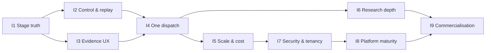

# OODA — executive roadmap

**Status:** plan · **Date:** 2026-11-26 · **Companion to:** [ooda-assessment.md](ooda-assessment.md) (what it is today) · **Owner lane:** #autoclaw-001

**How to read this plan.** The roadmap is derived **entirely from existing open issues** plus the assessment's findings; no new work is invented and no issue is renamed. Issue references are plain `#NNNN` (GitHub links them). Every initiative carries the five required blocks — **benefits, risks eliminated, resources optimized, journey improvements, measurable success** — plus the **artefacts and standards** it must ship to be compliant.

**Three horizons**

| Horizon | Window | Theme | Exit gate (all must hold) |
|---|---|---|---|
| **H1 — Make it true** | 0–6 weeks | A run either does its work or says it didn't; the evidence is visible | Six stages execute on real runs; evaluate runs; a past stage replays end-to-end; the report's provenance is on screen |
| **H2 — Make it one product** | 1–2 quarters | One dispatch seam, one result shape, cost and latency under control | Identical inputs from any door → same run shape and same report; p95 sync start < 800 ms; per-run cost instrumented |
| **H3 — Make it a platform & a business** | 2–4 quarters | Engine maturity, portability, metering, ecosystem | Engine capability set complete for the pinned matrix; research metered; API/MCP tier live; portability proven |

---

## 1. Initiative map

| ID | Initiative | Horizon | Primary issues |
|---|---|---|---|
| **I1** | Stage truth & report integrity | H1 | #6355, #6417, #6354, #6264, #6416, #6369 |
| **I2** | Control, replay & recovery | H1 | #6398, #6399, #6401, #6390, #6332, #6362 |
| **I3** | Evidence-first UX (provenance) | H1–H2 | #6356, #6357, #6378, #6448, #6352 |
| **I4** | One dispatch path (platform-first) | H2 | #6380, #6375, #6347, #6348, #6349, #6350, #6351, #6353, #6361, #6383 |
| **I5** | Scale, latency & unit cost | H2 | #6381, #6327, #6336, #6389, #6447, #6333, #6343, #6344 |
| **I6** | Research depth & configurability | H2 | #6360, #6363, #6364, #6365, #6366, #6373, #6037, #6359 |
| **I7** | Security, tenancy & trust boundary | H2–H3 | #3961, #6379, #6337, #6392 |
| **I8** | Engine platform maturity & portability | H3 | #6324, #6325, #6326, #6358, #6384, #6387, #6397, #6335, #6546, #6554, #6558, #6564, #5277, #5281, #5780, #3956–#3973 |
| **I9** | Commercialisation & ecosystem | H3 | research quota family *(new)*, API/MCP tier, #5757, #6338, #5769 |

---

## 2. H1 — Make it true (0–6 weeks)

### I1 — Stage truth & report integrity

**Scope.** The run must execute its own stages and the report must not contradict itself. #6355 (step params drop `userLogin`, stages record `not_configured` in 0 ms) is the gate for everything else; #6417 (evaluate never runs) closes the learning loop; #6354 (report says "3 expirations" and "0 expiries") and #6264 (PDF WinAnsi crash) are trust-destroying defects; #6416/#6369 make the ledger and the page tell one story.

- **Benefits delivered.** A green run means work was done; the six stages become genuinely observable; the RSI loop gets its first real signal (evaluate).
- **Risks eliminated.** "Successful no-op" runs (the worst possible failure mode for a research product); a deliverable that crashes on ordinary text; two conflicting truths about one run; silent loss of the learning loop.
- **Resources optimized.** One fix (#6355) unblocks every downstream control, provenance and trust feature — the cheapest leverage in the whole programme; removing duplicate reads (#6416/#6369) removes a redundant store path and its cost.
- **Journey improvements.** J1 (trader) sees real stage progress instead of a 0 ms lie; J2 (analyst) can trust the ledger as the single record; J3 (scheduled) gets a report that renders.
- **Success criteria.**
  - KPI: **% of runs with all six stages executed (non-zero, non-`not_configured`) ≥ 99%**; today unmeasured, expected ≈ 0 for generate/deliver paths.
  - KPI: **report self-contradiction incidents = 0** in 30 days; **PDF render success ≥ 99.5%**.
  - Adoption: **evaluate score present on 100% of completed runs** (it is the input to I6's quality loop).
  - Performance: stage-row read p95 **< 300 ms**; page first paint **< 1.0 s**.
- **Artefacts / standards.** Design note in `docs/architecture/design/`; a survey of the 0 ms stage path in `docs/architecture/survey/` if the root cause crosses families; ADR only if the step-param contract changes shape (`docs/architecture/adr/`); code per `docs/architecture/standards/standards.md` (design by contract at the step boundary), tests + pins, changelog fragment, gitops flow.

### I2 — Control, replay & recovery

**Scope.** Make the reproducibility promise true: job-level replay for research (#6398 residency mismatch), eviction re-entry (#6399), stage re-run that never rebuilds defaults (#6401), job-level pause/cancel used by OODA (#6390), the concurrency decision (#6332), and the one reusable stage-control component (#6362 — replay already delivered in #6617).

- **Benefits delivered.** "Press replay" becomes a product capability rather than a button that 404s; runaway analyze turns become stoppable; the same control vocabulary works from page, chat and API.
- **Risks eliminated.** Irreproducible research (a regulatory and reputational exposure); a re-run silently executing a *different* configuration (#6401 — the most dangerous class, "false reproduction"); unrecoverable long runs.
- **Resources optimized.** One replay path reused by page, door and MCP instead of three; one component instead of per-page controls (#6362); eviction re-entry removes manual re-dispatch work and duplicate runs.
- **Journey improvements.** J2 (analyst) can reproduce any past run, whole or per stage, months later; J1 gains pause/cancel on a live run; the operator gains one control surface across families.
- **Success criteria.**
  - KPI: **stage-replay success rate ≥ 99%**, **whole-run replay ≥ 99%** (today ≈ 0 for research per #6398).
  - Adoption: **≥ 20% of weekly active analysts use replay or re-run at least once per week**; **≥ 5% of reports get a replay within 7 days**.
  - Safety: **0 replays executed against a rebuilt/default definition** (pinned by test).
  - Performance: replay **ack p95 < 500 ms** (enqueue), status readable in **< 300 ms**.
- **Artefacts / standards.** ADR for the residency/replay boundary (architecture change); design doc for the reusable stage-control component; ADR for pause/restart vocabulary if decided (#6362); IAAA check on every control route (operator identity required).

### I3 — Evidence-first UX: provenance on the page and in the report

**Scope.** #6356 (every data source + one CSV per stage), #6357 (DataHub can show/download feed+enrich), #6378 (inline stage output), #6448 (standard picker), #6352 (effective rules printed on the report).

- **Benefits delivered.** The differentiator becomes visible: a report that shows its inputs, thresholds, exclusions and version. This is the commercial claim the platform can actually defend.
- **Risks eliminated.** "Black box advice" (adoption blocker for professionals and compliance-adjacent buyers); unsupported data-redistribution claims (provenance records the source per artifact).
- **Resources optimized.** One provenance projection reused by page, report, CSV and API rather than per-surface copies; DataHub reuses the existing dataset readers.
- **Journey improvements.** J1 can answer "why this idea?" without asking an engineer; J2 can hand a client an evidence pack; J3's message can carry the same provenance summary.
- **Success criteria.**
  - Adoption: **provenance expanded on ≥ 30% of report views**; **CSV-per-stage download used by ≥ 10% of active users monthly**.
  - KPI: **100% of ideas carry stage + source + threshold references** (sampled audit, 0 gaps).
  - Performance: provenance payload **< 150 KB**, render **< 200 ms** on expand.
- **Artefacts / standards.** UX design in `docs/architecture/design/` (UX-first, ui/ primitives + tokens only); ADR if the artifact/provenance contract changes; survey of competitor evidence UX in `docs/architecture/survey/`.

---

## 3. H2 — Make it one product (1–2 quarters)

### I4 — One dispatch path (platform-first, one of everything)

**Scope.** #6380 (OODA runs the ONE way), #6375 (who orchestrates the stages), then the seven doors become thin adapters: #6347 (workflow page), #6348 (schedule), #6349 (Copilot), #6350 (autopilot), #6351 (API), #6353 (MCP), #6361 (schedule this definition), #6383 (ExecutionContext).

- **Benefits delivered.** One behaviour, one result shape, one place to fix a bug; every door inherits every future improvement automatically.
- **Risks eliminated.** Divergent defaults per path (the "same request, different report" class); seven-way maintenance debt; orchestration ambiguity that makes every incident take twice as long to diagnose.
- **Resources optimized.** Seven glue implementations collapse to one seam + adapters (a direct engineering-capacity saving); one definition of "who owns the stage runtime" (#6375) removes duplicated wiring.
- **Journey improvements.** A user can start work wherever they are (page, chat, Slack, schedule, API) and get the identical run and report; hand-offs between surfaces stop losing context.
- **Success criteria.**
  - KPI: **dispatch parity ≥ 99%** — identical inputs through any door produce the same stage plan and the same report content hash (pinned test).
  - Adoption: **≥ 3 doors used weekly**; MCP/API usage **≥ 15% of runs**.
  - Reliability: **scheduled run success ≥ 99.5%**, missed firings **= 0** per month.
  - Performance: sync dispatch ack **p95 < 800 ms**; async enqueue **p95 < 300 ms**.
- **Artefacts / standards.** ADR for the canonical dispatch seam; design doc for the multi-agent orchestration map (`docs/architecture/design/`); surveys for any door whose client semantics are unclear; 15-factor config externalisation for every new knob.

### I5 — Scale, latency & unit cost

**Scope.** #6381 (async by default, resumable analyze), #6327 (`ctx.shardKey` partitioning), #6336 (combination-matrix pins), #6389 (per-stage maxParallel carrier), #6447 (budgets as config), #6333/#6343 (all exec vars externalized + UX-manageable), #6344 (one artifact download route).

- **Benefits delivered.** Bigger universes without proportional wall-clock; a run whose cost is bounded and visible; per-stage tuning as configuration, not code.
- **Risks eliminated.** Timeout-driven failures on the richest runs (the highest-value customers hit these first); runaway token spend; silent partial coverage.
- **Resources optimized.** Sharding + per-stage caps reduce wasted provider calls; one download route replaces per-family export code; externalised budgets let ops tune without a deploy.
- **Journey improvements.** J1 gets a run that survives a deploy and streams progress; J3 gets predictable morning delivery; the builder persona gets knobs they can actually set.
- **Success criteria.**
  - Performance: **p95 run duration −40%** at equal universe; **p95 sync start < 800 ms**; async progress event **< 2 s** after stage transition.
  - Cost: **cost per accepted idea −30%** (tokens + data), instrumented per run.
  - Coverage: **partial-coverage runs < 5%**; **combination-matrix refusals = 0 unexplained**.
- **Artefacts / standards.** Survey of current exec-var inventory (#6343); ADR for the costing/provenance carrier; design doc for the config lifecycle (UX/Chat-managed, full lifecycle); performance targets recorded in `docs/architecture/performance/`.

### I6 — Research depth & configurability

**Scope.** #6360 (all selection dimensions: strategies × theses × regimes), #6363 (75-strategy catalog), #6364 (one thesis vocabulary), #6365 (regime selectable), #6366 (Copilot can write config), #6373 (outlook + evaluate criteria externalised), #6037 (rules document), #6359 (tune timeouts/retry buckets from measured data).

- **Benefits delivered.** Research quality becomes an input the user can steer, not a fixed opinion; the catalog replaces hard-coded lists; measured tuning replaces guesswork.
- **Risks eliminated.** "9 hard-coded structures" drift (#6363); a regime that can never be returned (#6365); configuration that exists only in code (unmanageable, unauditable).
- **Resources optimized.** One rules document + one vocabulary, reused by page, chat and analysis; catalog-driven selection removes bespoke mapping code.
- **Journey improvements.** Copilot can do the configuration a user describes ("analyse semis, high-vol, credit spreads"); the OODA page and chat agree on the same vocabulary; the report prints the effective rules.
- **Success criteria.**
  - Adoption: **≥ 40% of active users change at least one research dimension**; Copilot config writes **≥ 20% of runs**.
  - Quality: **evaluation score (evaluate stage) improves ≥ 10%** across two rule versions.
  - KPI: **0 dimensions hard-coded** (census pin); **100% of runs print effective rules**.
- **Artefacts / standards.** Survey of the 75-strategy catalog and thesis vocabularies; ADR for the rules document as the single home; design doc for the config lifecycle (externalized, UX/Chat-managed, versioned).

### I7 — Security, tenancy & trust boundary

**Scope.** #3961 (tenant scoping in the engine), #6379 (run-ledger scoping model across sessions/users/tenants), #6337 (cross-family direct-caller survey), #6392 (stage-completed consumer seam with claims).

- **Benefits delivered.** A provable tenancy story for the engine and the ledger — the precondition for selling to desks and advisors.
- **Risks eliminated.** Cross-tenant reads; operator surfaces leaking other tenants' runs; queue messages that could claim another run's input.
- **Resources optimized.** One scoping model implemented once in the engine rather than per route; one ledger projection instead of per-surface reads.
- **Journey improvements.** A shared account (advisor + client) can see exactly what each is entitled to; audit questions ("who saw this run?") become answerable.
- **Success criteria.**
  - Security: **0 cross-tenant reads** in IAAA negative suites; **100% of control routes** covered by RBAC/TBAC tests.
  - KPI: **ledger scoping model published and pinned**; 100% of run reads carry tenant scope.
  - Performance: scoped read p95 **< 300 ms**.
- **Artefacts / standards.** ADR for the tenancy model (architecture change); security design in `docs/architecture/security/` + `docs/architecture/design/`; RBAC/TBAC matrix tests; IAAA audit events for every control op.

---

## 4. H3 — Make it a platform & a business (2–4 quarters)

### I8 — Engine platform maturity & portability

**Scope.** #6324 (the improvement container), #6325 (partial outcome), #6326 (retry `timed_out`), #6358 (one trace per run), #6384/#6387 (execution context on records/artifacts), #6397 (schedule backfill), #6335 (transactional semantics decision), #6546/#6554/#6558/#6564 (async-job convergence and deadline abort), the #3956–#3973 engine-gap series, and portability #5277/#5281/#5780.

- **Benefits delivered.** The engine becomes a genuine platform product — the thing other domains build on — with a complete capability set and a portability story.
- **Risks eliminated.** Vendor concentration (Cloudflare-only execution); divergence between the async-job executor and the engine (#6554/#5769); unbounded hangs (#6558); unknown transaction semantics under failure.
- **Resources optimized.** One execution substrate for every family (platform-first, one of everything); convergence removes a whole parallel runtime.
- **Journey improvements.** The same run behaves identically on any host; a missed schedule catches up instead of vanishing; a partial result becomes a legitimate outcome instead of a failure.
- **Success criteria.**
  - KPI: **engine capability matrix 100% implemented or explicitly decided-not-to**; **0 duplicate execution substrates**.
  - Ops: **anomaly MTTR < 1 day**; **0 unexplained stuck runs**; trace completeness **≥ 99%** (one trace per run).
  - Portability: **engine runs on a second substrate in CI** (dockerised proof).
- **Artefacts / standards.** ADRs for each capability decision (transactional semantics, convergence, portability); surveys for the evaluation tracks (#5757, #6338, #5769); `docs/architecture/code/` conformance (GoF/SOLID/GRASP/15-factor/AOP/OTEL) reviewed per PR; `docs/architecture/platform/platforms.md` updated for every promoted capability.

### I9 — Commercialisation & ecosystem

**Scope.** Add **research as a metered family** (quota + credits) so heavy runs carry a price; API/MCP tier packaging on the canonical seam (#6351/#6353); the evaluation tracks (#5757, #6338, #5769) as build-vs-adopt evidence.

- **Benefits delivered.** Price moves with cost; a paid surface for the builder persona; an evidence-based answer to "should we swap the engine".
- **Risks eliminated.** Margin erosion from unmetered heavy runs; a free API that cannibalises the paid product; an unreviewed engine migration.
- **Resources optimized.** Metering on the existing commercial spine (no new billing system); API/MCP reuse the one dispatch seam (no new product surface).
- **Journey improvements.** A user can buy exactly what they use; an API customer gets the same report and the same provenance as a UI customer.
- **Success criteria.**
  - Commercial: **100% of research runs metered**; **gross margin per run visible**; **≥ 10% of revenue from API/MCP tier** within two quarters of launch.
  - Adoption: **trial → paid conversion +20%**; **runs per paid seat +25%**.
  - KPI: **cost per run ≤ 25% of price per run**.
- **Artefacts / standards.** Commercial design in `docs/architecture/business/` (plans, quotas, entitlements); ADR for the new quota family; IAAA + payout safety review; changelog + release notes.

---

## 5. Cross-cutting compliance (applies to every initiative)

| Dimension | What it requires of each initiative | Where it lands |
|---|---|---|
| **Standards & practices** | Design by contract at every stage/step boundary; design thinking for journeys; systems thinking for cross-surface effects; documented trade-offs | `docs/architecture/standards/standards.md`, design docs, ADRs |
| **Tech stack (libraries first)** | Prefer an existing library/port over custom code; justify any new dependency; no parallel implementations | `docs/technology/`, ADR for every new dependency |
| **Architecture layers** | Platform-first (capability on the platform, not in a family); agentic-first (agents own decisions, engine owns durability); workflow-first; UX-first; ADD.md boundaries; multi-tenant by construction | `docs/architecture/ADD.md`, `docs/architecture/platform/platforms.md` |
| **Design surfaces** | One component, one service, one API, one MCP tool, one UX surface, one chat path per capability — no second control system | `docs/architecture/design/`, `docs/architecture/UX/` |
| **Security (IAAA, RBAC, TBAC)** | Identify → authenticate → authorize → audit on every op; role- and attribute-based gates; no anonymous control | `docs/architecture/security/`, tests per route |
| **Performance** | Sub-second interactive acknowledgements in **both** modes: sync start p95 < 800 ms, async enqueue p95 < 300 ms, status/read p95 < 300 ms | `docs/architecture/performance/` |
| **Operational excellence** | Every anomaly found becomes a tracked issue **and** a pin; consistency between DO, D1, ledger and page is tested, not assumed | issue + test in the same PR |
| **Platform consolidation** | One of everything: no second replay path, control plane, status view or metering; consolidation is a deliverable, not a cleanup | `platforms.md`, deprecation ledger |
| **Design home** | Multi-agent design, everything externalized, configurable, UX/Chat-manageable with full lifecycle | `docs/architecture/design/` |
| **Change records** | Any architecture change gets an ADR **before** the build | `docs/architecture/adr/` |
| **Research** | Market, vendor, engine and data decisions get a survey, not an opinion | `docs/architecture/survey/` |
| **Code** | gitops.md flow, standards.md (GoF, SOLID, GRASP, 15-factor, AOP, OTEL), full stack (UX, Chat, Service, API, MCP, Data) | `docs/architecture/code/`, PR checklist |

---

## 6. KPI framework (north star + leading indicators)

**North star: reproducible research runs that produce a decision a professional acts on.**

| # | Metric | Definition | Source | Baseline | H1 | H2 | H3 |
|---|---|---|---|---|---|---|---|
| 1 | Stage truth | % runs with six executed stages | run records + stage rows | unmeasured (≈0 on generate/deliver) | ≥ 99% | 100% | 100% |
| 2 | Report integrity | self-contradiction + render-failure incidents / 30d | incident log, pins | > 0 | 0 | 0 | 0 |
| 3 | Replay success | successful / attempted (stage + whole) | run records | ≈ 0 research | ≥ 99% | ≥ 99% | ≥ 99.5% |
| 4 | Evidence engagement | % report views with provenance expanded | UX telemetry | not instrumented | instrument | ≥ 30% | ≥ 40% |
| 5 | Dispatch parity | identical-door runs producing identical report hash | pin + telemetry | n/a | — | ≥ 99% | ≥ 99.9% |
| 6 | Sync latency | run-start ack p95 (sync) | OTel | unmeasured | < 1.2 s | < 800 ms | < 500 ms |
| 7 | Async latency | enqueue p95 / progress event lag p95 | OTel | unmeasured | < 500 ms / < 5 s | < 300 ms / < 2 s | < 200 ms / < 1 s |
| 8 | Read latency | stage/status read p95 | OTel | unmeasured | < 300 ms | < 250 ms | < 200 ms |
| 9 | Run success | completed-with-report / started | run records | unmeasured | ≥ 90% | ≥ 95% | ≥ 98% |
| 10 | Cost per accepted idea | (tokens + data) / accepted ideas | metering | not instrumented | instrument | −30% | −45% |
| 11 | Adoption | WAU / MAU, runs per active user / week | telemetry | not instrumented | instrument | +20% runs/user | +25% |
| 12 | Metering | % runs carrying a price signal | commercial | 0 research | — | design | 100% |
| 13 | Tenancy safety | cross-tenant reads in negative suites | security tests | 0 known | pins | pins + audit | continuous |
| 14 | Ops MTTR | anomaly open → pinned fix, median | issue log | unmeasured | < 3 d | < 2 d | < 1 d |
| 15 | Duplicate mechanisms | count of second implementations found | census + review | unknown | baseline | −50% | 0 new |

Targets above H1 are **commitments to instrument first** — the honest position today is that most of these are not measured, which is itself an H1 deliverable.

---

## 7. Sequencing, dependencies and decision gates

- **H1 gate:** #6355 + #6417 closed with pins; replay (#6398/#6399/#6401) proven; provenance visible. If the gate is not met, H2 does not start — the rest would be built on a lie.
- **H2 gate:** dispatch parity pinned across at least three doors; latency targets measured in production; cost instrumented.
- **H3 gate:** capability matrix complete or decided-not-to; metering live; a second substrate proven in CI.

**Decisions the owner must make before H2/H3** (from the assessment): canonical dispatch path; reproducibility as the marketed claim; research metering; options-first focus; per-stage pause/restart vocabulary (#6362).

---

## 8. Resourcing shape (not headcount)

| Horizon | Work shape | Constraint to respect |
|---|---|---|
| H1 | Small, sequential, mostly one lane; every change is a defect fix with a pin | Do not start UI work on top of stages that do not run |
| H2 | Two parallel tracks (dispatch consolidation; scale/cost) with a shared pins budget | Each door converts only after the canonical seam is pinned |
| H3 | Platform track + commercial track, each with its own ADR/survey trail | No engine swap without the evaluation evidence (#5757/#6338/#5769) |

**Operating rules.** One issue → one PR (gitops §5); every anomaly becomes an issue and a pin in the same PR; every architecture change gets an ADR; every market/vendor decision gets a survey; every capability is externalized, UX/Chat-manageable, and registered in `platforms.md`; no second mechanism is ever introduced to avoid an existing one.

---

## 9. Traceability appendix

| Issue | Initiative | Issue | Initiative |
|---|---|---|---|
| #6355 | I1 | #6347–#6353 | I4 |
| #6417 | I1 | #6361 | I4 |
| #6354 | I1 | #6383 | I4 |
| #6264 | I1 | #6381 | I5 |
| #6416 / #6369 | I1 | #6327 | I5 |
| #6398 | I2 | #6336 | I5 |
| #6399 | I2 | #6389 | I5 |
| #6401 | I2 | #6447 | I5 |
| #6390 | I2 | #6333 / #6343 | I5 |
| #6332 | I2 | #6344 | I5 |
| #6362 | I2 | #6360 | I6 |
| #6356 | I3 | #6363 / #6364 / #6365 | I6 |
| #6357 | I3 | #6366 | I6 |
| #6378 | I3 | #6373 | I6 |
| #6448 | I3 | #6037 / #6359 | I6 |
| #6352 | I3 | #3961 | I7 |
| #6379 | I7 | #6379 | I7 |
| #6337 / #6392 | I7 | #6324–#6335 | I8 |
| #6358 / #6384 / #6387 | I8 | #6397 | I8 |
| #6546 / #6554 / #6558 / #6564 | I8 | #5277 / #5281 / #5780 | I8 |
| #3956–#3973 | I8 | #5757 / #6338 / #5769 | I9 |
