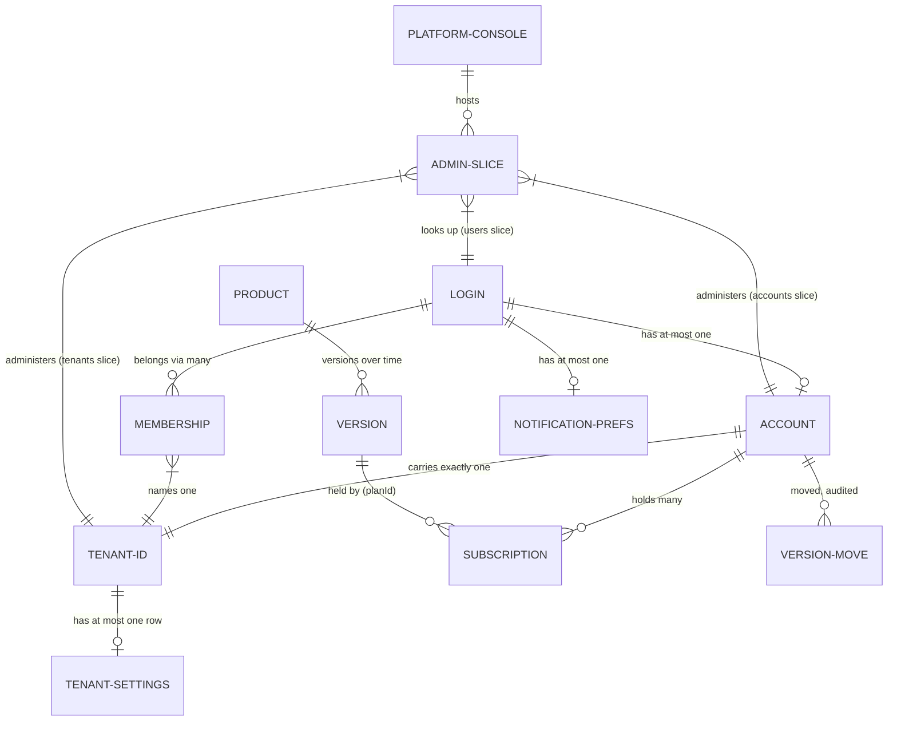
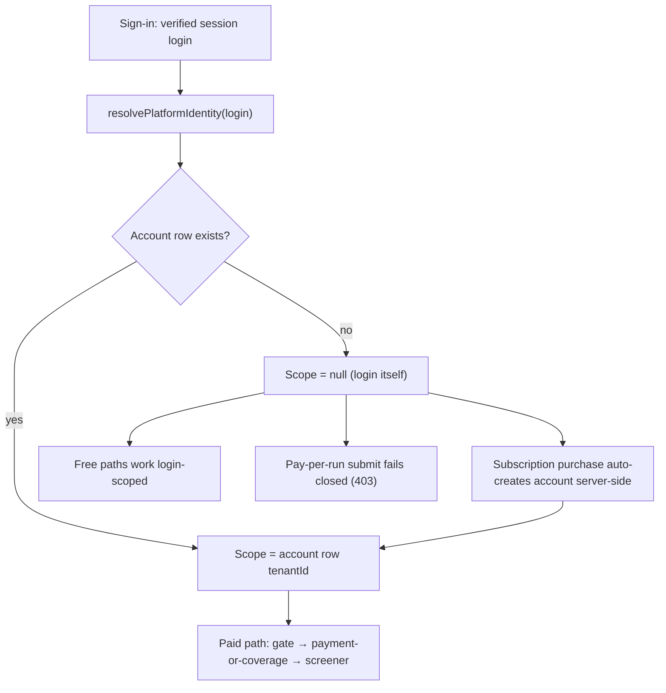
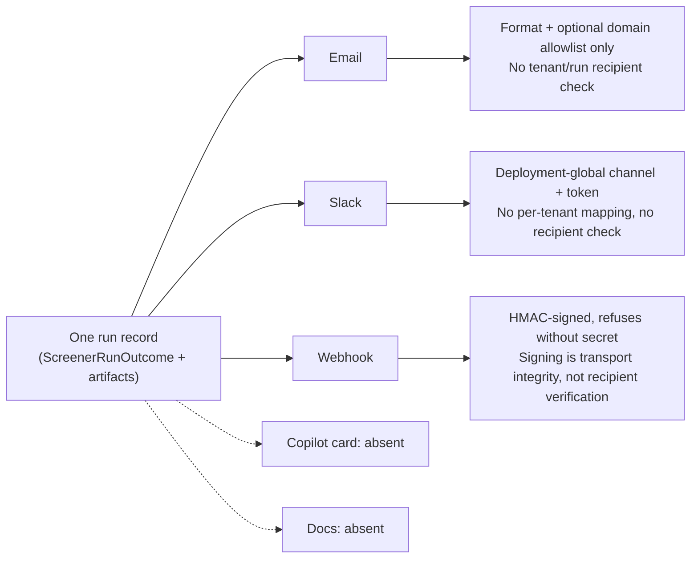

# Platform entity + capability map: tenant, platform, account, user

**Status:** surveyed against `origin/main` at `dc1de9d0` (2026-11-04). This page
describes what the code does today, not what any program intends. Where a
requirement and the current state differ, both are stated and the gap is named.

**Scope note — read this first.** The platform has no tenant table and no user
table. "Tenant" is a referenced id, not a row. "User" is a verified login
string, not a record. "Platform" is a console plus a scope string, not an
entity. Everything below follows from those three facts. The companion
product-capability map is `platform-capabilities.md` (research, discovery,
reporting, engines); this page maps the *platform-management* axis instead:
which entity owns, scopes, or performs each capability.

**Related issues:** program OpenAIMP/cfagent#2218 (platform management);
this doc OpenAIMP/cfagent#3168; channel-configuration UI shipped under
OpenAIMP/cfagent#3169 (PR #3196, merged 2026-11-04 — see §5.4);
multi-dimensional isolation matrix OpenAIMP/cfagent#2856 (CFO lane, open,
track not started — the target in §5, not current state).

## 1. The entities and how they relate

- **User (login).** The identity layer. A verified login string from the
  session (`x-user-login`, set by `src/server.ts`; 401 without a session).
  There is no user table. A login optionally has a wired alias: an
  `internalUserId` mapped via the session-store KV. Unwired logins still get
  identity and account views; their memberships read `"unmapped"`.
- **Account (commercial account row).** The billing layer. One row per login,
  keyed by login (`agent_commercial_accounts`: `id = userId`, `tenantId`
  NOT NULL, `tier`, `tierSource`, `creditsUSD`, `includedRuns`). Cardinality:
  login → account = 1 : 0..1; account → tenant = exactly one `tenantId`.
  A login cannot hold two commercial accounts and therefore cannot have two
  account tenants. A missing row is not an error — it resolves to implicit
  Free.
- **Tenant.** A referenced id, not a row. A tenant exists wherever its id is
  referenced: account rows carrying that `tenantId`, tenant-settings rows,
  IAAA memberships. Tenant enumeration is derived: distinct `tenantId`s
  across account rows UNION settings rows (`TenantDirectory`). A tenant
  with accounts but no settings row still lists; a settings-only tenant
  still lists. There is **no tenant lifecycle state** — no status column
  anywhere. Tenant → accounts = 1 : many; tenant → settings = 1 : 0..1.
- **Membership (IAAA).** The authorization layer, and the second tenant
  authority. One login CAN belong to multiple tenants via memberships
  (`Membership`: `internalUserId`, `tenantId`, optional `workspaceId`,
  `roleBindings[]`, `revokedAtMs`). Store: sessions-namespace KV.
  Membership mutation (grant/revoke/edit, role-grants) is CISO-lane owned,
  gated by the obligation channel with audit-before-allow and a hard
  NO-SELF-GRANT rule. Tenant Admin displays memberships read-only and
  never writes IAAA state.
- **Platform.** Not an entity with rows. "Platform" appears in exactly two
  senses: (1) the app console — the `platform-admin` tab /
  `PlatformAdminPage` hosting the admin slices; (2) the scope string
  `"platform"` in IAAA role bindings. A platform-admin membership is
  tenant-independent by design.
- **Product.** The commercial identity layer (#3289). A product is a
  row (`agent_products`: `id`, `name`, `kind` subscription |
  per_run, `description`); a version is a plan row (subscription
  products) or a catalogue row (per-run products) carrying
  `productId`, `segment`, `version`, `effectiveFromMs` /
  `effectiveToMs`. Products are global operator data (no tenant
  column). A subscription holds exactly one version (`planId`);
  a new version moves no holder by itself — movement is an
  explicit per-customer or bulk move, audited in
  `agent_version_moves` (+ `agent_bulk_moves` summaries).
  Segments are free-form operator labels on the account row
  (`segment`, default `default`); resolution is per segment.
  The Free baseline (`prod-free`) is a read-only product row
  with no versions. Product → versions = 1 : many; version →
  subscriptions = 1 : many (holders grandfathered on the held
  version until moved).
- **Adjacent rows.** Subscriptions (`agent_subscriptions`: many per user,
  each carrying its own denormalized `tenantId`); subscription plans and
  the price catalogue (global operator data, no tenant column — since
  #3289 these rows ARE product versions, see Product above); notification
  preferences (1 : 0..1 per login, plus denormalized `tenantId`); store
  operators (login list); audit policy (global) vs audit chain
  (tenant-scoped hashes).

The structural tension to hold in mind for the rest of this page: a login
has **one** account tenant but **many** membership tenants. There is no
defined "current tenant" for a multi-membership login — the payment path
uses the account tenant, the IAAA panel shows all membership tenants.
That is inconsistency 1 in §7, and it shapes every dimension below.

## 2. Sign-in → scope resolution

A user does not sign in *to* a tenant. Sign-in verifies the login; the
tenant is resolved afterwards, server-side. No tenant picker, no typed
tenant id, no anonymous tenant, and no client-supplied `tenantId` is ever
read for scoping on the paid routes.

- Login + account row → that row's tenant is the scope for paid operations.
- Login + no account row → scope is the verified login itself. Free paths
  still work login-scoped; pay-per-run submit fails closed until an
  account exists.
- Buying a subscription auto-creates the account server-side from verified
  identity — the one path that creates an account without an operator
  step, besides self-service account setup (`POST /platform/accounts/setup`,
  idempotent, Free tier, `created:false` on replay, never gates free runs).
- Free-path tenant is the login string itself (`tenantId = login`).
  Login-as-tenant and real tenant ids share one namespace with no marker
  distinguishing them (§7.10).

## 3. Capability / sub-capability map

Capabilities are grouped by owning entity. "Gate" is who may use the
capability, not who owns the data.

| Entity | Capability | Sub-capabilities (surface) | Gate |
|---|---|---|---|
| Platform (console) | Admin console | 13 sections: ads, background-tasks, scheduled-goals, jobs, provenance, api-keys, tenants, channels, data-providers, accounts, iaaa-admin, users, admin-access (`PlatformAdminPage`, `platformAdminConfig`, `nav-config.json`) | Section-dependent (see rows below) |
| Tenant | Tenant administration | List tenants (derived ids + settings + memberCount); create tenant (settings row with defaults, idempotent); detail (settings + account-row members); patch settings: ads, auto-refresh, providers | Store operator (env `COMMERCIAL_STORE_OPERATORS` UNION store list; empty = deny) |
| Tenant | Tenant settings | Ads flag (tenant ANDed with account tier for ads serving); auto-refresh (enabled, interval); providers (dataProviderId, brokerId) | Store operator |
| Tenant | Membership view (read-only) | Memberships filtered by tenant, displayed in Tenant Admin | Store operator (view); mutation is CISO lane |
| Account | Account self-service | View own account (identity + subscriptions + catalogue bindings with approval status; payment references stripped); setup (idempotent auto-create derivation) | Verified login (own account only; body/userId ignored) |
| Account | Account lookup | Lookup by login | Store operator |
| Account | Account mutation | Tier/credits upsert; credit grant (`POST /payments/agentic/commercial/account[/credits]`) | Store operator. Account Admin slice adds no new mutation endpoint |
| Account | Price catalogue | Operator price writes land as PROPOSED; separate approve step (approver + timestamp recorded); gate reads `getApprovedPrice` fail closed on unapproved prices | Operator writes; owner price approval is a separate owner decision |
| Account | Subscription plans | Plan create/deactivate (plans are data, never code; no hardcoded prices) | Operator |
| Account | Billing policy | Downgrade timing, channel fixed prices; billing price ≠ operator-mapped price → 402, no activation | Operator |
| User (login) | User lookup | Self view (any verified login); lookup by login (identity + IAAA memberships, or `"unmapped"`) | Self: any login. Lookup: IAAA platform-admin membership — NOT the operator list (§7.2) |
| User (login) | Notification preferences | Digest/welcome toggles per login; per-user-per-day digest guard; trading receipts + security mail non-suppressible | Self-service (own preferences) |
| User (login) | Lifecycle | Welcome on provisioning (membership email captured at grant); opt-in digest (skip-on-empty); self-service deactivation (own id, session registry, caller never supplies session ids) | System triggers; self for deactivation |
| Membership | Role grants | Grant/revoke platform-admin and tenant-admin; tenant-admin grants require `role:assign` in that tenant; platform-admin grants platform-admin; platform-admin is NOT a tenant superuser | CISO-lane surfaces; obligation channel + no-self-grant |
| Membership | Admin offboarding | Offboard another principal (or self via admin path); 200 with full report even when verification fails (caller checks `verified`) | Platform-admin or tenant-granting admin |
| Run / schedule | Runs | Manual paid runs (gate → payment-or-coverage → screener); scheduled runs (one-off via authorized-at-submission checkout; recurring via subscription/credits only; uncovered → skip/audit/explain, never charged unattended) | Submitter login; tick runs under the owner's login |
| Run / schedule | Premium x402 calls | Session login OR x402 payer fallback (`x-user-login || payerScopeId(receipt.payer)`); tier from the login's account; metered through the usage port; Subscribed users still pay per call | Session or payer identity |
| Delivery | Delivery channels | Email, Slack, webhook (see §5.3 for verification status); Copilot card and Docs are NOT delivery channels on main | Per-run/per-schedule selection; tenant-level channel enablement shipped (#3169, PR #3196); recipient verification still missing (see §5.1) |

## 4. The four dimensions, answered per entity

### 4.1 Data fetched — for whom is it scoped?

| Read surface | Scope key | Notes |
|---|---|---|
| Platform identity (`GET /payments/agentic/commercial/identity`) | Login → account tenant or null | `resolvePlatformIdentity`: stored account tenant, else null |
| Account self / lookup | Verified login (own account); lookup target login | Lookup is store-operator-gated; payment references stripped |
| Tenant list / detail | Operator-administered, all tenants | Path id is the administration target, never caller scope; unknown tenant → 404 |
| User me / lookup | Login (self = session login; lookup = target login) | Lookup gated by IAAA platform-admin membership, not the operator list |
| Receipts (`GET /payments/receipts`) | Session login only — NOT tenant | Caller's own meter rows, tier-decision audits, joined gateway rows; never the unscoped list, never another identity's rows |
| Metering / usage reads | Login ("tenant identity (user login)" in code) | `usage_events` rows carry `userLogin`, `runId` — no `tenantId` column; split across two DO databases; no production reader |
| Ads tier checks | Account tier of the viewer AND tenant ads flag | Only exact `Subscribed` suppresses; server config ANDed with `getTenantAdsEnabled(tenantId)` |
| Canonical reports / run results | Owner login at write | Every `mas_reports` row belongs to exactly one user; write without an owner is refused; generation dedupe index is tenant-scoped `(user_login, generation_id)`. Read-by-id owner check NOT verified (§8) |
| Schedules list (`GET /schedules`) | Agent-instance scope | Route adds no owner filter; scoping lives in per-login agent instances (`screener:<login>`); creation strips identity keys from the body and re-stamps from trusted context |

Short version: **reads are login-scoped almost everywhere, tenant-scoped
only where a tenant row or tenant-scoped read exists (tenant admin,
native ledger, journal), and platform-wide only for admin surfaces.**
"Tenant-scoped" in metering code means login-scoped in fact.

### 4.2 Transactions performed — whose rows are they?

| Row type | Owner entity | Carries `tenantId`? |
|---|---|---|
| `mas_transactions` charge/refund (DO ledger of record) | Session (`session_id`) + `customer` string | **No.** No tenant column; tenant/family attribution only via an audit-payload join. Action `"charge"`/`"credit"`, never `"micropayment"` |
| Native ledger rows (D1) | Tenant + user + run | **Yes.** `tenantId`, `family`, `runRequestId`, `userId`, `gateway`, `gatewayRef`, `action`, `status`. Tenant-scoped reads only, no list-all |
| Failure-credit claims / redemptions | Login + failed run | **No tenantId on the claim row.** Tenant scoping via the owning login only. Port shape carries family/amount; D1 table does not (§7.5) |
| Subscription rows | Login + tenant (denormalized) | **Yes** |
| Referral credit rows | Login (ledger) + referrer link (attribution) | Ledger login-keyed; attribution adds which referrer a user came from |
| Journal entries | Tenant + run + family | **Yes.** Port throws on a multi-tenant set before writing; posting idempotent (charge → `runRequestId`, failure credit → `runRequestId:credit`) |
| Paid-submission records | Login | Login-keyed, no tenant column; this is the check-payment ownership proof |
| Refund records | Tenant + requester/subject | **Yes.** Requester login, or `sub.userId` for subscription kind |

**Payer identity on a checkout:** the verified login. Email is a checkout
contact, never identity proof. The submit route ignores client `tenantId`
in every path; paid path with no account → 403; subscription checkout
auto-creates the account server-side when missing and audits
`commercial.subscription.checkout_created` with `userId + tenantId`.

**Tenant-mismatch enforcement, three layers (do not conflate):**
1. Client-supplied mismatch is impossible on paid routes — the client
   value is ignored entirely; resolved identity wins.
2. Seam-level throw (`resolvePaidScreenAccount`): a caller passing a
   `tenantId` ≠ stored account tenant throws "Tenant mismatch". This
   guards seam callers (stock/goal routes, scheduled ticks), not client
   input.
3. Refund cross-tenant refusal (`executeRefund`): resolved source tenant
   ≠ refund record tenant → refused before any gateway call. Refund
   request refuses when source user ≠ requester and caller is not an
   operator.
4. Check-payment ownership: another login's submission → 403. Ownership
   is per-login, and since tenant derives from login, this is cross-tenant
   refusal too. Residual: with no record (pre-record legacy runs) the
   route follows the legacy verify path; strict unknown→404 is a known
   follow-up, not yet flipped.

### 4.3 Configurations performed — who owns each surface?

| Config surface | Entity | Who may change it |
|---|---|---|
| Tenant settings (ads, auto-refresh, providers) | Tenant (`agent_tenant_settings`, tenantId PK) | Store operator only. Create = settings row with defaults, idempotent. Legacy ads-only route also exists |
| Catalogue bindings + approval | Global catalogue (one row per family), surfaced per account | Operator writes (land as PROPOSED); separate operator approve step; owner price approval is a separate decision |
| Account tier / credits | Account (login row) | Store operator only |
| User notification preferences | Login (userId PK + denormalized tenantId) | Self-service for own preferences; trading receipts + security mail non-suppressible |
| Subscription plans | Global operator data | Operator. Deactivation stops new purchases without touching existing subscriptions |
| Billing policy | Global (one row per key) | Operator |
| Operator list | Login list (env var UNION store list) | Env var = deployer; store list = whoever holds the operator-write route (§8) |
| Feature flags (`monetization`, etc.) | Platform-wide; no per-tenant flags found | Flagship dashboard when `FLAGS` bound, else Env adapter. Flagship `monetization` defaults ON (owner direction); Env adapter defaults it OFF unless explicitly enabled (§7.17) |
| IAAA role grants | Membership (login × tenant × role × scope) | Platform-admin grants platform-admin; tenant-admin grants require `role:assign` in that tenant. CISO lane owns IAAA writes |
| Q7 audit policy (blocking set, retention, mode) | Global | Operator data; activation gated on CISO+CDO sign-off — mechanism built, enforcement not activated |
| Delivery channels | Tenant-level enablement flags (operator-gated, no secrets in v1) | Shipped under #3169 (PR #3196, migration 0039). Per-schedule/per-run channel fields and per-user notification preferences remain adjacent config; recipient verification still missing (see §5.1) |

### 4.4 Activities performed — who acts, who is the subject?

| Activity | Actor | Subject |
|---|---|---|
| Manual screener run (paid) | Verified login (submitter) | Own account/run: `userId` = login, `tenantId` from identity, `runRequestId` = workflow instance id |
| Scheduled run + ticks | Schedule owner login (tick runs under its owner's explicit login) | Owner's account/run — BUT tick tenant = env default tenant, NOT the owner's account tenant (§7.8). Creation guard: recurring requires subscription/credits |
| Checkout / purchase | Verified login (buyer) | Own account; tenant = `identity.tenantId ?? login`; purchase auto-creates account when missing |
| Subscription cancel | Subscriber self-service, or store operator on a user's behalf (non-self + non-operator → 403) | Target user's subscriptions. Cancel-at-period-end by default; `immediate` only via operator billing policy. Cancel is never blocked by the monetization flag |
| Refund request / approval / execution | Request: owner login or operator. Approval: operator HITL only (policy approver `operator_hitl`, seeded window 30d, full-only). Execution: operator-approved + flag-gated + XOR-guarded | Refund record's tenant + subject user. Cross-tenant source → refused pre-gateway. #2549 XOR: a run with an automatic failure credit cannot also be cash-refunded |
| Lifecycle emails (welcome / digest) | System (grant trigger / digest pass) | User: welcome on provisioning (membership email); digest per-user-per-day guard, opt-in, skip-on-empty |
| Self-service deactivation | User (own id) | Self: offboard + verify over the session registry; caller never supplies session ids |
| Admin offboarding | Platform-admin or tenant-granting admin | Another principal (or self via admin path); 200 with full report even when verification fails |
| Tenant create | Store operator | New tenant id (settings row with defaults, idempotent). No self-service tenant creation |
| Account setup | Verified login (self-service) | Own account: tenant = resolved tenant ?? login, Free tier, idempotent, audited |
| Premium x402 calls | Session login OR x402 payer fallback | Payer-scoped call; tier from the login's account; metered through the usage port |

## 5. The #2856 multi-dimensional matrix: requirement vs current state

Issue #2856 (CFO lane, open) is the isolation matrix for the whole
product: multi-tenant, multi-user, multi-channel, multi-provider,
multi-broker, multi-dimensional. **Its own sequencing note says the work
is NOT started** — it verifies and closes the matrix after G1–G4 land,
only when the user orders that track. It does not re-implement G1–G4.
Its acceptance is measured: a tenant-isolation audit with cross-tenant
test cases (two tenants, different providers/brokers, in flight at once,
via UI, API, schedule, and delivery channel) all passing. **Nothing in
this section claims the matrix is done.** Two columns throughout:
requirement vs current state.

| #2856 dimension | Requirement | Current state on main | Verdict |
|---|---|---|---|
| Tenant | `tenantId` server-resolved only, never client-supplied; every query, capture, artifact, delivery scoped to it | Paid routes, account setup, subscription purchase: server-resolved, client value ignored. Scheduled ticks: env default tenant, not owner tenant. Captures: tenantId stamped. Reports: owner login, no tenantId column. R2 bodies: report-id only | Partial — money path complies; ticks, artifacts, DO ledger do not |
| User | Owner-scoped reads only, within their tenant; `userLogin + tenantId + runId` = run identity everywhere | Enforced: receipts (login), check-payment (login ownership 403), schedules (per-login instances + body re-stamp), `mas_reports` write (owner required). Not enforced/verified: report read-by-id owner check; membership listing is admin-scoped by design. Run identity holds on paid path + native ledger + journal; breaks on `mas_transactions` (no tenantId), `usage_events` (no tenantId), scheduled ticks (env tenant) | Partial (see §5.2) |
| Provider | Per-tenant selection; per-tenant credentials/tokens, never shared; provenance stamps the serving provider | Selection: yes (`agent_tenant_settings.dataProviderId`). Credentials per tenant: NOT FOUND — no provider credential store found. Provenance: partial — `mas_data_captures` stamp `providerId` + digests; canonical report rows stamp only producer `source`, not the serving data provider | Partial |
| Broker | Per-tenant selection; per-tenant credentials/tokens, never shared; surfaces/paths gated per tenant (G2/G3) | Selection: yes (`brokerId`). Credentials per tenant: NOT FOUND as per-tenant — E*TRADE tokens are per-login (cache key `ENV:login`, no tenant in key); other brokers' credentials are env-level as far as verified. G2/G3 gating: not verified | Partial-to-no |
| Channel | Every channel verifies recipient ∈ tenant+run, renders from the same run record; no cross-tenant delivery, no channel bypassing the run record | Same-run-record rendering: yes for the followup path. Recipient ∈ tenant+run verification: NOT FOUND at any channel layer. Copilot card + Docs as delivery channels: NOT FOUND in `src` | Partial (see §5.1) |
| Data | `mas_data_captures` + `mas_reports` tenant+user scoped; R2 keys namespaced tenant+user+run; no shared cache key, no shared in-memory store | Captures: yes, tenant+user+run+provider stamped (`userLogin` nullable). Reports: owner login required, tenant-scoped generation index — but no `tenantId` column. R2 keys: NO (`reports/<reportId>.json`, no tenant/user prefix). Shared cache: FOUND violating the letter — E*TRADE token cache is a module-level Map keyed `ENV:login` (user, no tenant). A second D1 table `agent_data_captures` coexists with DO `mas_data_captures`; their relationship is unverified | Partial, with two concrete gaps |
| Schedule / workflow / queue | Contexts propagate `tenantId + userLogin`; tenant-A run never executes with tenant-B selections/tokens/recipients; AOP #2848 tenant aspect, #2849 context propagation | `userLogin` propagates (payloads re-stamp login; ticks run as owner login; paid seam stamps `tenantId` into the screener command). `tenantId` propagation: BROKEN at the tick boundary (env tenant). Selections ARE read per tenant at execution — but the tick's tenant is the env tenant, so a tick can read the WRONG tenant's selections when they differ. AOP #2848/#2849: NOT FOUND — zero references in `src` or `docs` | Partial, with the tick-tenant break as the headline gap; AOP aspects not started |
| Audit / provenance | Every run, delivery, denial, fallback carries tenant+user+provider+broker+channel provenance, traceable from the record alone (AOP #1969 acceptance test) | Provenance exists per-surface, not uniformly: commercial audits carry `userId+tenantId`; captures carry tenant+user+run+provider; Q7 chain carries tenant+action+hash; delivery outcomes are per-channel reported + activity-logged when a store is supplied. Denials are typed (402/403) but do not uniformly carry the full tuple; fallbacks are recorded outcomes on the report row, not a unified provenance record | Partial — ingredients exist; the uniform tuple does not |
| Flagship flags | Flagship is the flag system of record; Env adapter local/test only, never a production bypass around Flagship OFF | NOT enforced in code. Flag selection is by binding presence, not environment (`FLAGS` bound → Flagship, else Env adapter) — on any runtime without the binding, Env IS the production path. The #2856 closure (Env local/test only) needs a code change, not a config note | Not implemented as a code guarantee |

### 5.1 Depth: multi-channel — which channels verify, which do not

Channels that exist as delivery paths on main: **Slack, email, webhook**.
**Voice is explicitly NOT a push channel** (NLQ conversational path only,
by design). **Copilot card and Docs: no delivery code found** — they
cannot be assessed as verifying or not; they are absent, not compliant.

**Same-run-record rendering — holds on the followup path.** The
followup delivery port sends content + transport for one channel,
sharing the single report artifact the report sub-job secured; all
channels render from that same outcome/artifact, and generation
idempotency means re-delivery and multi-channel sends never duplicate
the row. This is the closest thing on main to #2856's "renders from the
same run record" — but it is a property of the followup job path, not a
check enforced on every send.

**Recipient ∈ tenant+run verification — not found on any channel:**
- **Email:** format regex + optional `EMAIL_TO_ALLOWED_DOMAINS`
  allowlist (and a warning when the allowlist is unset: recipients are
  format-validated only). No check that the address belongs to the run's
  tenant or owner. Worse, the address itself is caller-supplied at
  schedule creation: `emailTo` flows from schedule options into the tick
  event and into delivery channel selection. A schedule created with
  someone else's address would deliver to that address after only a
  format/domain check — the tenant/run binding of the recipient is a
  schedule-creation property, not a delivery-time verification.
- **Slack:** channel resolved from delivery options or deployment env
  (`SLACK_CHANNEL_ID` / `SCREENER_SLACK_CHANNEL` / `SLACK_CHANNEL`),
  token from env — deployment-global config, no per-tenant channel
  mapping, no recipient check. Any tenant's report delivered via Slack
  goes to the deployment's channel.
- **Webhook:** HMAC-SHA256 signed, refuses to send with no signing
  secret configured. Signing is a transport-integrity property, not a
  recipient-tenant verification; the webhook URL's tenant binding was
  not isolated (§8).
- **Delivery claims:** a dedupe/claim store exists; claim scoping
  (per tenant+run?) was not isolated (§8).

Channel verdict for the record: **rendering-from-one-record:
implemented on the followup path; recipient verification: not
implemented at any channel layer; Slack is deployment-global; email is
format/domain only; Copilot card and Docs are not delivery channels on
main at all (their flags are configuration-only until a dispatch funnel
exists).** Tenant-level channel enablement SHIPPED under #3169 (PR
#3196, merged 2026-11-04 as baa674c, migration 0039, enforcement on
the main funnels); it does not by itself add recipient verification —
that remains missing (follow-ups #3177 direct Slack publishers, #3178
Copilot/Docs funnels).

### 5.2 Depth: multi-user — owner-scoped reads within tenant

**Where owner-scoping is enforced:** receipts (session login only, never
another identity's rows); check-payment (per-login ownership via paid
submission records, 403 otherwise); paid submission (everything derives
from the verified login; client identity values ignored); `mas_reports`
writes (owner login required, write refused without one; generation
dedupe tenant-scoped); schedules (per-login agent instances +
creation-time identity re-stamp); membership listing (platform-admin
sees all; tenant-granting callers see only their own tenant);
watchlists (owner column `user_login`).

**Where a user can read beyond their own rows, or scoping is absent:**
- **Report reads by id:** the write side is owner-pinned, but no owner
  check on report read paths was found in this survey — a bearer of a
  report id may or may not be checked against `user_login`. This is the
  largest multi-user read gap to verify before claiming owner-scoped
  reads.
- **Platform-admin sees everything by design** (all memberships, all
  tenants via operator surfaces) — role-scoped, not owner-scoped, and
  correct for the role; the doc states the role boundary rather than
  presenting it as a leak.
- **Tenant-admins cannot use user lookup at all** (platform-admin-only
  gate) — the reverse gap: a tenant-scoped admin cannot read their own
  tenant's users through this surface.
- **Premium x402 calls:** identity falls back to the on-chain payer
  when no session login exists — a payer wallet can read/act without a
  login identity, and tier is resolved from whatever login that maps to.
- **Legacy/unrecorded check-payment path:** when no paid-submission
  record exists, the route follows the legacy verify path with no owner
  to check against (known follow-up, strict 404 not yet flipped).

**Membership's role in multi-user isolation, stated plainly:**
membership is the *authorization* layer (which tenants a login belongs
to, with which roles/scopes, including revocation), while the
commercial account is the *billing* layer (one tenant per login) and the
session login is the *identity* layer. Reads are scoped by login
(identity) and, where implemented, by account tenant (billing) — **almost
never by membership tenant**. The code rarely asks "is this login a
member of tenant X for this read?" — it asks "is this the login that
owns this row?" Membership tenant checks appear at admin boundaries
(listing filter, grant gates), not on data reads. **Today, multi-user
isolation = owner-scoping by login + role gates at admin surfaces, not
membership-tenant-scoped data reads.**

### 5.3 Run identity (`userLogin + tenantId + runId`) — where it holds and breaks

**Holds end-to-end:** paid submission (login + resolved tenant +
`runRequestId` stamped into the workflow instance id and the screener
command) → native ledger row (tenantId + userId + runRequestId + family)
→ journal entries (tenantId + runRequestId + family, single-tenant sets
enforced) → failure-credit claim (`creditRunId` = failed run id, userId)
→ refund record (tenantId + userId + original payment ref) →
`mas_data_captures` (tenantId + userLogin + runId + providerId) →
`mas_reports` generation dedupe (user_login + generation_id, where
generation = runId for scheduled producers).

**Breaks:** (1) `mas_transactions` — no tenantId; run linkage only via
`gateway_ref`/audit-payload join. (2) `usage_events` — no tenantId;
login + runId only; non-saga runs are not metered here at all.
(3) Scheduled ticks — tenantId is the env default, so the tuple's tenant
leg can disagree with the account tenant and fail closed (or, where a
path does not re-check, misattribute). (4) Captures allow
`userLogin: null` — the user leg can be absent. (5) Report rows — no
tenantId column; tenant is implied by owner login's account, not
stamped. (6) R2 artifacts — keyed by report id only; the tuple is
recoverable only via the row that points at the key. (7) Premium
payer-fallback — the user leg can be a wallet-derived id instead of a
login. (8) `mas_events` payloads — the tuple is present only if the
emitting caller included it; the schema does not require it.

### 5.4 Channel configuration UI (the gap this doc's companion slice closed)

A Channels sub-tab now configures delivery channels at tenant level
(shipped 2026-11-04, see below). Tenant settings cover ads,
auto-refresh, providers; per-schedule fields and per-user notification
preferences are adjacent surfaces, not channel administration. Issue
#3169 (sub-issue of #2218) built the tenant-level Channels sub-tab in
Platform Admin (PR #3196, merged 2026-11-04 as baa674c): enablement
flags for email, Slack, webhook, Copilot card, Docs; operator-gated; D1
store behind a port (migration 0039); no secrets in v1; delivery
dispatch on the main funnels consults the config (disabled → refused;
no fake toggles). Recipient verification is still missing (see §5.1;
follow-ups #3177, #3178). This section of the map now describes a
capability, not an absence.

## 6. Other dimensions that must be documented and considered

- **Audit.** `mas_events` (DO): hash-chained, session-scoped as a column;
  tenant/user/provider/broker/channel appear only if the caller puts
  them in the JSON payload (not schema-enforced). Single insert owner:
  `OrchestratorAgent.recordAudit`. Q7 chain (`agent_audit_chain`) is
  tenant-scoped but covers only Q7 policy actions. Audit gaps: user
  admin reads emit NO audit events (documented rule); tenant admin audit
  is best-effort annotation only, with no funnel supplying it today
  (a follow-up, not a control); account setup DOES emit
  `platform.account.created`; commercial writes emit `commercial.*`
  events.
- **Quotas / limits — per what?** x402 endpoint prices/rate hints live
  in #2405's body (OPTIONS $0.05 60/min, MARKET_RESEARCH $0.10 30/min,
  STOCK_SIGNALS $0.02 120/min) — rate-limit scope (per-payer,
  per-endpoint, global) was not verified in code. DO rows-read quota
  and the 5-cron-trigger ceiling are deployment/account limits, not
  per-tenant code. E*TRADE token cache: module-level Map, eviction
  cap, keyed `ENV:login` — per-login, no tenant in the key.
- **Data isolation guarantees.** Strongest where the port enforces it:
  journal (multi-tenant set throws), native ledger (tenant-scoped reads
  only, no list-all), `mas_reports` write (owner required, tenant-scoped
  generation index), `mas_data_captures` (tenant+run+provider indexes).
  Weakest: `mas_transactions` (no tenant column), `usage_events`
  (login only, split across two DOs, no production reader), R2 keys
  (report-id only).
- **Observability.** Per-run: `mas_events` by session; per-login:
  `usage_events` by `userLogin`; per-tenant: only where the caller
  stamps tenant into payloads or uses the Q7 chain / tenant-scoped
  reads. No single per-tenant observability view exists.
- **Roles / permissions.** Roles: `platform-admin`, `tenant-admin`,
  `workspace-admin`, `member`, `approver`, `auditor`. Scopes:
  `"platform"` vs `"tenant"` (vs workspace). Platform-admin is
  tenant-independent; tenant-admin is tenant-bound; neither is a
  superuser of the other.
- **Lifecycle states.** Tenant: none (existence only). Account: `tier` +
  `tierSource` (operator grant survives lapse; subscription confers
  nothing once expired — effective tier resolved at read time) +
  subscription `status` (`active` | `canceled`). User: membership
  `revokedAtMs` (revoked = history; the policy decision point denies on
  next fresh read; session termination is offboarding, not revocation);
  session expiry; wired vs unwired alias.
- **Dimensions a future revision should add:** data residency (no
  residency dimension exists in code today); retention / deletion
  (per-tenant purge is not evidenced); cost attribution (spend is
  login/tier-shaped, not tenant-shaped, in the ledger of record);
  cross-tenant incident response (traceable only where the provenance
  tuple was stamped — see §5.3 breaks).

## 7. Inconsistencies found (stated, not smoothed over)

1. **Three tenant authorities.** Commercial account tenant (one per
   login) vs IAAA memberships (many per login) vs env default tenant
   (`IAAA_TENANT_ID` or `IAAA_DEFAULT_TENANT_ID`). No defined "current
   tenant" for a multi-membership login.
2. **Two admin gates.** Tenant/account admin = store-operator list; user
   admin lookup = IAAA platform-admin membership. A platform-admin who
   is not a store operator can look up users but cannot administer
   tenants/accounts, and vice versa.
3. **Tenant-admins are locked out of user lookup**
   (platform-admin-only gate), even though tenant-admins can grant
   tenant roles.
4. **`mas_transactions` carries no tenantId** — the financial audit
   record cannot be tenant-filtered without an audit-payload join.
5. **Credit-claim shape drift.** Port record has family + amountUSD;
   D1 table has neither (has `executedAtMs`, `entitlementConsequence`).
6. **`usage_events` "tenant-scoped" = login-scoped**, split across two
   DO databases, no production reader.
7. **Receipts are login-scoped, not tenant-scoped** — a user with
   memberships in two tenants sees one login's receipts, not a tenant's.
8. **Scheduled ticks resolve tenant from env, paid coverage from the
   account.** If they differ, the paid seam throws tenant-mismatch on
   the tick — a scheduled run can fail closed purely because the
   deployment's default tenant ≠ the owner's account tenant.
9. **Premium identity fallback:** no session login → x402 payer
   identity stands in as the user. A wallet, not a login, becomes the
   subject.
10. **Free-path tenant = the login string itself.** Login-as-tenant and
    real tenant ids share one namespace with no marker distinguishing
    them.
11. **Tenant create writes only a settings row.** There is no tenant
    entity creation beyond that; "create" is a settings write with
    defaults.
12. **E*TRADE-shaped defaults are silent:** absent settings row →
    etrade/etrade; absent auto-refresh → OFF/15s. A tenant that never
    selected a provider silently gets E*TRADE behavior.
13. **Refund request accepts a client tenantId as fallback** when the
    source carries none. Every other money path ignores client
    tenantId; this one does not.
14. **R2 report-body keys are not tenant-namespaced**
    (`reports/<reportId>.json`).
15. **Slack delivery channel is deployment-global** (env channel id);
    email validation is format + optional domain allowlist only —
    neither verifies tenant/run membership at the channel layer.
16. **Flag selection is by binding presence, not environment** (FLAGS
    bound → Flagship, else Env adapter). The Env adapter is therefore
    reachable in any runtime without the binding — not code-enforced
    to local/test only.
17. **Monetization defaults point opposite ways:** Flagship adapter
    defaults monetization ON; Env adapter defaults it OFF unless
    explicitly enabled. #2856's "divergence" is real but directional.

## 8. Not verified — do not cite these as established

1. x402 premium rate-limit scope (per-payer vs per-endpoint vs global).
2. Report read-by-id owner checks (the key multi-user gap).
3. Queue payload tenant propagation (`submitShardJob`, async-job
   context) — `userLogin` verified, `tenantId` fields not isolated.
4. Per-tenant provider/broker credentials — selection verified, no
   credential store found; env-global vs per-login vs per-tenant
   unverified beyond E*TRADE's per-login cache.
5. Broker surfaces G2/G3 gating (#2856's term) — no gate code isolated.
6. Webhook recipient URL binding — signing + no-secret refusal
   verified; per-tenant/per-schedule URL and run check not isolated.
7. Delivery-claim scoping (`deliveryClaimsStore.ts`) — existence
   noted, tenant+run scoping not isolated.
8. `agent_data_captures` (D1) vs `mas_data_captures` (DO) — both
   tables exist; which layer is authoritative is unverified.
9. Credit-claim D1 adapter mapping — whether family/amountUSD survive
   into the D1 table or are dropped is unverified.
10. Store-operator write route — the operator list is read (env UNION
    store); which route adds/removes store operators, and its gate,
    was not isolated.
11. Notification-preference write route — table verified; route/guard
    for user preference writes not isolated.
12. Digest/welcome trigger call sites — schema + membership-email
    field verified; grant→welcome and digest-pass wiring not traced
    end to end.
13. AOP #1969 acceptance test for audit provenance — referenced by
    #2856; not verified.
14. Schedules-list owner filtering inside the Agent base class — the
    route passes only a type filter; binding-level scoping rests on
    the per-login instance model, verified only via instance naming.
15. HTTP status mapping of the seam-level tenant-mismatch throw — the
    throw is verified; per-caller status mapping was not pinned for
    every caller.

## 9. Bottom line

The entity model is: **login (identity) → at most one commercial
account (billing, one tenant) → many IAAA memberships (authorization,
many tenants)**, with **tenant as a referenced id, not a row**, and
**platform as a console + a scope string, not an entity**. The money
path is the most tenant-disciplined surface (server-resolved tenant,
client values ignored, mismatch throws, journal single-tenant
enforcement); the reporting, metering, delivery, and scheduling
surfaces are login-scoped or env-scoped with tenant as an optional
stamp, not a gate. Against #2856's matrix, the honest status is:
**tenant selection and capture provenance largely implemented;
per-tenant credentials, R2 namespacing, channel recipient verification,
tick-tenant propagation, uniform audit provenance, AOP aspects, and the
Flagship-only guarantee not implemented** — and #2856 itself says its
track is not started and only verifies after G1–G4 land on the user's
order, so this page presents the matrix as the target with the gaps
above as the open list, not as current state.
