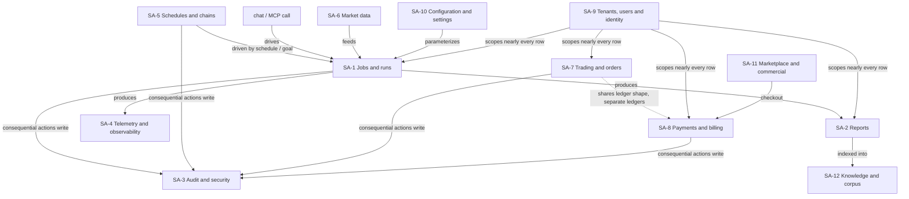
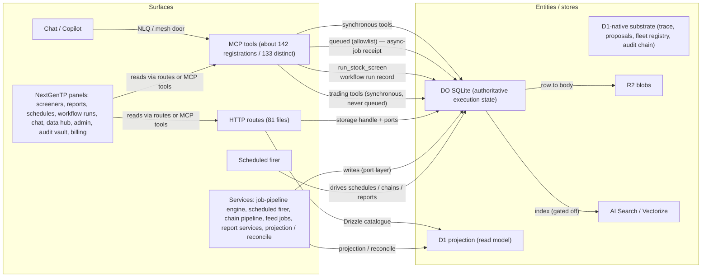
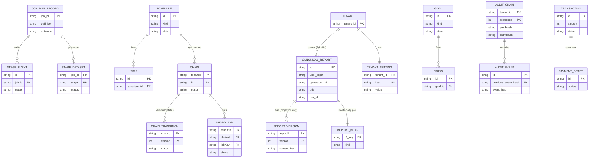

# System data model — conceptual, logical, physical and subject-area views

- **Status:** Draft (2026-11-17). Not yet reviewed; counts are measured on fresh `main` of that date (tarball, no git metadata in the survey tree — base commit hash UNVERIFIED).
- **Scope:** the whole Qunsultant/cfagent system (NextGenTP, live at `https://agent.openaimp.com/`): its stores, its catalogues, and how the data model relates to Durable Objects, agents, HTTP APIs, MCP, services, products, and security.
- **How to read it:** §1 is the conceptual view (subject areas, no tables). §2 is the logical view (entities, keys, cardinality, authoritative-vs-projection and tenancy marking). §3 is the physical view (the actual stores and catalogue counts). §4 is the subject-area view (one section per area: entities, store home, owner, readers/writers, integrity rules). §5 is the gap table — every gap found, with evidence and the issue it maps to (or the existing issue that already tracks it). Each view carries its diagram inline (Mermaid, rendered by GitHub): subject-area relationships in §1.2, surfaces-to-entities in §1.3, the core ER in §2.2, the physical topology in §3.3. §6 is the agentic-capabilities data substrate (per-capability verdicts, the substrate map, and the area-specific gaps), with its diagrams in §6.4: agents to service/API/MCP/entities, and capability to data-substrate. Every node and edge in the diagrams traces to a fact stated in the surrounding text; nothing is drawn from a name alone.
- **Sources (the model has no other home):** ADR 0020 (DO/D1/R2 topology), ADR 0022 (data foundation, esp. D-C transaction aspect, D-G authoritative reads, D-F substrate families), ADR 0028 (data-provider/broker taxonomy), ADR 0029 (unified schedule store), ADR 0032 (data-access mechanism standard), ADR 0033 (cross-store consistency contract, incl. the frozen Appendix A audit of 2026-11-16), the schema-component catalogues in `src/data/schemaComponent/`, `src/data/drizzleSchema.ts`, `src/data/migrationRunner.ts`, `wrangler.jsonc`, and the pin/census tests in `tests/`. The full survey evidence (including the 181-row per-table map) lives in the drafting workspace and is summarized here; anything this doc could not verify from the tree is marked **UNVERIFIED**.
- **Conventions:** "DO" = Durable Object SQLite (authoritative execution state, ADR 0022 D-G). "D1" = the `AGENT_DB` database (projection / read model, plus the D1-native substrate families of ADR 0022 D-F). "Catalogue" = the fail-closed statement registries in `src/data/schemaComponent/` (unknown code, duplicate code, or kind/plane/table mismatch is rejected at registration, never at execution). Counts below were recounted from the definitions on 2026-11-17; where a header comment disagrees with the recount, the recount wins and the disagreement is listed in §5.

## 1. Conceptual view

### 1.1 Subject areas

| # | Subject area | Purpose in one sentence | Key entities (conceptual, no tables) |
|---|---|---|---|
| SA-1 | Jobs and runs | Everything the system executes, and the record that it executed. | Job, job definition, job instance, job run record, async job, stage event, workflow run, shard job |
| SA-2 | Reports | The durable, replayable output of screens and research. | Canonical report, report version, report confirmation (HITL), report asset (PDF/blob), semantic index entry |
| SA-3 | Audit and security | The evidence that what happened can be proven afterwards. | Audit event (hash-chained), audit chain, audit policy, IAAA audit log, chain prune, tenant/admin audit funnel |
| SA-4 | Telemetry and observability | Measured outcomes of runs and of the platform itself. | Thesis realization, resource usage, resource rollup, trace hop, mesh proposal, evaluation result |
| SA-5 | Schedules and chains | Work that happens on a cadence, and the chains it synthesizes. | Unified schedule, goal, chain, synthesized schedule, schedule approval, tick, pause state |
| SA-6 | Market data | The data screens and research run over. | Feed dataset, feed snapshot, index list, quote source, IV history, enrichment run, discovery run/alert |
| SA-7 | Trading and orders | Orders, positions, and the ledger that proves them. | Trade draft/order, bracket ladder, position, order preview, execution outcome |
| SA-8 | Payments and billing | Money in, money out, and the proofs. | Transaction (ledger row), payment draft, native ledger row, subscription, top-up, refund, bundle/purchase |
| SA-9 | Tenants, users and identity | Who may act, under which tenant, with which credential. | Tenant, user profile, session, token, binding, membership, delegation, channel |
| SA-10 | Configuration and settings | The knobs the system reads before it acts. | Setting, screener preset, strategy profile/weights, provider config, breaker state |
| SA-11 | Marketplace and commercial | The storefront: products, referrals, ads, entitlements. | Product, bundle, referral code/attribution, ad, entitlement, quota, price catalogue |
| SA-12 | Knowledge and corpus | The indexed memory the research surface searches. | Corpus document, vector memory, AI Search document, research evaluation, learning |

### 1.2 Relationships between subject areas

- A **run** (SA-1) produces **reports** (SA-2) and **telemetry** (SA-4), and is driven by a **schedule/goal** (SA-5) or a chat/MCP call.
- A **report** (SA-2) is confirmed by a human through SA-2's confirmation entity, is indexed into SA-12, and its blob lives in R2 while its row lives in DO SQLite.
- Every consequential action in SA-1/SA-5/SA-7/SA-8 writes **audit events** (SA-3); the audit chain is the only store whose integrity rule is cryptographic (hash chain), not referential.
- **Trading** (SA-7) and **payments** (SA-8) share the transaction ledger shape but are separate ledgers: trades are broker orders recorded in the ORM ledger; payments are gateway charges recorded in the native ledger and in the ORM transaction table.
- **Market data** (SA-6) feeds SA-1 runs; **configuration** (SA-10) parameterizes them; **tenancy** (SA-9) scopes nearly every row in SA-1–SA-8, by construction on the DO side (per-login instance) and by `tenant_id` column on the D1 side.
- **Schedules** (SA-5) synthesize **chains** whose transitions project into D1; **chains** are the only subject area whose DO source of truth is a KV key (`synthesizedSchedules` in the ScheduledAgent), not a SQL table.

### 1.3 Relationship to the seven dimensions

| Dimension | Subject areas it touches | How it touches the data model |
|---|---|---|
| 1. DOs | All | Every subject area has a home DO (see §3.1). The DO's SQLite is authoritative for execution state; D1 is the projection. The SessionStore DO is the only DO whose data is KV-shaped (`kv_store`), not table-shaped. |
| 2. Agents | SA-1, SA-2, SA-5, SA-6, SA-7, SA-8 | Each agent owns the stores of its subject area on its own DO (OrchestratorAgent: reports/jobs/audit; ScreenerAgent: screens; ResearchAgent: research; ScheduledAgent: schedules/chains; TradingAgent: trades; PaymentsAgent: payments; ReportAssetAgent: assets). Three agents (Browser, AiSearch, Sandbox) have no durable store; TickerAgent writes the ticker-push record on its own DO — see §5 H-13. |
| 3. APIs (HTTP routes) | All | 81 route files under `src/agents/routes/`; every read/write goes through a route handler that receives a storage handle (`ctx.storage.sql` / `getStorageSql()`) and builds ports from it. The exceptions are the direct-SQL route sites listed in §3.5. |
| 4. MCP | SA-1, SA-2, SA-6, SA-7, SA-8 | ~142 tool registrations / 133 distinct tool names. Queueing is an allowlist (`SYNCHRONOUS_MCP_TOOLS`): anything not listed gets an async-job receipt instead of a result. Trading tools are synchronous by design; `run_stock_screen` gets a workflow run record; `run_options_strategy_screen` does not (§5). |
| 5. Services | SA-1, SA-2, SA-4, SA-5, SA-6 | The job-pipeline engine, scheduled tasks/firer, chain pipeline, feed jobs, report services, and projection/reconcile services are the writers of SA-1/SA-2/SA-5; they all write through the port layer except the sites in §3.5. |
| 6. Products (NextGenTP) | SA-2, SA-5, SA-6, SA-7, SA-8, SA-9 | Screeners, options hub, reports, schedules/goals, workflow runs/catalog, chat/Copilot, data hub, platform admin, audit vault, billing — every panel reads through the HTTP routes (§1.3 row 3) or the MCP tools in chat; no client code touches storage directly (verified by survey). |
| 7. Security | SA-3, SA-9, and the tenancy marking on every area | Audit chain (hash-chained `mas_events` + IAAA audit log), IAAA identity/binding, PDP-gated routes (5 sites), per-login DO isolation (authorization by construction), tenant-scoped D1 reads, session/token hashing. See §2.4 and §4 SA-3/SA-9. |

## 2. Logical view

Conventions: **A** = authoritative store (DO SQLite, unless marked D1-native). **P** = projection (D1 read model). **T** = tenant-scoped (key named). **N** = natural key / idempotency key. Cardinality is stated only where the code or an ADR states it; otherwise the relationship is named without a ratio.

### 2.1 Core entities

| Entity | Key / natural key | Attributes (logical) | Store | Tenancy |
|---|---|---|---|---|
| Canonical report | `id` (PK); unique `(user_login, generation_id)`; **N** `(tenantId, reportId, version)` on the projection | title, source, summary, body (or R2 body key), run id, generation id, owner, fanout outcome, created/updated | **A** DO `mas_reports` (OrchestratorAgent); **P** D1 `agent_reports` | **T** `user_login` (DO); `tenant_id` + nullable `user_login` (D1) |
| Report version | `(reportId, version)` | content hash/pointer, projected-at | **P** D1 `agent_reports` (versioned rows) | **T** `tenant_id` |
| Report confirmation (HITL) | `id` | payload, verdict, actor, decided-at | **A** DO `mas_report_confirmations` | **T** by instance (per-login DO) |
| Report asset | `id` / R2 key (`screener:*` → `stocks/*`, `options/*`) | kind, bytes pointer, owner, created-at | **A** R2 `REPORTS_BUCKET`; metadata **UNVERIFIED** (ReportAssetAgent is KV-only — see §5) | **T** per-login agent instance |
| Async job | `jobId`; **N** `jobId` + `updatedAt` stale guard | status, stage, result/error, created/updated, owner | **A** DO `mas_async_jobs`; **P** D1 `agent_async_jobs` | **T** `tenant_id` (D1); instance (DO) |
| Job run record | `job_id` (alone — no tenant key; see §5) | definition, instance, stage events, outcome, started/finished | **A** DO + **P** D1 `job_run_records` (dual-homed) | **N** none — tenant-blind |
| Job pipeline definition / instance / artifact | `job_id` (alone) | stages, inputs, artifacts, status | **A** DO + **P** D1 (dual-homed) | **N** none — tenant-blind |
| Stage dataset (feed / enriched / analyzed / generated / delivery) | `(job_id, stage)` | dataset rows, stage status | **A** DO + **P** D1 `job_*_datasets` (dual-homed) | **T** D1 side carries `tenant_id` (per drizzle); DO side by instance |
| Audit event (DO chain) | `id`; chain link `previous_event_hash` → `event_hash` | session, type, agent, payload, created-at | **A** DO `mas_events` (hash-chained; SHA-256 over canonical row) | **N** none — session-scoped only; tenancy by instance construction |
| Audit event (D1 projection) | **N** `<tenantId>:<eventId>` | kind, subject, payload, projected-at | **P** D1 `agent_chain_audit` | **T** `tenant_id` |
| Audit chain (D1) | `(tenant_id, sequence)`; `prevHash` → `entryHash` | entry, policy, pruned-at | **A** D1 `agent_audit_chain` (D1-native substrate) | **T** `tenant_id` |
| IAAA audit log entry | **N** `seq` (1-based chain position, dense) | actor, action, payload, chained hash | **A** SessionStore DO `iaaa_audit_events` (append-only table, one row per event; flag-OFF legacy segments in `kv_store` under `iaaa-audit:` keys retained), cap 22,000 events | **T** by bucket key discipline, not by column |
| Chain / synthesized schedule | **N** `(tenantId, id)` + status | schedule, status history (versioned), owner | **A** ScheduledAgent KV key `synthesizedSchedules`; **P** D1 `agent_chains` + `agent_synthesized_schedules` | **T** `tenant_id` (D1); DO side by KV key, owner not carried on the record |
| Shard job | **N** `(tenantId, chainId, jobKey)` + status | leg outcomes, workflow run id, status | **A** DO (screener collation); **P** D1 `agent_shard_jobs` | **T** `tenant_id` |
| Thesis realization (telemetry) | **N** `(tenantId, outcomeId)` | outcome, evaluation, realized-at | **P** D1 `agent_thesis_realizations` | **T** `tenant_id` |
| Resource usage / rollup | `(tenant_id, day)` | rows read/written, DO requests, alert state | **P** D1 `resource_sql_ops` / `resource_daily_rollups` (+ a duplicative DO-side rollup — see §5) | **T** `tenant_id` (nullable on `resource_sql_ops`) |
| Trace record / mesh hop / proposal | `id` / `run_id` | principal/actor (free text), payload, hops | **A** D1 `agent_trace_records`, `agent_mesh_trace_hops`, `agent_proposals` (D1-native substrate, ADR 0022 D-F) | **N** none — `principal` only, no `tenant_id` (see §5) |
| Transaction (ledger row) | `id` | action, amount, currency, gateway, gateway ref, status, customer, authorizer | **A** DO `mas_transactions` (ORM ledger) | **T** `tenant_id` (nullable legacy rows never invented) |
| Native ledger row | `id` | tx hash, amount, proof, status | **A** D1 `agent_native_ledger_rows` | **T** `tenant_id` |
| Payment draft | `pay_xxx` id | amount, gateway, checkout url, status (`draft` → `completed`/`rejected`) | **A** DO `mas_transactions` (same table as the ledger) | **T** `tenant_id` |
| Trade (broker order draft) | `id` | broker, symbol, side, qty, price source, mode, status | **A** DO `mas_trades` (ORM) | **T** by instance (per-login DO) |
| Unified schedule / goal | `id` | kind, cadence, payload, owner, state | **A** DO `unified_schedules` (SQL) **and** ScheduledAgent KV `"goals"` array (dual store — see §5) | **T** by instance; KV side by key |
| Screener preset / strategy profile | `id` | definition, owner, version | **A** DO `mas_screener_presets` / `mas_strategy_profiles` | **T** by instance |
| Setting | `(owner, key)` | value, scope | **A** DO `mas_settings` | **T** by instance |
| Tenant | `tenant_id` (PK) | settings, channels, projection carriers, read mode | **P** D1 `agent_tenant_settings` / `agent_tenant_channels` / `agent_tenant_projection_carriers` | **T** itself |
| User profile / session / token | `id` / session id / key hash | login, provider subject, binding, expiry, hash (never plaintext) | **A** SessionStore DO `kv_store` (`sessions`, `service_tokens`, `api_keys` buckets) | **T** by key discipline |
| Product / bundle / referral / ad | `id` | price, entitlement, attribution, quota | **A** D1 `agent_products`, `agent_product_bundles`, `agent_referral_*`, `agent_ads` (+ DO `mas_ads`, `mas_referrals` mirrors) | **T** `tenant_id` (D1); DO mirrors by instance |
| Corpus document | `report:`-prefixed id | text, embedding pointer, source | **A** AI Search namespace `screener-search`; vectors in Vectorize `vector-memory` | **T** **UNVERIFIED** (indexing gated off by default) |

### 2.2 Relationships and cardinality

- Report 1:N report versions (projection only; the DO holds the current row, D1 holds the version history).
- Job 1:N stage events; job 1:N stage datasets (one per stage); chain 1:N transitions (versioned status rows); schedule 1:N ticks; goal 1:N firings.
- Tenant 1:N almost everything on the D1 side (by `tenant_id`); tenant 1:1 settings/channels/carriers rows (PK `tenant_id`).
- Audit event N:1 chain (each event links to exactly one predecessor; the chain is append-only, genesis boundary skips pre-chain rows).
- Transaction 1:1 payment draft (same row, status transition); transaction 1:N gateway attempts is **UNVERIFIED** (no attempt table was found).
- Report 1:1 R2 blob (row↔body pair, R2 put precedes the row insert per the #2347 contract; a row never claims a body it does not have).
- Schedule 1:N synthesized chains; chain 1:N shard jobs.

### 2.3 Authoritative vs projection (ADR 0033 R-3, R-5)

- The DO is authoritative for execution state; D1 is the projection/read model — except the D1-native substrate families (trace, proposal ledger, fleet registry, audit chain), which are D1-authoritative and are not projections.
- A read that must reflect a just-completed write reads the authoritative store — unless the write path's projection carrier is synchronous, in which case the projection has landed before the write returns.
- The runs + reports surfaces read D1 only (#6103): there is no
  per-tenant mode and no mode rides the response. Job outcomes are
  served from the facts folded onto D1 `job_run_records`, not from a
  projection of the DO list; stage transitions are not projected.
- Lag classes (ADR 0033 R-2): synchronous (ORM carrier, awaited `projectAfterTransition`, shard-job projection at run completion), asynchronous (queue carrier, retry then DLQ), operator (sweep/reconcile, unbounded lag until invoked). A projection that has not landed is missing, not evidence the row does not exist.

### 2.4 Tenancy marking (summary)

- DO side: tenancy is constructional — a per-login Orchestrator instance physically cannot read another login's `mas_*` rows (ADR 0022 D-0 (f)). The exception is the SessionStore DO, which holds all buckets in one instance (`idFromName("kv")`); isolation there is by key discipline, not construction.
- D1 side: tenancy is by `tenant_id` column (NOT NULL on the large majority of ~104 D1 tables). Gaps: the D1-native substrate families (`agent_trace_records`, `agent_proposals`, `agent_proposal_transitions`, `agent_work_item_events`) and the job-pipeline families (`job_pipeline_*`, `job_run_records`) carry no `tenant_id`; `mas_events` carries no tenant column at all (see §5).
- The deployment default tenant is not one value: `"primary"` (IAAA, `src/security/iaaaGithubEndToEnd.ts:100`), `"default"` (captures, `src/agents/routes/dataProviders.ts:465`), and a hardcoded `workspaceId: "primary"` (canonical seed, `src/agents/orchestrator/canonicalReportSeed.ts:76`) — see §5.

## 3. Physical view

Measured on fresh `main` 2026-11-17. Catalogue totals (recounted from definitions): DO DDL 103 entries / 66 tables; D1 DDL+seed 222 entries / 101 tables; ORM/index DDL 26 entries / 16 tables; remainder DDL 57 entries / 20 tables; D1 DML 64 runtime entries / 19 tables; DO DML 81 entries / 15 named tables + `__table__`. **553 catalogue entries total; 181 distinct table names in the union.**

### 3.1 Durable Object SQLite — one database per DO instance

14 DO bindings (`wrangler.jsonc:125-170`; migrations v1–v15; `new_sqlite_classes` through v13). Instance addressing: per-login `OrchestratorAgent` (`idFromName(userLogin)`); shared singletons `"default"` (ScreenerAgent/ScheduledAgent pipeline doors), `"ticker"`, `"aisearch"`, `"kv"` (SessionStore); per-login `ReportAssetAgent`.

| DO (binding / class) | Tables it owns (SQLite) | Notes |
|---|---|---|
| OrchestratorAgent (`ORCHESTRATOR_AGENT`) | `mas_messages`, `mas_events`, `mas_memory`, `mas_async_jobs`, `mas_referrals`, `mas_ads`, `mas_reports`, `mas_report_confirmations`, `mas_screener_presets`, `mas_policy_verdicts`, `mas_settings`, `mas_transactions`, `mas_trades`, `mas_watchlists`, `mas_options_chain_cache`, `mas_categories`, `mas_external_ads`, `webhook_replay_nonces`, `mas_promotions`, plus autopilot/stock-copilot activity tables | The shared host for the `mas_*` families; `DatabaseORM(this.ctx.storage.sql)`; D1 run-ledger projection source |
| ScreenerAgent (`SCREENER_AGENT`) | ORM tables (own instance), `ScreenerTaskLedger`, provider configs, owner key | Durable task record per run |
| ResearchAgent (`RESEARCH_AGENT`) | Research store/config/task ledger; latest report in KV | Report PDFs via R2 |
| ScheduledAgent (`SCHEDULED_AGENT`) | `unified_schedules` (SQL) + KV `"goals"` / `"tickHistory"` (cap 50) / `"jobRunRecords"` (capped) | Dual store — see §5 |
| TradingAgent (`TRADING_AGENT`) | ORM tables (own instance) | Tools built with `{ orm, storage }` |
| PaymentsAgent (`PAYMENTS_AGENT`) | KV `payments` array (no SQL table) | Header calls it a "SECOND payment ledger" — see §5 |
| ReportAssetAgent (`REPORT_ASSET_AGENT`) | KV-only (`ctx.storage` put/get/list) | No SQL, no D1 projection — see §5 |
| SessionStore (`SESSION_STORE`) | Two tables: `kv_store` (all buckets: sessions, service tokens, API keys, payments claims, slack links, IAAA bindings) + `iaaa_audit_events` (append-only audit log, one row per event; #3251 O1) | Plain `DurableObject`, not an Agent; performs no authorization |
| SlackAgent (`SLACK_AGENT`) | ORM tables (own instance) | |
| OptionsScannerMCP (`OPTIONS_SCANNER_MCP`) | Own storage via ORM (header notes it "never ran" its own storage through the ORM — see §5) | `McpAgent`, not `PortThink` |
| TickerAgent | Own DO `unified_schedules` (SQL) — the ticker-push record | Writes through `tickerScheduleStore()` / `recordTickerPush` (best-effort, #4237); §SA-5 |
| BrowserAgent / AiSearchAgent / SandboxAgent | No verified durable store | Verified stateless for data purposes (no SQL/storage reads in the first two; container service only in the third) — §5 H-13 |

### 3.2 D1 (`AGENT_DB`, database `agentdb`) — projection + D1-native substrate

- 67 migrations (`MIGRATION_0001`–`MIGRATION_0067`, `src/data/migrationRunner.ts`; runner-owned `_migrations` table, deliberately not catalogued; marker-last, idempotent, no multi-statement transaction — D1 `db.transaction()` is non-atomic, pinned by `tests/d1_transaction_pin_4937.test.ts`).
- 101 tables in `d1Catalogue.ts`; 84 `sqliteTable` definitions in `drizzleSchema.ts` (19 catalogue tables have no Drizzle object — see §5).
- Families: `agent_*` commercial/billing/marketplace (~60 tables), `agent_async_jobs` / `agent_reports` / `agent_chains` / `agent_synthesized_schedules` / `agent_shard_jobs` / `agent_chain_audit` (run-ledger projections), `agent_audit_chain` (D1 chain), `agent_trace_records` / `agent_proposals` / `agent_work_item_events` / `agent_fleet_registry` (D1-native substrate), `agent_tenant_*` (tenancy), `job_pipeline_*` / `job_run_records` / `job_*_datasets` (dual-homed with DO), `resource_*` (telemetry rollups), `agent_thesis_realizations` (telemetry).
- D1 access: Drizzle via the D1 DML catalogue (64 runtime entries) + `d1*Adapter.ts` (55 files). Retry policy `withD1Retry` (max 3 attempts, 100/200ms backoff, allowlist classification; #4930; 24 direct-builder-call files / 30 inserts NOT yet wired — tracked #5011).

### 3.3 KV, R2, Vectorize, AI Search, Analytics Engine

- **KV:** no `kv_namespaces` binding in `wrangler.jsonc`. KV is DO-SQLite via `src/data/durableKv.ts` (JSON protocol over `stub.fetch` to the SessionStore DO; `namespaceName` = logical bucket: `sessions`, `etrade`, `public`, `payments`, `slack_principal_links`, `api_keys`, `service_tokens`; legacy Workers KV fallback still in code but unbound — see §5).
- **R2:** one bucket, `REPORTS_BUCKET` → `screener` (`wrangler.jsonc:58`). Report PDF/blob bodies; DO storage keeps metadata pointers only. Row↔body pair governed by the #2347 contract (R2 put precedes the row insert).
- **Vectorize:** one index, `VECTOR_MEMORY` → `vector-memory` (`wrangler.jsonc:278-283`).
- **AI Search:** namespace `AI_SEARCH` → `default`, instance `"screener-search"` (`wrangler.jsonc:186-188`); report indexing gated by `AI_SEARCH_REPORT_INDEXING_ENABLED` (default OFF). The MCP endpoint is deliberately unconfigured (`AI_SEARCH_MCP_ENDPOINT` unset, owner decision).
- **Analytics Engine:** `OBSERVABILITY` dataset `observability` (`wrangler.jsonc:61-64`); unbound degrades to local logging.

```mermaid
flowchart TD
    subgraph DO["Durable Object SQLite — one database per DO instance (14 bindings)"]
        ORCH["OrchestratorAgent — mas_* families: mas_reports, mas_events, mas_async_jobs, mas_transactions, mas_trades"]
        SCR["ScreenerAgent — task ledger, provider configs"]
        RES["ResearchAgent — research store, task ledger"]
        SCH["ScheduledAgent — unified_schedules (SQL) + KV goals / tickHistory"]
        TRD["TradingAgent — ORM tables (own instance)"]
        PAY["PaymentsAgent — KV payments array (no SQL)"]
        RAA["ReportAssetAgent — KV-only"]
        SES["SessionStore — single table kv_store (all buckets)"]
        SLK["SlackAgent — ORM tables (own instance)"]
        OSC["OptionsScannerMCP — own storage via ORM"]
    end
    subgraph D1["D1 (AGENT_DB) — projection + D1-native substrate (101 tables)"]
        PROJ["Run-ledger projections: agent_async_jobs, agent_reports, agent_chains, agent_synthesized_schedules, agent_shard_jobs, agent_chain_audit"]
        DUAL["Dual-homed: job_pipeline_*, job_run_records, job_*_datasets"]
        NAT["D1-native substrate: agent_audit_chain, agent_trace_records, agent_proposals, agent_work_item_events, agent_fleet_registry"]
        COMM["Commercial / billing / marketplace: agent_products, agent_bundles, agent_referral_*, agent_ads (about 60 tables)"]
        TEN["Tenancy: agent_tenant_settings, agent_tenant_channels, agent_tenant_projection_carriers"]
        TEL["Telemetry: agent_thesis_realizations, resource_sql_ops, resource_daily_rollups"]
    end
    subgraph EXT["Object / search stores"]
        R2["R2 REPORTS_BUCKET — report PDF / blob bodies"]
        VEC["Vectorize vector-memory"]
        AIS["AI Search screener-search — report index (gated off by default)"]
        KV["KV via durableKv — logical buckets over SessionStore DO"]
    end
    ORCH -->|"projection (sync / async / operator carrier)"| PROJ
    ORCH -->|"projection"| DUAL
    SCH -->|"projection"| PROJ
    ORCH -->|"row to body pair (R2 put first)"| R2
    ORCH -->|"report index (gated off)"| AIS
    RES -->|"report bodies"| R2
    KV -->|"stub.fetch to SessionStore"| SES
```

### 3.4 Indexes (physical, named)

- `mas_reports`: UNIQUE `(user_login, generation_id)` (`idx_mas_reports_generation`), tenant-scoped since #2398 (shape-reconciled from the pre-#2398 global index in `ensureSchema`). Guard: #4507 dedupe-or-report — on CREATE failure the ensure dedupes legacy duplicate pairs (surviving row: greatest `created_at`, ties greatest `id`; NULL pairs untouched), retries once, then throws a named error; every seam caller fails closed. (PR #5015, merged 2026-11-17.)
- `mas_events`: no secondary index named in the catalogue; chain verification reads all rows `ORDER BY rowid ASC`.
- D1: 52 `CREATE INDEX` + 7 `CREATE UNIQUE INDEX` across the 222 D1 catalogue entries; ORM/index catalogue adds 10 index entries. Notable: `idx_promotions_candidate`, `idx_mas_transactions_tenant_id`, the `agent_audit_chain` sequence index.
- `job_run_records` recent-read index: tracked as an out-of-scope follow-up (#4204, open) — the D1 read path has no recent-read index.

### 3.5 Where the physical model diverges from the logical one

- **Append-only audit table:** the IAAA audit log is the `iaaa_audit_events` table in the same SessionStore DO SQLite (one row per event; append = tail point-read + COUNT(*) cap check + one row insert; #3251 O1, decided 2026-11-18). The flag-OFF legacy segments (JSON arrays in `kv_store` under `iaaa-audit:` keys, live ≤2,000 + ≤10 archive segments of 2,000 = 22,000 cap) are retained; migration explodes them into rows, byte-identical per event. Hitting the cap fails visibly (`AUDIT_STORE_FULL`), never deletes evidence.
- **Projection lag classes:** the logical model says "D1 mirrors DO"; physically D1 lags by carrier class (synchronous / asynchronous / operator) and a missing row is not evidence of absence (ADR 0033 R-2).
- **Dual-homed job tables:** `job_pipeline_*`, `job_run_records`, `job_*_datasets` exist in both D1 and DO SQLite with live adapters on both sides; the stated rule is "D1 is a projection, DO is authoritative" (`wrangler.jsonc:60-62`), but no single-writer enforcement exists beyond the cross-store pin suite — see §5.
- **Cross-plane tables:** `mas_feed_datasets` (DDL in the remainder catalogue, DML in D1) and `mas_index_lists` (DDL in DO, DML in both D1 and DO) have no named owning plane.
- **Direct-SQL sites outside the governed path** (allow-listed, not removed): 27 above-layer storage-exec sites (`tests/global_dd_census_2356.test.ts:116-145` — learnings 7, cancelPreviewStore 5, ladderStateStore 4, orchestratorMigration 3, schedules 3, receiptSurface 2, screenerResearch 2, cfAgentsAdapter 1); 228 inline DO DML statements remaining (`tests/do_dml_mechanism_mix_4385.test.ts`); the ORM browse SELECT stays inline by recorded decision (17 facade exec sites, `src/data/ormFacade.ts:551-560`); whole-table dumps in `orchestratorMigration.ts:220-291` and `schedules.ts:1830-1835`; raw `sql.exec` in `maintenance.ts:111` and `screenerResearch.ts:1178-1186`; stores built straight from `env.AGENT_DB` in `agenticPayments.ts:5087`; generic table-read MCP tools `list_database_tables` / `query_table_data`.

### 3.6 Pins and censuses guarding the model (what each pins — not gaps)

- `neutrality_census_3525` — provider-brand mentions ≤ 991 baseline (shrink-only).
- `global_dd_census_2356` — above-layer exec sites allow-listed at 27; D1 `prepare()` above the layer pinned to 1; `doSessionStoreAdapter` exactly 2 sites.
- `do_dml_mechanism_mix_4385` — DO DML catalogue 81 (64 repository + 17 template); 228 inline statements remaining (117 read + 111 write).
- `orm_dml_catalogue_4386` — ORM-core DML only in the DO DML catalogue; facade pinned at 17 exec sites.
- `dml_do_catalogue_4385` / `dml_d1_catalogue_4384` — catalogue pins (81 DO / 64 D1 runtime entries; unknown-code rejection).
- `cross_store_consistency_pin_4935` — ADR 0033 conformance (dual-write census, DO-first ordering, never-throw carriers, reconcile operator-only, idempotency); exactly 2 exceptions (F-2, F-3) until #4962/#4963 land.
- `d1_transaction_pin_4937` — forbids drizzle `db.transaction()` on D1.
- `schema_component_*_catalogue` — sha256 pins for every entry in each catalogue (103 / 222 / 26 / 57).
- `console_migration_ratchet_3515` — per-file `console.*` ceilings; new files must be at zero.
- Family censuses: async-jobs step4a (0 sites above layer), orchestrator-tables step4d (0 above layer), ORM step3a (0 above layer), strategy-cluster step4b (45 in-layer), options/discovery step2 (28 in-layer).

## 4. Subject-area view

### SA-1 Jobs and runs

- **Entities:** job definition, job instance, job run record, async job, stage event, workflow run, shard job, stage dataset (feed/enriched/analyzed/generated/delivery).
- **Store home:** DO SQLite per host (OrchestratorAgent `mas_async_jobs`; ScreenerAgent task ledger; ScheduledAgent job records) + D1 projections (`agent_async_jobs`, `job_run_records`, `job_pipeline_*`, `job_*_datasets` — dual-homed, see §3.5).
- **Owning agent/service:** `JobPipelineControl` engine (`src/services/jobPipelineEngine.ts`), `JobPipelineWorkflow` host, `ScheduledTasksService`, async-job ports.
- **Readers/writers:** chat/MCP (`run_*_job`, `get_async_job`, `get_job_status`), workflow-runs UI, scheduled firer, queue carrier, sweep/reconcile (operator only).
- **Integrity rules:** DO-first dual-write ordering (ADR 0033 R-7); async-job projection is an atomic conditional upsert (`ON CONFLICT DO UPDATE … WHERE updatedAt < bound`); reconcile is operator-only, never boot/deploy/tick; no cross-store atomicity is claimed (decided non-goal).

### SA-2 Reports

- **Entities:** canonical report, report version, report confirmation (HITL), report asset, semantic index entry.
- **Store home:** DO `mas_reports` (OrchestratorAgent, UNIQUE `(user_login, generation_id)`) + D1 `agent_reports` (versioned projection) + R2 blobs (`REPORTS_BUCKET`) + AI Search `screener-search` index (gated off by default) + Vectorize `vector-memory`.
- **Owning agent/service:** `scheduledReports.ts` (seam/ensure door), `DoSqliteCanonicalReportStore`, `ReportAssetAgent` (assets, KV-only), `ResearchAgent` (publish).
- **Readers/writers:** reports routes (`/api/reports`, replay, semantic search), scheduled firer, D1 read mode (`d1-only`/`merged`), replay reads persisted data with no live re-fetch.
- **Integrity rules:** row↔R2-body pair per #2347 (R2 put first); generation id is a tenant-local idempotency key; #4507 dedupe guard (see §3.4); version bump is read-then-write — concurrent carriers can silently drop a version (tracked #4963, F-3).

### SA-3 Audit and security

- **Entities:** DO audit event (hash-chained), D1 audit event (projection), D1 audit chain, IAAA audit log entry, audit policy/action, retention prune.
- **Store home:** DO `mas_events` (OrchestratorAgent) + D1 `agent_chain_audit` / `agent_audit_chain` + SessionStore DO `iaaa_audit_events` (append-only table; flag-OFF legacy segments in `kv_store` under `iaaa-audit:` keys retained), 22,000 cap.
- **Owning agent/service:** `auditChain.ts` (SHA-256 chain), `ChainedAuditRepository` (writer), `iaaaAuditStore.ts` (SessionStore `audit-append` op), `auditTamperAlert.ts`.
- **Readers/writers:** audit routes (`/api/audit`), retention route (the one live verifier path), reconcile paths, admin audit funnel.
- **Integrity rules:** hash chain over canonical rows; `recordBlockingAudit` has no try/catch (consequential actions must not report success when the audit write failed); cap reached fails visibly (`AUDIT_STORE_FULL`); the direct verifier `verifyStoredAuditChain` has NO production caller (tracked #2437) — its twin `verifyStoredAuditChainAndAlert` is live on exactly one retention path; the D1 prune has no production caller (see §5); append substrate is the `iaaa_audit_events` table (#3251 O1, decided 2026-11-18).

### SA-4 Telemetry and observability

- **Entities:** thesis realization, resource usage, resource rollup, trace hop, mesh proposal, evaluation result, observability event.
- **Store home:** D1 `agent_thesis_realizations`, `resource_sql_ops`, `resource_daily_rollups`, `resource_alert_state`, `agent_trace_records`, `agent_mesh_trace_hops`, `agent_proposals`, `agent_fleet_registry` (+ a duplicative DO-side `resource_*` rollup, retirement status UNVERIFIED).
- **Owning agent/service:** `D1TelemetryAdapter`, `telemetryProjection.ts`, `resourceRollup.ts`, observability ports/sinks, `structuredLogger.ts` (the one seam; 7 mandatory attributes).
- **Readers/writers:** ResearchAgent `evaluateRun`, admin reconcile import, telemetry routes, Sentinel (S-0 consumer of the substrate).
- **Integrity rules:** realizations are idempotent on `(tenantId, outcomeId)` — except the adapter is SELECT-then-INSERT with no `ON CONFLICT`, so concurrent redelivery throws (tracked #4962, F-2); the logger never fails the caller (a throwing sink is swallowed — see §5).

### SA-5 Schedules and chains

- **Entities:** unified schedule, goal, chain, synthesized schedule, schedule approval, tick, pause state, shard job.
- **Store home:** DO `unified_schedules` (SQL) + ScheduledAgent KV `"goals"` / `"tickHistory"` / `"jobRunRecords"` (dual store — see §5) + D1 `agent_chains` / `agent_synthesized_schedules` / `agent_shard_jobs` (projections).
- **Owning agent/service:** ScheduledAgent, `SqlUnifiedScheduleStore`, `unifiedScheduleManagement.ts`, chain pipeline jobs.
- **Readers/writers:** schedules routes, scheduled firer, goal-chain synthesize/approve/kill, chain/schedule projection + reconcile, and **TickerAgent** — `recordTickerPush` upserts the one ticker-push record for the live feed (armed state, alarm id, last push, interval, operator pause) on its own DO; the write is best-effort (#4237, #5062), never thrown, so a store failure cannot break the feed.
- **Integrity rules:** projection is synchronous-awaited after the DO save; replay of an already-projected status is a no-op (version+1 otherwise); chain/schedule rows stamp the deployment-default tenant (tracked #4965, F-5); the reconcile path stamps it too, independently (see §5).

### SA-6 Market data

- **Entities:** feed dataset, feed snapshot, index list, quote source, IV history, enrichment run, discovery run/alert, opportunity scan.
- **Store home:** DO (`mas_feed_snapshots`, `mas_iv_history`, `mas_index_lists`, `mas_discovery_*`, `mas_enrichment_runs`, `mas_opportunity_scans`) + D1 (`mas_feed_datasets` DML, `quote_source_setting`, `agent_iv_history` as a separate D1 table).
- **Owning agent/service:** feed jobs, `FeedJobRegistry`, market-data services, discovery/options services.
- **Readers/writers:** market-data routes, screener/research surfaces, feed/enrich/analyze pipeline stages.
- **Integrity rules:** feed/enrich datasets are pipeline stage stores (job datasets family); `mas_feed_datasets` / `mas_index_lists` are cross-plane with no named owning plane (see §5).

### SA-7 Trading and orders

- **Entities:** trade draft/order, bracket ladder, position, order preview, execution outcome.
- **Store home:** DO `mas_trades` (ORM, OrchestratorAgent instance) + broker-side state (Alpaca/E*TRADE/Public APIs; no local order table for Alpaca verified).
- **Owning agent/service:** TradingAgent, broker adapters (Alpaca/E*TRADE/Public), bracket ladder service, trade-approval workflow.
- **Readers/writers:** MCP trading tools (all synchronous by design, never queued), broker routes (`/etrade/*`, broker-neutral paths), draft ledger reads (`GET /etrade/orders`).
- **Integrity rules:** preview-first (Public.com), draft ledger with payload hash; no HITL/proposal gate on the MCP trade path (tracked #3661); queued MCP calls must never be reported as success (tracked #3660); native bracket support (tracked #3658).

### SA-8 Payments and billing

- **Entities:** transaction (ledger row), payment draft, native ledger row, subscription, top-up, refund, bundle/purchase, quota.
- **Store home:** DO `mas_transactions` (ORM ledger, OrchestratorAgent) + D1 `agent_native_ledger_rows` (native ledger) + PaymentsAgent KV `payments` array (second ledger — see §5) + SessionStore buckets (`payments` claims).
- **Owning agent/service:** PaymentsAgent, `agenticPayments.ts`, `nativeMonetization.ts`, `cfpayLedger.ts`, Stripe/X402 adapters.
- **Readers/writers:** payment MCP tools (`draft_payment`, `confirm_payment_draft`, …), payment routes, checkout flows.
- **Integrity rules:** `confirmDraft` swallows ledger-write failures and still returns success after the gateway charge/refund executed (see §5 — the highest-severity gap found); only the hash is stored for API keys/service tokens; expiry required at mint.

### SA-9 Tenants, users and identity

- **Entities:** tenant, user profile, session, token, binding, membership, delegation, channel.
- **Store home:** D1 `agent_tenant_settings` / `agent_tenant_channels` / `agent_tenant_projection_carriers` (PK `tenant_id`), `agent_user_profiles` + SessionStore DO `kv_store` (sessions, `service_tokens`, `api_keys`, `iaaa-binding:` keys).
- **Owning agent/service:** IAAA (`iaaaLogin.ts`, `iaaaGithubEndToEnd.ts`), `pepGateway.ts`, tenant directory/channel ports.
- **Readers/writers:** auth routes, platform admin (`/api/iaaa/*`), membership store, session validation.
- **Integrity rules:** provider-stable subject (never login/email) bound to an internal user id; session absolute expiry 7 days, lifetime cap 30 days, idle timeout; revocation propagation delayed up to the 30s freshness window (recorded trade-off, CISO #945); PDP enforcement is entirely flag-gated (`IAAA_PDP_ENABLED`, production value UNVERIFIED); interactive MCP principals hold every scope by recorded default (ADR 0012) — role-based restriction is a CISO-lane follow-up that does not exist yet.

### SA-10 Configuration and settings

- **Entities:** setting, screener preset, strategy profile/weights, provider config, breaker state, quote source setting.
- **Store home:** DO `mas_settings`, `mas_screener_presets`, `mas_strategy_profiles`, `mas_strategy_weights_v2`, provider-config tables (per-agent instances) + D1 `quote_source_setting` (single-row global), `agent_breaker_state`.
- **Owning agent/service:** `createOrmPorts(sql).settings`, provider wiring, screener preset routes.
- **Readers/writers:** settings/preset routes, scheduled firer, screeners, breaker machinery.
- **Integrity rules:** settings are per-instance (per-login DO); the D1 `quote_source_setting` row is fleet-global by design.

### SA-11 Marketplace and commercial

- **Entities:** product, bundle, referral code/attribution/earning, ad, entitlement, quota, price catalogue.
- **Store home:** D1 `agent_products`, `agent_product_bundles`, `agent_referral_*`, `agent_ads`, `agent_approved_free_quotas`, `agent_price_catalogue` (+ DO mirrors `mas_ads`, `mas_referrals`, `mas_promotions`).
- **Owning agent/service:** marketplace ports (`buildMarketplacePorts` — D1 when `AGENT_DB` is bound, DO-SQLite otherwise), billing service.
- **Readers/writers:** marketplace routes, referral/ad management tools, checkout.
- **Integrity rules:** marketplace DML is catalogue-driven (28 generated + literal entries in `dmlEntries.ts`); the DO `mas_promotions` read in `screenerResearch.ts` has no adapter or D1 migration (its owning module was deleted) — see §5.

### SA-12 Knowledge and corpus

- **Entities:** corpus document, vector memory, AI Search document, research evaluation, learning.
- **Store home:** AI Search namespace `screener-search` + Vectorize `vector-memory` + DO `mas_learnings` (learnings service, above-layer SQL) + `research_evaluations` / `research_runs`.
- **Owning agent/service:** corpus sync (`corpusSync.ts` — read-only integrity check + index bridge, legs never throw into the tick), `documentPublish.ts` index legs, ResearchAgent.
- **Readers/writers:** knowledge/search routes, `knowledge_search` / `ai_search_*` MCP tools, research publish.
- **Integrity rules:** corpus sync divergences are recorded, never silently healed (ADR 0022 D-F2 exemplar); report indexing is gated off by default; learnings have no port/adapter (see §5).

## 5. Gaps, issues and opportunities

Severity: **High** = data can be lost, duplicated, or misreported silently, or money moves on a false record. **Medium** = a real defect or missing capability with a bounded blast radius, or a structural debt that blocks a governed path. **Low** = hygiene, naming, or documentation drift. "Already tracked" rows are not new issues — they are listed so this doc does not re-propose them.

| # | Gap | Severity | Evidence | Maps to |
|---|---|---|---|---|
| D-1 | **Resolved by #5025.** Header counts in `d1Catalogue.ts` (225 statements, 52 ALTER TABLE), `ormCatalogue.ts` (26 statements: 13 CREATE, 3 ALTER, 10 INDEX), and `remainderCatalogue.ts` (57 entries) reconciled to live catalogue counts; pin tests remain the live source of truth (`tests/catalogue_headers_5025.test.ts`). | Low | `src/data/schemaComponent/d1Catalogue.ts`; `ormCatalogue.ts`; `remainderCatalogue.ts`; pin: `tests/catalogue_headers_5025.test.ts` | #5025 |
| D-2 | **Resolved by #5025.** The 8 `doCatalogue.ts` `CREATE TABLE` entries with leading whitespace/newline inside template literals (`mas_agent_workspace_files`, `mas_async_jobs`, `mas_autopilot`, `mas_policy_verdicts`, `mas_report_confirmations`, `mas_run_aliases`, `mas_runs`, `mas_screener_presets`) are identified and documented in `doCatalogue.ts` header; SQL text kept untouched so pin tests remain green. | Low | `src/data/schemaComponent/doCatalogue.ts`; pin: `tests/catalogue_headers_5025.test.ts` | #5025 |
| D-3 | **Resolved by #5035.** Verified and pinned: all 101 D1 tables in `D1_CATALOGUE_ENTRIES` have corresponding `sqliteTable` definitions in `src/data/drizzleSchema.ts` (104 `sqliteTable` objects total); zero untyped D1 tables remain. Pinned by `tests/d1_drizzle_coverage_5035.test.ts`. | Low | `src/data/drizzleSchema.ts`; `src/data/schemaComponent/d1Catalogue.ts`; pin: `tests/d1_drizzle_coverage_5035.test.ts` | #5035 |
| D-4 | **Resolved by #5036.** Recorded owning planes: `mas_feed_datasets` is **D1-owned** (`d1FeedDatasetAdapter.ts` production, DDL in `remainderCatalogue.ts`); `mas_index_lists` is **D1-owned** for deployment-global reads/writes (`d1IndexListAdapter.ts`), with `doSqliteIndexListAdapter.ts` retained as fallback when `AGENT_DB` is unbound. Pinned by `tests/cross_plane_ownership_5036.test.ts`. | Medium | `src/data/feedDatasetPorts.ts`; `src/data/indexListPorts.ts`; pin: `tests/cross_plane_ownership_5036.test.ts` | #5036 |
| D-5 | **Resolved by #5036.** Single-writer ownership declared for the 8 dual-homed job tables (`job_pipeline_*`, `job_run_records`, `job_*_datasets`): DO SQLite is authoritative in host residency (`doSqlite*Adapter.ts`); D1 (`d1*Adapter.ts`) is the workflow-residency / projection plane. Pinned by `tests/cross_plane_ownership_5036.test.ts` and `tests/cross_store_consistency_pin_4935.test.ts`. | Medium | `src/data/schemaComponent/d1Catalogue.ts`; `doCatalogue.ts`; pin: `tests/cross_plane_ownership_5036.test.ts` | #5036 |
| D-6 | **Resolved by #5034.** `mas_learnings` (`learningsStorePorts.ts` + `doSqliteLearningsAdapter.ts`), `mas_cancel_previews` (`cancelPreviewPorts.ts` + `doSqliteCancelPreviewAdapter.ts`), `mas_ladder_states` (`ladderStatePorts.ts` + `doSqliteLadderStateAdapter.ts`), and `mas_promotions` active-check read (`promotionsReadAdapter.ts`) now reside behind data-layer ports/adapters; retired all 18 sites from `STORAGE_ALLOW_LIST` in `tests/global_dd_census_2356.test.ts`. | Medium | `src/data/learningsStorePorts.ts`; `src/data/cancelPreviewPorts.ts`; `src/data/ladderStatePorts.ts`; `src/data/promotionsReadAdapter.ts`; pin: `tests/global_dd_census_2356.test.ts` | #5034 |
| D-7 | **Resolved by #5033 (P6e tranche 1).** Migrated `mas_autopilot` (`src/data/doSqliteAutopilotStateAdapter.ts`, 2 statements) into `DO_DML_CATALOGUE_ENTRIES` (`81 → 83` entries; remaining inline count pinned at `248`: `120 write + 128 read`). Scoped next family: `mas_comparison_ledger` (`doSqliteComparisonLedgerAdapter.ts`, 4 statements). | Medium | `src/data/doSqliteAutopilotStateAdapter.ts`; `src/data/schemaComponent/doDmlEntries.ts`; pin: `tests/do_dml_mechanism_mix_4385.test.ts` | #5033 |
| D-8 | ORM browse SELECT stays inline by recorded decision + the facade carries 17 exec sites — already tracked. | — | `src/data/ormFacade.ts:551-560`; `tests/orm_dml_catalogue_4386.test.ts:48` | Already tracked: #4751 |
| D-9 | **Resolved by #5025.** `src/data/schemaComponent/index.ts` now exports `doDmlCatalogue`, `doDmlEntries`, and `doDmlExecutor` alongside the D1 DML modules. | Low | `src/data/schemaComponent/index.ts`; pin: `tests/catalogue_headers_5025.test.ts` | #5025 |
| D-10 | **Resolved by #5025.** `doCatalogue.ts` header reconciled to state the exact basis: 47 `src/data/doSqlite*Adapter.ts` files on disk (50+ exported adapter classes/factories) and 107 statements (69 CREATE TABLE, 37 index, 1 unique-index). | Low | `src/data/schemaComponent/doCatalogue.ts`; pin: `tests/catalogue_headers_5025.test.ts` | #5025 |
| D-11 | **Resolved by #5035.** `tests/d1_drizzle_coverage_5035.test.ts` resolves every Drizzle export symbol in `src/data/drizzleSchema.ts` to its SQL table name and pins D1-catalogue-to-Drizzle coverage across `src/data/`. | Low | `src/data/drizzleSchema.ts`; pin: `tests/d1_drizzle_coverage_5035.test.ts` | #5035 |
| D-12 | **Resolved by #5025.** Updated `src/data/ormFacade.ts` §8c comment to note that `ensureScheduledReportsTable` delegates to `storePorts(sql).write.ensureSchema()` (`DoSqliteCanonicalReportStore.ensureSchema`), whose parameterized DDL lives in `doCatalogue.ts`. | Low | `src/data/ormFacade.ts`; `src/services/scheduledReports.ts` | #5025 |
| D-13 | **Resolved by #5044.** `tests/migration_consolidation_5044.test.ts` pins that every `MIGRATION_00*` export in `src/data/migrationRunner.ts` is included in `ALL_MIGRATIONS` and every `CREATE TABLE` in `ALL_MIGRATIONS` has a matching entry in `D1_CATALOGUE_ENTRIES` (`d1Catalogue.ts`). | Medium | `src/data/migrationRunner.ts`; `src/data/schemaComponent/d1Catalogue.ts`; pin: `tests/migration_consolidation_5044.test.ts` | #5044 |
| D-14 | **Resolved by #5040.** Recorded decision: `wrangler.jsonc` declares no `kv_namespaces` binding; `durableKv.ts` `legacy`/`legacyFallback` is retained solely for test doubles and historical migration. Pinned by `tests/one_store_per_family_5040.test.ts`. | Low | `src/data/durableKv.ts`; `wrangler.jsonc`; pin: `tests/one_store_per_family_5040.test.ts` | #5040 |
| D-15 | **Resolved by #5044.** Recorded decision: `applyDoSchemaMigrations` (`src/data/doSchemaMigrations.ts`) stays opt-in for the 6 adapters requiring ordered versioned migrations/rollback (`DO_MANAGED_MIGRATION_ADAPTERS`), while remaining `doSqlite*Adapter.ts` adapters intentionally use idempotent `ensureSchema` catalogued in `doCatalogue.ts`/`remainderCatalogue.ts`. Pinned by `tests/migration_consolidation_5044.test.ts`. | Medium | `src/data/doSchemaMigrations.ts`; pin: `tests/migration_consolidation_5044.test.ts` | #5044 |
| H-1 | **Resolved by #5042.** `#2577`'s unified run record was originally un-wired on the `#2581` MCP door (`registry.ts:1569`), then wired by `#4066` (threading `pipelineStorage` + `engineSql` into `runOptionsStrategyAction`) and `#4469` (threading `env` for the workflow host), so `run_options_strategy_screen` creates a durable engine run record (`strategy-screen:<runId>`) addressable by `options_copilot_stage_control`. Pinned by `tests/options_strategy_run_record_5042.test.ts`. | Medium | `src/agents/orchestrator/meshOptionsStrategyDoor.ts`; `src/agents/registry.ts`; pin: `tests/options_strategy_run_record_5042.test.ts` | #5042 |
| H-2 | **Resolved by #5042.** Both `run_options_strategy_screen` (MCP/chat door) and NLQ (`options_opportunities`) dispatch to `runOptionsStrategyAction` (`src/agents/nlqOptionsStrategy.ts`) with the same durable engine storage/env wiring (`pipelineStorage`, `engineSql`, `env`). Pinned by `tests/options_strategy_run_record_5042.test.ts`. | Medium | `src/agents/orchestrator/meshOptionsStrategyDoor.ts`; `src/agents/nlqOptionsStrategy.ts`; pin: `tests/options_strategy_run_record_5042.test.ts` | #5042 |
| H-3 | **Resolved by #5040.** Canonical store is DO `mas_reports` (`scheduledReports.ts` / `DoSqliteCanonicalReportStore`); D1 `agent_reports` is the projected read replica (D1-only reads, #6103). Pinned by `tests/one_store_per_family_5040.test.ts`. | Medium | `src/services/scheduledReports.ts`; `src/agents/orchestrator.ts`; pin: `tests/one_store_per_family_5040.test.ts` | #5040 |
| H-4 | **Resolved by #5040.** Canonical store is DO `unified_schedules` (`ScheduleStore`, `#3121`); `ScheduledAgent` KV `"goals"` / `"tickHistory"` are internal goal-adapter state surfaced under `ScheduleStore` / `/api/ledger/runs`. Pinned by `tests/one_store_per_family_5040.test.ts`. | Medium | `src/services/scheduleSystems.ts`; `src/agents/scheduled-agent.ts`; pin: `tests/one_store_per_family_5040.test.ts` | #5040 |
| H-5 | **Resolved by #5040.** Canonical payment ledger is DO `mas_transactions` (`OrchestratorAgent`); `PaymentsAgent` KV `payments` array is retired (`#896`), and D1 `agent_native_ledger_rows` is the native ledger projection. Pinned by `tests/one_store_per_family_5040.test.ts`. | Medium | `src/agents/payments-agent.ts`; `src/payments/ledger.ts`; pin: `tests/one_store_per_family_5040.test.ts` | #5040 |
| H-6 | **Resolved by #5040.** Canonical PDF blob store is `reportBlobStore.ts` (R2 `REPORTS_BUCKET` primary, DO storage fallback), referenced from `mas_reports`. Pinned by `tests/one_store_per_family_5040.test.ts`. | Medium | `src/agents/report-asset-agent.ts`; `src/services/reportBlobStore.ts`; pin: `tests/one_store_per_family_5040.test.ts` | #5040 |
| H-7 | **Resolved by #5038 (decision (b) + pin).** Shared `SessionStore` DO (`idFromName("kv")`) is the intentional shared auth-substrate DO (splitting per tenant would block pre-auth login/membership resolution). Multi-tenant isolation is enforced by `tenantId`/key-prefix discipline (`iaaaMembershipStore`, `session.ts`) and server-side `resolveCaller` + `checkPlatformPermission` gates on `kvWipe.ts`, pinned by `tests/tenant_isolation_5038.test.ts`. | Medium | `src/agents/routes/kvWipe.ts`; `src/security/sessionStore.ts`; `src/security/iaaaMembershipStore.ts`; pin: `tests/tenant_isolation_5038.test.ts` | #5038 |
| H-8 | **Resolved by #5025.** Clarified in `src/security/iaaaMembershipStore.ts` JSDoc that `createKvMembershipStore` is backed by the `SessionStore` DO (no Cloudflare KV binding exists) and exported `createSessionMembershipStore` as a clear alias. | Low | `src/security/iaaaMembershipStore.ts`; pin: `tests/catalogue_headers_5025.test.ts` | #5025 |
| H-9 | **Resolved by #5041.** `tests/mcp_registry_completeness_5041.test.ts` pins every registered `McpToolFactory` tool against `MCP_TOOL_SCOPES` and `SYNCHRONOUS_MCP_TOOLS` + `QUEUED_MCP_TOOLS` (so no new tool can silently queue unclassified) and verifies that queueing paid tools (`paid_options_screener`) submits an async job without charging at queue time. | Medium | `src/config/asyncJobModes.ts`; `src/mcps/openaimp/commands.ts`; pin: `tests/mcp_registry_completeness_5041.test.ts` | #5041 |
| H-10 | AI Search MCP path is deliberately unconfigured (`AI_SEARCH_MCP_ENDPOINT` unset, owner decision, `wrangler.jsonc:299-303`). Not a gap — recorded so it is not re-filed. | — | `wrangler.jsonc:299-303` | None (owner decision) |
| H-11 | No duty crons: all scheduled work depends on ScheduledAgent + queue consumers, with only the hourly heartbeat cron live (`wrangler.jsonc:269-272`). Whether a watchdog covers a stalled queue consumer is UNVERIFIED (`scheduleWatchdog.ts` not read). | — | `wrangler.jsonc:262-272` | None yet — UNVERIFIED |
| H-12 | D1 is a second authority with best-effort sync: projection is a one-off reconcile (`POST /api/ops/run-ledger-reconcile`, "never auto-run") plus queue-carried claims; a missed queue message leaves D1 stale with no verified alert. Whether DLQ/retry covers the projection path is UNVERIFIED. | — | `src/agents/orchestrator.ts:1029-1050` | None yet — UNVERIFIED |
| H-13 | Three agents with no verified durable store: `BrowserAgent`, `AiSearchAgent`, `SandboxAgent` — verified stateless for data purposes. **Corrected by #5062 (AG-8):** `TickerAgent` was listed here and is not stateless — it reads and writes the unified-schedules store on its own DO (`tickerScheduleStore()`), where `recordTickerPush` upserts the one ticker-push record for the live feed (arm / push / idle-cancel), best-effort by construction: a store failure is reported, never thrown, so recording cannot break the feed (#4237). Recorded in SA-5. | — | `src/agents/ticker-agent.ts:296-320`; SA-5 | #5062 |
| H-14 | `OptionsScannerMCP` persistence is doubtful by its own comment ("this DO never ran [its] own storage through the ORM", `cloudflareWalletsScanner.ts:261-262`); its scan results' durability is UNVERIFIED. | — | `src/mcps/scanner/cloudflareWalletsScanner.ts:261-262` | None yet — UNVERIFIED |
| H-15 | **Resolved by #5041.** Both `list_database_tables` and `query_table_data` are permission-gated via `MCP_TOOL_SCOPES` (`mcp:admin`), and `QueryTableDataCommand.execute` (`src/mcps/openaimp/commands.ts`) now enforces `ALLOWED_QUERY_TABLES`, rejecting sensitive audit/financial/settings tables (`mas_events`, `mas_transactions`, `mas_trades`, `mas_policy_verdicts`, `mas_settings`). Pinned by `tests/mcp_registry_completeness_5041.test.ts`. | Medium | `src/mcps/openaimp/commands.ts`; `src/mcps/openaimp/mcpPermissionPorts.ts`; pin: `tests/mcp_registry_completeness_5041.test.ts` | #5041 |
| G-1 | **Resolved by #5038 (decision (b) + pin).** `agent_trace_records`, `agent_proposals`, `agent_proposal_transitions`, and `agent_work_item_events` (`drizzleSchema.ts:1361-1435`) are deployment-level D1 substrate tables carrying `principal`/`actor` attribution behind route/door PEP gates; multi-tenant D1 sharing of substrate rows would require an additive `tenant_id` migration slice. Pinned by `tests/tenant_isolation_5038.test.ts`. | Medium | `src/data/drizzleSchema.ts:1361-1435`; pin: `tests/tenant_isolation_5038.test.ts` | #5038 |
| G-2 | **Resolved by #5039.** `reconcileChainScheduleProjection` (`src/agents/scheduled-agent.ts:3239-3260`) now defaults `tenantId` to `DEPLOYMENT_DEFAULT_TENANT_ID` and `workspaceId` to `DEPLOYMENT_DEFAULT_WORKSPACE_ID` (`src/config/tenantDefaults.ts`), pinned by `tests/deployment_default_tenant_5039.test.ts`. | Medium | `src/config/tenantDefaults.ts`; `src/agents/scheduled-agent.ts`; pin: `tests/deployment_default_tenant_5039.test.ts` | #5039 |
| G-3 | **Resolved by #5039.** Single deployment-default tenant source `DEPLOYMENT_DEFAULT_TENANT_ID = "primary"` (`src/config/tenantDefaults.ts`), wired into IAAA (`IAAA_DEFAULT_TENANT_ID`), provider captures (`resolveRunContext`, `resolveCaptureUserLogin`, `CAPTURE_TENANT_ID`), canonical report seed (`canonicalReportSeed.ts`), chain-schedule reconciliation (`scheduled-agent.ts`), and `workflowRuns.ts`. Third-tenant migration consequence: pre-change capture rows stamped `"default"` need a one-time backfill to `"primary"` if queried under `"primary"`; adding a second/third real tenant requires no migration of `"primary"` rows when explicit `tenantId`s are supplied. | Medium | `src/config/tenantDefaults.ts`; `src/security/iaaaGithubEndToEnd.ts`; `src/data/providerCapturePorts.ts`; `src/agents/routes/dataProviders.ts`; `src/agents/orchestrator/canonicalReportSeed.ts`; `src/agents/routes/workflowRuns.ts`; pin: `tests/deployment_default_tenant_5039.test.ts` | #5039 |
| G-4 | **Resolved by #5043.** `pruneAuditChainForTenant` (`src/data/auditPolicyPorts.ts`) is now wired into the nightly `/schedules/trigger-retention` pass (`src/agents/routes/schedules.ts`) via `createAuditPolicyAdapter(ctx.env)` and `resolveIaaaTenant(ctx.env)` whenever DO chain verification passes; fails closed (`skipped: true, pruned: 0`) when `audit_policy.retentionDays` is unset, surfaces errors via `structuredLog.warn`, and returns `d1AuditChainPrune` in the retention report. | Medium | `src/agents/routes/schedules.ts`; `src/data/auditPolicyPorts.ts`; pin: `tests/silent_noops_5043.test.ts` | #5043 |
| G-5 | **Payment confirm reports success when the ledger write fails.** `mas.ts:339` (`completed`) and `:365` (`rejected`) swallow `ormPorts.transactions.update` failures with `catch {}` and return success payloads asserting `status: "completed"` / `"rejected"` — after the gateway charge/refund has executed (`:310-330`). A failed ledger write leaves a charged payment whose durable record still says draft/pending, and the caller is told it completed. The preceding `findById` failure is likewise swallowed (`:292-293`), so the flow proceeds with `amount: 0` and gateway defaults when the draft cannot even be read. Same failure shape as #3660 (queued MCP calls reported as success) but on the synchronous payment path, in a different module — not the same issue. GitHub search "confirmDraft": 0 results. | **High** | `src/agents/mas.ts:292-293,310-330,339,365` (verified by direct read 2026-11-17) | Issue 06 ([Fix]) |
| G-6 | **Resolved by #5038 (decision (b) + pin).** `mas_events` (`ormCatalogue.ts:71-88`) is intentionally isolated per DO instance per ADR 0022 D-0(f) and the frozen `#3251` tamper-chain schema; owner/instance routing (`actorGateway.stub`) is the tenant/owner boundary. Pinned by `tests/tenant_isolation_5038.test.ts`. | Medium | `src/data/schemaComponent/ormCatalogue.ts:71-88`; pin: `tests/tenant_isolation_5038.test.ts` | #5038 |
| G-7 | **Resolved by #5038 (decision (b) + pin).** `job_pipeline_definitions`, `job_pipeline_instances`, `job_pipeline_artifacts`, and `job_run_records` (`drizzleSchema.ts:1807-1880`) are deployment-scoped pipeline host tables keyed by unique `job_id`/`run_id`, paired with tenant-scoped `agent_async_jobs` (`tenant_id`) for per-user async job projections. Pinned by `tests/tenant_isolation_5038.test.ts`. | Medium | `src/data/drizzleSchema.ts:1807-1880`; pin: `tests/tenant_isolation_5038.test.ts` | #5038 |
| G-8 | **Resolved by #5043.** `createStructuredLogger` (`src/observability/structuredLogger.ts`) no longer silently swallows sync or async sink failures: `reportSinkFailure` emits a `structured_logger.sink_failed` JSON error record on `console.error` (naming the failed operation, tenant, trace, error, and dropped event) and invokes an optional `onSinkFailure` hook, while still never throwing to the caller. | Medium | `src/observability/structuredLogger.ts`; pin: `tests/silent_noops_5043.test.ts` | #5043 |
| G-9 | Fleet registry has no production writer (ADR 0022 gate G-6 still open). `agent_fleet_registry` / `agent_conformance_cells` (`drizzleSchema.ts:1390-1413`) are D1-native read models whose population duty was gated (deploy-time seed vs scheduled sync). No production writer was found (UNVERIFIED — a writer may exist under a name not grepped); if none exists, the registry/matrix the loop and UI read is empty or stale by construction. GitHub search "fleet registry writer": 0 results. | — | `src/data/drizzleSchema.ts:1390-1413`; ADR 0022 G-6 | None yet — UNVERIFIED |
| G-10 | **Resolved by #5043.** `dispatchRunLedgerProjectQueueWork` (`src/server/routes/queue.ts`) now enforces non-empty `userLogin` and `tenantId` before dispatching to either the per-user instance or `SHARED_ORCHESTRATOR_INSTANCE`, and `tests/silent_noops_5043.test.ts` pins both the owner-scoped shared-instance fallback and blank-owner/tenant rejection. | Medium | `src/server/routes/queue.ts`; pin: `tests/silent_noops_5043.test.ts` | #5043 |

### 5.1 Already tracked — cited, not re-proposed

#4961 (F-1 d1-only gate), #4962 (F-2 telemetry `ON CONFLICT`), #4963 (F-3 report version bump), #4964 (F-4 audit-publication silent drop), #4965 (F-5 chain/schedule default tenant) — ADR 0033 audit follow-ups under #4935. #5011 (direct-builder-call retry wiring, under #4930). #4933 (Drizzle query observability). #4751 (browse where-language, under #4386). #2437 (audit-chain verification has no production caller). #3251 (audit append-substrate decision). #4507 (report-store dedupe guard; PR #5015 in flight). #4789 (one-engine out-of-scope tracker). #3660 / #3661 / #3658 (MCP trade-path reporting, HITL gate, bracket support). #4006 / #4003 (strategy-discovery incident). #3748 (MCP scoping/security programme, CISO lane). #3182 (closed — DO ledger tenantId), #3185 (open — `usage_events` carry no tenantId), #4921 (open — copilot ledger write sink), #4204 (open — `job_run_records` recent-read index), #2577 (closed — unified run record for options strategy screens).

### 5.2 What this doc does not claim

- Base commit hash: UNVERIFIED (survey tree was a tarball without git metadata).
- Whether the DO-side `resource_*` rollup duplicate has been retired into the D1 path (ADR 0022 D-F.1).
- Whether a production writer for the fleet registry now exists (G-9).
- Whether `clearRows()` (`doSqliteJobOutcomeAdapter.ts:176-182`), the unpredicated pending-approvals delete (`doSqlitePendingScheduleApprovalsAdapter.ts:59`), or the deprecated paused-schedule whole-table delete have live callers.
- Whether job ids are globally unique by construction (G-7).
- The production value of `IAAA_PDP_ENABLED`.
- Whether `paid_options_screener` / `paid_market_research` queue today (H-9).
- Whether the three stateless-looking agents persist state anywhere (H-13 — TickerAgent's write is verified and recorded in SA-5), and whether `OptionsScannerMCP` scan results are durable (H-14).
- The current console-ratchet total (baseline 234 at batch 3; not re-counted in this survey — note #4507's fix moved the adapter ceiling 2 → 3).
- The per-table D1 adapter map in the survey's §2 "D1 adapter?" column is approximate (substring matching; false positives from comments/migration imports) — the authoritative D1-ownership signal is the drizzle definition + creating migration.

---

## 6. Agentic-capabilities data substrate

This section is a condensed rendering of the RSI/ASI agentic-capabilities survey (main `e338710a`, 2026-11-17; survey workspace `~/workspace/data-model/diagrams/survey-agentic/`). It answers one question the earlier sections do not: how does this data model support the agentic capabilities of RSI/ASI — reflection, learning, self-improvement, self-modification — and what other agentic capabilities actually exist?

**Method.** Every capability below is established from file:line evidence in the surveyed tree. A file named "learning" with no durable write is not a learning loop; a doc that describes a pipeline is not the pipeline. Where the code and the architecture docs disagree, the code wins and the disagreement is recorded as a gap (AG-1..AG-10 in §6.5). Anything not established from the tree is marked **UNVERIFIED**.

**Loop vocabulary.** CLOSED = the capability's output is read back by a later decision (a real feedback loop). OPEN = the output is written but never read by any decision (write-only, display-only, or audit-only). ABSENT = the capability is described in docs but has no code path.

### 6.1 Capability inventory

| # | Capability | Verdict | Store home | Feedback path |
|---|---|---|---|---|
| C1 | Weekly reflection → learnings | CLOSED (human-gated) | DO `mas_learnings` (OrchestratorAgent) | Screener reads learnings at run start; adjustments via human review |
| C2 | Strategy-review HITL queue | CLOSED (human) | DO `mas_strategy_reviews` | Human approve/reject → reflection reads decisions |
| C3 | Strategy-bank reselection | CLOSED (proposal-only) | DO `mas_reselection_proposals` | Proposals → challenger bridge (C5) |
| C4 | RSI weight adaptation v2 | CLOSED (human-gated) | DO `mas_strategy_weights_v2` + `mas_adaptation_audit` | Weights read by reselection + challenger evaluation; applied only via C5 |
| C5 | Champion/challenger promotion gate | CLOSED (human) | DO `mas_challengers`, promotion records | Promotion changes live weights/gates; rollback restores exactly |
| C6 | Stock Copilot agentic-cycle learn | OPEN (write-only for decisions) | DO `stock_copilot_learnings` | None into planning; display-only reads |
| C7 | Copilot introspection / gap diagnosis | Diagnosis real; both pathways OPEN | `mas_settings` (mode) + activity/position/learning reads | Governed = draft text; self = unimplemented |
| C8 | LLM judge quality evaluation | OPEN (audit-only) | Audit event + Vectorize (best-effort) | No consumer reads scores |
| C9 | Vector memory recall | CLOSED | Vectorize `vector-memory` | Recall injected into chat turns + plan composition |
| C10 | Session memory (`mas_memory`) | CLOSED (chat recall); no consolidation | DO `mas_memory` (OrchestratorAgent) | Recall into turns; never consolidated into learnings |
| C11 | Research evaluation + track record | CLOSED for reselection/calibration | ResearchAgent DO `research_runs`, `research_evaluations` | Track ideas feed reselection; NOT consumed by live screen ranking |
| C12 | Thesis realizations (telemetry) | OPEN (write-only) | D1 `agent_thesis_realizations` | No reader found |
| C13 | Corpus sync | Read-only by design | AI Search + R2 + D1 (report index) | Divergences recorded, never healed |
| C14 | Autopilot monthly evaluation | Evaluation only | Verdict record (run record) | No consumer adapts policy on verdicts |
| C15 | Platform gap remediation | Real action (step 1); steps 2–4 verify-only | Via door → ScheduledAgent chain | Chain run is the action; result is a report |
| C16 | Self-RSI sandbox synthesis | ABSENT | — | No code path |
| C17 | Agent-written patterns/presets/skills | ABSENT | — (presets are user-written) | No write path exists |
| C18 | Autonomous goal evolution | ABSENT | — (status changes are user-driven) | No autonomous mutation |
| C19 | Memory consolidation | PRESENT (narrow) | `src/services/memoryConsolidation.ts` | Durable `mas_memory` facts (`preference:`/`fact:`, stable past the age floor) → `mas_learnings` → Vectorize; daily-guarded, idempotent, best-effort |
| C20 | Stateless agents + scanner persistence | Verified mixed | TickerAgent writes; others stateless | See §6.3 |

### 6.2 How the closed loops close

**Reflection, review, reselection, weights, promotion (C1–C5) — the one self-improvement substrate that is real.** Every Sunday `runReflection` (`src/services/reflection.ts:172-180`, weekly guard via a `reflection_meta` learning) reads strategy-review decisions and active learnings, computes per-family approval rates, and writes findings as learnings (`source: "reflection"`). Findings with a concrete strategy family become pending review candidates; proposed behavioral adjustments go through human review — "the agent proposes, the human disposes". The screener reads applicable learnings at run start (`src/agents/screener-agent.ts:1293-1294`, `:1964-1965`, `getActiveLearnings(this.sql, "screener")`). What is NOT closed: a learning's `proposedAdjustment` text is never applied automatically — there is no code path from it to a ranking change; it reaches production only through the review queue and the promotion gate.

The reselection tick (`src/services/strategyBankReselection.ts`, fired from the research track tick) builds per-regime evidence from the track record's ideas, reads the regime's v2 weights, and records proposals (`proposal_only_not_promoted` — they change nothing live). The v2 weight policy (`src/services/strategyWeightsV2.ts`: regime-conditioned, after-cost risk-adjusted, decay, versioned) scores per-(strategy, regime) evidence; every applied change writes an append-only version record with exact-restore semantics, through the `applyAdaptation` seam (budget enforced before application, kill switch halts, every attempt audited in append-only `mas_adaptation_audit`, which has no update/delete path).

The champion/challenger gate (`src/services/championChallenger.ts`) has three locks, all of which must open: (1) frozen-set evidence — the challenger is scored against the champion walk-forward on the frozen, versioned v2 evaluation dataset (v2: 4 cases × 1 idea, holdout fold decides); (2) frozen criteria — acceptance criteria written at challenger creation are immutable; (3) authorized approval — promotion requires an approval record from a human/owner actor who is neither the challenger's creator nor any system/nightly actor. Every state change is audited, snapshots its prior state, and is reversible with exact restore. Evaluation is deterministic over the frozen set — no model call decides a promotion. **This gate is the one place where an autonomous proposal can become live behavior — and only with a human approval record, frozen evidence, and frozen criteria.**

**Memory recall (C9, C10).** Turn outcomes and plans are embedded and stored in Vectorize `vector-memory`; recall queries by embedding similarity and injects the most similar chunks into the orchestrator prompt or the plan composer — CLOSED for chat turns and plan composition (with the caveat that the turn remember is best-effort and swallowed on failure, and a failed recall degrades silently to no context). Session facts live in the global key-value store `mas_memory` on the OrchestratorAgent DO and are recalled into turns — CLOSED for chat recall.

**Research evaluation (C11).** `evaluateRun` compares a published run's ideas against later prices, writes an evaluation row, and never mutates the original report; the reselection tick consumes `track.ideas` and the challenger gate scores against the frozen v2 set. CLOSED for strategy-bank reselection and calibration display. NOT consumed by the live screen ranking: §5 records (from the #773 verification) that the stock screener ranking has zero `trackRecord` references — cited here, not re-proposed.

**Corpus sync (C13)** is read-only by design, not a gap: it checks that bucket bytes AND index items both reflect the canonical corpus and records divergences, never silently healing them (ADR 0022 D-F2 exemplar; SA-12). **Platform remediation (C15)** genuinely triggers a 5-stage pipeline chain run via the door (step 1); steps 2–4 (job stagnation, connectivity, tool availability) verify nothing in that function and report `skipped` (not-run, not verified) rather than success.

### 6.3 Where the loops are open or absent

**C6 — the agentic cycle's learn step never reads its own learnings (AG-1).** The cycle is perceive → plan → critic/reflect → execute → learn, distilling verdicts and execution deltas into `stock_copilot_learnings` (DO SQLite, retention 50) every cycle. The module header claims step 1 reads "prior distilled learnings from tenancy memory", but `runStockCopilotAgenticCycle` never calls `listLearnings` — the only readers are display surfaces (the mesh door and the HTTP route, via `summarizeLearnings`). Learnings are written every cycle and read only when a human asks what was learned. The learn→perceive link the header describes does not exist in code.

**C7 — introspection diagnoses real gaps; both improvement pathways terminate in prose (AG-2, AG-3).** `synthesizeCapabilityProposals` inspects live configuration, positions, refusals, learnings, and the tool catalog, and diagnoses four gap types (static-universe bottleneck, unhedged tail-risk exposure, strategy-synthesis sandbox, restricted session coverage). The governed pathway (default) carries a GitHub issue *draft* — title, lane, actionable plan — but no code path files the issue; the pathway is a formatted draft, not a dispatch. The self-RSI pathway describes research → sandbox code synthesis → backtest → strategy card → 1-click activation (`docs/architecture/agentic/stockcopilot-RSI.md` §7), but in code no `synthesizeStrategy` / `StrategyCard` symbol exists in `src/`; the pattern-signals module the RSI doc cites does not exist under that name (the real module is pure functions over close series, code-only, no writer); the SandboxAgent is a container-command runner with no strategy-code synthesis and no production toolset composition for headless use. The `rsiMode` switch exists and persists, but switching it to `self` enables nothing — the pipeline it enables is not built. No gap, proposal, or diagnosis is persisted to a table; proposals are computed per introspection call and rendered as markdown.

**C8 — judge scores have no consumer (AG-4).** After every chat turn the orchestrator scores the answer (0–100, grounded, safe, issues) and writes the score to the audit stream (`response.evaluated`) plus a best-effort Vectorize record. No durable score table exists; no code reads past scores to change routing, prompting, or model selection. The scores are auditable and recallable as vector chunks (C9), but nothing consumes them as feedback.

**C12 — thesis realizations are write-only (AG-5).** The telemetry projector writes D1 `agent_thesis_realizations` with a `(tenantId, outcomeId)` idempotency key; no route, MCP tool, service, or ranking path reads the table.

**C10/C19 — memory consolidation, narrow by design (AG-6, resolved by #5060).** The three memory systems keep distinct jobs: `mas_memory` owns session facts, `mas_learnings` owns behavioral beliefs, Vectorize is a recall index — never a source of truth. The bridge is one-directional and rule-bound (`src/services/memoryConsolidation.ts`): a fact whose key carries a durable prefix (`preference:` / `fact:`, configurable) and that has been stable past `MEMORY_CONSOLIDATION_MIN_AGE_HOURS` becomes a `memory`-domain learning; a promoted learning is embedded for recall. Session keys are deliberately never promoted. The run is idempotent per fact (`mas_memory:<key>` evidence ref), daily-guarded by a `memory_consolidation_meta` learning, triggered from the chat turn's finish hook, and best-effort — a consolidation failure never fails the turn.

**C14 — autopilot verdicts have no consumer (AG-7).** The monthly evaluation checks the live policy envelope against live limits and account state (dry-run only, never places orders) and writes a verdict record. No consumer reads verdicts to change policy, limits, or the envelope — a repeatedly failing policy check produces a record each month, not an adaptation.

**C16 — self-RSI sandbox synthesis is absent (AG-2).** Specified in the RSI doc §7, no code path. See C7 above.

**C17 — no agent write path into the pattern/preset/skill catalogues (AG-9).** Preset writes exist only in the user-facing preset adapter and routes (user-driven); pattern signals are pure functions; no pattern-catalogue module and no skill files exist. Every capability gain arrives via a human, a PR, or the champion/challenger weight path (C4–C5), never via a new pattern. Decision-first: build a governed promotion path for agent-proposed patterns, or record decided-not-to.

**C18 — autonomous goal evolution is absent.** No agent modifies, evolves, or retires a goal autonomously. Goals are set by users and fired by the scheduler; the agent manages their execution, not their definition. (`updateGoalStatus` is called only from the user-facing goal routes.)

**C20 — stateless agents and scanner persistence, verified mixed.** BrowserAgent, AiSearchAgent, and SandboxAgent have no SQL store — stateless, verified. TickerAgent is NOT stateless: it reads and writes the unified-schedules store on its own DO (`tickerScheduleStore()`, `src/agents/ticker-agent.ts:296-309`; `recordTickerPush` upserts the one ticker-push record for the live feed, best-effort, #4237). §5 H-13 now says three agents and records this write; the correction landed with #5062 (AG-8). OptionsScannerMCP's persistence doubt (§5 H-14) is confirmed: its own storage never ran through the ORM; scan results are forwarded to the orchestrator as async jobs and live only in the async job + the tool response, and its only durable record is the paid-scan audit event in the orchestrator's `mas_events`.

**The weights read boundary is now pinned (AG-10, #5064).** `STRATEGY_WEIGHTS_V2_READERS` declares every module allowed to import the weights module, with its purpose, and the pin test compares that declaration to the real import graph — a new reader fails CI until the boundary is stated. The live screen ranking does not read v2 weights at decision time (`src/agents/screener-agent.ts` is on the never-list); the reselection tick reads them to build proposals only, and the challenger evaluation reads them to score candidates. The header states this read set instead of the old, invertible absolute claim.

### 6.4 Diagrams

#### 6.4.1 Agents → service / API / MCP / entities

```mermaid
flowchart TB
    subgraph Agents ["Agents (Durable Objects)"]
        Orch["OrchestratorAgent<br/>per-login instance"]
        Scr["ScreenerAgent"]
        Res["ResearchAgent"]
        Sched["ScheduledAgent"]
        Trade["TradingAgent"]
        Pay["PaymentsAgent"]
        RepA["ReportAssetAgent<br/>KV-only"]
        Sess["SessionStore<br/>single kv_store"]
        Tick["TickerAgent"]
        Brow["BrowserAgent<br/>stateless"]
        AIS["AiSearchAgent<br/>stateless"]
        Sand["SandboxAgent<br/>container runner, no SQL store"]
        Scan["OptionsScannerMCP<br/>no own store"]
    end

    subgraph Services ["Services (agentic capabilities)"]
        Refl["reflection.ts<br/>runReflection (weekly)"]
        Learn["learnings.ts<br/>record / getActive"]
        RevQ["strategy-review queue<br/>evidence-satellite ports"]
        Rese["strategyBankReselection<br/>proposals only"]
        Wts["strategyWeightsV2<br/>regime / after-cost / decay"]
        Champ["championChallenger<br/>3-lock promotion gate"]
        Adapt["adaptationAudit<br/>applyAdaptation + budgets"]
        Loop["stockCopilotAgenticLoop<br/>perceive-plan-critic-execute-learn"]
        Intro["stockCopilotIntrospection<br/>gap diagnosis + remediation"]
        Judge["LLMJudge<br/>route + evaluate"]
        VecM["VectorMemory<br/>remember / recall"]
        CorpS["corpusSync<br/>integrity check only"]
        AutoE["autopilotMonthlyEvaluation<br/>dry-run policy check"]
    end

    subgraph API ["HTTP routes"]
        LearnR["GET/POST /learnings<br/>POST /reflection/run"]
        AdaptR["/adaptation/*<br/>candidates / promote / rollback"]
        CopR["/stockCopilot/*<br/>status / control / learnings"]
        EvalR["POST /api/autopilot/evaluate"]
        TrackR["GET track-record / calibration"]
    end

    subgraph MCP ["MCP tools"]
        MCPStatus["stock_copilot_status"]
        MCPControl["stock_copilot_control<br/>incl. rsiMode"]
        MCPLearn["stock_copilot_learnings"]
        MCPEval["stock_copilot_evaluate"]
        MCPIntro["stock_copilot_introspect"]
        MCPRem["stock_copilot_remediate_gaps"]
        MCPStage["stock_copilot_stage_control"]
    end

    subgraph Stores ["Stores / entities"]
        ML["mas_learnings<br/>DO SQLite"]
        MSR["mas_strategy_reviews<br/>DO SQLite"]
        MW2["mas_strategy_weights_v2<br/>DO SQLite"]
        MAA["mas_adaptation_audit<br/>DO SQLite, append-only"]
        MCh["mas_challengers<br/>DO SQLite"]
        MRP["mas_reselection_proposals<br/>DO SQLite"]
        SCL["stock_copilot_learnings<br/>DO SQLite"]
        SCA["stock_copilot_activity<br/>DO SQLite"]
        SCC["stock_copilot_control<br/>DO SQLite"]
        MM["mas_memory<br/>DO SQLite, key-value"]
        ME["mas_events<br/>DO SQLite, hash chain"]
        RR["research_runs<br/>ResearchAgent DO"]
        RE["research_evaluations<br/>ResearchAgent DO"]
        ATR["agent_thesis_realizations<br/>D1 (write-only)"]
        VM["vector-memory<br/>Vectorize"]
        MS["mas_settings<br/>DO SQLite"]
        US["unified_schedules<br/>DO SQLite"]
    end

    Orch --> Refl
    Orch --> Learn
    Orch --> RevQ
    Orch --> Judge
    Orch --> VecM
    Orch --> Intro
    Orch --> Loop
    Scr --> Learn
    Scr --> Rese
    Res --> TrackR
    Res --> CorpS
    Sched --> Loop
    Sched --> AutoE
    Sched --> Rese
    Tick --> US
    Scan --> ME

    Refl --> ML
    Refl --> MSR
    Learn --> ML
    RevQ --> MSR
    Rese --> MRP
    Rese --> MW2
    Wts --> MW2
    Wts --> MAA
    Champ --> MCh
    Champ --> MW2
    Champ --> MAA
    Adapt --> MAA
    Loop --> SCL
    Loop --> SCA
    Loop --> SCC
    Intro --> MS
    Intro --> SCL
    Intro --> SCA
    Judge --> ME
    Judge --> VM
    VecM --> VM
    CorpS --> RR
    AutoE --> EvalR
    MM --> Orch

    LearnR --> Learn
    LearnR --> Refl
    AdaptR --> Champ
    AdaptR --> Wts
    CopR --> Loop
    CopR --> Intro
    EvalR --> AutoE
    TrackR --> RR
    TrackR --> RE

    MCPStatus --> Loop
    MCPControl --> Intro
    MCPControl --> MS
    MCPLearn --> SCL
    MCPEval --> Loop
    MCPIntro --> Intro
    MCPRem --> Intro
    MCPStage --> Loop
```

Reading notes: TickerAgent writes a ticker-push record into `unified_schedules` on its own DO (the #5062 correction to §5 H-13; see §6.3 and SA-5). BrowserAgent, AiSearchAgent, and SandboxAgent have no SQL store. OptionsScannerMCP has no own store; its only durable record is the paid-scan audit event in the orchestrator's `mas_events`. The `stock_copilot_learnings` write edge from the loop exists; the read-back edge from planning to learnings does not (see §6.4.2).

#### 6.4.2 Capability → data-substrate mapping (missing links marked)

```mermaid
flowchart TB
    subgraph Caps ["RSI / ASI capabilities"]
        C1["C1 weekly reflection"]
        C2["C2 review HITL queue"]
        C3["C3 strategy-bank reselection"]
        C4["C4 weights v2 adaptation"]
        C5["C5 champion/challenger gate"]
        C6["C6 agentic-cycle learn"]
        C7["C7 gap diagnosis"]
        C8["C8 judge quality eval"]
        C9["C9 vector-memory recall"]
        C10["C10 session memory"]
        C11["C11 research eval + track record"]
        C12["C12 thesis realizations"]
        C14["C14 autopilot monthly eval"]
        C15["C15 platform remediation"]
        C16["C16 self-RSI sandbox synthesis"]
        C17["C17 agent pattern promotion"]
        C18["C18 goal evolution"]
        C19["C19 memory consolidation"]
    end

    subgraph Sub ["Data substrate"]
        S_ML["mas_learnings (DO)"]
        S_MSR["mas_strategy_reviews (DO)"]
        S_MRP["mas_reselection_proposals (DO)"]
        S_MW2["mas_strategy_weights_v2 (DO)"]
        S_MAA["mas_adaptation_audit (DO)"]
        S_MCH["mas_challengers (DO)"]
        S_SCL["stock_copilot_learnings (DO)"]
        S_SCA["stock_copilot_activity (DO)"]
        S_MM["mas_memory (DO)"]
        S_ME["mas_events audit chain (DO)"]
        S_RR["research_runs / evaluations (DO)"]
        S_ATR["agent_thesis_realizations (D1)"]
        S_VM["vector-memory (Vectorize)"]
        S_MS["mas_settings (DO)"]
        S_VERD["autopilot verdict record"]
        S_CHAIN["ScheduledAgent chain run"]
    end

    subgraph Decisions ["Later decisions that consume the substrate"]
        D_SCR["screener run start<br/>reads learnings"]
        D_HUM["human review decision"]
        D_PROM["promotion applies weights/gates"]
        D_PLAN["copilot planning<br/>(next cycle)"]
        D_TURN["chat turn prompt<br/>(recall injected)"]
        D_RESE["reselection tick<br/>reads track + weights"]
        D_RANK["live screen ranking"]
        D_POL["policy / limits / envelope"]
    end

    C1 --> S_ML
    C1 --> S_MSR
    S_ML --> D_SCR
    S_MSR --> D_HUM
    D_HUM --> C1
    C2 --> S_MSR
    C3 --> S_MRP
    S_MRP --> C5
    C3 --> S_MW2
    C4 --> S_MW2
    C4 --> S_MAA
    S_MW2 --> D_RESE
    S_MW2 --> C5
    C5 --> S_MCH
    C5 --> S_MW2
    C5 --> S_MAA
    C5 --> D_PROM
    C6 --> S_SCL
    C6 --> S_SCA
    S_SCL -.-|"MISSING: no read-back<br/>into planning"| D_PLAN
    S_SCA --> C7
    C7 --> S_MS
    C7 -.-|"MISSING: governed path<br/>files no issue"| D_HUM
    C7 -.-|"MISSING: self-RSI<br/>pipeline unbuilt"| C16
    C8 --> S_ME
    C8 --> S_VM
    S_ME -.-|"MISSING: no score<br/>consumer"| D_TURN
    C9 --> S_VM
    S_VM --> D_TURN
    C10 --> S_MM
    S_MM --> D_TURN
    S_MM -.-|"MISSING: no<br/>consolidation"| S_ML
    S_MM -.-|"MISSING: no<br/>consolidation"| S_VM
    C11 --> S_RR
    S_RR --> D_RESE
    S_RR -.-|"MISSING: track record<br/>not read by ranking"| D_RANK
    C12 --> S_ATR
    S_ATR -.-|"MISSING: no<br/>reader"| D_RESE
    C14 --> S_VERD
    S_VERD -.-|"MISSING: no<br/>consumer"| D_POL
    C15 --> S_CHAIN
    C16 -.-|"ABSENT: no code path"| S_CHAIN
    C17 -.-|"ABSENT: no write path<br/>into catalogues"| S_MW2
    C18 -.-|"ABSENT: no autonomous<br/>mutation"| S_CHAIN
    C19 -.-|"ABSENT: no bridge"| S_ML
```

Reading notes: solid arrows are verified read/write/consume edges. Dotted arrows labeled MISSING are the gaps: a substrate exists but the consuming decision does not, or the capability itself is absent. C13 (corpus sync) is intentionally not drawn: it is read-only by design, not a loop. C20 (stateless agents / scanner) is intentionally not drawn: it is a store-presence finding, covered in §6.4.1.

### 6.5 Gap table (specific to the agentic-capabilities data substrate)

Severity: High = a claimed closed loop is open, or an autonomous capability acts on ungrounded state. Medium = a real defect or missing capability with a bounded blast radius. Low = hygiene, doc drift, or a decision to record. "Already tracked" rows are cited in §6.6, not re-proposed. All ten gaps below are filed as sub-issues under #5023; all are filed only — implementing them is not part of this section.

| # | Gap | Severity | Evidence | Maps to |
|---|---|---|---|---|
| AG-1 | **Resolved by #5055.** Agentic-cycle learnings are read back into planning. `runStockCopilotAgenticCycle` calls `listLearnings` in its perceive step and turns the newest learnings into plan constraints through `deriveCopilotLearningPolicy` (`src/services/stockCopilotLearningPolicy.ts`): risk learnings at/above `COPILOT_LEARNING_RISK_BLOCK_AT` hold back NEW entries (exits still execute), session learnings at/above `COPILOT_LEARNING_SESSION_LIMIT_AT` force limit-only shaping. `COPILOT_LEARNING_READBACK_ENABLED=false` is the kill switch; a failed read fails open and is recorded as a `learning_readback` cycle error. The policy travels in `plan.learningsPolicy` and the plan's reasoning line. | Medium | `src/services/stockCopilotLearningPolicy.ts`; `src/services/stockCopilotAgenticLoop.ts` (perceive → plan); pin: `tests/stock_copilot_learning_readback_5055.test.ts` | #5055 |
| AG-2 | **Resolved by #5056 as a correction, not a build.** Self-RSI sandbox synthesis stays specified-only; the doc no longer presents it as current behaviour (§7 status block, §3's phantom `patternCatalog.ts` corrected to `patternSignals.ts`), and the `self` mode switch no longer enables nothing: `STOCK_COPILOT_RSI_CAPABILITIES` (`src/services/stockCopilotRsiCapabilities.ts`) is the single statement of implementation state, `resolveStockCopilotRsiModeState` reports `self` as requested while keeping `governed` in effect with a notice, and a door write of `self` is refused (audited). Flipping the registry entry to `implemented` is the one change that re-enables the mode. | Medium | `src/services/stockCopilotRsiCapabilities.ts`; `src/services/stockCopilotRsiMode.ts`; `docs/architecture/agentic/stockcopilot-RSI.md` §3, §7; pin: `tests/stock_copilot_rsi_mode_gate_5056.test.ts` | #5056 |
| AG-3 | **Resolved by #5057.** The governed RSI pathway files its issue. `fileStockCopilotProposalViaDoor` builds the §5 task issue from the proposal's own title, lane, and plan (`buildGovernedProposalIssue`, `src/services/stockCopilotProposalFiling.ts`) and dispatches it through the existing GitHub filer seam (`createGitHubProposalFiler`, #2460 — no second REST client). Filing requires an explicit human approver (`proposal_approval_required` otherwise) and a configured `GITHUB_ISSUE_TOKEN` (`proposal_filer_unavailable` otherwise); every attempt is audited (`stock_copilot.proposal_filed` / `proposal_filing_failed`). Surfaced through `stock_copilot_introspect` with `fileProposalGapId` + `approveProposalFiling`. | Low | `src/services/stockCopilotProposalFiling.ts`; `src/services/meshProposalFiler.ts`; `src/agents/orchestrator/meshStockCopilotDoor.ts`; pin: `tests/stock_copilot_proposal_filing_5057.test.ts` | #5057 |
| AG-4 | **Resolved by #5058.** Judge scores have a consumer. A turn scored below `JUDGE_LEARNING_THRESHOLD` (default 60/100) becomes a `judge`-domain learning in `mas_learnings` (deduped by request id, `src/services/judgeScoreFeedback.ts`); the weekly reflection job aggregates the recent rows (`summarizeJudgeScoreLearnings`) and emits a review finding when `JUDGE_LEARNING_MIN_COUNT` low scores land inside `JUDGE_LEARNING_WINDOW_DAYS`, naming the agents and the mean score. `JUDGE_LEARNING_ENABLED=false` is the kill switch; a write failure never fails the chat turn. | Low | `src/services/judgeScoreFeedback.ts`; `src/agents/orchestrator.ts` (turn finish hook); `src/services/reflection.ts` §2.5; pin: `tests/judge_score_feedback_5058.test.ts` | #5058 |
| AG-5 | **Resolved by #5059.** `agent_thesis_realizations` has a content consumer. The reconcile route (`POST /api/ops/run-ledger-reconcile` → `handleTelemetryReconcileRoute`) ran the import and used the rows only for dedupe; it now runs `TelemetryCalibrationEngine.proposeCalibrations` after the import, so fresh realizations produce falsification-driven calibration proposals for human review (`calibrationsCreated`, `calibrationError` in the report). The proposal pass is best-effort: the import has already landed, so a failure is reported, never thrown. | Low | `src/telemetry/telemetryRoute.ts` (reconcile); `src/telemetry/telemetryPorts.ts:359-366` (the reader); pin: `tests/telemetry_realizations_consumer_5059.test.ts` | #5059 |
| AG-6 | **Resolved by #5060, narrowly.** Memory consolidation exists between `mas_memory` → `mas_learnings` → Vectorize, with the source of truth stated: session facts stay session-only; a fact under a durable prefix (`preference:` / `fact:`, `MEMORY_CONSOLIDATION_FACT_PREFIXES`) that has been stable past `MEMORY_CONSOLIDATION_MIN_AGE_HOURS` becomes a `memory`-domain learning; a promoted learning is embedded for recall. Idempotent (`mas_memory:<key>` evidence ref), daily-guarded (`MEMORY_CONSOLIDATION_INTERVAL_HOURS`), triggered from the chat turn's finish hook, and best-effort. | Low | `src/services/memoryConsolidation.ts`; `src/agents/orchestrator.ts` (turn hook); pin: `tests/memory_consolidation_5060.test.ts` | #5060 |
| AG-7 | **Resolved by #5061.** Autopilot monthly verdicts have an operator-facing consumer. `GET /autopilot` aggregates the verdicts it already lists (`summarizeAutopilotVerdictTrend`, `src/services/autopilotVerdictTrend.ts`): a binding rule seen at/above `AUTOPILOT_VERDICT_REPEAT_THRESHOLD` times in the newest `AUTOPILOT_VERDICT_TREND_WINDOW` verdicts is named in `verdictTrend.repeatedBindingRules` and in a notice. Evidence only — the envelope still changes by human edit; `AUTOPILOT_VERDICT_TREND_ENABLED=false` is the kill switch. | Low | `src/services/autopilotVerdictTrend.ts`; `src/agents/routes/autopilot.ts` (GET /autopilot); pin: `tests/autopilot_verdict_trend_5061.test.ts` | #5061 |
| AG-8 | **Resolved by #5062.** H-13 is corrected to three agents (`BrowserAgent`, `AiSearchAgent`, `SandboxAgent` — verified stateless for data purposes), and TickerAgent's durable write is recorded in SA-5: `recordTickerPush` upserts the one ticker-push record for the live feed on the ticker's own DO (`unified_schedules`), best-effort — a failure is reported, never thrown (#4237). §3.1's agent table and §1.3's bullet now say three, and §6.3 no longer carries a pending correction. | Low | `src/agents/ticker-agent.ts:296-320`; data-model doc §1.3, §3.1, §5 H-13, SA-5, §6.3 | #5062 |
| AG-9 | **Decided (not to build) by #5063.** No agent write path into the pattern, preset, or skill catalogues, and none is added. Patterns are code (`patternSignals.ts`, pure functions); presets are user-owned configuration written through the screener routes; no skill files exist under `src/`. A catalogue write path needs code synthesis plus a sandbox (#5056's specified-only §7 pipeline), frozen evidence, and a human gate with audit — only the last two exist, as the champion/challenger model that already governs the one parameterisable surface (strategy weights). What the loop can do is stated there: propose (`synthesizeCapabilityProposals` → #5057 filing), propose weight changes (champion/challenger), record learnings. Revisit trigger: #5502 lands the synthesis pipeline. | Low | `docs/architecture/agentic/rsi-catalogue-write-policy.md` (the decision record); `src/services/patternSignals.ts`; `src/data/doSqliteScreenerPresetAdapter.ts:39`; `src/services/championChallenger.ts` | #5063 |
| AG-10 | **Resolved by #5064.** The v2-weights read boundary is declared once and pinned. `STRATEGY_WEIGHTS_V2_READERS` (`src/services/strategyWeightsV2.ts`) lists every allowed importer and why — reselection tick (proposal-only, `proposal_only_not_promoted`), champion/challenger evaluation, fit-discovery runner, and a type-only regime import; `STRATEGY_WEIGHTS_V2_NEVER_READERS` names the live decision paths (the screen ranking agent, the agentic cycle). The pin (`tests/strategy_weights_v2_read_boundary_5064.test.ts`) enumerates the real import graph under `src/` and fails on any difference, so a new reader cannot land without a deliberate line — the header's claim can no longer invert silently. The header now states the read set and that live ranking does not read v2 weights at decision time. | Low | `src/services/strategyWeightsV2.ts`; pin: `tests/strategy_weights_v2_read_boundary_5064.test.ts` | #5064 |

### 6.6 Already tracked — cited, not re-proposed

- F-2 telemetry `ON CONFLICT` (#4962) — touches C12's writer.
- #2437 audit-chain verification has no production caller — the audit substrate the judge scores (C8) ride on.
- #3251 audit append-substrate decision — the audit substrate.
- #4965 chain/schedule default tenant — touches the schedule store TickerAgent writes.
- #3748 MCP scoping/security (CISO lane) — the MCP doors in C6/C7.
- #3660/#3661 MCP trade-path reporting/HITL — the order seam the agentic cycle (C6) executes through.
- H-13 four stateless agents (partially corrected by AG-8; BrowserAgent/AiSearchAgent/SandboxAgent confirmed stateless, OptionsScannerMCP confirmed H-14).
- H-14 OptionsScannerMCP persistence doubt — confirmed (C20).
- G-9 fleet registry with no production writer — no writer found in this pass either; not re-proposed.
*Sources: ADR 0020, ADR 0022, ADR 0028, ADR 0029, ADR 0032, ADR 0033 (incl. Appendix A, frozen 2026-11-16); `src/data/schemaComponent/` catalogues; `src/data/drizzleSchema.ts`; `src/data/migrationRunner.ts`; `wrangler.jsonc`; `tests/` pin/census files listed in §3.6. Survey workspace: `~/workspace/data-model/` (survey-data-layer.md, survey-hosts-surfaces.md, survey-security-crossstore.md; diagrams/survey-agentic/ for §6).*
