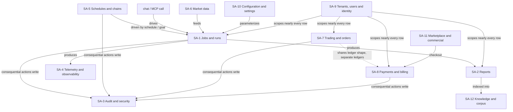
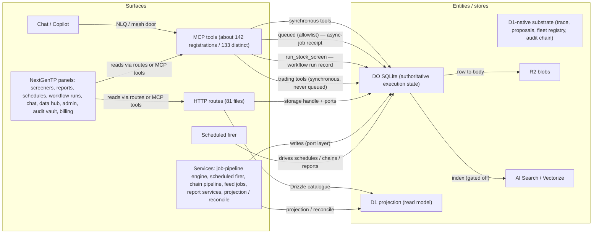

# System data model — conceptual, logical, physical and subject-area views

- **Status:** Draft (2026-11-17). Not yet reviewed; counts are measured on fresh `main` of that date (tarball, no git metadata in the survey tree — base commit hash UNVERIFIED).
- **Scope:** the whole Qunsultant/cfagent system (NextGenTP, live at `https://agent.openaimp.com/`): its stores, its catalogues, and how the data model relates to Durable Objects, agents, HTTP APIs, MCP, services, products, and security.
- **How to read it:** §1 is the conceptual view (subject areas, no tables). §2 is the logical view (entities, keys, cardinality, authoritative-vs-projection and tenancy marking). §3 is the physical view (the actual stores and catalogue counts). §4 is the subject-area view (one section per area: entities, store home, owner, readers/writers, integrity rules). §5 is the gap table — every gap found, with evidence and the issue it maps to (or the existing issue that already tracks it). Each view carries its diagram inline (Mermaid, rendered by GitHub): subject-area relationships in §1.2, surfaces-to-entities in §1.3, the core ER in §2.2, the physical topology in §3.3. Every node and edge in the diagrams traces to a fact stated in the surrounding text; nothing is drawn from a name alone.
- **Sources (the model has no other home):** ADR 0020 (DO/D1/R2 topology), ADR 0022 (data foundation, esp. D-C transaction aspect, D-G authoritative reads, D-F substrate families), ADR 0028 (data-provider/broker taxonomy), ADR 0029 (unified schedule store), ADR 0032 (data-access mechanism standard), ADR 0033 (cross-store consistency contract, incl. the frozen Appendix A audit of 2026-11-16), the schema-component catalogues in `src/data/schemaComponent/`, `src/data/drizzleSchema.ts`, `src/data/migrationRunner.ts`, `wrangler.jsonc`, and the pin/census tests in `tests/`. The full survey evidence (including the 181-row per-table map) lives in the drafting workspace and is summarized here; anything this doc could not verify from the tree is marked **UNVERIFIED**.
- **Conventions:** "DO" = Durable Object SQLite (authoritative execution state, ADR 0022 D-G). "D1" = the `AGENT_DB` database (projection / read model, plus the D1-native substrate families of ADR 0022 D-F). "Catalogue" = the fail-closed statement registries in `src/data/schemaComponent/` (unknown code, duplicate code, or kind/plane/table mismatch is rejected at registration, never at execution). Counts below were recounted from the definitions on 2026-11-17; where a header comment disagrees with the recount, the recount wins and the disagreement is listed in §5.

## 1. Conceptual view

### 1.1 Subject areas

| # | Subject area | Purpose in one sentence | Key entities (conceptual, no tables) |
|---|---|---|---|
| SA-1 | Jobs and runs | Everything the system executes, and the record that it executed. | Job, job definition, job instance, job run record, async job, stage event, workflow run, shard job |
| SA-2 | Reports | The durable, replayable output of screens and research. | Canonical report, report version, report confirmation (HITL), report asset (PDF/blob), semantic index entry |
| SA-3 | Audit and security | The evidence that what happened can be proven afterwards. | Audit event (hash-chained), audit chain, audit policy, IAAA audit log, chain prune, tenant/admin audit funnel |
| SA-4 | Telemetry and observability | Measured outcomes of runs and of the platform itself. | Thesis realization, resource usage, resource rollup, trace hop, mesh proposal, evaluation result |
| SA-5 | Schedules and chains | Work that happens on a cadence, and the chains it synthesizes. | Unified schedule, goal, chain, synthesized schedule, schedule approval, tick, pause state |
| SA-6 | Market data | The data screens and research run over. | Feed dataset, feed snapshot, index list, quote source, IV history, enrichment run, discovery run/alert |
| SA-7 | Trading and orders | Orders, positions, and the ledger that proves them. | Trade draft/order, bracket ladder, position, order preview, execution outcome |
| SA-8 | Payments and billing | Money in, money out, and the proofs. | Transaction (ledger row), payment draft, native ledger row, subscription, top-up, refund, bundle/purchase |
| SA-9 | Tenants, users and identity | Who may act, under which tenant, with which credential. | Tenant, user profile, session, token, binding, membership, delegation, channel |
| SA-10 | Configuration and settings | The knobs the system reads before it acts. | Setting, screener preset, strategy profile/weights, provider config, breaker state |
| SA-11 | Marketplace and commercial | The storefront: products, referrals, ads, entitlements. | Product, bundle, referral code/attribution, ad, entitlement, quota, price catalogue |
| SA-12 | Knowledge and corpus | The indexed memory the research surface searches. | Corpus document, vector memory, AI Search document, research evaluation, learning |

### 1.2 Relationships between subject areas

- A **run** (SA-1) produces **reports** (SA-2) and **telemetry** (SA-4), and is driven by a **schedule/goal** (SA-5) or a chat/MCP call.
- A **report** (SA-2) is confirmed by a human through SA-2's confirmation entity, is indexed into SA-12, and its blob lives in R2 while its row lives in DO SQLite.
- Every consequential action in SA-1/SA-5/SA-7/SA-8 writes **audit events** (SA-3); the audit chain is the only store whose integrity rule is cryptographic (hash chain), not referential.
- **Trading** (SA-7) and **payments** (SA-8) share the transaction ledger shape but are separate ledgers: trades are broker orders recorded in the ORM ledger; payments are gateway charges recorded in the native ledger and in the ORM transaction table.
- **Market data** (SA-6) feeds SA-1 runs; **configuration** (SA-10) parameterizes them; **tenancy** (SA-9) scopes nearly every row in SA-1–SA-8, by construction on the DO side (per-login instance) and by `tenant_id` column on the D1 side.
- **Schedules** (SA-5) synthesize **chains** whose transitions project into D1; **chains** are the only subject area whose DO source of truth is a KV key (`synthesizedSchedules` in the ScheduledAgent), not a SQL table.

### 1.3 Relationship to the seven dimensions

| Dimension | Subject areas it touches | How it touches the data model |
|---|---|---|
| 1. DOs | All | Every subject area has a home DO (see §3.1). The DO's SQLite is authoritative for execution state; D1 is the projection. The SessionStore DO is the only DO whose data is KV-shaped (`kv_store`), not table-shaped. |
| 2. Agents | SA-1, SA-2, SA-5, SA-6, SA-7, SA-8 | Each agent owns the stores of its subject area on its own DO (OrchestratorAgent: reports/jobs/audit; ScreenerAgent: screens; ResearchAgent: research; ScheduledAgent: schedules/chains; TradingAgent: trades; PaymentsAgent: payments; ReportAssetAgent: assets). Four agents (Browser, Ticker, AiSearch, Sandbox) have no verified durable store — see §5. |
| 3. APIs (HTTP routes) | All | 81 route files under `src/agents/routes/`; every read/write goes through a route handler that receives a storage handle (`ctx.storage.sql` / `getStorageSql()`) and builds ports from it. The exceptions are the direct-SQL route sites listed in §3.5. |
| 4. MCP | SA-1, SA-2, SA-6, SA-7, SA-8 | ~142 tool registrations / 133 distinct tool names. Queueing is an allowlist (`SYNCHRONOUS_MCP_TOOLS`): anything not listed gets an async-job receipt instead of a result. Trading tools are synchronous by design; `run_stock_screen` gets a workflow run record; `run_options_strategy_screen` does not (§5). |
| 5. Services | SA-1, SA-2, SA-4, SA-5, SA-6 | The job-pipeline engine, scheduled tasks/firer, chain pipeline, feed jobs, report services, and projection/reconcile services are the writers of SA-1/SA-2/SA-5; they all write through the port layer except the sites in §3.5. |
| 6. Products (NextGenTP) | SA-2, SA-5, SA-6, SA-7, SA-8, SA-9 | Screeners, options hub, reports, schedules/goals, workflow runs/catalog, chat/Copilot, data hub, platform admin, audit vault, billing — every panel reads through the HTTP routes (§1.3 row 3) or the MCP tools in chat; no client code touches storage directly (verified by survey). |
| 7. Security | SA-3, SA-9, and the tenancy marking on every area | Audit chain (hash-chained `mas_events` + IAAA whole-log store), IAAA identity/binding, PDP-gated routes (5 sites), per-login DO isolation (authorization by construction), tenant-scoped D1 reads, session/token hashing. See §2.4 and §4 SA-3/SA-9. |

## 2. Logical view

Conventions: **A** = authoritative store (DO SQLite, unless marked D1-native). **P** = projection (D1 read model). **T** = tenant-scoped (key named). **N** = natural key / idempotency key. Cardinality is stated only where the code or an ADR states it; otherwise the relationship is named without a ratio.

### 2.1 Core entities

| Entity | Key / natural key | Attributes (logical) | Store | Tenancy |
|---|---|---|---|---|
| Canonical report | `id` (PK); unique `(user_login, generation_id)`; **N** `(tenantId, reportId, version)` on the projection | title, source, summary, body (or R2 body key), run id, generation id, owner, fanout outcome, created/updated | **A** DO `mas_reports` (OrchestratorAgent); **P** D1 `agent_reports` | **T** `user_login` (DO); `tenant_id` + nullable `user_login` (D1) |
| Report version | `(reportId, version)` | content hash/pointer, projected-at | **P** D1 `agent_reports` (versioned rows) | **T** `tenant_id` |
| Report confirmation (HITL) | `id` | payload, verdict, actor, decided-at | **A** DO `mas_report_confirmations` | **T** by instance (per-login DO) |
| Report asset | `id` / R2 key (`screener:*` → `stocks/*`, `options/*`) | kind, bytes pointer, owner, created-at | **A** R2 `REPORTS_BUCKET`; metadata **UNVERIFIED** (ReportAssetAgent is KV-only — see §5) | **T** per-login agent instance |
| Async job | `jobId`; **N** `jobId` + `updatedAt` stale guard | status, stage, result/error, created/updated, owner | **A** DO `mas_async_jobs`; **P** D1 `agent_async_jobs` | **T** `tenant_id` (D1); instance (DO) |
| Job run record | `job_id` (alone — no tenant key; see §5) | definition, instance, stage events, outcome, started/finished | **A** DO + **P** D1 `job_run_records` (dual-homed) | **N** none — tenant-blind |
| Job pipeline definition / instance / artifact | `job_id` (alone) | stages, inputs, artifacts, status | **A** DO + **P** D1 (dual-homed) | **N** none — tenant-blind |
| Stage dataset (feed / enriched / analyzed / generated / delivery) | `(job_id, stage)` | dataset rows, stage status | **A** DO + **P** D1 `job_*_datasets` (dual-homed) | **T** D1 side carries `tenant_id` (per drizzle); DO side by instance |
| Audit event (DO chain) | `id`; chain link `previous_event_hash` → `event_hash` | session, type, agent, payload, created-at | **A** DO `mas_events` (hash-chained; SHA-256 over canonical row) | **N** none — session-scoped only; tenancy by instance construction |
| Audit event (D1 projection) | **N** `<tenantId>:<eventId>` | kind, subject, payload, projected-at | **P** D1 `agent_chain_audit` | **T** `tenant_id` |
| Audit chain (D1) | `(tenant_id, sequence)`; `prevHash` → `entryHash` | entry, policy, pruned-at | **A** D1 `agent_audit_chain` (D1-native substrate) | **T** `tenant_id` |
| IAAA audit log entry | position in the per-bucket array (no row key) | actor, action, payload, chained hash | **A** SessionStore DO `kv_store` (`iaaa-audit:` keys), whole-log JSON arrays, cap 22,000 events | **T** by bucket key discipline, not by column |
| Chain / synthesized schedule | **N** `(tenantId, id)` + status | schedule, status history (versioned), owner | **A** ScheduledAgent KV key `synthesizedSchedules`; **P** D1 `agent_chains` + `agent_synthesized_schedules` | **T** `tenant_id` (D1); DO side by KV key, owner not carried on the record |
| Shard job | **N** `(tenantId, chainId, jobKey)` + status | leg outcomes, workflow run id, status | **A** DO (screener collation); **P** D1 `agent_shard_jobs` | **T** `tenant_id` |
| Thesis realization (telemetry) | **N** `(tenantId, outcomeId)` | outcome, evaluation, realized-at | **P** D1 `agent_thesis_realizations` | **T** `tenant_id` |
| Resource usage / rollup | `(tenant_id, day)` | rows read/written, DO requests, alert state | **P** D1 `resource_sql_ops` / `resource_daily_rollups` (+ a duplicative DO-side rollup — see §5) | **T** `tenant_id` (nullable on `resource_sql_ops`) |
| Trace record / mesh hop / proposal | `id` / `run_id` | principal/actor (free text), payload, hops | **A** D1 `agent_trace_records`, `agent_mesh_trace_hops`, `agent_proposals` (D1-native substrate, ADR 0022 D-F) | **N** none — `principal` only, no `tenant_id` (see §5) |
| Transaction (ledger row) | `id` | action, amount, currency, gateway, gateway ref, status, customer, authorizer | **A** DO `mas_transactions` (ORM ledger) | **T** `tenant_id` (nullable legacy rows never invented) |
| Native ledger row | `id` | tx hash, amount, proof, status | **A** D1 `agent_native_ledger_rows` | **T** `tenant_id` |
| Payment draft | `pay_xxx` id | amount, gateway, checkout url, status (`draft` → `completed`/`rejected`) | **A** DO `mas_transactions` (same table as the ledger) | **T** `tenant_id` |
| Trade (broker order draft) | `id` | broker, symbol, side, qty, price source, mode, status | **A** DO `mas_trades` (ORM) | **T** by instance (per-login DO) |
| Unified schedule / goal | `id` | kind, cadence, payload, owner, state | **A** DO `unified_schedules` (SQL) **and** ScheduledAgent KV `"goals"` array (dual store — see §5) | **T** by instance; KV side by key |
| Screener preset / strategy profile | `id` | definition, owner, version | **A** DO `mas_screener_presets` / `mas_strategy_profiles` | **T** by instance |
| Setting | `(owner, key)` | value, scope | **A** DO `mas_settings` | **T** by instance |
| Tenant | `tenant_id` (PK) | settings, channels, projection carriers, read mode | **P** D1 `agent_tenant_settings` / `agent_tenant_channels` / `agent_tenant_projection_carriers` | **T** itself |
| User profile / session / token | `id` / session id / key hash | login, provider subject, binding, expiry, hash (never plaintext) | **A** SessionStore DO `kv_store` (`sessions`, `service_tokens`, `api_keys` buckets) | **T** by key discipline |
| Product / bundle / referral / ad | `id` | price, entitlement, attribution, quota | **A** D1 `agent_products`, `agent_product_bundles`, `agent_referral_*`, `agent_ads` (+ DO `mas_ads`, `mas_referrals` mirrors) | **T** `tenant_id` (D1); DO mirrors by instance |
| Corpus document | `report:`-prefixed id | text, embedding pointer, source | **A** AI Search namespace `screener-search`; vectors in Vectorize `vector-memory` | **T** **UNVERIFIED** (indexing gated off by default) |

### 2.2 Relationships and cardinality

- Report 1:N report versions (projection only; the DO holds the current row, D1 holds the version history).
- Job 1:N stage events; job 1:N stage datasets (one per stage); chain 1:N transitions (versioned status rows); schedule 1:N ticks; goal 1:N firings.
- Tenant 1:N almost everything on the D1 side (by `tenant_id`); tenant 1:1 settings/channels/carriers rows (PK `tenant_id`).
- Audit event N:1 chain (each event links to exactly one predecessor; the chain is append-only, genesis boundary skips pre-chain rows).
- Transaction 1:1 payment draft (same row, status transition); transaction 1:N gateway attempts is **UNVERIFIED** (no attempt table was found).
- Report 1:1 R2 blob (row↔body pair, R2 put precedes the row insert per the #2347 contract; a row never claims a body it does not have).
- Schedule 1:N synthesized chains; chain 1:N shard jobs.

### 2.3 Authoritative vs projection (ADR 0033 R-3, R-5)

- The DO is authoritative for execution state; D1 is the projection/read model — except the D1-native substrate families (trace, proposal ledger, fleet registry, audit chain), which are D1-authoritative and are not projections.
- A read that must reflect a just-completed write reads the authoritative store — unless the write path's projection carrier is synchronous, in which case the projection has landed before the write returns.
- The read names the mode it read under: the resolved `ledgerReadMode` rides the response (`d1-only` / `merged`).
- Lag classes (ADR 0033 R-2): synchronous (ORM carrier, awaited `projectAfterTransition`, shard-job projection at run completion), asynchronous (queue carrier, retry then DLQ), operator (sweep/reconcile, unbounded lag until invoked). A projection that has not landed is missing, not evidence the row does not exist.

### 2.4 Tenancy marking (summary)

- DO side: tenancy is constructional — a per-login Orchestrator instance physically cannot read another login's `mas_*` rows (ADR 0022 D-0 (f)). The exception is the SessionStore DO, which holds all buckets in one instance (`idFromName("kv")`); isolation there is by key discipline, not construction.
- D1 side: tenancy is by `tenant_id` column (NOT NULL on the large majority of ~104 D1 tables). Gaps: the D1-native substrate families (`agent_trace_records`, `agent_proposals`, `agent_proposal_transitions`, `agent_work_item_events`) and the job-pipeline families (`job_pipeline_*`, `job_run_records`) carry no `tenant_id`; `mas_events` carries no tenant column at all (see §5).
- The deployment default tenant is not one value: `"primary"` (IAAA, `src/security/iaaaGithubEndToEnd.ts:100`), `"default"` (captures, `src/agents/routes/dataProviders.ts:465`), and a hardcoded `workspaceId: "primary"` (canonical seed, `src/agents/orchestrator/canonicalReportSeed.ts:76`) — see §5.

## 3. Physical view

Measured on fresh `main` 2026-11-17. Catalogue totals (recounted from definitions): DO DDL 103 entries / 66 tables; D1 DDL+seed 222 entries / 101 tables; ORM/index DDL 26 entries / 16 tables; remainder DDL 57 entries / 20 tables; D1 DML 64 runtime entries / 19 tables; DO DML 81 entries / 15 named tables + `__table__`. **553 catalogue entries total; 181 distinct table names in the union.**

### 3.1 Durable Object SQLite — one database per DO instance

14 DO bindings (`wrangler.jsonc:125-170`; migrations v1–v15; `new_sqlite_classes` through v13). Instance addressing: per-login `OrchestratorAgent` (`idFromName(userLogin)`); shared singletons `"default"` (ScreenerAgent/ScheduledAgent pipeline doors), `"ticker"`, `"aisearch"`, `"kv"` (SessionStore); per-login `ReportAssetAgent`.

| DO (binding / class) | Tables it owns (SQLite) | Notes |
|---|---|---|
| OrchestratorAgent (`ORCHESTRATOR_AGENT`) | `mas_messages`, `mas_events`, `mas_memory`, `mas_async_jobs`, `mas_referrals`, `mas_ads`, `mas_reports`, `mas_report_confirmations`, `mas_screener_presets`, `mas_policy_verdicts`, `mas_settings`, `mas_transactions`, `mas_trades`, `mas_watchlists`, `mas_options_chain_cache`, `mas_categories`, `mas_external_ads`, `webhook_replay_nonces`, `mas_promotions`, plus autopilot/stock-copilot activity tables | The shared host for the `mas_*` families; `DatabaseORM(this.ctx.storage.sql)`; D1 run-ledger projection source |
| ScreenerAgent (`SCREENER_AGENT`) | ORM tables (own instance), `ScreenerTaskLedger`, provider configs, owner key | Durable task record per run |
| ResearchAgent (`RESEARCH_AGENT`) | Research store/config/task ledger; latest report in KV | Report PDFs via R2 |
| ScheduledAgent (`SCHEDULED_AGENT`) | `unified_schedules` (SQL) + KV `"goals"` / `"tickHistory"` (cap 50) / `"jobRunRecords"` (capped) | Dual store — see §5 |
| TradingAgent (`TRADING_AGENT`) | ORM tables (own instance) | Tools built with `{ orm, storage }` |
| PaymentsAgent (`PAYMENTS_AGENT`) | KV `payments` array (no SQL table) | Header calls it a "SECOND payment ledger" — see §5 |
| ReportAssetAgent (`REPORT_ASSET_AGENT`) | KV-only (`ctx.storage` put/get/list) | No SQL, no D1 projection — see §5 |
| SessionStore (`SESSION_STORE`) | Single table `kv_store` (all buckets: sessions, service tokens, API keys, payments claims, slack links, IAAA audit/bindings) | Plain `DurableObject`, not an Agent; performs no authorization |
| SlackAgent (`SLACK_AGENT`) | ORM tables (own instance) | |
| OptionsScannerMCP (`OPTIONS_SCANNER_MCP`) | Own storage via ORM (header notes it "never ran" its own storage through the ORM — see §5) | `McpAgent`, not `PortThink` |
| BrowserAgent / TickerAgent / AiSearchAgent / SandboxAgent | No verified durable store | **UNVERIFIED** whether stateless or persisted elsewhere |

### 3.2 D1 (`AGENT_DB`, database `agentdb`) — projection + D1-native substrate

- 67 migrations (`MIGRATION_0001`–`MIGRATION_0067`, `src/data/migrationRunner.ts`; runner-owned `_migrations` table, deliberately not catalogued; marker-last, idempotent, no multi-statement transaction — D1 `db.transaction()` is non-atomic, pinned by `tests/d1_transaction_pin_4937.test.ts`).
- 101 tables in `d1Catalogue.ts`; 84 `sqliteTable` definitions in `drizzleSchema.ts` (19 catalogue tables have no Drizzle object — see §5).
- Families: `agent_*` commercial/billing/marketplace (~60 tables), `agent_async_jobs` / `agent_reports` / `agent_chains` / `agent_synthesized_schedules` / `agent_shard_jobs` / `agent_chain_audit` (run-ledger projections), `agent_audit_chain` (D1 chain), `agent_trace_records` / `agent_proposals` / `agent_work_item_events` / `agent_fleet_registry` (D1-native substrate), `agent_tenant_*` (tenancy), `job_pipeline_*` / `job_run_records` / `job_*_datasets` (dual-homed with DO), `resource_*` (telemetry rollups), `agent_thesis_realizations` (telemetry).
- D1 access: Drizzle via the D1 DML catalogue (64 runtime entries) + `d1*Adapter.ts` (55 files). Retry policy `withD1Retry` (max 3 attempts, 100/200ms backoff, allowlist classification; #4930; 24 direct-builder-call files / 30 inserts NOT yet wired — tracked #5011).

### 3.3 KV, R2, Vectorize, AI Search, Analytics Engine

- **KV:** no `kv_namespaces` binding in `wrangler.jsonc`. KV is DO-SQLite via `src/data/durableKv.ts` (JSON protocol over `stub.fetch` to the SessionStore DO; `namespaceName` = logical bucket: `sessions`, `etrade`, `public`, `payments`, `slack_principal_links`, `api_keys`, `service_tokens`; legacy Workers KV fallback still in code but unbound — see §5).
- **R2:** one bucket, `REPORTS_BUCKET` → `screener` (`wrangler.jsonc:58`). Report PDF/blob bodies; DO storage keeps metadata pointers only. Row↔body pair governed by the #2347 contract (R2 put precedes the row insert).
- **Vectorize:** one index, `VECTOR_MEMORY` → `vector-memory` (`wrangler.jsonc:278-283`).
- **AI Search:** namespace `AI_SEARCH` → `default`, instance `"screener-search"` (`wrangler.jsonc:186-188`); report indexing gated by `AI_SEARCH_REPORT_INDEXING_ENABLED` (default OFF). The MCP endpoint is deliberately unconfigured (`AI_SEARCH_MCP_ENDPOINT` unset, owner decision).
- **Analytics Engine:** `OBSERVABILITY` dataset `observability` (`wrangler.jsonc:61-64`); unbound degrades to local logging.

```mermaid
flowchart TD
    subgraph DO["Durable Object SQLite — one database per DO instance (14 bindings)"]
        ORCH["OrchestratorAgent — mas_* families: mas_reports, mas_events, mas_async_jobs, mas_transactions, mas_trades"]
        SCR["ScreenerAgent — task ledger, provider configs"]
        RES["ResearchAgent — research store, task ledger"]
        SCH["ScheduledAgent — unified_schedules (SQL) + KV goals / tickHistory"]
        TRD["TradingAgent — ORM tables (own instance)"]
        PAY["PaymentsAgent — KV payments array (no SQL)"]
        RAA["ReportAssetAgent — KV-only"]
        SES["SessionStore — single table kv_store (all buckets)"]
        SLK["SlackAgent — ORM tables (own instance)"]
        OSC["OptionsScannerMCP — own storage via ORM"]
    end
    subgraph D1["D1 (AGENT_DB) — projection + D1-native substrate (101 tables)"]
        PROJ["Run-ledger projections: agent_async_jobs, agent_reports, agent_chains, agent_synthesized_schedules, agent_shard_jobs, agent_chain_audit"]
        DUAL["Dual-homed: job_pipeline_*, job_run_records, job_*_datasets"]
        NAT["D1-native substrate: agent_audit_chain, agent_trace_records, agent_proposals, agent_work_item_events, agent_fleet_registry"]
        COMM["Commercial / billing / marketplace: agent_products, agent_bundles, agent_referral_*, agent_ads (about 60 tables)"]
        TEN["Tenancy: agent_tenant_settings, agent_tenant_channels, agent_tenant_projection_carriers"]
        TEL["Telemetry: agent_thesis_realizations, resource_sql_ops, resource_daily_rollups"]
    end
    subgraph EXT["Object / search stores"]
        R2["R2 REPORTS_BUCKET — report PDF / blob bodies"]
        VEC["Vectorize vector-memory"]
        AIS["AI Search screener-search — report index (gated off by default)"]
        KV["KV via durableKv — logical buckets over SessionStore DO"]
    end
    ORCH -->|"projection (sync / async / operator carrier)"| PROJ
    ORCH -->|"projection"| DUAL
    SCH -->|"projection"| PROJ
    ORCH -->|"row to body pair (R2 put first)"| R2
    ORCH -->|"report index (gated off)"| AIS
    RES -->|"report bodies"| R2
    KV -->|"stub.fetch to SessionStore"| SES
```

### 3.4 Indexes (physical, named)

- `mas_reports`: UNIQUE `(user_login, generation_id)` (`idx_mas_reports_generation`), tenant-scoped since #2398 (shape-reconciled from the pre-#2398 global index in `ensureSchema`). Guard: #4507 dedupe-or-report — on CREATE failure the ensure dedupes legacy duplicate pairs (surviving row: greatest `created_at`, ties greatest `id`; NULL pairs untouched), retries once, then throws a named error; every seam caller fails closed. (PR #5015, merged 2026-11-17.)
- `mas_events`: no secondary index named in the catalogue; chain verification reads all rows `ORDER BY rowid ASC`.
- D1: 52 `CREATE INDEX` + 7 `CREATE UNIQUE INDEX` across the 222 D1 catalogue entries; ORM/index catalogue adds 10 index entries. Notable: `idx_promotions_candidate`, `idx_mas_transactions_tenant_id`, the `agent_audit_chain` sequence index.
- `job_run_records` recent-read index: tracked as an out-of-scope follow-up (#4204, open) — the D1 read path has no recent-read index.

### 3.5 Where the physical model diverges from the logical one

- **Whole-log rewrite audit segments:** the IAAA audit log is not a table — it is JSON arrays in one KV key (live ≤2,000 events + ≤10 archive segments of 2,000 = 22,000 cap). Appends are whole-log read-modify-write inside one DO request; hitting the cap fails visibly (`AUDIT_STORE_FULL`), never deletes evidence. The append-substrate decision (move to a real append-only table?) is deferred — tracked #3251.
- **Projection lag classes:** the logical model says "D1 mirrors DO"; physically D1 lags by carrier class (synchronous / asynchronous / operator) and a missing row is not evidence of absence (ADR 0033 R-2).
- **Dual-homed job tables:** `job_pipeline_*`, `job_run_records`, `job_*_datasets` exist in both D1 and DO SQLite with live adapters on both sides; the stated rule is "D1 is a projection, DO is authoritative" (`wrangler.jsonc:60-62`), but no single-writer enforcement exists beyond the cross-store pin suite — see §5.
- **Cross-plane tables:** `mas_feed_datasets` (DDL in the remainder catalogue, DML in D1) and `mas_index_lists` (DDL in DO, DML in both D1 and DO) have no named owning plane.
- **Direct-SQL sites outside the governed path** (allow-listed, not removed): 27 above-layer storage-exec sites (`tests/global_dd_census_2356.test.ts:116-145` — learnings 7, cancelPreviewStore 5, ladderStateStore 4, orchestratorMigration 3, schedules 3, receiptSurface 2, screenerResearch 2, cfAgentsAdapter 1); 228 inline DO DML statements remaining (`tests/do_dml_mechanism_mix_4385.test.ts`); the ORM browse SELECT stays inline by recorded decision (17 facade exec sites, `src/data/ormFacade.ts:551-560`); whole-table dumps in `orchestratorMigration.ts:220-291` and `schedules.ts:1830-1835`; raw `sql.exec` in `maintenance.ts:111` and `screenerResearch.ts:1178-1186`; stores built straight from `env.AGENT_DB` in `agenticPayments.ts:5087`; generic table-read MCP tools `list_database_tables` / `query_table_data`.

### 3.6 Pins and censuses guarding the model (what each pins — not gaps)

- `neutrality_census_3525` — provider-brand mentions ≤ 991 baseline (shrink-only).
- `global_dd_census_2356` — above-layer exec sites allow-listed at 27; D1 `prepare()` above the layer pinned to 1; `doSessionStoreAdapter` exactly 2 sites.
- `do_dml_mechanism_mix_4385` — DO DML catalogue 81 (64 repository + 17 template); 228 inline statements remaining (117 read + 111 write).
- `orm_dml_catalogue_4386` — ORM-core DML only in the DO DML catalogue; facade pinned at 17 exec sites.
- `dml_do_catalogue_4385` / `dml_d1_catalogue_4384` — catalogue pins (81 DO / 64 D1 runtime entries; unknown-code rejection).
- `cross_store_consistency_pin_4935` — ADR 0033 conformance (dual-write census, DO-first ordering, never-throw carriers, reconcile operator-only, idempotency); exactly 2 exceptions (F-2, F-3) until #4962/#4963 land.
- `d1_transaction_pin_4937` — forbids drizzle `db.transaction()` on D1.
- `schema_component_*_catalogue` — sha256 pins for every entry in each catalogue (103 / 222 / 26 / 57).
- `console_migration_ratchet_3515` — per-file `console.*` ceilings; new files must be at zero.
- Family censuses: async-jobs step4a (0 sites above layer), orchestrator-tables step4d (0 above layer), ORM step3a (0 above layer), strategy-cluster step4b (45 in-layer), options/discovery step2 (28 in-layer).

## 4. Subject-area view

### SA-1 Jobs and runs

- **Entities:** job definition, job instance, job run record, async job, stage event, workflow run, shard job, stage dataset (feed/enriched/analyzed/generated/delivery).
- **Store home:** DO SQLite per host (OrchestratorAgent `mas_async_jobs`; ScreenerAgent task ledger; ScheduledAgent job records) + D1 projections (`agent_async_jobs`, `job_run_records`, `job_pipeline_*`, `job_*_datasets` — dual-homed, see §3.5).
- **Owning agent/service:** `JobPipelineControl` engine (`src/services/jobPipelineEngine.ts`), `JobPipelineWorkflow` host, `ScheduledTasksService`, async-job ports.
- **Readers/writers:** chat/MCP (`run_*_job`, `get_async_job`, `get_job_status`), workflow-runs UI, scheduled firer, queue carrier, sweep/reconcile (operator only).
- **Integrity rules:** DO-first dual-write ordering (ADR 0033 R-7); async-job projection is an atomic conditional upsert (`ON CONFLICT DO UPDATE … WHERE updatedAt < bound`); reconcile is operator-only, never boot/deploy/tick; no cross-store atomicity is claimed (decided non-goal).

### SA-2 Reports

- **Entities:** canonical report, report version, report confirmation (HITL), report asset, semantic index entry.
- **Store home:** DO `mas_reports` (OrchestratorAgent, UNIQUE `(user_login, generation_id)`) + D1 `agent_reports` (versioned projection) + R2 blobs (`REPORTS_BUCKET`) + AI Search `screener-search` index (gated off by default) + Vectorize `vector-memory`.
- **Owning agent/service:** `scheduledReports.ts` (seam/ensure door), `DoSqliteCanonicalReportStore`, `ReportAssetAgent` (assets, KV-only), `ResearchAgent` (publish).
- **Readers/writers:** reports routes (`/api/reports`, replay, semantic search), scheduled firer, D1 read mode (`d1-only`/`merged`), replay reads persisted data with no live re-fetch.
- **Integrity rules:** row↔R2-body pair per #2347 (R2 put first); generation id is a tenant-local idempotency key; #4507 dedupe guard (see §3.4); version bump is read-then-write — concurrent carriers can silently drop a version (tracked #4963, F-3).

### SA-3 Audit and security

- **Entities:** DO audit event (hash-chained), D1 audit event (projection), D1 audit chain, IAAA audit log entry, audit policy/action, retention prune.
- **Store home:** DO `mas_events` (OrchestratorAgent) + D1 `agent_chain_audit` / `agent_audit_chain` + SessionStore DO `kv_store` (`iaaa-audit:` keys, whole-log arrays, 22,000 cap).
- **Owning agent/service:** `auditChain.ts` (SHA-256 chain), `ChainedAuditRepository` (writer), `iaaaAuditStore.ts` (SessionStore `audit-append` op), `auditTamperAlert.ts`.
- **Readers/writers:** audit routes (`/api/audit`), retention route (the one live verifier path), reconcile paths, admin audit funnel.
- **Integrity rules:** hash chain over canonical rows; `recordBlockingAudit` has no try/catch (consequential actions must not report success when the audit write failed); cap reached fails visibly (`AUDIT_STORE_FULL`); the direct verifier `verifyStoredAuditChain` has NO production caller (tracked #2437) — its twin `verifyStoredAuditChainAndAlert` is live on exactly one retention path; the D1 prune has no production caller (see §5); append-substrate decision deferred (tracked #3251).

### SA-4 Telemetry and observability

- **Entities:** thesis realization, resource usage, resource rollup, trace hop, mesh proposal, evaluation result, observability event.
- **Store home:** D1 `agent_thesis_realizations`, `resource_sql_ops`, `resource_daily_rollups`, `resource_alert_state`, `agent_trace_records`, `agent_mesh_trace_hops`, `agent_proposals`, `agent_fleet_registry` (+ a duplicative DO-side `resource_*` rollup, retirement status UNVERIFIED).
- **Owning agent/service:** `D1TelemetryAdapter`, `telemetryProjection.ts`, `resourceRollup.ts`, observability ports/sinks, `structuredLogger.ts` (the one seam; 7 mandatory attributes).
- **Readers/writers:** ResearchAgent `evaluateRun`, admin reconcile import, telemetry routes, Sentinel (S-0 consumer of the substrate).
- **Integrity rules:** realizations are idempotent on `(tenantId, outcomeId)` — except the adapter is SELECT-then-INSERT with no `ON CONFLICT`, so concurrent redelivery throws (tracked #4962, F-2); the logger never fails the caller (a throwing sink is swallowed — see §5).

### SA-5 Schedules and chains

- **Entities:** unified schedule, goal, chain, synthesized schedule, schedule approval, tick, pause state, shard job.
- **Store home:** DO `unified_schedules` (SQL) + ScheduledAgent KV `"goals"` / `"tickHistory"` / `"jobRunRecords"` (dual store — see §5) + D1 `agent_chains` / `agent_synthesized_schedules` / `agent_shard_jobs` (projections).
- **Owning agent/service:** ScheduledAgent, `SqlUnifiedScheduleStore`, `unifiedScheduleManagement.ts`, chain pipeline jobs.
- **Readers/writers:** schedules routes, scheduled firer, goal-chain synthesize/approve/kill, chain/schedule projection + reconcile.
- **Integrity rules:** projection is synchronous-awaited after the DO save; replay of an already-projected status is a no-op (version+1 otherwise); chain/schedule rows stamp the deployment-default tenant (tracked #4965, F-5); the reconcile path stamps it too, independently (see §5).

### SA-6 Market data

- **Entities:** feed dataset, feed snapshot, index list, quote source, IV history, enrichment run, discovery run/alert, opportunity scan.
- **Store home:** DO (`mas_feed_snapshots`, `mas_iv_history`, `mas_index_lists`, `mas_discovery_*`, `mas_enrichment_runs`, `mas_opportunity_scans`) + D1 (`mas_feed_datasets` DML, `quote_source_setting`, `agent_iv_history` as a separate D1 table).
- **Owning agent/service:** feed jobs, `FeedJobRegistry`, market-data services, discovery/options services.
- **Readers/writers:** market-data routes, screener/research surfaces, feed/enrich/analyze pipeline stages.
- **Integrity rules:** feed/enrich datasets are pipeline stage stores (job datasets family); `mas_feed_datasets` / `mas_index_lists` are cross-plane with no named owning plane (see §5).

### SA-7 Trading and orders

- **Entities:** trade draft/order, bracket ladder, position, order preview, execution outcome.
- **Store home:** DO `mas_trades` (ORM, OrchestratorAgent instance) + broker-side state (Alpaca/E*TRADE/Public APIs; no local order table for Alpaca verified).
- **Owning agent/service:** TradingAgent, broker adapters (Alpaca/E*TRADE/Public), bracket ladder service, trade-approval workflow.
- **Readers/writers:** MCP trading tools (all synchronous by design, never queued), broker routes (`/etrade/*`, broker-neutral paths), draft ledger reads (`GET /etrade/orders`).
- **Integrity rules:** preview-first (Public.com), draft ledger with payload hash; no HITL/proposal gate on the MCP trade path (tracked #3661); queued MCP calls must never be reported as success (tracked #3660); native bracket support (tracked #3658).

### SA-8 Payments and billing

- **Entities:** transaction (ledger row), payment draft, native ledger row, subscription, top-up, refund, bundle/purchase, quota.
- **Store home:** DO `mas_transactions` (ORM ledger, OrchestratorAgent) + D1 `agent_native_ledger_rows` (native ledger) + PaymentsAgent KV `payments` array (second ledger — see §5) + SessionStore buckets (`payments` claims).
- **Owning agent/service:** PaymentsAgent, `agenticPayments.ts`, `nativeMonetization.ts`, `cfpayLedger.ts`, Stripe/X402 adapters.
- **Readers/writers:** payment MCP tools (`draft_payment`, `confirm_payment_draft`, …), payment routes, checkout flows.
- **Integrity rules:** `confirmDraft` swallows ledger-write failures and still returns success after the gateway charge/refund executed (see §5 — the highest-severity gap found); only the hash is stored for API keys/service tokens; expiry required at mint.

### SA-9 Tenants, users and identity

- **Entities:** tenant, user profile, session, token, binding, membership, delegation, channel.
- **Store home:** D1 `agent_tenant_settings` / `agent_tenant_channels` / `agent_tenant_projection_carriers` (PK `tenant_id`), `agent_user_profiles` + SessionStore DO `kv_store` (sessions, `service_tokens`, `api_keys`, `iaaa-binding:` keys).
- **Owning agent/service:** IAAA (`iaaaLogin.ts`, `iaaaGithubEndToEnd.ts`), `pepGateway.ts`, tenant directory/channel ports.
- **Readers/writers:** auth routes, platform admin (`/api/iaaa/*`), membership store, session validation.
- **Integrity rules:** provider-stable subject (never login/email) bound to an internal user id; session absolute expiry 7 days, lifetime cap 30 days, idle timeout; revocation propagation delayed up to the 30s freshness window (recorded trade-off, CISO #945); PDP enforcement is entirely flag-gated (`IAAA_PDP_ENABLED`, production value UNVERIFIED); interactive MCP principals hold every scope by recorded default (ADR 0012) — role-based restriction is a CISO-lane follow-up that does not exist yet.

### SA-10 Configuration and settings

- **Entities:** setting, screener preset, strategy profile/weights, provider config, breaker state, quote source setting.
- **Store home:** DO `mas_settings`, `mas_screener_presets`, `mas_strategy_profiles`, `mas_strategy_weights_v2`, provider-config tables (per-agent instances) + D1 `quote_source_setting` (single-row global), `agent_breaker_state`.
- **Owning agent/service:** `createOrmPorts(sql).settings`, provider wiring, screener preset routes.
- **Readers/writers:** settings/preset routes, scheduled firer, screeners, breaker machinery.
- **Integrity rules:** settings are per-instance (per-login DO); the D1 `quote_source_setting` row is fleet-global by design.

### SA-11 Marketplace and commercial

- **Entities:** product, bundle, referral code/attribution/earning, ad, entitlement, quota, price catalogue.
- **Store home:** D1 `agent_products`, `agent_product_bundles`, `agent_referral_*`, `agent_ads`, `agent_approved_free_quotas`, `agent_price_catalogue` (+ DO mirrors `mas_ads`, `mas_referrals`, `mas_promotions`).
- **Owning agent/service:** marketplace ports (`buildMarketplacePorts` — D1 when `AGENT_DB` is bound, DO-SQLite otherwise), billing service.
- **Readers/writers:** marketplace routes, referral/ad management tools, checkout.
- **Integrity rules:** marketplace DML is catalogue-driven (28 generated + literal entries in `dmlEntries.ts`); the DO `mas_promotions` read in `screenerResearch.ts` has no adapter or D1 migration (its owning module was deleted) — see §5.

### SA-12 Knowledge and corpus

- **Entities:** corpus document, vector memory, AI Search document, research evaluation, learning.
- **Store home:** AI Search namespace `screener-search` + Vectorize `vector-memory` + DO `mas_learnings` (learnings service, above-layer SQL) + `research_evaluations` / `research_runs`.
- **Owning agent/service:** corpus sync (`corpusSync.ts` — read-only integrity check + index bridge, legs never throw into the tick), `documentPublish.ts` index legs, ResearchAgent.
- **Readers/writers:** knowledge/search routes, `knowledge_search` / `ai_search_*` MCP tools, research publish.
- **Integrity rules:** corpus sync divergences are recorded, never silently healed (ADR 0022 D-F2 exemplar); report indexing is gated off by default; learnings have no port/adapter (see §5).

## 5. Gaps, issues and opportunities

Severity: **High** = data can be lost, duplicated, or misreported silently, or money moves on a false record. **Medium** = a real defect or missing capability with a bounded blast radius, or a structural debt that blocks a governed path. **Low** = hygiene, naming, or documentation drift. "Already tracked" rows are not new issues — they are listed so this doc does not re-propose them.

| # | Gap | Severity | Evidence | Maps to |
|---|---|---|---|---|
| D-1 | Stale catalogue header arithmetic: `d1Catalogue.ts:14-22` says 221 statements + 10 more (= 231) but the recount is 222, and 49 ALTERs vs 50 recounted; `ormCatalogue.ts:14-21` says 22 statements (12 CREATE, 2 ALTER, 8 INDEX) vs 26 recounted (13/3/10); `remainderCatalogue.ts:14-19` says 51 entries vs 57 recounted. Only `doCatalogue.ts` (103) reconciles. The pin tests assert the recounted numbers, so the headers are stale, not the code. | Low | `src/data/schemaComponent/d1Catalogue.ts:14-22`, `ormCatalogue.ts:14-21`, `remainderCatalogue.ts:14-19` (recounts in the survey) | Issue 01 |
| D-2 | DO verb-grep undercount: `statement: \`CREATE TABLE` matches 60 entries in `doCatalogue.ts`, not the 66 the header/test claim — 6 entries carry leading whitespace/newline inside the template literal. Which six is UNVERIFIED. | Low | `src/data/schemaComponent/doCatalogue.ts` | Issue 01 |
| D-3 | 19 D1-catalogue tables have no Drizzle object (DDL-only via migration, no typed access): `agent_approved_free_quota_counts`, `agent_code_redemption_counts`, `agent_conformance_cells`, `agent_data_provider_routes`, `agent_digest_sends`, `agent_free_run_counts`, `agent_iv_history`, `agent_market_edges`, `agent_market_nodes`, `agent_mesh_eval_results`, `agent_mesh_trace_hops`, `agent_offer_suppressions`, `agent_price_catalogue_legacy`, `agent_reports`, `agent_shard_jobs`, `agent_synthesized_schedules`, `agent_thesis_realizations`, `agent_work_item_events`, `resource_alert_state`, `resource_daily_rollups`. Any adapter touching them must use raw SQL or the DML catalogue. | Medium | `src/data/drizzleSchema.ts` (84 defs) vs `src/data/schemaComponent/d1Catalogue.ts` (101 tables) | Issue 02 |
| D-4 | Cross-plane DDL/DML split with no named owner: `mas_feed_datasets` (DDL in the remainder catalogue, DML in D1) and `mas_index_lists` (DDL in DO, DML in both D1 and DO). Nothing states which plane owns either table. | Medium | `src/data/schemaComponent/remainderCatalogue.ts`, `doCatalogue.ts`, `dmlEntries.ts`, `doDmlEntries.ts` | Issue 03 |
| D-5 | Job tables dual-homed with live adapters on both sides (`job_pipeline_*`, `job_run_records`, `job_*_datasets` in D1 migrations 0046/0047/0051/0052/0056/0057 and in DO SQLite). The rule "D1 is a projection, DO is authoritative" (`wrangler.jsonc:60-62`) has no single-writer enforcement beyond the cross-store pin suite for named paths. | Medium | `src/data/schemaComponent/d1Catalogue.ts`, `doCatalogue.ts`, `d1JobPipelineAdapter.ts`, `doSqliteJobPipelineAdapter.ts` | Issue 03 |
| D-6 | 27 above-layer exec sites remain, dispositioned but not removed (`global_dd_census_2356.test.ts:116-145`). The first three own whole tables with no port/adapter: `mas_learnings` (`learnings.ts`, 7), `mas_cancel_previews` (`cancelPreviewStore.ts`, 5), `mas_ladder_states` (`ladderStateStore.ts`, 4). `screenerResearch.ts` reads `mas_promotions` with no adapter or D1 migration (its owning module was deleted). | Medium | `tests/global_dd_census_2356.test.ts:116-145`; `src/services/learnings.ts`, `cancelPreviewStore.ts`, `ladderStateStore.ts`; `src/agents/routes/screenerResearch.ts:1186` | Issue 04 |
| D-7 | 228 inline DO DML statements remain (117 read + 111 write); only the 81-entry first tranche (+ P6c/P6d additions) is catalogued. | Medium | `tests/do_dml_mechanism_mix_4385.test.ts:187-197` | Issue 05 |
| D-8 | ORM browse SELECT stays inline by recorded decision + the facade carries 17 exec sites — already tracked. | — | `src/data/ormFacade.ts:551-560`; `tests/orm_dml_catalogue_4386.test.ts:48` | Already tracked: #4751 |
| D-9 | Barrel omission: `src/data/schemaComponent/index.ts` exports the D1 DML modules but not `doDmlCatalogue`, `doDmlEntries`, or `doDmlExecutor` — consumers must import the DO DML modules by direct path. | Low | `src/data/schemaComponent/index.ts` | Issue 01 |
| D-10 | DO adapter count does not reconcile: `doCatalogue.ts:7` says "the 49 DO adapters"; there are 46 `doSqlite*Adapter.ts` files and 54 exported `DoSqlite*` classes/`createDo*` functions. Which basis "49" uses is UNVERIFIED. | Low | `src/data/schemaComponent/doCatalogue.ts:7` | Issue 01 |
| D-11 | D1 table→adapter ownership is not verifiable by literal grep (adapters reference drizzle export objects, not table-name strings). A true per-table D1 adapter map needs drizzle-object resolution. | Low | Survey §8.11 | Issue 02 |
| D-12 | Stale `mas_reports` DDL comment: `ormFacade.ts:330-336` says the DDL "lives in `src/services/scheduledReports.ts`", but that function only delegates to `storePorts(sql).write.ensureSchema()` — no live duplicate DDL was found; the comment is stale, the code is single-sourced per #389. | Low | `src/data/ormFacade.ts:330-336`; `src/services/scheduledReports.ts:175-177` | Issue 01 |
| D-13 | Migration-subset drift risk: 11+ adapters apply `ALL_MIGRATIONS`, but many apply named subsets (e.g. `d1BillingCustomerAdapter.ts:37` only 0030; `d1SubscriptionAdapter.ts:66` lists 12). A new migration is applied only by adapters whose list includes it; `applyMigrations` is idempotent, so the failure mode is silent omission on subset paths, not double-apply. Two above-layer callers (`d1MarketGraphAdapter.ts:51`, `d1TelemetryAdapter.ts:61`) apply `ALL_MIGRATIONS` from outside `src/data/`. | Medium | `src/data/migrationRunner.ts`; `src/data/d1BillingCustomerAdapter.ts:37`; `src/data/d1SubscriptionAdapter.ts:66` | Issue 13 |
| D-14 | Legacy Workers KV fallback is dead in config but alive in code: no `kv_namespaces` binding in `wrangler.jsonc`, yet `durableKv.ts` still carries the `legacy`/`legacyFallback` path. Whether a dashboard binding exists outside wrangler is UNVERIFIED. | Low | `src/data/durableKv.ts`; `wrangler.jsonc` (no `kv_namespaces`) | Issue 09 |
| D-15 | DO migration coverage is opt-in and partial: only 6 adapters reference `applyDoSchemaMigrations`; the rest use legacy `ensureSchema` with per-adapter PRAGMA-guarded ALTERs. DO schema evolution has two live mechanisms with no global version count. | Medium | `src/data/doSchemaMigrations.ts`; adapters listed in survey §5.2 | Issue 13 |
| H-1 | Options strategy screens have no durable run record: `run_options_strategy_screen` is an awaited inline scan ("the door carries no workflow/job", `src/agents/registry.ts:1558`), while `run_stock_screen` gets a `ScreenerScreenWorkflow` run. No run record, no stage control, no replay surface — while `options_copilot_stage_control` assumes a runId/stageId exists. Related: #4006 (open incident, scheduled-discovery path) and #4003; #2577 (closed) built a unified run record — the issue must first establish whether it was never wired to this path or regressed. | Medium | `src/agents/registry.ts:1558`; `src/agents/orchestrator/meshScreenDoor.ts` | Issue 10 |
| H-2 | NLQ still has a direct-`ScreenerAgent` fallback while chat uses the mesh door with "NO direct-ScreenerAgent fallback" (`src/agents/registry.ts:1558`). Two entries to the same capability with different durability/governance. | Medium | `src/agents/registry.ts:1558` | Issue 10 |
| H-3 | Reports have (at least) three read paths: ORM/canonical ports (`scheduledReports.ts:158`), D1 `agent_reports` projection (`orchestrator.ts:1029-1075`), and raw SQL in the schedules route (`schedules.ts:1762,1835`). No single read path verified. | Medium | `src/services/scheduledReports.ts:158`; `src/agents/orchestrator.ts:1029-1075`; `src/agents/routes/schedules.ts:1762,1835` | Issue 09 |
| H-4 | Schedules live in two stores: SQL unified schedule store (`scheduled-agent.ts:494-498`) AND KV `"goals"` array (`scheduled-agent.ts:546-619`), plus capped KV `"tickHistory"` (50) and `"jobRunRecords"`. Which surface reads which was not traced per surface. | Medium | `src/agents/scheduled-agent.ts:494-498,546-705` | Issue 09 |
| H-5 | Two payment ledgers: PaymentsAgent KV `payments` array, explicitly a "SECOND payment ledger" (`payments-agent.ts:5`), vs the D1 native ledger `agent_native_ledger_rows`. Reconciliation between them not verified. Related but distinct: #3182 (closed, DO ledger `mas_transactions` carries no tenantId). | Medium | `src/agents/payments-agent.ts:5,344-376`; `src/data/schemaComponent/d1Catalogue.ts:585` | Issue 09 |
| H-6 | ReportAssetAgent has no queryable store: KV-only (`report-asset-agent.ts:103-153`); listing is `ctx.storage.list()` with no SQL, no D1 projection, no run-ledger entry found. | Medium | `src/agents/report-asset-agent.ts:103-153` | Issue 09 |
| H-7 | Shared `"kv"` SessionStore instance is a multi-tenant blast radius: one instance holds all sessions/tokens (`kvWipe.ts:6` — "wiping one affects all"); the DO itself does no authorization (`sessionStore.ts:197-198`). Isolation inside it is key discipline, not construction. | Medium | `src/agents/routes/kvWipe.ts:6`; `src/security/sessionStore.ts:197-198,37` | Issue 08 |
| H-8 | "KV" naming vs DO backing: `createKvMembershipStore(sessionStore(…))` (`orchestrator.ts:658`, `scheduled-agent.ts:1719`) — the membership store is called KV but is backed by the SessionStore DO; no KV binding exists. Naming gap only, but it misdirects anyone tracing the data path. | Low | `src/agents/orchestrator.ts:658`; `wrangler.jsonc:236-240` | Issue 01 |
| H-9 | MCP queueing is a hand-maintained allowlist: anything not in `SYNCHRONOUS_MCP_TOOLS` is queued (`mcpAdapter.ts:71`, `handler.ts:230`). Precedent: the five Public tools were missing and "a quote answered with a job receipt" until #4102 added them (`asyncJobModes.ts:404-410`); `paid_options_screener` / `paid_market_research` are not in the set — UNVERIFIED whether they queue today. Related programme: #3748 (open, CISO lane — sync/async parity theme; the pin below is the concrete data-model-registry slice of it). | Medium | `src/config/asyncJobModes.ts:301-414`; `src/agents/mcpAdapter.ts:71` | Issue 11 |
| H-10 | AI Search MCP path is deliberately unconfigured (`AI_SEARCH_MCP_ENDPOINT` unset, owner decision, `wrangler.jsonc:299-303`). Not a gap — recorded so it is not re-filed. | — | `wrangler.jsonc:299-303` | None (owner decision) |
| H-11 | No duty crons: all scheduled work depends on ScheduledAgent + queue consumers, with only the hourly heartbeat cron live (`wrangler.jsonc:269-272`). Whether a watchdog covers a stalled queue consumer is UNVERIFIED (`scheduleWatchdog.ts` not read). | — | `wrangler.jsonc:262-272` | None yet — UNVERIFIED |
| H-12 | D1 is a second authority with best-effort sync: projection is a one-off reconcile (`POST /api/ops/run-ledger-reconcile`, "never auto-run") plus queue-carried claims; a missed queue message leaves D1 stale with no verified alert. Whether DLQ/retry covers the projection path is UNVERIFIED. | — | `src/agents/orchestrator.ts:1029-1050` | None yet — UNVERIFIED |
| H-13 | Four agents with no verified durable store: `BrowserAgent`, `TickerAgent`, `AiSearchAgent`, `SandboxAgent` — either genuinely stateless (plausible) or their state lives somewhere not found in this pass. | — | Survey §2 | None yet — UNVERIFIED |
| H-14 | `OptionsScannerMCP` persistence is doubtful by its own comment ("this DO never ran [its] own storage through the ORM", `cloudflareWalletsScanner.ts:261-262`); its scan results' durability is UNVERIFIED. | — | `src/mcps/scanner/cloudflareWalletsScanner.ts:261-262` | None yet — UNVERIFIED |
| H-15 | Generic table-read MCP tools (`list_database_tables`, `query_table_data`, `commands.ts:1142,1165`) bypass per-entity authorization/governance by design; whether they are permission-gated was not verified in this pass. | Medium | `src/mcps/openaimp/commands.ts:1142,1165` | Issue 11 |
| G-1 | D1-native substrate families have no tenant column: `agent_trace_records`, `agent_proposals`, `agent_proposal_transitions` (`drizzleSchema.ts:1354-1389`) and `agent_work_item_events` (`:1414-1438`) carry `principal`/`actor` but no `tenant_id`. A cross-tenant substrate read must parse free-text `principal` or read all tenants' rows. Outside ADR 0033 R-4 as written (R-4 governs projections), so a genuine gap, not a restatement of #4965. | Medium | `src/data/drizzleSchema.ts:1354-1389,1414-1438` | Issue 08 |
| G-2 | Reconcile path stamps the default tenant too, independently of #4965: `reconcileChainScheduleProjection` defaults its parameter to `"primary"` (`scheduled-agent.ts:3100-3101`) and hardcodes `workspaceId: "primary"` (`:3120`, `:3129`, `:3251`). #4965 covers the live `projectSynthesized` path; fixing it does not fix this. | Medium | `src/agents/scheduled-agent.ts:3100-3101,3120,3129,3251` | Issue 07 |
| G-3 | Three different deployment-default tenant literals: `"primary"` (IAAA, `iaaaGithubEndToEnd.ts:100`), `"default"` (captures, `dataProviders.ts:465`), and the seed's hardcoded `workspaceId: "primary"` (`canonicalReportSeed.ts:76`). A row's tenant depends on which family wrote it; a cross-family tenant join silently mismatches. No single source of truth for the default was found. | Medium | `src/security/iaaaGithubEndToEnd.ts:100`; `src/agents/routes/dataProviders.ts:465`; `src/agents/orchestrator/canonicalReportSeed.ts:76` | Issue 07 |
| G-4 | D1 audit-chain prune has no production caller: `pruneAuditChainForTenant` (`auditPolicyPorts.ts:400-440`) + `deleteChainEntries` (`d1AuditPolicyAdapter.ts:269`) exist, but no caller was found in `src/`. If the chain is meant to be retention-pruned, the prune is dead code; if it is meant to grow unboundedly, that contradicts the 22,000-event cap discipline of the IAAA store and ADR 0022's retention open gate (G-4). Caller search was `src/`-wide grep; a caller under a different name would have been missed — high-confidence, not proven. | Medium | `src/data/auditPolicyPorts.ts:400-440`; `src/data/d1AuditPolicyAdapter.ts:269` | Issue 12 |
| G-5 | **Payment confirm reports success when the ledger write fails.** `mas.ts:339` (`completed`) and `:365` (`rejected`) swallow `ormPorts.transactions.update` failures with `catch {}` and return success payloads asserting `status: "completed"` / `"rejected"` — after the gateway charge/refund has executed (`:310-330`). A failed ledger write leaves a charged payment whose durable record still says draft/pending, and the caller is told it completed. The preceding `findById` failure is likewise swallowed (`:292-293`), so the flow proceeds with `amount: 0` and gateway defaults when the draft cannot even be read. Same failure shape as #3660 (queued MCP calls reported as success) but on the synchronous payment path, in a different module — not the same issue. GitHub search "confirmDraft": 0 results. | **High** | `src/agents/mas.ts:292-293,310-330,339,365` (verified by direct read 2026-11-17) | Issue 06 ([Fix]) |
| G-6 | `mas_events` has no tenant/user_login column (session-scoped only, `ormCatalogue.ts:71-88`); tenancy is entirely by DO-instance construction. There is no way to verify, query, or reconcile the audit chain for one tenant across instances, and the per-instance verifier cannot detect a row written into the wrong instance. A design consequence of ADR 0022 D-0 (f), not a bug — but the guarantee rests on the instance-routing code with no second check at the row level. | Medium | `src/data/schemaComponent/ormCatalogue.ts:71-88` | Issue 08 |
| G-7 | Job-pipeline families are tenant-blind: `job_pipeline_definitions` / `job_pipeline_instances` / `job_pipeline_artifacts` / `job_run_records` (`drizzleSchema.ts:1800-1887`) have no `tenant_id`; instances are keyed by `job_id` alone. If two tenants ever share a job id, rows collide or leak across tenants with no schema-level defence. Whether job ids are globally unique by construction is UNVERIFIED. | Medium | `src/data/drizzleSchema.ts:1800-1887` | Issue 08 |
| G-8 | Structured-log sink failures are swallowed by design, with no fallback record (`structuredLogger.ts:1-60` — "a throwing sink is swallowed — logging is observability, never behavior"). If the Analytics Engine sink throws AND the console fallback is unavailable (or the sink is the in-memory adapter nobody reads), the event is gone with no durable trace. Same shape as ADR 0033 R-6 (publication honesty) applied to the logging plane; no R-6 analogue exists for the logger. Related but distinct: #4921 (open — a failed copilot ledger write on a sink the SQL path cannot swallow). | Medium | `src/observability/structuredLogger.ts:1-60`; `src/observability/observabilityPorts.ts` | Issue 12 |
| G-9 | Fleet registry has no production writer (ADR 0022 gate G-6 still open). `agent_fleet_registry` / `agent_conformance_cells` (`drizzleSchema.ts:1390-1413`) are D1-native read models whose population duty was gated (deploy-time seed vs scheduled sync). No production writer was found (UNVERIFIED — a writer may exist under a name not grepped); if none exists, the registry/matrix the loop and UI read is empty or stale by construction. GitHub search "fleet registry writer": 0 results. | — | `src/data/drizzleSchema.ts:1390-1413`; ADR 0022 G-6 | None yet — UNVERIFIED |
| G-10 | Queue carrier's shared-instance fallback widens the read: `dispatchRunLedgerProjectQueueWork` (`queue.ts:226-249`) tries the per-user instance, then the shared instance, for a row named by `(ledger, naturalKey, userLogin)`. The shared-instance read is owner-scoped today, so it is not a cross-tenant read — but the fallback exists because the recorder instance is ambiguous, and if a future caller passes a wrong or defaulted `userLogin`, the fallback would project a row from the shared instance under that login's name. No pin asserts the fallback's owner-scoping (UNVERIFIED — the cross-store pin covers call sites and ordering, not this fallback). | Medium | `src/server/routes/queue.ts:226-249` | Issue 12 |

### 5.1 Already tracked — cited, not re-proposed

#4961 (F-1 d1-only gate), #4962 (F-2 telemetry `ON CONFLICT`), #4963 (F-3 report version bump), #4964 (F-4 audit-publication silent drop), #4965 (F-5 chain/schedule default tenant) — ADR 0033 audit follow-ups under #4935. #5011 (direct-builder-call retry wiring, under #4930). #4933 (Drizzle query observability). #4751 (browse where-language, under #4386). #2437 (audit-chain verification has no production caller). #3251 (audit append-substrate decision). #4507 (report-store dedupe guard; PR #5015 in flight). #4789 (one-engine out-of-scope tracker). #3660 / #3661 / #3658 (MCP trade-path reporting, HITL gate, bracket support). #4006 / #4003 (strategy-discovery incident). #3748 (MCP scoping/security programme, CISO lane). #3182 (closed — DO ledger tenantId), #3185 (open — `usage_events` carry no tenantId), #4921 (open — copilot ledger write sink), #4204 (open — `job_run_records` recent-read index), #2577 (closed — unified run record for options strategy screens).

### 5.2 What this doc does not claim

- Base commit hash: UNVERIFIED (survey tree was a tarball without git metadata).
- Whether the DO-side `resource_*` rollup duplicate has been retired into the D1 path (ADR 0022 D-F.1).
- Whether a production writer for the fleet registry now exists (G-9).
- Whether `clearRows()` (`doSqliteJobOutcomeAdapter.ts:176-182`), the unpredicated pending-approvals delete (`doSqlitePendingScheduleApprovalsAdapter.ts:59`), or the deprecated paused-schedule whole-table delete have live callers.
- Whether job ids are globally unique by construction (G-7).
- The production value of `IAAA_PDP_ENABLED`.
- Whether `paid_options_screener` / `paid_market_research` queue today (H-9).
- Whether the four stateless-looking agents persist state anywhere (H-13), and whether `OptionsScannerMCP` scan results are durable (H-14).
- The current console-ratchet total (baseline 234 at batch 3; not re-counted in this survey — note #4507's fix moved the adapter ceiling 2 → 3).
- The per-table D1 adapter map in the survey's §2 "D1 adapter?" column is approximate (substring matching; false positives from comments/migration imports) — the authoritative D1-ownership signal is the drizzle definition + creating migration.

---

*Sources: ADR 0020, ADR 0022, ADR 0028, ADR 0029, ADR 0032, ADR 0033 (incl. Appendix A, frozen 2026-11-16); `src/data/schemaComponent/` catalogues; `src/data/drizzleSchema.ts`; `src/data/migrationRunner.ts`; `wrangler.jsonc`; `tests/` pin/census files listed in §3.6. Survey workspace: `~/workspace/data-model/` (survey-data-layer.md, survey-hosts-surfaces.md, survey-security-crossstore.md).*
