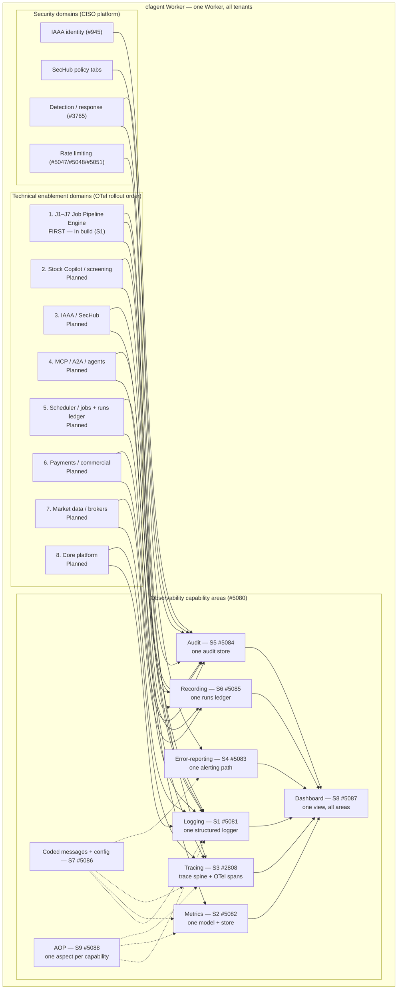
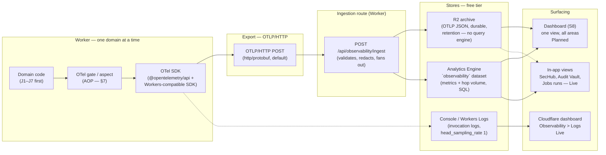
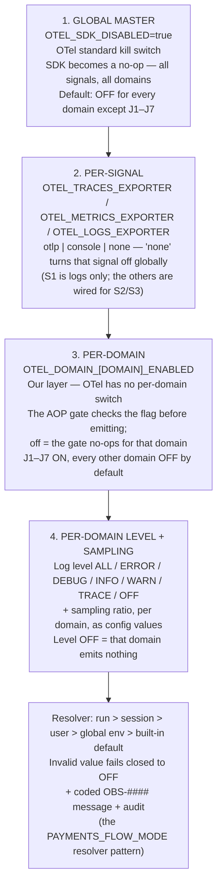
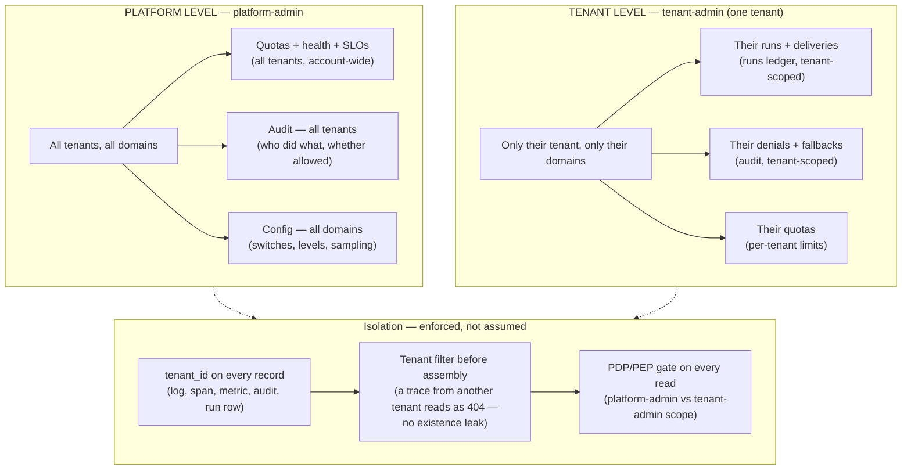

# Observability + Security Domains

Program: [#5080](https://github.com/Qunsultant/cfagent/issues/5080) (Observability).
Status of this document: the domain map for the program. It is a map, not a
build — it describes what exists, what is being built, and what is planned,
and it labels each capability honestly. **Nothing in this document is a
fabricated surface**: a capability marked Planned is not live, and a
capability marked Live names the code or route that proves it.

## Status labels used in this document

| Label | Meaning |
|---|---|
| **Live** | The capability exists on main and is wired. The doc names the code, route, or store that proves it. |
| **Live (proof pending)** | The mechanism is verified by tests, but a real production run has not yet proven it end to end. The doc says what proof is owed. |
| **In build** | A slice is being built now (a PR is open or a builder is dispatched). The doc names the issue. |
| **Planned** | Filed as a sub-issue of #5080 (or of a related program) and queued, but not started. |

## 1. The domain model — two divisions

There are two divisions of the platform into domains, and this document
uses both. They answer different questions.

### 1.1 The federated executive platforms (governance model)

`docs/agentic-org/platforms.md` proposes a **federated** agentic operating
model: each executive owns a domain platform over a shared architecture and
control plane, and every platform improves through a governed
evidence-to-change loop. **That document is a PROPOSAL, not adopted policy.**
Gitops still governs delivery. The proposed platforms are:

| Executive | Platform |
|---|---|
| CEO | Organization and strategy |
| CBO | Business architecture and commercial |
| CPO | Product and experience |
| COO | Operations and service delivery |
| CTO | Technology and engineering |
| CDO | Data and knowledge |
| CAIO | AI, agent, and improvement |
| CFO | Finance and capital |
| CLO | Legal and obligation |
| CIO | Investment and portfolio |
| CRO / Chief Scientist | Research and model risk |
| **CISO** | **Security and trust** (this lane) |
| CCO | Compliance and market integrity |
| Chief Quality / Evaluation Officer | Independent assurance |
| Chief People / Workforce Officer | Human–agent workforce |

The security work in this document lives on the **CISO — Security and
trust** platform. The observability work is a shared capability: every
executive platform consumes the same telemetry (one logger, one trace
spine, one audit store, one dashboard), and no platform builds a parallel
one. That is the point of #5080.

### 1.2 The technical enablement domains (OTel rollout order)

For OTel enablement, the platform is divided into the technical areas of
the codebase. Each area is switched on independently (see §7), in this
order. **J1–J7 first; the rest follow one at a time.**

| # | Domain | What it is | OTel enablement |
|---|---|---|---|
| 1 | **J1–J7 Job Pipeline Engine** | The execution substrate: the job model, checkpoints, and the Feed → Enrich → Analyze → Generate → Deliver pipeline (Epic #3533, issues #3534–#3540, all closed and running). | **First. In build (S1 #5081).** |
| 2 | Stock Copilot / screening | The autonomous copilot loop and the stock screener — the workloads that run on (and migrate onto) J1–J7. | Planned, after J1–J7. |
| 3 | IAAA / SecHub | Identity, sessions, and the SecurityHub policy tabs (PDP, PEP, PIP, PAP) and the IAAA Admin sub-tabs. | Planned. |
| 4 | MCP / A2A / agents | The agent surface: the orchestrator, mesh doors, MCP tools, and A2A dispatch. | Planned. |
| 5 | Scheduler / jobs + runs ledger | ScheduledAgent goals, schedules, and the runs ledger (the record of whether a run happened). | Planned. |
| 6 | Payments / commercial | Agentic payments, Stripe billing, x402 tier gating, entitlements. | Planned. |
| 7 | Market data / brokers | Data providers and broker integrations. | Planned. |
| 8 | Core platform | The Worker runtime itself: routing, ingress, the dashboard/API, config. | Planned. |

## 2. The technical enablement domains in detail

Each domain: what it is, what telemetry it emits today, who owns it, and
what store that telemetry uses. OTel enablement for a domain means the
domain's logs, metrics, and traces flow through the OTel instrumentation
(§4) behind that domain's switch (§7) — it does not mean the domain gets a
second logger, a second trace store, or a second dashboard.

### 2.1 J1–J7 Job Pipeline Engine — FIRST

- **What it is.** The single converged workflow engine (Epic #3533).
  J1 (#3534) job and checkpoint model (durable cursors, checkpoint records,
  CloudEvents status streams, coded failure classification); J2 (#3535)
  feed; J3 (#3536) enrich; J4 (#3537) analyze; J5 (#3538) generate;
  J6 (#3539) deliver; J7 (#3540) full-chain composition. The five stages
  are Feed → Enrich → Analyze → Generate → Deliver; every stage hand-off
  is durably written before the queue emission, and every run creates a
  `JobRunRecord` with timestamps, row counts, shard identities, and exit
  codes. 24 J1–J7 MCP tools are registered in Stock Copilot's catalog via
  the mesh door. Owner: CAIO lane (Epic #3533).
- **Telemetry it emits today.** Structured logs through the one logger
  (`src/observability/structuredLogger.ts`); mesh trace hops on the trace
  spine (`src/observability/meshTrace.ts`, D1 `agent_mesh_trace_hops`);
  run rows in the runs ledger (the #4002 rule: job/run ids are recorded
  even with no artifact); resource events (`resource.sql_op`) for the
  store ops the pipeline performs. The autonomous copilot loop does **not**
  yet run on J1–J7 — it is an in-process monolith and its state lives in
  Durable Object SQLite tables; migrating it onto the substrate is Phase 2
  of the J1–J7 convergence, not this program.
- **Store.** D1 (`agent_mesh_trace_hops`, runs ledger rows) + Analytics
  Engine `observability` dataset + Workers Logs (console output).
- **OTel status.** **Live (S1 #5081 logging, S2 #5082 metrics, S3
  #2808 tracing).** The OTel foundation + logging + metrics +
  tracing instrumentation, scoped to J1–J7, gated by the
  per-domain switch. S1/S2/S3 are merged; the other domains
  stay OFF by default and follow as their own slices.

### 2.2 Stock Copilot / screening

- **What it is.** The autonomous paper-trading copilot (scheduled cycles,
  paper-only by construction) and the stock screener (universe → quotes
  → screen). Owner: the Stock Copilot program (#4001 / #3929 / #3911
  lineage); the pipeline underneath is J1–J7.
- **Telemetry it emits today.** Cycle events in the Audit Vault
  (`stock_copilot.cycle`, status ok, no trades/errors when idle); run rows
  in the runs ledger (the #4002 fixes #4009/#4015/#4018 — merged and
  deployed — record job/run ids even with no artifact); structured logs;
  mesh trace hops for the screener workflow (door workflow-start + every
  step including fan-out). Known gap, recorded on #4001: a cycle can fire
  and leave no ledger row and no named failure — the diagnosis (comment
  on #4001) is that no code-level mechanism explains the joint absence,
  and the fix issue #4921 (KV marker sink) is filed and queued.
- **Store.** Audit Vault (`mas_events`) + runs ledger + D1 trace hops +
  Analytics Engine.
- **OTel status.** Planned, after J1–J7. The copilot loop's migration onto
  J1–J7 (Phase 2) is a precondition for its OTel traces to be complete.

### 2.3 IAAA / SecHub

- **What it is.** The human-identity epic (#945): stable identities,
  federated login + sessions + step-up, tenant/workspace membership,
  RBAC + FGA default-deny authorization, bounded agent delegation,
  attributable audit, lifecycle/revocation. The SecurityHub UI
  (`?tab=security-hub`) carries the PDP, PEP, PIP, and PAP policy tabs and
  the IAAA Admin sub-tabs (Summary, Service user, Service tokens, Role
  grants, Bootstrap proposals, Logged-in users, Deactivate, Access
  requests, Audit events). Owner: CISO lane (#945); the SecHub tabs are
  live on main.
- **Telemetry it emits today.** Audit events via `recordAuditEvent`
  (audit-before-allow), read in the IAAA Admin Overview Audit events
  view; permission-denial records (the KV denial store, prefix
  `iaaa-permission-deny:`); session and login records; structured
  logs. PDP/PEP/PIP are read-only viewers; PAP is the
  policy-proposals flow.
- **Store.** IAAA audit store (SessionStore DO, `iaaa-audit:` keys,
  append-only, hash-chained, cap 22,000) + KV denial store + D1
  (sessions, grants). The Audit Vault page (`?tab=audit-vault`) reads
  the older `mas_events` orchestrator record — a separate record, not
  the IAAA audit store (own decision, #5264).
- **OTel status.** Planned. IAAA audit attribution is the audit
  capability (§3.5), not a second telemetry store.

### 2.4 MCP / A2A / agents

- **What it is.** The agent surface: the orchestrator
  (`src/agents/orchestrator.ts`), the mesh doors, the MCP tools (the
  platform MCP surface and the per-agent tools), and A2A dispatch
  (`POST /a2a/*`, gated by the single shared `DASHBOARD_API_KEY`).
  Agent identity and authorization live in `src/security/agentAccess.ts`
  (agent ids `agent:<kind>:<slug>`, grants, delegation, 0ms revocation,
  PDP/obligations, `IAAA_AGENT_ACCESS_MODE` off/audit/enforce).
- **Telemetry it emits today.** Structured logs; mesh trace hops
  (traceparent propagated in orchestrator/a2a/mcpAdapter/mesh);
  audit events for agent actions (attributed to the agent id, not a
  human). Known gaps: MCP has no rate limiting (filed as #5047) and A2A
  is a single shared key with no per-agent throttle (filed as #5048);
  per-agent A2A credentials are the DID program's S3 (#5069).
- **Store.** Audit Vault + D1 trace hops + Analytics Engine.
- **OTel status.** Planned.

### 2.5 Scheduler / jobs + runs ledger

- **What it is.** ScheduledAgent goals and schedules (the `resource`
  catalog goals, the copilot cycles, the sweep), the runs ledger (the
  record of every job/run), and the Jobs UI (`?tab=schedules&view=runs`,
  `?tab=schedules&view=goals`). Owner: the scheduling / job-system
  work; the runs ledger is the recording capability (§3.6).
- **Telemetry it emits today.** Run rows (job id, run id, stage, outcome,
  artifact) — the #4002 rule; scheduled-job outcome records
  (`src/observability/scheduledJobOutcomes.ts`); resource rollup rows
  (D1 `resource_daily_rollups`) and cap-alert state
  (`resource_alert_state`); the sweep's stuck-run alerts.
- **Store.** D1 (runs ledger, rollups, alert state) + Audit Vault +
  Analytics Engine.
- **OTel status.** Planned. The #1819 resource rollup lives in the
  metrics area (S2), not here.

### 2.6 Payments / commercial

- **What it is.** Agentic payments: Stripe Billing webhook (signature
  verified), entitlements, per-service quotas, x402 tier gating
  (`PAYMENTS_FLOW_MODE` hitl|immediate, default hitl, invalid fails
  closed to hitl). Owner: the commercial/payments work.
- **Telemetry it emits today.** Structured logs; audit events for payment
  decisions (config errors are logged + audited as
  `payment.config_error`); run rows for payment jobs. Known gap: the
  payment workflow has no traceparent field and emits no mesh hops yet
  (a follow-up slice, not this program's S3).
- **Store.** Audit Vault + D1 + Analytics Engine.
- **OTel status.** Planned.

### 2.7 Market data / brokers

- **What it is.** The data providers and broker integrations (broker OAuth
  tokens keyed by broker, environment, and login; quotes,
  fundamentals, news/sentiment from the market-data providers). The feed jobs are
  parameterized by universe (one job per data type taking a symbol list).
- **Telemetry it emits today.** Feed-run records (`data_provider.feed_run`
  audit, job/run ids recorded even with no artifact since #4015);
  structured logs; store-op records for the SessionStore ops the broker
  flows perform. The outbound token bucket (brokers/LLM) is the
  rate-limiting for this domain (#3532).
- **Store.** Audit Vault + runs ledger + D1.
- **OTel status.** Planned.

### 2.8 Core platform

- **What it is.** The Worker runtime itself: the HTTP boundary, routing,
  ingress throttling (IP-keyed, per-route bursts), config, and the
  dashboard/API surface. Owner: CTO (technology platform).
- **Telemetry it emits today.** One `http.request` event per request
  through `withRequestObservability` (method, status, duration, trace
  id); Workers Logs invocation logs (one per Worker invocation,
  `head_sampling_rate: 1`); store-op records.
- **Store.** Workers Logs + Analytics Engine + Audit Vault.
- **OTel status.** Planned. The HTTP boundary is where the traceparent
  is honored or a fresh trace is minted.

## 3. The observability capability areas (#5080)

One owner, one store, one purpose per area. A second store for the same
purpose is a duplicate and gets consolidated — never a parallel
capability. The six telemetry capabilities are distinct; observability
itself is the umbrella, not a record.

| # | Area | Issue | Owner / store | Status |
|---|---|---|---|---|
| S1 | Logging | #5081 | One structured logger: `src/observability/structuredLogger.ts`. Store: Workers Logs + R2 archive (S1). | **In build** |
| S2 | Metrics | #5082 | One metrics model + store (S2). The #1819 resource rollup (`src/data/d1ResourceRollupAdapter.ts`, D1 `resource_daily_rollups`) lives here. Health + SLOs live here as metrics. | **Planned** (the #1819 rollup itself is Live) |
| S3 | Tracing | #2808 | Trace spine: `traceparent` + D1 `agent_mesh_trace_hops` + `GET /api/traces`. OTel spans are the instrumentation; #2808's harmonization program stays parked. | **Built** (OTel span instrumentation merged; the mesh spine is Live, proof pending) |
| S4 | Error-reporting | #5083 | One owner + one alerting path (`src/observability/otelAlerting.ts`, `createAlertingPort`). Consumes logs/metrics/audit; never replaces them. Slack (SCREENER_SLACK_CHANNEL) AND email (CHANNEL_EMAIL_PRINCIPALS), both. First consumers: sweep stuck-run, cap alert, CI failure alerts. Placeholder rules (S7 defines the real catalog). | **Built** |
| S5 | Audit | #5084 | One audit store: the canonical store is the IAAA audit store (contract `src/data/auditLogPorts.ts`, `recordAuditEvent` in `src/security/iaaaAudit.ts`, wiring `createWiredAuditStore` in `src/security/iaaaAuditStore.ts`, SessionStore DO `audit-append` on `iaaa-audit:` keys). The audit-append client is single-sourced in `createAuditLogStore` (`src/data/auditLogStoreImpl.ts`); `createAtomicAuditStore` is a thin adapter over it. Decision + evidence: `docs/architecture/security/audit-canonical-store-5084.md`. The #1688 report family is a projection of different events, not a duplicate; the Audit Vault page reads the older `mas_events` record (own decision, #5264). | **Built** |
| S6 | Recording | #5085 | One runs ledger / run-row model (the #4002 rule). Reconciles runs ledger vs Audit Vault vs Loop status into one source of truth for "did the run happen": the ledger is the source of truth, the Audit Vault records authorisation/attribution, the Loop status reads the ledger (`src/services/stockCopilotLedger.ts`). A failed ledger write is named through one shared namer (`nameLedgerWriteFailure`, audit + coded OBS-1020). Decision + evidence: `docs/architecture/observability/recording-one-ledger-5085.md`. | **Built** |
| S7 | Coded messages + externalized config | #5086 | One message catalog (stable `OBS-####` codes + severity per message) and one config port. All thresholds, severities, retention, sampling, and the catalog live in config. | **Planned** |
| S8 | Dashboard | #5087 | One dashboard surfacing ALL areas in one view. Health + SLOs surface here as metric thresholds. | **Planned** |
| S9 | AOP alignment | #5088 | One aspect per capability (`src/observability/aspects.ts`), applied at boundaries. Eliminates per-module re-implementation of telemetry hooks. | **Planned** |

## 4. The security domains

Security is a domain of the platform (the CISO platform), and its
telemetry is the same telemetry — it does not get a parallel pipeline.
The security domains and where their telemetry lives:

| Security domain | What it is | Telemetry / store | Status |
|---|---|---|---|
| IAAA identity | Human identity (#945): federated login, sessions, step-up, membership, RBAC+FGA, delegation, revocation. | Audit events (`recordAuditEvent`, audit-before-allow) in the Audit Vault; session/login records in D1. | Live |
| SecHub policy tabs | PDP, PEP, PIP (read-only viewers) and PAP (policy-proposals flow) at `?tab=security-hub&view=pdp\|pep\|pip\|pap`; IAAA Admin sub-tabs. | Audit events for proposals and decisions; structured logs. | Live |
| Audit attribution | Who did what to whom, when, and whether it was allowed — attributed to the acting identity (human admin, service user, or agent id). | Audit Vault (`mas_events`, append-only, per-tenant); surfaced in the Audit Vault UI. | Live (one-store consolidation is S5) |
| Detection / response | Detection signals, alerting, containment (#3765). No detection system exists in code today — a genuine gap, not a hidden one. S1–S9 are filed under #3765 (S1 detection signals + records, S2 alerting, S3 containment, S4 audit chaining + doc, S5–S9 signals 2–4, config UX, reviewer panel). | Detection records via `recordAuditEvent`; alerting consumes the S4 alerting port; containment is human-only lift. | Planned (S1 build stood down; resumes after the OTel stream) |
| Rate limiting / throttling | Inbound ingress throttling (IP-keyed), webhook gates, outbound token bucket, session caps (#2840), report-run quotas (#2842). Gaps filed under #2837: MCP rate limiting (#5047), A2A per-agent throttling (#5048), per-user adaptive throttling (#5051). | Throttle decisions are audit events (denials) in the Audit Vault; the KV denial store carries the per-denial record. | Live in pieces; the gaps are Planned |

## 5. Diagrams

### 5a. Domain map — domains and their telemetry

Reading the map: every domain emits into the same capability areas
(the solid arrows), the dashboard reads all of them (S8), and config
(S7) and AOP (S9) cut across every capability (the dotted arrows).
No domain has its own logger, its own trace store, or its own
dashboard.

### 5b. Telemetry pipeline — instrumentation to dashboard

Notes on the pipeline, all verified:

- **Transport is OTLP/HTTP.** The OTel exporters include OTLP over
  HTTP (`otlptracehttp`, `otlpmetrichttp`, `otlploghttp` — OTLP over
  HTTP with protobuf payloads). Our stack is TypeScript, so we use the
  JS SDK's equivalent OTLP/HTTP exporter. The default protocol is
  `http/protobuf`.
- **R2 is the archive, not a query engine.** R2 has an S3-compatible
  HTTP API (PUT/GET/HEAD/DELETE at
  `https://<ACCOUNT_ID>.r2.cloudflarestorage.com`), but it speaks S3,
  not OTLP — you cannot POST OTLP straight to R2. The ingestion route
  translates OTLP into R2 objects (or the Collector's `awss3`
  exporter does). Raw object storage gives no query engine; the
  dashboard reads the Analytics Engine dataset for queries and R2 for
  durable retention.
- **Analytics Engine is metrics, not all telemetry.** It is a managed
  columnar time-series store you write to from a Worker
  (`writeDataPoint`: ≤20 blobs, ≤20 doubles, 1 index per point; ≤250
  points per invocation; ~3-month retention). Free: 100k writes/day +
  10k read queries/day. It carries S2 metrics and the mesh-trace hop
  volume — not S1 logs or S3 traces in OTel form, and it is not an
  OTel backend.
- **No SigNoz, no ClickHouse, no VPS, no Workers Paid features.**
  The owner decision (2026-11-17) is OTel without SigNoz, inside the
  free tier, now. SigNoz is the recorded platform recommendation
  (OTel-native, one app for all three signals), not an adopted
  platform; its telemetry store is ClickHouse only, and D1 cannot be
  its metastore. The instrumentation (S1–S3) is the durable,
  backend-agnostic work; the backend is the swappable part — swap the
  exporter and the same instrumented code reports to a different
  backend with zero code changes.
- **D1 is not a telemetry store.** D1 stays the app's store for audit
  + recording (low-volume, attributable records). Telemetry volume
  would blow the D1 free tier (100k rows written/day, ~1 write/sec).
  Audit + recording stay in D1/KV; telemetry goes to R2 +
  Analytics Engine + Workers Logs.

### 5c. On/off switch hierarchy

How a switch is flipped:

- **In S1:** change the config value or env var. Env-var and
  config-file flips take effect on the next deploy (wrangler.jsonc
  `vars` are baked at deploy; a config-file change is a code change).
  That is the mechanism S1 ships.
- **Since S7 (#5086):** the runtime flip without a redeploy —
  switches stored in D1 (`otel_config_overrides`), read by the
  Worker at runtime through the override cache, manageable through
  the admin UI (`?tab=observability&view=config`) — versioned,
  auditable, reversible, the same treatment as the #2838
  policy-editor and #2842 tier decisions. The S8 dashboard is the
  remaining piece (display of codes).

### 5d. Platform vs tenant surfacing

## 6. How each capability is surfaced and used to manage the system

For each capability: what the operator sees, what action it drives, and
its status. The operator here is the platform-admin (platform level) or
the tenant-admin (tenant level, §8).

### 6.1 Logging — Live (logger) / In build (OTel logging, S1)

- **What it is.** The chronological record of what code did, step by
  step, for debugging. Short-lived, sampled, not durable truth.
  Owner: `src/observability/structuredLogger.ts` — the ONE structured
  logger. Every emitted event carries the 7 mandatory attributes
  (`trace_id`, `tenant_id`, `actor_id`, `agent_id`,
  `timestamp_iso8601`, `severity`, `component`) on the
  ObservabilityEvent schema; scope defaults are carried once at
  construction, never re-derived per call site. The logger never fails
  the caller: a throwing sink is swallowed — logging is
  observability, never behavior.
- **What the operator sees.** Today: Workers Logs in the Cloudflare
  dashboard (Observability > Logs) — one log per Worker invocation
  plus `console.*` output, `head_sampling_rate: 1` (100% sampled).
  The SessionStore data-plane records (`store_op`: namespace, op,
  outcome, latency) are bare JSON `console.log` lines, so Workers
  Logs lifts the fields out without free-text parsing. In build
  (S1): the same events through the OTel logging instrumentation,
  exported OTLP/HTTP to the ingestion route, archived in R2 and
  visible in the dashboard.
- **What action it drives.** Debugging and incident triage: find the
  failing call, read its structured fields (tenant, actor, component,
  trace id, error code), and follow the trace id into the trace
  (§6.2). A log line never authorizes or performs an action — it is
  evidence, not a control.
- **Status.** **Live** (the logger + Workers Logs). **In build** (OTel
  logging instrumentation, S1 #5081, J1–J7 first, configurable levels,
  per-domain switches).

### 6.2 Tracing — Live, proof pending (mesh spine) / Planned (OTel spans, S3)

- **What it is.** One request's causal chain across services, linked
  by a shared trace id (`traceparent`, already propagated in
  orchestrator/a2a/mcpAdapter/mesh). About performance/causality, NOT
  authority. The trace spine: the W3C trace id (#1743) minted or
  continued at ingress, carried on the messaging envelope and on the
  workflow command (`WorkflowJobCommand.traceparent`), and recorded
  hop by hop into the D1 hop store (`agent_mesh_trace_hops`).
- **What the operator sees.** `GET /api/traces?traceId=` (any
  signed-in user): the assembly — ordered hops, named breaks, and the
  mapped jobIds. Decision order: 401 → 405 → 400 → 503 (AGENT_DB
  unbound) → 404 (no hops survive the tenant filter) → 200. The
  Analytics Engine `observability` dataset carries one datapoint per
  hop event (blob1 event type, blob3 operation, blob4 runId, blob6
  traceId, blob8 fields JSON) for volume/shape queries (hops per
  trace, hops per operation). Break detection (a missing step, a
  missing projection leg) is computed by the assembly in the route,
  not by an AE query.
- **What action it drives.** Latency and causality: which hop was
  slow, which step is missing (a break), which run a trace belongs
  to. A break in a trace is the signal that a stage did not complete
  — the operator follows it into the runs ledger (§6.6) to see
  whether the run happened.
- **Status.** **Live (proof pending)** — the mechanism is verified by
  tests; a real staged run has not yet proven it end to end (the
  owner run is owed). **Planned** — OTel spans (S3, its own slice
  after S2) and the #2808 harmonization program (parked; OTel spans
  are the instrumentation, not the harmonization). Honest gaps: a
  service-layer emission inside a step does not carry the run's trace
  id (threading trace context through the service layer needs
  orchestrator-door signature changes — a follow-up); the payment
  workflow has no traceparent field and emits no hops yet.

### 6.3 Metrics — Live (rollup + Analytics Engine) / Planned (S2 model)

- **What it is.** Counts, rates, quotas, resource usage. The third
  telemetry pillar alongside logs and traces. Health is a metric;
  SLOs are thresholds on metrics, surfaced on the dashboard.
- **What the operator sees.** Today: the #1819 resource rollup —
  three ScheduledAgent goals (`resource.rollup_daily` 01:30 UTC,
  `resource.cap_alert` hourly at 70% of the free budgets,
  `resource.dashboard_comparison` 02:00 UTC) writing D1
  `resource_daily_rollups` and `resource_comparison_reports`
  (the comparison carries `dashboard: null` — dashboard numbers are
  never invented); the Analytics Engine `observability` dataset for
  totals queries (`resource.sql_op` events, `bucketTotals`
  aggregation by ns/op/caller/trigger). The free-tier budgets are two
  100,000/day ceilings (Worker requests, KV reads) plus 1,000/day KV
  writes/deletes/lists and 1 GB KV storage, resetting at 00:00 UTC;
  the D1 free tier is 5M rows read/day, 100k rows written/day, 5 GB
  total, 500 MB per DB.
- **What action it drives.** Capacity and quota management: the
  70% cap alert is a plain-text Slack alert (never an approval card)
  when the day's cumulative usage crosses 70% of a free budget; the
  rollup totals name the burner (the namespace/operation consuming
  the budget) so the fix is scoped to the named burner only — no fix
  is built before the comparison names the burner. A rising p95
  latency at flat volume is the early-warning shape of a store under
  pressure.
- **Status.** **Live** (the #1819 rollup + cap alert + Analytics
  Engine dataset). **Planned** — the one metrics model + store (S2
  #5082, its own slice after S1) and the OTel metrics instrumentation.

### 6.4 Error-reporting — Built (S4 #5083); one owner + one alerting path

- **What it is.** The alert that something failed, routed to a human
  who must act. It CONSUMES logs, metrics, and audit — it never
  replaces them. One owner module + one alerting port
  (`src/observability/otelAlerting.ts`, `createAlertingPort`):
  every alert goes to Slack (SCREENER_SLACK_CHANNEL) AND email
  (CHANNEL_EMAIL_PRINCIPALS) — both, every alert. Alerts are
  notifications, never approval cards.
- **What the operator sees.** The three first consumers, all
  through the one port: the SessionStore cap alert (Slack + email,
  hourly, 70% watch + 90%/100% tiers), the sweep's stuck-run alert
  (Slack + email, exactly-once, runs >30 min; reaped as failed
  after 2h), and CI failure alerts (the Workflow Failure Watch
  workflow POSTs to `POST /api/otel/v1/alerts` when it files a
  new [QA self-heal] issue). The #3765 S2 alerting slice is a
  consumer of the S4 port, not a parallel alerter.
- **What action it drives.** A human acts: a cap alert drives a
  capacity decision; a stuck-run alert drives an investigation (and,
  for the 5-minute auto-heal, a provably-safe retry — read-only or
  idempotency-keyed jobs only, never order placement); a detection
  alert drives containment (human-only lift).
- **Status.** **Built** (S4 #5083). Placeholder rules only (S7
  defines the real severity/rule catalog); the alert-subject codes
  OBS-1017/1018/1019 are S4 identifiers. Credentials from GitHub
  secrets (Worker secrets), never hardcoded.

### 6.5 Audit — Live (one store to consolidate, S5)

- **What it is.** The tamper-evident, attributable record of who did
  what to whom, when, and whether it was allowed. Policy-bound,
  append-only, long-lived. Owner: `src/security/iaaaAudit.ts` +
  `iaaaAuditStore.ts` (`recordAuditEvent`, audit-before-allow),
  surfaced in the Audit Vault. The sink is `mas_events` (SQLite,
  per-tenant; schema `src/orm/index.ts:462`); writes are best-effort
  and never fail the operation they instrument.
- **What the operator sees.** The Audit Vault: audit events with
  actor, subject, action, decision (allowed/denied), and timestamp;
  the per-tenant view (§8) aggregates a tenant's runs, deliveries,
  denials, and fallbacks. Retention honesty: `mas_events` is
  append-only — no pruning is enforced and no retention window is
  advertised for the ledger (R2 archival has not landed yet).
- **What action it drives.** Attribution and accountability: a
  permission denial is evidence for detection (#3765 reads the KV
  denial store); a grant/revoke is evidence for the access review;
  an audit event is the record a human reviews when a decision is
  challenged. Audit-before-allow means the event is recorded before
  the action is permitted — the record cannot be skipped by the
  action it governs.
- **Status.** **Live**. **Planned** — S5 (#5084) eliminates the
  duplicate store layers (`iaaaAuditStore.ts` vs
  `auditLogPorts`/`auditLogStoreImpl` + `auditReportPorts`): the
  canonical store is decided with evidence, and the other layer is
  deprecated in rename form (gitops §22), never deleted.

### 6.6 Recording — Live (ledger + reconciliation, S6)

- **What it is.** Persisting a job/run's result (run row, dataset,
  artifact) so it can be read later. Owner: the runs ledger / run
  rows. The #4002 rule: record job/run ids even with no artifact.
- **What the operator sees.** The Jobs runs view
  (`?tab=schedules&view=runs`): run rows with job id, run id, stage,
  outcome, and artifact. A run that died invisibly (the synchronous
  `run_feed_job` killed by a deploy restart, with no row/audit/
  artifact) is exactly the failure the #4002 fixes closed: #4009
  (recovery re-arms resumable feed dispatches), #4015 (recording even
  with no artifact), #4018 (feed-jobs route recording) — all merged
  and deployed.
- **What action it drives.** "Did the run happen?" — the runs ledger
  is the source of truth for that question. A missing row for a run
  that should have happened is itself the finding (see #4001).
- **Status.** **Live** (the ledger + the #4002 fixes + the S6
  reconciliation, #5085). S6 (#5085) reconciled the runs ledger vs
  the Audit Vault vs the Loop status into one source of truth: the
  ledger decides "did the run happen", the Audit Vault records who
  authorised it, and the Loop status reads the ledger (lastCycle is
  a projection of the newest copilot cycle ledger row; neverExecuted
  is simply "no ledger row"). A failed ledger write is named through
  one shared namer (audit + coded OBS-1020). Decision + evidence:
  `docs/architecture/observability/recording-one-ledger-5085.md`.

### 6.7 Coded messages — Planned (S7); codes exist in places today

- **What it is.** One message catalog: stable `OBS-####` codes +
  severity per message, used by every log / audit / alert / trace
  event. A code is stable across releases; the human-readable text
  may change, the code does not.
- **What the operator sees.** Today, codes exist in places but there
  is no single catalog: J1's coded failure classification, the
  store-op outcome codes (`ok` / `miss` / `failed` /
  `unavailable`), the named refusal codes
  (`ONLINE_SYNC_NOT_SUPPORTED`, `SYNC_EXECUTION_OVER_LIMIT`,
  `SHARDED_WITHOUT_SHARD_KEYS`), the `payment.config_error` code.
  S7 unifies them into one catalog.
- **What action it drives.** Triage by code: an operator (or an
  alert rule) matches on the stable code, not on free text. A code
  that appears in an alert is the same code that appears in the log
  and in the audit event for the same failure.
- **Status.** **Planned** (S7 #5086).

### 6.8 Config — Live in pieces / Planned (S7 port)

- **What it is.** Every threshold, severity, retention, sampling
  value, log level, exporter destination, and per-domain switch
  lives in config — no hard-coding (owner directive 2026-11-12).
  The per-domain switches are the S1 config (§5c); the single
  config port is S7.
- **What the operator sees.** Today: config values in `src/config/`
  (e.g. `sessionLimits`, `agenticPaymentsModes`) and env vars in
  `wrangler.jsonc` (e.g. `IAAA_WIRING_ENABLED`,
  `IAAA_ENABLED_PROVIDERS`). Flipping a switch in S1 means changing
  a config value or env var and redeploying. Since S7 (#5086): the
  runtime flip — switches stored in D1, read at runtime,
  manageable through the admin UI (`?tab=observability&view=config`),
  versioned, auditable, reversible; the S8 dashboard is the
  remaining display piece.
- **What action it drives.** Changing a level, a threshold, a
  sampling ratio, or a domain switch — without a code change.
- **Status.** **Live** — the single config port (S7 #5086): the
  catalog + D1 override store + admin UI + routes.

### 6.9 Dashboard — Planned (S8); the surfaces today are separate

- **What it is.** One dashboard surfacing ALL areas in one view
  (S8 #5087). Health + SLOs surface here as metric thresholds.
- **What the operator sees today.** There is **no single
  observability dashboard** — the surfaces are separate, and this
  document does not pretend otherwise:
  - Cloudflare dashboard > Observability > Logs (Workers Logs).
  - The in-app SecHub tabs and Audit Vault (security + audit).
  - The Jobs runs view (`?tab=schedules&view=runs`) and scheduled
    goals (`?tab=schedules&view=goals`).
  - Analytics Engine SQL queries (the `observability` dataset) and
    D1 queries (rollups, trace hops) for totals and volume.
  - Slack alerts (cap alert, stuck-run alert).
- **What action it drives.** Today, the operator assembles the
  picture from those surfaces. S8 gives one view: logging, metrics,
  traces, audit, recording, and alerts, with health + SLOs as
  thresholds on metrics.
- **Status.** **Planned** (S8 #5087). The separate surfaces above are
  Live.

### 6.10 AOP — Live (foundation aspects) / Planned (alignment, S9)

- **What it is.** Cross-cutting telemetry is aspects (owner framing
  2026-11-04): one aspect per capability, applied at boundaries,
  toggled without modifying domain code. The foundation aspects are
  `src/observability/aspects.ts`: `withObservability` (tracing +
  logging + metrics + correlation in one place — one completion event
  carrying duration, or one error event carrying a code, never a
  message) and `withRequestObservability` (the HTTP boundary —
  honors an incoming traceparent or starts a fresh trace, times the
  request, returns the response unchanged).
- **What the operator sees.** Nothing directly — aspects are a code
  shape, not a UI. Their effect is that telemetry is uniform (one
  schema, one sink, one trace context) and that a failing sink never
  fails the wrapped call (observability never changes behavior).
- **What action it drives.** S9 eliminates the duplication in the
  aspects layer: the two legacy aspect modules
  (`src/aspects/loggingAspect.ts`,
  `src/outcomes/outcomeAspects.ts`) keep serving their existing call
  sites today, and consolidating them into re-export shims is a
  follow-up, not a churn event.
- **Status.** **Live** (the foundation aspects). **Planned** — S9
  (#5088) alignment.

## 7. The on/off mechanism (summary)

The full mechanism is specified in the S1 slice (#5081) and recorded
in the program notes. In brief:

1. **Global master** — `OTEL_SDK_DISABLED=true` (OTel standard kill
   switch: the SDK becomes a no-op for all signals, all domains).
   Fully off = master off.
2. **Per-signal** — `OTEL_TRACES_EXPORTER` /
   `OTEL_METRICS_EXPORTER` / `OTEL_LOGS_EXPORTER` (`otlp` |
   `console` | `none`); `none` turns that signal off globally.
3. **Per-domain** — `OTEL_DOMAIN_<DOMAIN>_ENABLED` (our layer). The
   AOP gate checks the flag before emitting; off = the gate no-ops
   for that domain. J1–J7 ON; every other domain OFF by default.
4. **Per-domain level + sampling** — log level
   (ALL / ERROR / DEBUG / INFO / WARN / TRACE / OFF) and sampling
   ratio per domain, as config values. Level OFF = that domain emits
   nothing.

Resolution follows the `PAYMENTS_FLOW_MODE` pattern: run > session >
user > global env > built-in default; an invalid value fails closed
to OFF with a coded `OBS-####` message + audit. The domain code never
carries its own `if (enabled)` checks — it calls through the gate.

## 8. Platform vs tenant level

### 8.1 Platform level — the whole Worker, all tenants

The platform-admin sees everything: all tenants, all domains, the
account-wide quotas and health, the SLOs, and the full audit record.
Platform-level management is:

- **Quotas and health.** The free-tier budgets (Worker requests, KV
  reads/writes, D1 rows, DO rows) are account-wide; the #1819 rollup
  and cap alert measure them per namespace/operation and the
  comparison names the burner. A platform-admin acts on the burner
  (a fix scoped to the named burner only).
- **Config.** The per-domain switches, levels, and sampling are
  platform-level config (the runtime store + admin UI land in
  S7/S8). A tenant cannot change another tenant's switches, and a
  tenant cannot change the platform's.
- **Audit.** The full audit record across tenants — who did what,
  whether allowed — for access review and incident response.
- **Detection and containment.** Detection signals are evaluated
  platform-wide (#3765); containment is human-only lift, by a
  platform-admin.

### 8.2 Tenant level — one tenant, tenant-scoped

A tenant-admin sees only their tenant's telemetry, and only the
domains their tenant uses. Tenant-level management is:

- **Their runs and deliveries.** The per-tenant observability view
  (`src/observability/tenantObservabilityView.ts`,
  `buildTenantObservabilityView`) aggregates a single tenant's runs,
  deliveries, denials, and fallbacks into one view over
  `AuditReader.listAuditForTenant(tenantId)` and the uniform
  5-leg `ProvenanceTuple` — without manual joins. Counts: total,
  run, delivery, denial, fallback.
- **Their denials and fallbacks.** A tenant-admin sees their own
  permission denials (the audit record for a denial names the
  permission and the decision) and their own fallbacks (degraded
  paths taken instead of the primary).
- **Their quotas.** Per-tenant quotas and limits (report-run quotas
  per user, session caps, per-service quotas) are enforced at the
  submission gate; a refused run charges nothing.

### 8.3 How tenant scoping is enforced

- **Tenant id on every record.** Every log, span, metric, audit
  event, and run row carries `tenant_id` (one of the 7 mandatory
  attributes on the ObservabilityEvent schema). Absent scope reads
  null — never fabricated.
- **Tenant filter before assembly.** The trace read route
  (`GET /api/traces`) excludes hops recorded under a different
  tenant before assembly; a hop whose tenant is null (an ingress
  boundary with no scope) stays visible, since it carries no tenant
  material. A trace from another tenant reads as 404 — no existence
  leak.
- **PDP/PEP gate on every read.** The read surfaces are gated by the
  same PDP/PEP that gates the actions: a tenant-admin's scope is
  their tenant, a platform-admin's scope is the platform. A
  tenant-admin cannot see another tenant's telemetry, and cannot
  change platform-level config.
- **Redaction at the fold.** The resource-event fold
  (`resource.sql_op`) admits only a whitelist of fields (`ns`, `op`,
  `rowsRead`, `rowsWritten`, `caller`, `trigger`, `statement`) and
  deliberately drops session ids, user logins, bound values, error
  messages, and prompt/thesis text — a leaky producer envelope
  cannot leak through it. Session ids are accepted only as the
  12-hex-char `sessionRef` correlator, never raw.

## 9. What is not live (honest gaps)

- There is **no single observability dashboard** yet (S8). The
  surfaces in §6.9 are separate.
- There is **no single error-reporting owner or alerting path** yet
  (S4). Alerts exist in pieces.
- There is **no single audit store** yet (S5). Two layers exist;
  the canonical store is decided by S5 with evidence.
- There is **no single message catalog** yet (S7). Codes exist in
  places; the `OBS-####` catalog is S7.
- There is **no single config port** yet (S7). Config lives in
  `src/config/` + env vars; the runtime flip is S7/S8.
- There is **no detection system** in code yet (#3765). Detection
  signals, alerting, and containment are filed and queued.
- The mesh trace spine's **production proof is pending** an owner
  run. The payment workflow has no traceparent yet. Service-layer
  emissions inside a step do not carry the run's trace id yet.
- The **R2 telemetry archive does not exist yet** — it lands with
  S1 (the ingestion route). `mas_events` R2 archival has not landed
  either.
- **SigNoz is not adopted.** It is the recorded platform
  recommendation, not a live backend. OTel without SigNoz is the
  decision in force.

## 10. References

- Program: #5080 (Observability) — sub-issues #5081–#5088, #2808.
- This document: issue #5092.
- `docs/OBSERVABILITY.md` — the existing observability doc (Workers
  Logs, `mas_events`, free-tier budgets, store-op records, mesh
  traces, retention, resource aggregation).
- `src/observability/` — `structuredLogger.ts` (the one logger),
  `aspects.ts` (foundation aspects), `meshTrace.ts` (trace spine),
  `observabilityPorts.ts` (schema + sink), `cfAnalyticsEngineAdapter.ts`
  (Analytics Engine mapping), `tenantObservabilityView.ts`
  (per-tenant view), `resourceEventGuard.ts` (fold + cardinality
  guard), `scheduledJobOutcomes.ts`, `alertingList.ts`.
- `docs/agentic-org/platforms.md` — the federated executive
  platforms (PROPOSAL, not adopted policy).
- `docs/architecture/agentic/job-system.md` — the J1–J7 job system
  (Epic #3533). Note: that doc still shows J2 IN PROGRESS; the
  lifecycle assessment (§4.5 of
  `docs/architecture/agentic/agents-workflows-schedules-queues-platforms-lifecycle.md`)
  records J1–J7 as landed, closed, and running.
- IAAA epic #945; SecHub tabs (PDP #4651, PEP #4653, PIP #4655, PAP
  #4822); detection #3765; rate limiting #5047/#5048/#5051 (parent
  #2837); runs ledger #4002 (fixes #4009/#4015/#4018); #4001
  diagnosis and #4921; #1819 resource rollup.
- OTel decisions (owner, 2026-11-17): OTel without SigNoz, free
  tier, now; OTLP/HTTP transport; R2 archive + Analytics Engine +
  console/Workers Logs; configurable log levels; per-domain switches,
  J1–J7 first; on/off mechanism (master → per-signal → per-domain
  → per-domain level/sampling).
