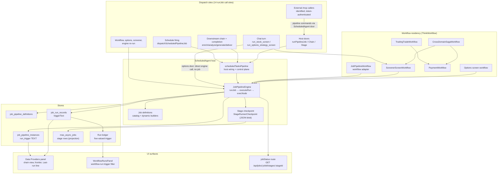

# Jobs, workflows, pipelines, stages — dispatch modes

An operations reference for the job/workflow/pipeline system: what each
component is, how the components differ and interrelate, what each one is
for, which products and user journeys each supports, which execution
modes and dispatch modes each supports, and how a dispatch mode travels
from a dispatch site through a workflow to a job to a stage.

**Verified against main `5ee1f23d` (tag `v0.1.1855`, 2026-11-16).** Every
load-bearing claim cites a file:line. Where the code has no answer, the
doc says so instead of inventing one.

**Related docs — read, not repeated here.** Ids, tracking, auditing,
entity relationships, and status vocabularies live in
[`jobs-workflows-stages-01.md`](jobs-workflows-stages-01.md); the
Workflow Runs tab's read surface is in
[`../agents/workflow-runs.md`](../agents/workflow-runs.md); the
scheduling inventory and the pinned O4 decision live in
[`../architecture/scheduling/3121-s0-inventory.md`](../architecture/scheduling/3121-s0-inventory.md);
stuck-run handling is in [`runbook/stuck-runs.md`](runbook/stuck-runs.md).
This doc links to them rather than duplicating them. What this doc adds
is the component inventory (what each piece is and what it supports),
the dispatch-site inventory, and the hop-by-hop propagation trace.

## Diagrams

The repo's diagram convention is Mermaid `flowchart` blocks (34 docs
under `docs/` use them). Every node and edge below traces to a code
fact cited in the sections that follow; there are no invented boxes
or arrows.

### Relationships — engine, doors, workflows, jobs, stages, stores, UI

### Usage — one dispatch end to end

```mermaid
flowchart LR
    SITE["Dispatch site<br/>e.g. Run now (door), clock firing,<br/>chat turn, or /mcp command"] --> CTRL["Control plane<br/>createScheduledAgentPipelineControl<br/>+ ensureScheduledAgentPipelineJobs"]
    CTRL --> RUNJOB["JobPipelineEngine.runJob<br/>opts: trigger, scopePath,<br/>scheduleId, asyncJobId"]
    RUNJOB --> EXEC["executeRun<br/>stamps runTrigger<br/>resolves definition config"]
    EXEC --> NODE["execNode (per stage)<br/>effectiveMode: root + node<br/>stage plan + checkpoint"]
    NODE --> STEP["Step execution<br/>step library<br/>(feed / enrich / analyze /<br/>generate / deliver / options)"]
    STEP --> CHK["Stage checkpoint<br/>persistLedger<br/>units: status/attempt/times"]
    CHK --> SETTLE["Settlement<br/>terminal run record<br/>trigger = instance.runTrigger"]
    SETTLE --> UI["UI surfaces<br/>chain view, frontier,<br/>Last-run line, jobStatus"]
```

## Vocabulary

These words are used with the meanings the code gives them. They are
not interchangeable.

| Word | Meaning | Where defined |
|---|---|---|
| Job | A named unit of work with a definition and an instance: a `jobId`, a resolved definition, and a run history. One job may be dispatched many times; each dispatch is one run. | `src/services/jobPipelineEngine.ts:794` (`runJob`) |
| Job definition | The versioned, externalized description of a job: its stages (nodes), execution mode, schedule, parameters. Stored in `job_pipeline_definitions`. | `src/data/jobPipelinePorts.ts:42`, `src/config/jobDefinitionCatalog.ts:84` |
| Job instance | The durable per-job record: current state, current run id, the stage checkpoint, `runTrigger`. Stored in `job_pipeline_instances`. | `src/data/jobPipelinePorts.ts:43`, `:222` |
| Run | One dispatch of a job: a `runId`, a trigger, a scope path, a schedule id when clock-fired. Recorded in the run record and the ledger. | `src/services/jobPipelineEngine.ts:794` |
| Workflow | A durable Cloudflare Workflow instance (a `ThinkWorkflow` subclass) that executes a job or a journey. The workflow is the async boundary and the journal, not a second engine. | `src/workflows/jobPipelineWorkflow.ts:1` |
| Pipeline | A job whose stages form a chain. "Pipeline" is a shape of job, not a separate system — and it names no chain by itself: the chains are named by their short ids (see "Chain short ids" below), never by a bare "the pipeline". | `src/services/chainPipelineJobs.ts:1`, `src/config/jobDefinitionCatalog.ts:85` |
| Stage | One node of a job's definition (a `JobNodeConfig`): feed, gather/enrich, analysis, store, serve, deliver. The stage vocabulary is `feed | gather | analysis | store | serve | deliver`. | `src/messaging/messagingPorts.ts:154` |
| Sub-job | One stage addressed on its own (a `scopePath` dispatch, or a stage control action): `GET /api/jobs/:jobId/stages/:stageId`. Sub-jobs are individually schedulable. | `src/agents/routes/jobStatus.ts:6`, `:48` |
| Sub-stage / unit | One execution unit inside a stage. A run without shardable units has one implicit unit; a sharded stage has one unit per shard key. The checkpoint holds one entry per (stage, unit) pair. | `src/workflows/stageRunnerPlan.ts:57`, `src/workflows/stageRunnerPorts.ts:271` |
| Chain | A composed pipeline job: one chain shape's stages, themselves jobs dispatched in order. The shapes are `feedsrc`, `stockscr`, and `optionsscr` (see "Chain short ids" below). | `src/services/chainPipelineJobs.ts:1` |
| Dispatch site | A code site that calls `JobPipelineEngine.runJob`. There are 14, listed in the inventory below. | `src/services/jobPipelineEngine.ts:794` |
| Dispatch mode | Two things, not one: the execution mode (how the run executes) and the trigger (why the run was dispatched). Both are covered below. | `src/data/jobPipelinePorts.ts:60`, `src/data/jobRunRecordPorts.ts:54` |

### Chain short ids (#4774)

Every chain shape is named by one short identifier (user ruling,
issue #4774 comment 6912854849, 2026-11-16). A run is named, traced,
and surfaced under its chain's short id; a bare "the pipeline" names
no chain and must not appear where a chain is named.

| Short id | Chain shape | Stages | Where declared |
|---|---|---|---|
| `feedsrc` | Feed chain (one `*-pipeline` job per quotes feed) | feed → enrich → analyze → generate → deliver | `src/services/chainPipelineJobs.ts` (`FEED_CHAIN_SHORT_ID`) |
| `stockscr` | Screener chain (the static catalog's one family; goal screens ride this chain) | feed → enrich → analyze → store → serve → deliver | `src/workflows/workflowCatalog.ts` (stock-screener), `src/config/jobDefinitionCatalog.ts` (screener spec) |
| `optionsscr` | Options chain (`options.runRoot` / `options.runStage`, 8 execution stages, 4 display stages) | feed → assemble → generate → store → serve → deliver | `src/workflows/workflowCatalog.ts` (options-screener), `src/services/optionsChainJobDefinition.ts` (`OPTIONS_CHAIN_SHORT_ID`) |
| `goalscr` | Goal screen (a family, not a separate chain shape — goal screens ride the screener chain) | feed → analysis → store → deliver (goal-shaped request) | `src/workflows/workflowCatalog.ts` (goal-screen) |
| `strategyscr` | Strategy discovery | analysis → store → deliver | `src/workflows/workflowCatalog.ts` (strategy-discovery) |
| `tradrun` | Trading leg (approval-gated order execution — one family; stocks and options are screening families, not trading) | analysis → store | `src/workflows/workflowCatalog.ts` (trading-leg) |
| `payrun` | Payment run (the charged path) | analysis → store → deliver | `src/workflows/workflowCatalog.ts` (payment-run) |
| `sagarun` | Saga run (one cross-domain journey, payment leg then screen leg, compensable) | payment leg → screen leg | `src/workflows/workflowCatalog.ts` (saga-run) |
| `resrch` | Research (OODA is one research type within the family) | configure → observe → orient → decide → build-and-price → challenge-and-gate → rank-and-report → evaluate-later | Ruled; no catalog family yet — #5118 owns the entry |

OODA option-chain reads reuse the shared `options-chains` feed dataset when a
same-provider artifact is within the configured `quoteFreshnessSeconds` window
and includes the requested symbol. The ResearchDataProvider reads it through
the shared `OptionChainSource`; a missing, stale, or uncovered row falls back
to the run's selected broker platform. The report records whether chain data
came from the persisted feed or the selected broker, and preserves bounded
provider failure details. The feed catalog remains the producer: OODA does not
create a second options fetcher or feed job.

All catalog families now carry a ruled short id (2026-11-17). The
research family is ruled `resrch` but has no catalog family yet —
#5118 owns the research catalog entry.

### Execution-tree levels (#4774)

The short-id system covers ALL levels of the execution tree, not just
chain/family ids (user ruling, issue #4774 comment 6959360479,
2026-11-17). One printable id per instance: `<level-short-id>:<local-id>`
(`src/services/executionTreeIds.ts`, `qualifyExecutionId`).

| Level | Short id | Instance id example | Where the id comes from |
|---|---|---|---|
| Chain | `chain` | `chain:feedsrc` | The ruled chain short ids above |
| Pipeline | `pipe` | `pipe:<feed>-<dataset>` | The chain job's `jobId` |
| Workflow | `wf` | `wf:<workflow instance id>` | The ThinkWorkflow instance |
| Job | `job` | `job:stock-screener` | The job definition's `jobId` |
| Stage | `stage` | `stage:feed` | The stage's node path (bare — `feed`, not `job:feed`) |
| Sub-stage / unit | `unit` | `unit:AAPL` | The stage's shard key |
| Task | `task` | `task:<uuid8>` | A task proposal; a schedule tick is `sched:<uuid>` |
| Run | `run` | `run:m9x-1` | The engine's `newRunId()` |
| Transaction | `txn` | `pay:a1b2c3d4` | The `mas_transactions` `id` PK (a payment draft's id is its row id) |

A stage execution's id is `stage:<runBody>:<stageId>:<unitId>` and a
step execution's id is
`step:<runBody>:<nodePath>:<stepIndex>:<shardKey>:<itemIndex>` — the
journal id the engine passes to `journal.do`
(`jobPipelineEngine.ts`), the durability key for the step's
exactly-once execution. Both embed bodies, never full ids: the run
body (`m9x-1`), not the run id (`run:m9x-1`), and the stage body
(`feed`), not the qualified node id (`job:feed`). A stage-action
CloudEvents id (`event:<runBody>:<stageId>:<unitId>:<action>:<atMillis>:<suffix>`,
`jobPipelineEvents.ts`) shares the stage id's run-body / stage /
unit segments — segment equality, not a string prefix, is the link
between a stage execution and its events.

#### OODA vs run-level stages

The research pipeline has the same stage name at two levels, and the
level is what resolves it: the candidate-level OODA loop's steps are
`ooda:observe` | `ooda:orient` | `ooda:decide` | `ooda:act`
(`OodaStep`, `researchPipeline.ts`), while each run-level pipeline
stage is identified by its stage execution id
(`stage:<runBody>:configure`, `stage:<runBody>:observe`, … —
`PipelineStage`). The `respipe:` namespace that used to qualify
run-level stages was retired by the uniform-convention adoption
(#5175, 2026-11-17); only the candidate-level OODA loop carries a
qualified shortId. The bare `stage` string is unchanged.
The research run's engine onboarding (#5109, CFO lane) is in flight:
the engine job id (`research:<runId>`) and data ports landed (#5121,
`researchDataPorts.ts`); the trigger dispatch (#5120) and the cutover
flag (#5122) are recorded merged; the analyze.ooda step registration
(#5118, PR #5143 open), AOP compliance (#5119, PR #5144 open), and
Copilot execution (#5123, no PR) remain. The direct
`runResearchPipeline` call from ResearchAgent is the pre-cutover /
rollback path. The `ooda:` ids are names the #5118 step
registration can reuse; CLO-arsi does not build it.

#### Per-instance ids

Every run/transaction instance carries a unique id: engine runs mint
`run:<time>-<counter>` (`jobPipelineEngine.ts` `newRunId`), research
runs still mint `rsr_<time>_<rand>` (`researchPipeline.ts` `newRunId`)
— legacy, pending #5175 migration — async jobs mint
`crypto.randomUUID()`, ledger rows carry their `id` PK. A trace
step's instance id is DERIVED, not stored:
`trace:<runBody>:<loop>:<step>:<index>` (e.g.
`trace:m9x-1:ooda:observe:2`) — the index is the entry's position in
its trace array.

## The nine named components

Each entry answers the same five questions: what it is, its purpose,
which products it supports, which user journeys it supports, which
execution modes it supports, which dispatch modes it supports.

### `runJob` — `JobPipelineEngine.runJob`

- **What:** The single dispatch funnel for every chain. Signature
  `runJob(jobId, opts?: { trigger?, scopePath?, scheduleId?,
  asyncJobId?, workflowInstanceId? })`
  (`src/services/jobPipelineEngine.ts:794`). It refuses a dispatch
  when the job is already queued, running, or paused
  (`job_already_running`); it validates the resolved execution mode;
  it mints a run id and hands the run to `executeRun`. Every one of
  the 14 dispatch sites calls this method — there is no other way to
  start a pipeline run.
- **Purpose:** one funnel so that dispatch semantics (already-running
  refusal, mode validation, run-id minting, sync/async contract) are
  decided once, not once per caller.
- **Products:** every product whose work runs on the pipeline — the
  stock screener, the options screener, the feed pipelines (Yahoo,
  Alpaca, and the other feed jobs), goal screens, strategy discovery.
- **User journeys:** every journey that runs a pipeline: a scheduled
  feed pull, a Run now from the Data Providers panel, a chat screen
  from the copilot, a scheduled screen, a workflow-resident run.
- **Execution modes:** all four axes, from the job's resolved
  configuration. `delivery: "sync"` awaits the outcome and returns
  it; `delivery: "async"` returns the handle immediately and the run
  proceeds on the host's behalf. The other axes are resolved per
  stage by `effectiveMode` (see the propagation trace).
- **Dispatch modes:** it accepts `trigger?: "manual" | "scheduled"`
  and defaults it to `"manual"` when the caller passes nothing
  (`src/services/jobPipelineEngine.ts:794`). That default is the
  conflation the three-way trigger split (#4767) exists to fix:
  today a caller that does not say why it dispatched gets recorded
  as manual.

### `scheduledTasksPipeline` — the J1 host wiring

- **What:** The job pipeline's host wiring on the ScheduledAgent
  (`src/agents/scheduledTasksPipeline.ts:1`, issue #3543, Pipeline
  J1). It owns the declaration, the control-plane construction, and
  the dispatch; the class owns storage. The host decision, recorded
  on #3543: the ScheduledAgent manages and controls the pipeline;
  the OrchestratorAgent's doors are invoking surfaces over the same
  control plane. The control plane is built over the agent's DO
  SQLite, run records go through the platform JobRunRecordStore,
  and status publication rides the `JOB_PIPELINE_EVENTS` queue.
- **Purpose:** the host side of the pipeline — where jobs are
  declared, scheduled, and dispatched from.
- **Products:** the same set as `runJob` — it is the host that
  `runJob` runs on.
- **User journeys:** scheduled runs (the clock firing a feed job or
  a screen), downstream chain runs (a stage firing the next stage),
  and the host doors' Run now.
- **Execution modes:** it does not choose a mode; it builds the
  control plane the engine resolves modes on. Schedule firing uses
  the job's configured delivery (async is the feed jobs' default —
  the firing settles the run in the background so its records
  complete with the agent's lifetime).
- **Dispatch modes:** its own firing passes `trigger: "scheduled"`
  (`src/agents/scheduledTasksPipeline.ts:709`). Its downstream chain
  dispatches also pass `"scheduled"`
  (`:993`, `:1039`, `:1085`, `:1131`) — a Q1 ruling (2026-11-16,
  recorded on #4767) keeps that: chain/completion firings stay
  `"scheduled"` as the system-caused bucket.

### `runPipelineJob` — host door (Run now, one job)

- **What:** "Run one pipeline job now and settle it; returns the
  outcome view" (`src/agents/scheduled-agent.ts:935`). It builds the
  control, ensures the job definitions exist on the host, dispatches
  through `control.runJob`, and awaits the outcome when the delivery
  mode is async (the door settles the run; the engine's async handle
  is awaited here, not returned).
- **Purpose:** the Run now door the feed-run route and the UX use to
  run a job out of band.
- **Products:** the feed pipelines (the Data Providers panel's Run
  now) and any job the UX runs on demand.
- **User journeys:** an operator pressing Run now on a feed dataset
  in the Data Providers panel; any UX flow that runs a job now.
- **Execution modes:** it does not set a mode; the job's configured
  mode applies. It awaits settlement regardless of the delivery
  mode, so from the caller's side a Run now always looks
  synchronous even when the engine dispatched async.
- **Dispatch modes:** it hardcodes `trigger: "manual"`
  (`src/agents/scheduled-agent.ts:935`). That is one half of the
  conflation #4767 names: a Run now on a scheduled job is recorded
  as manual, indistinguishable from an ad-hoc UX run.

### `runPipelineChain` — host door (Run now, a chain)

- **What:** Like `runPipelineJob`, but for a chain job: it refreshes
  the chain definition from the stored stage definitions first, "so
  a stage reconfigured through the control plane is what the chain
  runs" (`src/agents/scheduled-agent.ts:1466`), then dispatches and
  settles it.
- **Purpose:** Run now for a whole chain (feed → enrich → analyze →
  generate → deliver) with the current stage configuration.
- **Products / journeys:** the same as `runPipelineJob`, for chain
  jobs rather than single jobs — the J-stack chain from the Data
  Providers panel.
- **Execution modes:** the chain's configured mode applies per
  stage; the door awaits settlement.
- **Dispatch modes:** it hardcodes `trigger: "manual"`
  (`src/agents/scheduled-agent.ts:1466`).

### `runPipelineStage` — host door (Run now, one stage)

- **What:** "Run one pipeline job stage now and settle it; the
  scoped dispatch (`scopePath` = the stage's node path) with the
  dispatching schedule id threaded, so the terminal run record
  joins to the schedule and to the workflow instance"
  (`src/agents/scheduled-agent.ts:963`). The engine refuses a
  retired scope (fail-closed).
- **Purpose:** run or re-run a single stage of a job — the scoped
  sub-job dispatch.
- **Products / journeys:** any pipeline job, for a stage-level
  Run now or re-run from the jobStatus route's stage controls
  (`run | rerun | stop | resume | cancel`,
  `src/agents/routes/jobStatus.ts:49`).
- **Execution modes:** the dispatched node's resolved mode applies
  (`effectiveMode` merges root + node); a scoped run executes only
  that sub-tree.
- **Dispatch modes:** it takes an explicit trigger param
  (`trigger?: "manual" | "scheduled"`) and defaults it to
  `"scheduled"` when the caller passes nothing
  (`src/agents/scheduled-agent.ts:963`) — the only door whose
  default is not `"manual"`.

### `jobPipelineWorkflowFlow` — the workflow residency

- **What:** The workflow-side flow for pipeline jobs
  (`src/workflows/jobPipelineWorkflowFlow.ts:1`, issue #3534,
  Pipeline J1). The durable execution substrate's half of the
  engine. The flow dispatches the job through the SAME control
  plane the UX and copilot doors use — a workflow run is one
  dispatch surface, not a second engine. The workflow's step
  object becomes the engine's journal: each step invocation is
  wrapped in `step.do`, so a workflow replay re-uses journaled
  step results while the engine's persisted checkpoints carry the
  resume semantics. Claim-check discipline: the payload carries
  ids and the trigger only — never configuration or data; the
  definition is read from the job stores at run start.
- **Purpose:** run a pipeline job as a durable Cloudflare Workflow
  instance (ThinkWorkflow residency) instead of on the
  ScheduledAgent host, without forking the engine.
- **Products:** any pipeline job whose residency is the workflow
  substrate (the options screen's durable start seam is the live
  example — `src/workflows/optionsWorkflowHost.ts:1`).
- **User journeys:** a workflow-resident run — started from the
  options screen or any other workflow entry — that must survive
  host eviction by replay.
- **Execution modes:** whatever the job's definition configures;
  the flow awaits the run's outcome and returns it as the workflow
  result whatever the configured delivery mode ("the workflow is
  the async boundary").
- **Dispatch modes:** the payload type is
  `trigger?: "manual" | "scheduled"`, and the flow dispatches with
  `payload.trigger ?? "manual"`
  (`src/workflows/jobPipelineWorkflowFlow.ts:77`).

### `optionsScreenEngine` — the options screen's engine

- **What:** The options screen's own engine surface
  (`src/workflows/optionsScreenEngine.ts`). It builds its OWN
  `JobPipelineControl` (with `invocation: "sync"`, a separate
  control instance from the host's), defines the per-run job with
  `defineJob`, and dispatches it with `runJob`. The dispatch
  request rides the job definition's rawConfig (persisted by
  `defineJob`) so a later per-stage control action can rebuild
  the run's step ports from it (#4066).
- **Purpose:** run an options screen end to end — plan, chain
  fetch, enrich, screen, risk, persist, shape, deliver — on the
  one options pipeline.
- **Products:** the options screener.
- **User journeys:** an options screen from the Options Screener
  tab, and the comparison run (a second dispatch of a comparison
  job for the same request).
- **Execution modes:** the per-run job definition's configured
  mode; the control is built with `invocation: "sync"`, which is
  the control's own invocation style, not the job's delivery mode.
- **Dispatch modes:** the main dispatch passes
  `params.trigger ?? "manual"` (`:1019`); the comparison dispatch
  hardcodes `"manual"` (`:1200`).

### `screenerWorkflow` — `ScreenerScreenWorkflow`

- **What:** The adapter-side workflow class for screener
  decoupling (`src/workflows/screenerWorkflow.ts:1`, #1737 →
  #4192). Thin by design (mirroring `TradingTradeWorkflow`):
  `run()` validates the payload, builds the engine deps from the
  environment, and dispatches via the engine (`defineJob` +
  `runJob`, workflow step as journal), then reads back the
  collation artifact. Every decision lives in
  `screenerPipelineJobs.ts` (the stage registry) and
  `screenerCollation.ts` (the collation composer).
- **Purpose:** run a stock screen as a durable workflow — the
  decoupling seam between the chat/copilot request and the
  screener engine.
- **Products:** the stock screener (and goal screens, which execute
  through the screener workflow with a goal command —
  `src/workflows/workflowCatalog.ts:377`).
- **User journeys:** a stock screen from chat or the Stock Hub;
  a goal screen from the goal journey.
- **Execution modes:** the per-run job definition's configured
  mode (built by `ensureScreenerJob`).
- **Dispatch modes:** it passes `runCommand.trigger`
  (`src/workflows/screenerWorkflow.ts:308`) — the trigger the
  bridge command carried (`runBridge.ts:59`,
  `trigger: "manual" | "scheduled"`).

### `jobPipelineEngine` — `JobPipelineEngine`

- **What:** The engine itself (`src/services/jobPipelineEngine.ts`).
  It owns definitions, instances, checkpoints, dispatch
  (`runJob`), execution (`executeRun` → `execNode` per stage),
  scheduling registration (`registerSchedules`), settlement, and
  the stage views. It is the one place where execution mode is
  resolved (`effectiveMode`, `:2743`), validated
  (`assertExecutionModeSupported`), and where the trigger is
  stamped (`executeRun`, `:2162`).
- **Purpose:** the single execution substrate for every pipeline
  job on every surface.
- **Products:** all of them — every job family flows through it.
- **User journeys:** all of them — every dispatch site ends here.
- **Execution modes:** all four axes, resolved per stage from the
  definition (root mode merged with the node's own override), with
  the online+sync refusal. See the execution-mode reference.
- **Dispatch modes:** it accepts `trigger` on `runJob`, defaults
  it to `"manual"`, stamps it on the instance at dispatch, and
  reads it back at settlement. It also has one internal re-run
  site that hardcodes `"manual"` (`:1032`).

## Dispatch surfaces

The nine components above are the internals. These are the
surfaces a dispatch arrives through — the chat turn, the REST
API, the MCP server, and the service (control-plane) surface.
Every surface ends in the same `runJob`; none is a second
engine entry.

### Agentic mode — chat, preferred

- **What:** The chat turn is the preferred entry point. The
  turn's tools are discovered at runtime from the platform's
  own openaimp MCP server through the Agents SDK MCP client
  (`src/agents/orchestrator/meshMcpClient.ts`) and merged into
  the turn by Think under `tool_openaimp_<name>` keys, alongside
  the native turn tools (`src/agents/registry.ts:1335`; #2496).
  The turn's own prompt names the two screen tools as THE tools
  for the job (`src/agents/chatPrompt.ts:264–266`):
  `tool_openaimp_run_stock_screen` is THE universe-screen tool;
  `tool_openaimp_run_options_strategy_screen` is THE
  options-strategy-screen tool, never deflected to a UI workflow.
- **The two screen doors.** `run_stock_screen` (Batch E, #2488)
  runs the chat turn's universe stock screen as a
  `ScreenerScreenWorkflow` run through the mesh screen door
  (`src/agents/orchestrator/meshScreenDoor.ts:2`), a door-layer
  service built WITHOUT NLQ. It has no direct-ScreenerAgent
  fallback: an unavailable workflow port is a coded
  `door_unavailable` refusal with zero runs started
  (meshScreenDoor.ts:40–52). Its workflow command's source is
  `"mesh-door"`, not `"nlq-chat"` — the trigger source is audit
  data. `run_options_strategy_screen` (Batch F, #2581) runs the
  chat turn's options strategy screen through the mesh
  options-strategy door
  (`src/agents/orchestrator/meshOptionsStrategyDoor.ts:2`): the
  structured constraints (catalog strategy type, max loss, min
  profit) are assembled into the engine's filters and evaluated
  by `runOptionsStrategyAction` — the same seam the NLQ
  `options_opportunities` action dispatches to — and returned
  directly. Its carriage is a single awaited inline scan: there
  is no workflow, job, or read-back behind it to await.
- **NLQ is off by default in the turn.** `execute_nlq` stays
  registered and wired (catalog, `/mcp` surface, facade, async
  `nlq.execute` capability, A2A, routes, channels) but is
  flagged off in the turn by the `CHAT_NLQ_MODE` switch
  (`src/config/chatNlqModes.ts:15–16`, built-in default `"off"` —
  "the chat turn's tool set does not offer `execute_nlq` to the
  model"). Resolution is user > global env > built-in `"off"`,
  and an unrecognized value fails closed to `"off"`
  (chatNlqModes.ts:38–47). The NLQ modules
  (`src/agents/nlq/` — execution, planning, llmPlanning,
  schema, types) keep serving their own callers: the async
  `nlq.execute` capability, A2A, and the chat error fallback
  (meshScreenDoor.ts:35–36). The chat screen path does not
  depend on NLQ, and the owner direction behind that (#2488,
  2026-10-30) was explicit: build the solution without NLQ,
  keep NLQ in the turn but don't use it, turn it off with a flag.
- **The bridge.** `runBridge.ts` (#3787, sub-issue of incident
  #3781) inserts `mas_async_jobs` rows for runs that do NOT
  execute as async jobs — `ScreenerScreenWorkflow` runs started
  by the mesh screen door and J1–J7 pipeline-chain runs started
  through the mesh doors — so the #3784 stale sweep (30-min
  alert, 2h reap) covers them. Its trigger is
  `"manual" | "scheduled"` (runBridge.ts:59). The bridge is
  best-effort and never fails the run: every function catches
  its own failures and reports them as a return value, never a
  throw.
- **Purpose:** the user asks in prose and the turn runs the
  pipeline — screens, strategy screens, and (through the G1
  mesh doors) the other agents — without the user touching a
  panel or an API.
- **Products / journeys:** stock screens and goal screens from
  chat (through the mesh screen door), options strategy screens
  from chat (through the mesh options-strategy door), paid
  screens (the screen door's paid path: budget door, payment
  workflow submission), and — via the mesh doors — the
  ScheduledAgent, PaymentsAgent, TradingAgent, ReportAssetAgent,
  BrowserAgent, and SlackAgent families (registry.ts:947).
- **Execution modes:** the stock screen door dispatches through
  the engine (`ScreenerScreenWorkflow` → `runJob`), so the
  job's configured mode applies. The options strategy door
  carries no job and therefore no execution mode: its scan is
  an awaited inline engine call.
- **Dispatch modes:** the screen door's runs carry the
  `"mesh-door"` source and the bridge trigger
  (`"manual" | "scheduled"`). The options door stamps no
  trigger: there is no run record behind its direct return.

### REST API endpoints

- **What:** The routes are handler functions invoked from
  `OrchestratorAgent.routeRequest` in a sequential
  path-matching sequence, returning a `Response` on match and
  null when no path matches
  (`src/agents/routes/dataProviders.ts:3–8`). Paths in the
  route files are the DO-internal spellings: `src/server.ts`
  strips the `/api` prefix when forwarding, so externally these
  are `/api/*` (dataProviders.ts:33–36). Session gate (#1156):
  production traffic reaches the DO only through `src/server.ts`'s
  generic `/api/` forwarder, which runs `requireAuth` on EVERY
  `/api/*` request before forwarding and sets the `x-user-login`
  header from the verified session; mutations additionally refuse
  to run without that verified login in the route context (401).
- **Inventory — routes that dispatch or control jobs:**

| Method + path | What it dispatches / controls |
|---|---|
| `POST /api/data-providers/:id/feed-run` | Run the provider's feed job now (#3530 S1; through the pipeline host door since #3578 — `door.runPipelineJob`, `src/agents/routes/dataProviders.ts:1006`) |
| `POST /api/data-providers/:id/feed-jobs/:jobId/:action` | `run` \| `pause` \| `resume` \| `cancel` \| `retry` a feed job (#3535) |
| `POST /api/data-providers/:id/feed-jobs/:jobId/schedule` | Configure a feed job's stored schedule (#3530) |
| `POST /api/data-providers/:id/enrich-jobs/:jobId/:action` | `run` \| `pause` \| `resume` \| `cancel` \| `retry` an enrich job (#3536) |
| `POST /api/data-providers/:id/analyze-jobs/:jobId/:action` | Same actions for an analyze job (#3537) |
| `POST /api/data-providers/:id/generate-jobs/:jobId/:action` | Same actions for a generate job (#3538) |
| `POST /api/data-providers/:id/deliver-jobs/:jobId/:action` | Same actions for a deliver job (#3539) |
| `POST /api/data-providers/:id/pipeline-chains/:jobId/:action` | `run` \| `pause` \| `resume` \| `cancel` \| `retry` a chain, or `stage_pause` \| `stage_resume` \| `stage_cancel` one of its stages (stage in the JSON body) (#3540) |
| `POST /api/job-definitions/:id/define` | Define an engine job from a spec (#4366); per-stage overrides (#4466): `stageParams`, `stageModes`, `stageSchedules` |
| `POST /api/jobs/:jobId/stages/:stageId/(run\|rerun\|stop\|resume\|cancel)` | Drive one stage of one run (#4362; matched on POST only, `src/agents/routes/jobStatus.ts:80`) |
| `POST /api/data-providers/:id/register\|configure\|verify\|enable\|disable\|deprovision` | Provider lifecycle (provisioning, not job dispatch) |
| `POST /api/schedules` | Create a schedule; the define flow's second half, with callback `runPipelineJobSchedule` (the Orchestrator host method that runs one engine job) (`src/agents/routes/jobDefinitions.ts:10–13`) |

- **Inventory — read-only job routes (same files, for
  completeness):** `GET /api/data-providers` (configs + routes
  + servability), `GET /api/data-providers/:id`,
  `GET /api/data-providers/:id/feed`,
  `GET /api/data-providers/:id/feed-jobs`,
  `GET /api/data-providers/:id/enrich-jobs`,
  `GET /api/data-providers/:id/analyze-jobs`,
  `GET /api/data-providers/:id/generate-jobs`,
  `GET /api/data-providers/:id/deliver-jobs`,
  `GET /api/data-providers/:id/pipeline-chains`,
  `GET /api/job-definitions` (the externalized catalogue),
  `GET /api/jobs/:jobId/status` (whole job + per-sub-job
  roll-up, #4361), `GET /api/jobs/:jobId/stages/:stageId` (one
  sub-job), `GET /api/saga/:sagaId/status` (the panel's `{jobs}`
  shape, #2041 S4 — owner-scoped, 404 for another user's saga;
  NOT flag-gated; live instance status best-effort).
- **Purpose:** the programmatic surface the UX itself uses —
  the Data Providers panel's Run now and chain controls call
  these routes, and the define view's define + schedule flow
  calls the definition and schedule routes.
- **Products / journeys:** feed pipelines (every provider),
  pipeline chains, job definitions, per-stage control, saga
  status — for the operator in the UI and for any authenticated
  caller.
- **Execution modes:** the dispatching routes call the host
  doors, so the job's configured mode applies; the define route
  is the one place a mode is set from outside the code
  (`stageModes` overrides, #4466). The status routes read,
  never dispatch — except the POST stage-control route, which
  drives one stage through the scoped `runPipelineStage`
  dispatch.
- **Dispatch modes:** the dispatching routes ride the doors, so
  their trigger is the doors' `"manual"` (the #4767
  conflation) — including a define-flow schedule firing: the
  callback `runPipelineJobSchedule` calls
  `door.runPipelineJob(jobId, { userLogin })` with no trigger
  (`src/agents/orchestrator.ts:1111–1125`), so `runJob`
  defaults it to `"manual"`. A job scheduled from the define
  view therefore records its firings as manual, not scheduled
  — another case for #4767.

### MCP endpoints

- **What:** The platform's own openaimp MCP server
  (`src/mcps/openaimp/`). Commands are `IMcpToolCommand`
  objects adapted into tools (`src/agents/mcpAdapter.ts`). Since
  #2496 the chat turn consumes the exact MCP surface external
  clients consume (Claude Desktop, Cursor, Antigravity) — the
  dogfooding guarantee: the turn's catalog tools are discovered
  at runtime from the platform's own MCP server through the
  Agents SDK MCP client and merged by Think under
  `tool_openaimp_<name>` keys (mcpAdapter.ts:11–16;
  registry.ts:1335).
- **The `/mcp` route.** `handlePlatformMcpRoutes`
  (`src/server/routes/platform.ts:323`) serves `/mcp`,
  `/api/mcp`, `/mcp/scanner`, `/mcp/scanner/*`
  (`src/server.ts:193–196`). Transport identity is the app
  session OR a per-user API key (`Authorization: Bearer …`,
  bound to the login that minted it); the caller-asserted
  `x-user-id` header no longer asserts anything, and no
  credential returns 401 before any DO access
  (platform.ts:324–334). The verified login is threaded into
  the forwarded request as the `x-user-login` header, with
  `x-principal-kind` (`session` or `api-key`) alongside it
  (platform.ts:342–358). The CSRF gate exempts
  token-authenticated `/mcp` (server.ts:111).
- **Inventory — command families that dispatch pipeline work.**
  All ride the ScheduledAgent pipeline door
  (`src/agents/orchestrator/meshDoors.ts:237–238` — "the
  ScheduledAgent host's control-plane RPC surface (#3543)"),
  unless noted:

| Batch / issue | Commands | What they dispatch / control |
|---|---|---|
| G / #3535 | `run_feed_job`, `get_feed_job_status`, `list_feed_jobs`, `manage_feed_job`, `get_feed_job_schedule`, `set_feed_job_schedule` (`src/mcps/openaimp/feedJobCommands.ts:40,68,93,113,241,273`) | run / status / list / manage (+ schedule read/write) for the per-source feed jobs |
| H / #3536 | `run_enrich_job`, `get_enrich_job_status`, `list_enrich_jobs`, `manage_enrich_job` (`enrichJobCommands.ts:39,67,92,112`) | Same four for the enrich jobs |
| I / #3537 | `run_analyze_job`, `get_analyze_job_status`, `list_analyze_jobs`, `manage_analyze_job` (`analyzeJobCommands.ts:41,69,94,114`) | Same four for the analyze jobs |
| J / #3538 | `run_generate_job`, `get_generate_job_status`, `list_generate_jobs`, `manage_generate_job` (`generateJobCommands.ts:42,70,95,115`) | Same four for the generate jobs |
| K / #3539 | `run_deliver_job`, `get_deliver_job_status`, `list_deliver_jobs`, `manage_deliver_job` (`deliverJobCommands.ts:42,70,95,115`) | Same four for the deliver jobs |
| L / #3540 | `run_pipeline_chain`, `get_pipeline_chain_status`, `list_pipeline_chains`, `manage_pipeline_chain` (`chainJobCommands.ts:51,109,135,160`) | run / status / list / manage for the composed pipeline chains — the five stage jobs of one lineage as one job — including per-stage pause/resume/cancel inside a chain run (registry.ts:947) |
| M / #4066 | `options_copilot_stage_control` (`src/agents/orchestrator/meshOptionsStageControlDoor.ts:1–6`) | Per-stage run/rerun/stop/resume/cancel of an options screen by (runId, stageId) on the 8-stage vocabulary, through `src/workflows/optionsStageControl.ts`; since #4272 the same door drives strategy runs (`strategy-screen:<runId>`) |
| E / #2488 | `run_stock_screen` (mesh screen door) | The chat turn's universe stock screen as a `ScreenerScreenWorkflow` run |
| F / #2581 | `run_options_strategy_screen` (mesh options-strategy door) | The chat turn's options strategy screen, direct return |
| — | `stock_copilot_stage_control`, `get_job_status`, `get_job_stage_status`, `set_job_execution_mode` (`jobStageControlCommands.ts:32`, `jobStatusCommands.ts:32,53`, `jobExecutionModeCommands.ts:29`) | Adjacent: stock per-stage control, job/stage status reads, and setting a job's execution mode (names verified; behavior not re-derived here) |

- **Identity.** The commands require the caller's acting
  identity (the context `actingLogin` carrier) and fail closed
  without one; since #2496 they also serve identified external
  MCP callers — the `/mcp` route threads the edge-verified login
  into the same carrier — while anonymous MCP callers still fail
  closed, and the A2A doors remain the cross-instance surface
  for these agents (registry.ts:947).
- **Purpose:** the same control-plane operations the Data
  Providers UX dispatches, exposed as tools — for the chat turn
  (by discovery) and for identified external callers (by
  `/mcp`). "The same control-plane operations the Data Providers
  UX dispatches, never a second engine entry" (registry.ts:947,
  Batch G).
- **Products / journeys:** every pipeline family (feed, enrich,
  analyze, generate, deliver, chains), the stock and options
  screens, and per-stage control — from chat or from an external
  MCP client acting as the user.
- **Execution modes:** the pipeline-door commands call the same
  control-plane operations as the UX, so the job's configured
  mode applies; `set_job_execution_mode` is the command that
  changes a job's mode.
- **Dispatch modes:** the door commands ride the host doors, so
  their trigger is the doors' `"manual"` (the #4767
  conflation).

### Service endpoints

- **What:** The callable operations are
  `createScheduledAgentPipelineControl`
  (`src/agents/scheduledTasksPipeline.ts:485`) and the doors
  (`runPipelineJob` :935, `runPipelineChain` :1466,
  `runPipelineStage` :963 in `src/agents/scheduled-agent.ts`).
  The control is built over the agent's DO SQLite with the
  stores, the run recorder, the settlement observer, and the
  step registry (feed, enrich, analyze, generate, deliver, and
  screener steps); the feed execution bound resolves from env
  here (`FEED_JOB_EXECUTION_MS`, 240s when no knob is set —
  #4312, scheduledTasksPipeline.ts:501–505). The doors are the
  typed RPC surface the orchestrator calls across the
  agent boundary: `ScheduledAgentDoorStub`
  (`src/agents/orchestrator/meshDoors.ts:234–295`) declares
  `runPipelineJob`, `runPipelineStage`, `runPipelineChain`,
  `pause` / `resume` / `cancel` / `retry` for jobs and chains,
  `configurePipelineJob` (the schedule write path), and the
  per-family surface-status reads.
- **Who calls them.** The REST routes (the data-providers
  feed-run and feed-jobs actions ride the door; the jobStatus
  control route drives a stage through the scoped
  `runPipelineStage` dispatch, `src/agents/routes/jobStatus.ts:80–92`;
  the scheduled callback drives a stage the same way,
  `src/agents/orchestrator/scheduledCallbacks.ts:1094`); the MCP
  command implementations (the door's `runPipelineJob` is called
  from `meshDoors.ts:523,702,826,950,1074` and
  `runPipelineChain` from `:1244`); the orchestrator itself
  (`src/agents/orchestrator.ts:1125`); and the UX, through the
  routes. The control is cached on the pipeline context
  (`if (ctx.control) return ctx.control`,
  scheduledTasksPipeline.ts:488) — one control per host, not one
  per caller.
- **Purpose:** the one control plane every surface rides. The
  host wiring (J1) builds it; the doors are invoking surfaces
  over it; the MCP commands, the REST routes, and the chat doors
  all dispatch through it.
- **Products / journeys:** all of them — every job family flows
  through this control.
- **Execution modes:** the control carries the job's configured
  mode; the doors do not choose a mode. `configurePipelineJob`
  is the service-level schedule write.
- **Dispatch modes:** the doors' trigger behavior is the
  #4767 conflation in miniature — `runPipelineJob` and
  `runPipelineChain` hardcode `"manual"`, `runPipelineStage`
  takes a param defaulting to `"scheduled"`.

## The workflow catalogue — all seven workflows

`src/workflows/workflowCatalog.ts` declares every workflow the
catalogue knows (`WORKFLOW_CATALOG`). Each declaration carries an
id, a family, a label, whether it has a stage seam, its runtime
steps, whether it is runnable from the UI, its run path, and its
stages. Each stage declares what it persists, what it publishes,
what it consumes, whether it needs approval, and which runtime
stage ids it covers. The stage vocabulary is
`feed | gather | analysis | store | serve | deliver`
(`src/messaging/messagingPorts.ts:154`).

| Workflow | Family | Stages (display) | Runnable | Run path | What it is for |
|---|---|---|---|---|---|
| `stock-screener` | stock | feed, gather, analysis, store, serve, deliver | yes | `?tab=stock-hub&view=new-screen` | The stock screen: plan, fetch quotes, enrich, filter, rank, persist the canonical report, shape it, deliver it. Six stages in canonical order, each a producer/consumer on the stage seam. | 
| `options-screener` | options | feed, store, serve, deliver (display) | yes | `?tab=options-screener` | The options screen. The display stages partition eight execution stages (feed covers plan/chainFetch/enrich/screen/risk; store covers persistCanonicalResults; serve covers shapeReport; deliver covers deliver). Feed, store, and serve are presentation only, never control addresses; deliver is the one id shared with execution stage 8. |
| `trading-leg` | trading | analysis, store | no | — | The trading leg: approval-gated before execution. Two stages only: await-approval (persists the approval decision) and settle-trade (persists the settlement). No feed and no separate delivery stage exist. |
| `payment-run` | payment | analysis, store, deliver | no | — | The charged path, gate-checked before anything is confirmed: gate-check, record checkout/approval, confirm paid, record the payment and the native ledger entry, record usage. |
| `saga-run` | saga | feed, analysis, deliver | no | — | One cross-domain journey, payment leg then screen leg, compensable: the payment leg, the screen leg, and compensation if the screen fails. |
| `goal-screen` | goal | feed, analysis, store, deliver | no | — | Goal screens. They execute through the screener workflow with a goal command; their stage ids are the stock seam's, not separately declared. |
| `strategy-discovery` | strategy | analysis, store, deliver | yes | `?tab=options-screener` | Ranked strategies, no artifacts by design. Stages are recorded on the unified run record, not as stage-message topics. |

The catalogue also declares each stage's modes (`StageModes`,
`src/workflows/workflowCatalog.ts:38`): delivery sync/async,
concurrency sequential/parallel, pacing batch/online, shape
sharded/monolith — the same names and values as the engine's
execution-mode axes (#4772 unified the two namings on the engine's
names; the catalogue's old names timing/volume/partitioning and the
`monolithic` spelling are retired).

## The stage-job builders — J2 through J7, plus options and screener

Each stage of the J-stack chain is built by its own module in
`src/services/`, and each module is the composition point between
the landed foundations for that stage: the job definitions, the
step the runs execute, name resolution for the copilot/UX surfaces,
and the merged status view.

| Stage job | Module | Issue | What it builds |
|---|---|---|---|
| J2 feed | `feedPipelineJobs.ts` | #3535 | The feed jobs as J1 pipeline jobs: definitions, the step library the runs execute, the merged status view. The feed pull step hardcodes `trigger: "manual"` in its `runOpts` (`:583`) — the second trigger channel (see the propagation trace). |
| J3 enrich | `enrichPipelineJobs.ts` | #3536 | The enrich jobs as J1 pipeline jobs. |
| J4 analyze | `analyzePipelineJobs.ts` | #3537 | The analyze jobs as J1 pipeline jobs. |
| J5 generate | `generatePipelineJobs.ts` | #3538 | The generate jobs as J1 pipeline jobs. |
| J6 deliver | `deliverPipelineJobs.ts` | #3539 | The deliver jobs as J1 pipeline jobs. |
| J7 chains | `chainPipelineJobs.ts` | #3540 | The composed pipeline chains as J1 pipeline jobs: definitions, name resolution, and the end-to-end status roll-up. |
| Options steps | `optionsPipelineJobs.ts` | #4289 | The options steps for the workflow residency: the resolving registration of `options.runRoot` / `options.runStage`. |
| Screener substrate | `screenerPipelineJobs.ts` | #4190 | The screener substrate: the job-definition builder, the screener step registry, and the per-stage step handlers that let the one engine execute a stock screen. |

The feed runners themselves live in `src/services/feedJobs.ts`:
`runFeedJob` (:927), `runFeedFundamentalsJob` (:1221),
`runFeedTechnicalsJob` (:1512), `runFeedSentimentJob` (:1853),
`runFeedOptionsChainsJob` (:2290). Each takes
`RunFeedJobOptions.trigger?: "manual" | "scheduled"` (:739) and
defaults it (`opts.trigger ?? "manual"`). The registry builder is
`buildFeedJobRegistry` (`feedJobs.ts:374`); the definition builder
is `buildFeedPipelineJobDefinition`
(`feedPipelineJobs.ts:352`).

## The other workflows, jobs, and seams

### Trading — `TradingTradeWorkflow` and the saga

- **Trading (`trading-leg`).** There is no file literally called
  `tradingWorkflow`. The trading workflow is the class
  `TradingTradeWorkflow` (`src/agents/trading-trade-workflow.ts:206`,
  extending `ThinkWorkflow` with agent-type `any`) plus the
  catalog's `trading-leg` declaration
  (`src/workflows/workflowCatalog.ts:253`). It executes two steps:
  `await-approval`, then `settle-trade` through the approval door.
  It is approval-gated before execution; it is not runnable from
  the UI (`runnable: false`, `runPath: null`). Products: trade
  execution for the trading product. Journey: a screen's
  recommendation reaching settlement, with a human approval gate
  in between. Execution modes: the workflow substrate's modes;
  the trade itself is one approval step and one settlement step,
  not a fanned-out pipeline. Dispatch modes: it is dispatched by
  the saga or by the approval flow, not by `runJob` directly —
  see the saga below.
- **Saga (`saga-run`).** `CrossDomainSagaWorkflow`
  (`src/workflows/sagaWorkflow.ts`, #2041) with the deterministic
  flow in `sagaWorkflowFlow.ts`. One cross-domain journey:
  payment leg, then screen leg, compensable if the screen fails.
  Its legs live in `sagaTradeLeg.ts`, `sagaCompensation.ts`,
  `sagaRiskStage.ts`, `sagaTerminal.ts`, `sagaLegPort.ts`,
  `sagaJourneyGate.ts`, `sagaOutcomeNotice.ts`, and the stage
  Blocks in `blocks/sagaBlocks.ts`. Products: paid screener runs.
  Journey: a user pays for a screen and the screen runs, with
  compensation (refund/credit) if the screen leg fails after
  payment. Execution modes: the saga's own step execution (the
  Blocks in `blocks/uniformExecution.ts`); it composes the
  payment and screen workflows rather than running pipeline
  stages itself. Dispatch modes: the saga is started as a
  workflow; its legs dispatch the payment and screen workflows.
- **Payment (`payment-run`).** `PaymentWorkflow`
  (`src/workflows/paymentWorkflow.ts`, #2014, live) with the flow
  in `paymentWorkflowFlow.ts`. The durable payment wrapper for
  screener runs: gate-check, record checkout and approval,
  confirm paid, record the payment, the native ledger entry, and
  usage. Products: the paid screener. Journey: checkout → payment
  → screen. It does not create a payment agent; `PaymentsAgent`
  already exists (`src/agents/payments-agent.ts`).

### Options screen — workflow, engine, host, manual and goal legs

- **Options screen workflow** (`src/workflows/optionsScreenWorkflow.ts`,
  #3186 step 2): a thin composer of ordered stage Blocks and
  nothing else. Each stage, in pipeline order: claim run id +
  stage id (already claimed → skip, never re-run); execute (reads
  only persisted input, by artifact key); persist (canonical
  store), then publish the stage message (persist-then-publish;
  publish never throws — a publish miss is warned, never a failed
  run); a stage failure stops the run loudly.
- **Options workflow host** (`src/workflows/optionsWorkflowHost.ts`,
  #4289): the options screen's durable start seam — define the
  per-run job in the workflow residency (D1) and create the
  `JobPipelineWorkflow` instance that executes it, with the
  workflow step as the engine's journal. The mirror of the
  scheduled host's start seam.
- **Manual legs:** `manualOptionsScreen.ts` (the manual entry's
  shapeReport/deliver for the one options pipeline),
  `manualPanelScreen.ts` (the manual panel route's pipeline call:
  `POST /trading/options/strategies` + `/best-trade` run through
  the one options pipeline), `goalOptionsLeg.ts` (the goal leg's
  shapeReport/deliver — a leg inside a composed run does not
  deliver itself: the GOAL run delivers), `goalStockScreenSpec.ts`
  (#2882 — the goal stock leg translated to a stock-screen run
  spec).
- **One-engine seams:** `runStockScreenViaEngine.ts` (#4278 — the
  one shared seam every direct stock-screen entry routes through
  instead of calling `ScreenerAgent.runScreen` / `runSharded`)
  and `runGoalScreenViaEngine.ts` (#4279 — the one seam the A2A
  `screener.run_goal_screen` entry routes through).

### Mesh doors and the bridge

- **Mesh doors** (`src/agents/orchestrator/meshScreenDoor.ts`):
  build `WorkflowJobCommand` objects for mesh-dispatched screens,
  hardcoding `trigger: "manual"` (`:568`, `:659`, `:1027`). The
  mesh trigger rides the command (#2908). These are per-run jobs
  with no schedule, so `"manual"` stays correct for them under
  the three-way split — they need no behavior change, only the
  widened type.
- **Bridge** (`src/agents/orchestrator/runBridge.ts`): the run
  bridge between chat/copilot and the engine. Its
  `BridgeRunStartInput.trigger` is `"manual" | "scheduled"`
  (`:59`); the screener workflow passes `runCommand.trigger`
  through to `runJob`. The engine job id IS the bridge id for a
  chat stock screen, so the terminal D1 record carries it and
  links to the bridge row that dispatched the run (#4357).

### Completion firing

- **Completion** (`src/agents/scheduledTasksCompletion.ts`): when
  a run completes, its completion bindings fire the next job
  (`:65`, `trigger: "scheduled"`). A self-trigger is refused by
  name (`self-trigger refused`), and a completion that does not
  match its trigger binding is skipped. Q1 (ruled 2026-11-16,
  recorded on #4767) keeps these firings `"scheduled"`.

### The stage-runner substrate

- **Stage runner plan** (`src/workflows/stageRunnerPlan.ts`):
  `planNext` (the next stage with unfinished units, in plan
  order), `resumeUnits` (only the unfinished units a resume must
  re-run — a completed unit is never re-run), `planStageFanout`
  (cap fan-out at the stage's `maxParallel` and name the deferred
  tail `fanout_cap_exceeded`). It does NOT claim, deliver, retry,
  or time units — those are the engine's and the stage's jobs.
- **Stage runner checkpoint** (`src/workflows/stageRunnerPorts.ts:271`):
  `StageRunnerCheckpoint = { runId, units: StageUnitCheckpoint[] }`
  — one entry per planned (stage, unit) pair, with status,
  attempt, error, and times. Persisted as an opaque JSON blob
  (`stage_checkpoint_json`) in all three instance adapters, so
  adding a field needs no DDL. The production adapter projects
  `mas_async_jobs` stage rows as the unit store; the pipeline's
  adapter (`src/data/jobPipelineStageCheckpoint.ts`, #3549)
  persists the checkpoint on the job instance record.
- **Stage queue transport** (`src/workflows/stageQueueTransport.ts`,
  #2869 slice 1): the queue transport for the `analysis-done`
  stage message, and nothing else — after the canonical report
  row lands. Stage messages themselves are in
  `src/workflows/stageMessage.ts`.
- **Stage consumers:** `stageReportConsumer.ts`,
  `stageReportProduction.ts`, `stageTabularConsumer.ts` — the
  consumers that turn persisted stage output into reports and
  tabular views.
- **Workflow substrate:** `workflowPorts.ts`,
  `createWorkflowPorts.ts`, `cfWorkflowAdapter.ts` (#1737 — the
  provider adapter for the workflow port; starts route through
  the one seam, `workflowInstanceSeam.ts`), `workflowCommandEnvelope.ts`,
  `runLedgerQueueTransport.ts`.

## Execution-mode reference

### The four axes

`src/data/jobPipelinePorts.ts:60–84`. Each axis has two values; a
run's mode is one value on each axis.

| Axis | Values | Meaning |
|---|---|---|
| Concurrency | `sequential` \| `parallel` | How a node's children and shards fan out: one at a time, or a capped fan-out. |
| Pacing | `batch` \| `online` | `batch` = all input items in one pass; `online` = item-by-item as a stream. |
| Delivery | `sync` \| `async` | `sync` = the dispatcher awaits the terminal state; `async` = it returns a run handle. |
| Shape | `monolith` \| `sharded` | `monolith` = one execution unit; `sharded` = one unit per configured shard key. |

**Defaults** (`DEFAULT_JOB_EXECUTION_MODE`): sequential, batch,
async, monolith — "one unit, in order, all items, async dispatch".

### Resolution and validation

- `resolveExecutionMode` (`src/services/jobPipelineConfig.ts:119`)
  merges a partial mode over the defaults axis by axis. An
  undefined mode resolves to the defaults; a non-object mode or an
  invalid value is refused (an invalid configuration error), never
  silently defaulted.
- `assertExecutionModeSupported`
  (`src/services/jobPipelineConfig.ts:137`) refuses exactly one
  combination: online pacing with sync delivery
  (`job_execution_mode_unsupported` — "a synchronous dispatch
  cannot await the terminal state of an online (streaming) run").
  Every other combination is executable on the workflow substrate.
- The job's resolved mode comes from `resolveJobConfig`
  (`src/services/jobPipelineConfig.ts:308`); per-node overrides are
  kept on the node (`JobNodeConfig.executionMode`). The static
  catalog's one family, `screener`, sets its mode explicitly to
  the defaults (`src/config/jobDefinitionCatalog.ts:107–112`).
- **Per-stage resolution:** `effectiveMode`
  (`src/services/jobPipelineEngine.ts:2743`) merges the root mode
  with the node's own override and asserts support; `execNode`
  calls it once per stage. The stage plan carries only
  concurrency and pacing (`stageForNode`, engine ~:2402); delivery
  and shape are consumed by the engine itself (shape → shard keys;
  delivery → the sync/async dispatch contract).

### Which modes each component supports

- **The engine** supports all four axes on every job, with the
  one refusal above.
- **The workflow catalogue** declares the same four axes under
  the same names (`StageModes`,
  `src/workflows/workflowCatalog.ts:38`): delivery (sync/async),
  concurrency (sequential/parallel), pacing (batch/online),
  shape (sharded/monolith). The names and the values match the
  engine's (#4772).
- **The workflow residency** supports whatever the job's
  definition configures; the flow awaits the outcome whatever the
  delivery mode.
- **The doors** do not choose a mode; the job's configured mode
  applies, and the doors await settlement.
- **The trading leg and the saga** do not run pipeline stages, so
  the four axes do not apply to them; their steps execute in
  order on the workflow substrate.

## Trigger-vocabulary reference

There are three pipeline trigger vocabularies, plus a separate
one for workflow runs. They are not the same field and they do
not have the same values.

| Vocabulary | Type | Values today | Where |
|---|---|---|---|
| Instance `runTrigger` | `JobInstanceRecord.runTrigger` (`src/data/jobPipelinePorts.ts:222`) | `"scheduled" \| "manual" \| null` | Stamped at dispatch (`executeRun`, engine `:2162`); read at settle (`:873`, `:940`, `:2064`, `:2090`, `?? "manual"`) |
| Record `triggeredBy` | `JobRunTrigger` (`src/data/jobRunRecordPorts.ts:54`) | `"scheduled" \| "manual"` | Comment: "scheduled = the cadence fired it; manual = a Run-now / trigger". Validated by `TRIGGERS` (`src/services/jobRunRecords.ts:64`, enforced `:97`) |
| Ledger `trigger` | `JobRunLedgerTrigger` (`src/data/jobRunRecordPorts.ts:66`) | `"scheduled" \| "manual" \| "worker-cron" \| "async-chain" \| "unknown"` | `LEDGER_TRIGGERS` + `isLedgerTrigger` + `resolveLedgerTrigger` (`src/services/consolidatedScheduling.ts:70–112`); derived from `triggeredBy` when not stamped explicitly; `"unknown"` is legacy-rows-only |
| Workflow runs (separate ledger) | `WorkflowRunTrigger` (`src/services/workflowRuns.ts:81`) | `"manual" \| "scheduled" \| "autonomous" \| "webhook" \| "agent" \| "unknown"` | Workflow runs (ThinkWorkflow residency), surfaced in `WorkflowRunsPanel.tsx` (filter enumerates scheduled/manual/autonomous/webhook/unknown) |

**The O4 decision** (`docs/architecture/scheduling/3121-s0-inventory.md:803`,
pinned): "`trigger` sits ALONGSIDE `triggeredBy` — it does not
supersede it." `triggeredBy` stays the two-valued human-facing
origin; `trigger` is the five-valued ledger vocabulary that
distinguishes firings `triggeredBy` cannot express.

**The three-way split (filed, not built).** Issue #4767 splits
the run trigger into scheduled / triggered / manual, with the
user's definitions: scheduled = upon system time; triggered =
manually triggering a scheduled job (Run now); manual = an ad-hoc
run from the UX. Today a Run now on a scheduled job is recorded
as `"manual"`, so it cannot be told from a fresh ad-hoc UX run.
The split must widen all three vocabularies coherently; the
ledger vocabulary then becomes six-valued. Q1 is already ruled:
chain/completion firings keep `"scheduled"` (user, 2026-11-16,
recorded on #4767). Q2 (engine-derivation vs explicit stamping)
is still open. The workflow-runs vocabulary is out of the split
unless the user rules otherwise (see the remediation list).

## Dispatch-site inventory — all 14 `runJob` sites

Every site below calls `JobPipelineEngine.runJob`
(`src/services/jobPipelineEngine.ts:794`). "Trigger passed today"
is what the code passes at that site on this base — not what the
three-way split will record.

| # | Site | File:line | What fires it | Trigger passed today |
|---|---|---|---|---|
| 1 | Schedule firing (`dispatchScheduledPipelineJob`) | `src/agents/scheduledTasksPipeline.ts:709` | The clock: a registered Think scheduled task fires | `"scheduled"` |
| 2 | Downstream chain — enrich | `src/agents/scheduledTasksPipeline.ts:993` | Feed completion fires the next stage | `"scheduled"` |
| 3 | Downstream chain — analyze | `src/agents/scheduledTasksPipeline.ts:1039` | Enrich completion fires the next stage | `"scheduled"` |
| 4 | Downstream chain — generate | `src/agents/scheduledTasksPipeline.ts:1085` | Analyze completion fires the next stage | `"scheduled"` |
| 5 | Downstream chain — deliver | `src/agents/scheduledTasksPipeline.ts:1131` | Generate completion fires the next stage | `"scheduled"` |
| 6 | Completion firing | `src/agents/scheduledTasksCompletion.ts:65` | A run's completion event matches a binding | `"scheduled"` |
| 7 | Door `runPipelineJob` | `src/agents/scheduled-agent.ts:935` | Run now on one job (feed-run route, UX) | hardcoded `"manual"` |
| 8 | Door `runPipelineChain` | `src/agents/scheduled-agent.ts:1466` | Run now on a chain | hardcoded `"manual"` |
| 9 | Door `runPipelineStage` | `src/agents/scheduled-agent.ts:963` | Run now on one stage (sub-job) | param, defaults `"scheduled"` |
| 10 | Workflow residency | `src/workflows/jobPipelineWorkflowFlow.ts:77` | A workflow instance runs a job | `payload.trigger ?? "manual"` |
| 11 | Options screen engine | `src/workflows/optionsScreenEngine.ts:1019` | An options screen dispatch | `params.trigger ?? "manual"` |
| 12 | Options screen engine (comparison) | `src/workflows/optionsScreenEngine.ts:1200` | A comparison run for the same request | hardcoded `"manual"` |
| 13 | Screener workflow | `src/workflows/screenerWorkflow.ts:308` | A chat/Hub stock screen | `runCommand.trigger` |
| 14 | Engine internal re-run | `src/services/jobPipelineEngine.ts:1032` | The engine re-runs a job after clearing an instance | hardcoded `"manual"` |

**Upstream callers (not `runJob` sites).** The feed-run route
calls the doors from 7 sites (`src/agents/routes/dataProviders.ts`,
including `:1006` and the chain site `:1656`) with no trigger —
the door hardcodes `"manual"`. The mesh doors build
`WorkflowJobCommand` objects with hardcoded `"manual"`
(`src/agents/orchestrator/meshScreenDoor.ts:568`, `:659`, `:1027`).
The bridge carries `trigger: "manual" | "scheduled"`
(`src/agents/orchestrator/runBridge.ts:59`).

## Propagation trace — how a dispatch mode travels

### Execution mode, hop by hop

1. **Definition.** The mode is declared on the job definition:
   the static catalog's `screener` family sets it explicitly
   (`src/config/jobDefinitionCatalog.ts:107–112`); every other
   chain's builder sets it (or omits it, leaving the defaults) —
   feed definitions (`buildFeedPipelineJobDefinition`,
   `src/services/feedPipelineJobs.ts:352`), stage-job builders,
   per-run screener definitions (`ensureScreenerJob`).
2. **Resolution at dispatch.** `defineJob` persists the
   definition; `resolveJobConfig`
   (`src/services/jobPipelineConfig.ts:308`) resolves the root
   mode with `resolveExecutionMode` (`:119`) and keeps per-node
   overrides on the nodes.
3. **Dispatch.** A dispatch site calls `runJob` with its opts.
   `runJob` (`src/services/jobPipelineEngine.ts:794`) loads the
   definition and the instance, refuses an already-running job,
   and asserts the resolved mode is supported.
4. **Per-stage resolution.** `executeRun` walks the nodes;
   `execNode` calls `effectiveMode` (`:2743`), which merges the
   root mode with the node's own override and asserts support.
   This is the only place the per-stage mode exists — and it is
   computed in memory, not written anywhere (see the gaps).
5. **Stage plan.** `stageForNode` (engine ~:2402) passes only
   concurrency and pacing into the `StageRunnerStage` plan.
   Delivery and shape never reach the plan; the engine consumes
   them itself.
6. **Checkpoint.** The stage runner executes units against the
   `StageRunnerCheckpoint`
   (`src/workflows/stageRunnerPorts.ts:271`); `persistLedger`
   (engine `:2394`) writes it back as an opaque JSON blob. The
   checkpoint carries status, attempt, error, and times per unit
   — no mode.
7. **Stage view.** `projectStageViews` (engine `:628`) builds the
   view the UI reads. Its `executionMode` is
   `definition.config.executionMode ?? null` (`:649`) — the ROOT
   mode, re-derived from the CURRENT definition, not the mode the
   stage ran with.
8. **View mapping.** `subJobStatusFromStageView`
   (`src/services/jobStageStatus.ts:58`) builds a fresh object
   with an explicit field list and does NOT carry
   `executionMode`; the jobStatus route's sub-job entries would
   not show the mode unless the mapper carries it.
9. **UI.** The Data Providers chain view renders the stage view
   (`src/client/DataProvidersPanel.tsx:1390–1430`); the jobStatus
   route serves it (`src/agents/routes/jobStatus.ts:6`). Neither
   shows a per-stage mode today, because none is stored.

### Trigger, hop by hop

1. **Dispatch site.** The site passes a trigger (or nothing —
   `runJob` defaults it to `"manual"`).
2. **Stamping.** `executeRun` stamps `runTrigger: opts.trigger`
   on the instance (engine `:2162`).
3. **Settlement.** At settle, the terminal run record reads
   `instance.runTrigger ?? "manual"` (engine `:873`, `:940`,
   `:2064`, `:2090`), and `buildJobRunRecord` validates it
   against `TRIGGERS` (`src/services/jobRunRecords.ts:97`).
   The ledger trigger is derived from `triggeredBy` when not
   stamped explicitly
   (`src/services/consolidatedScheduling.ts:72–112`).
4. **UI.** The Data Providers panel's Last-run line renders
   `lastRun.trigger` (`src/client/DataProvidersPanel.tsx:149`).
   The trigger is typed `string` on the client
   (`src/client/dataProvidersApi.ts`), so a new value renders
   without a client change.
5. **The second channel (feed only).** The feed pull step does
   NOT receive the run's trigger from the engine: the step
   context (`JobStepContext`,
   `src/services/jobPipelineSteps.ts:21`) has no trigger field,
   and the step hardcodes `trigger: "manual"` in its `runOpts`
   (`src/services/feedPipelineJobs.ts:583`). The five feed
   runners then default it (`opts.trigger ?? "manual"`,
   `src/services/feedJobs.ts:946`, `:1240`, `:1531`, `:1872`,
   `:2309`), and the feed outcome's trigger is what the card's
   Last-run line shows. Fixing the engine's trigger alone does
   NOT fix the card — the build must carry the run's trigger
   into the step context (engine → step context → feed step →
   `runOpts`). That wiring is part of #4767, not a separate gap.

## Schedule firing, deadline, stores

### Schedule firing

- A job or node declares a schedule in its definition
  (`JobScheduleConfig`: `enabled`, `cron`, `interval`,
  `registrationId`, `reason` — `src/data/jobPipelinePorts.ts`).
  `registerSchedules` (engine `:1121`) reads
  `definition.config.schedule` (root) and `node.schedule`
  (per-node) and registers each enabled (job, node) with the
  schedule host; each registration becomes one Think scheduled
  task whose handler dispatches
  `runJob(jobId, { trigger: "scheduled", scopePath })`.
- `dispatchScheduledPipelineJob`
  (`src/agents/scheduledTasksPipeline.ts:709`) is one scheduled
  firing: the same dispatch the doors make. The firing is
  best-effort at the declaration boundary (a throw would invite
  a scheduler retry double-fire); the run's own record is the
  failure's durable surface. The dispatching schedule's id is
  threaded (#3310) so the terminal run record joins to it.
- Sub-jobs are individually schedulable: a node's own schedule
  fires that node (`scopePath`), not the whole job.

### The per-unit deadline

- Default: `DEFAULT_SHARD_TIMEOUT_MS = 10 * 60 * 1000`
  (`src/workflows/workflowPorts.ts:134`), shared with the
  workflow shard budget. A stage's `timeoutMs` defaults to it
  (`src/workflows/workflowPorts.ts:380`).
- When a stage exceeds it, the engine fails the run:
  `Stage "<stage>" exceeded its per-unit deadline of
  <timeoutMs>ms.` (`src/services/jobPipelineEngine.ts:3186`).
  The Yahoo Nasdaq-100 feed run of Nov 11, 2026 failed exactly
  this way at the feed stage (600,000ms), so enrich, analyze,
  generate, and deliver never ran. The stage deadline is the
  engine's budget for one stage unit; it is not the feed-run
  timeouts (refresh 30s / fetch 60s / capture 30s / execution
  240s, #3992), which bound the legs inside the feed run.

### The run-record stores

- Definitions, instances, and artifacts live in
  `job_pipeline_definitions`, `job_pipeline_instances`, and
  `job_pipeline_artifacts` (`src/data/jobPipelinePorts.ts:42–44`).
  The instance's `runTrigger` is a TEXT column
  (`run_trigger`: `src/data/doSqliteJobPipelineAdapter.ts:57`,
  `src/data/drizzleSchema.ts:1821`) — a third trigger value
  needs no DDL. The D1 run records carry `triggerText`.
- The checkpoint is an opaque JSON blob (`stage_checkpoint_json`)
  in all three instance adapters
  (`src/data/d1JobPipelineAdapter.ts:73`,
  `src/data/doSqliteJobPipelineAdapter.ts:176`,
  `src/data/inMemoryJobPipelineAdapter.ts:75`).
- The ledger's read normalizer degrades any unlisted trigger to
  `"unknown"` (`src/services/consolidatedScheduling.ts:176`) —
  widening a vocabulary without widening the normalizer silently
  loses the new value.

## Current-state gaps (filed, not built)

- **#4766 — record the resolved execution mode per stage
  (Small).** The per-stage mode is computed at dispatch
  (`effectiveMode`) and never written. The stage view derives
  the root mode from the live definition, so per-node overrides
  are invisible and a definition change rewrites history. The
  persistence home is a per-stage mode map on the checkpoint
  (no DDL). This doc describes the current, derived behavior;
  it does not describe #4766 as done.
- **#4767 — split the trigger into scheduled / triggered /
  manual (Medium).** The trigger is two-valued today; a Run now
  on a scheduled job records `"manual"`. Q1 is ruled (chain /
  completion firings keep `"scheduled"`); Q2 (engine-derivation
  vs explicit stamping) is open. The O4 decision doc must be
  updated in the same change. This doc describes the current,
  two-valued behavior; it does not describe #4767 as done.
- **The remediation list** (naming, deadline coherence, dead
  deprecated modules, and the workflow-runs question) lives in
  the research notes for this doc
  (`~/workspace/w3533/evidence-dispatch-doc/RESEARCH-NOTES.md`)
  and is filed from there after a reuse check — not in this doc.

## What does not exist

- There is no file literally called `tradingWorkflow`. The
  trading workflow is `TradingTradeWorkflow`
  (`src/agents/trading-trade-workflow.ts:206`) plus the catalog's
  `trading-leg` declaration.
- There is no second engine. The workflow residency, the doors,
  the options engine, and the screener workflow all dispatch
  through the same `JobPipelineEngine.runJob`. A workflow run is
  one dispatch surface, not a second engine.
- There is no unified "jobs" UI. The Data Providers panel shows
  feed pipelines (chain view, frontier, Last-run line); the
  Workflow Runs tab shows workflow runs (its own trigger filter);
  the jobStatus route serves per-job and per-stage reads. Each
  surface reads a different store.
- There is no per-stage mode on any stored record today, and no
  three-valued trigger. Both are filed (#4766, #4767), neither
  is built.
- NLQ is not on the chat turn by default. `execute_nlq` stays
  registered and wired, but `CHAT_NLQ_MODE` defaults to `"off"`,
  so the turn offers the mesh doors instead. NLQ still serves
  the async `nlq.execute` capability, A2A, and the chat error
  fallback.
