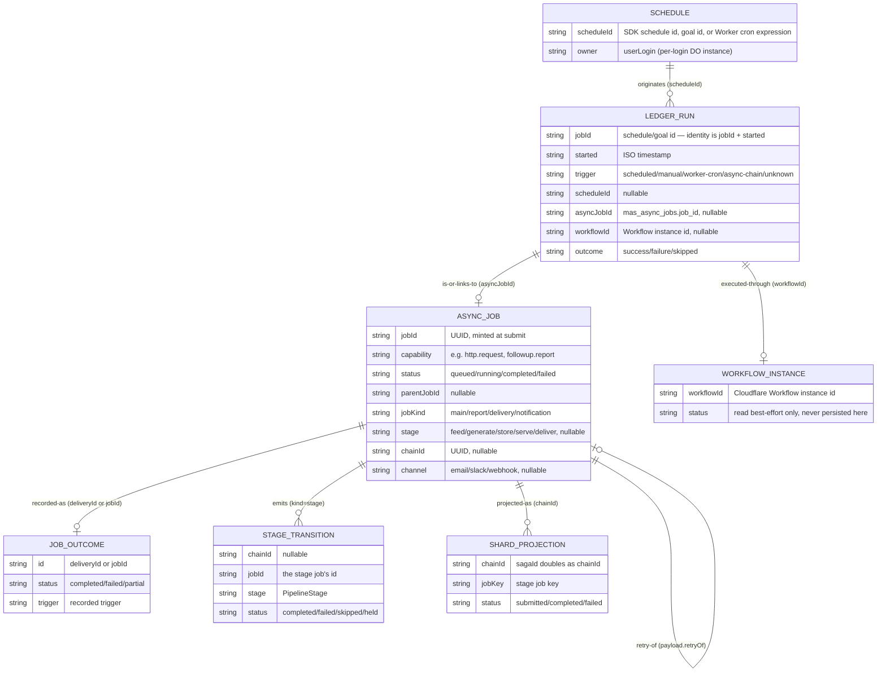
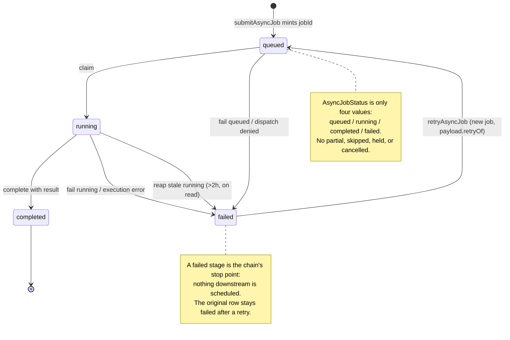

# Jobs, workflows, stages — ids, tracking, auditing

An operations reference for the three systems that record what the
platform did: async jobs (`mas_async_jobs`), the run ledger
(`job_run_records`), and Cloudflare Workflow instances — plus the
chains and stages that join them. It answers, for each entity: what
its id is and where it is minted, what statuses it can carry, how its
status is (and is not) rolled up, where it can be seen, and what audit
record it leaves.

**Verified against main `92a15c08` (2026-11-07).** Every load-bearing
claim cites a file:line. Where the code has no answer, the doc says so
instead of inventing one.

**Related docs — read, not repeated here.** The Workflow Runs tab's
read surface is documented in
[`docs/agents/workflow-runs.md`](../agents/workflow-runs.md); the
ledger's inventory and the S1–S4 slice history live in
[`docs/architecture/scheduling/3121-s0-inventory.md`](../architecture/scheduling/3121-s0-inventory.md);
stuck-run handling is in
[`runbook/stuck-runs.md`](runbook/stuck-runs.md). This doc links to
them rather than duplicating them.

## The one endpoint

`GET /api/jobs/<jobId>` and `GET /api/jobs/<id>` are the **same
endpoint**. There is one route — `GET /api/jobs/:uuid` — which returns
that row from `mas_async_jobs` as JSON, or a 404
(`src/agents/orchestrator.ts:2403-2409`). `<jobId>` and `<id>` are two
names for the same slot in different docs. What matters is **which** id
you put in it, because the ledger page shows two different kinds of
id: the ledger's Job column is a schedule/goal id (not an async-job
id — `/api/jobs/<that>` 404s), while the Async job column is the
`mas_async_jobs` row id (see [Entity reference](#entity-reference)).

## The stage-status reads (#4361)

Two reads answer "which stage is running, and how long did each take?" — the
job at a glance, and one stage in detail:

| Read | Returns |
| --- | --- |
| `GET /api/jobs/:jobId/status` | the job's status and window, then one entry per stage (sub-job): `stageId`, `kind`, `status`, `startedAt`, `endedAt`, `durationMs`, `units`, `completedUnits`, `error` |
| `GET /api/jobs/:jobId/stages/:stage` | one entry of the same list, addressed by stage id (`job:root`), stage kind (`feed`) or node path |
| MCP `get_job_status` / `get_job_stage_status` | the same payloads, read from the same engine status view |
| `POST /api/jobs/:jobId/stages/:stage/:operation` | drives one stage — `run`, `rerun`, `stop`, `resume`, `cancel` — through the engine's own control plane; the reply names the stage and the resulting state |
| MCP `stock_copilot_stage_control` | the same control from chat: `(jobId, stage, operation)`, requiring the turn's acting identity |

Both read the engine's own status view through the ScheduledAgent door — the
same source the Workflow Runs stages use (#4359) — never a second stage source.
An unknown job id refuses by name with a 404; an unknown or ambiguous stage
refuses with the stages that do exist; a door outage is a 503, never a pretend
"not found". `get_async_job` keeps its verbatim `mas_async_jobs` passthrough and
is deliberately not widened: its record carries no stages.

## Entity relationships

Reading the diagram: a ledger run is the record of one run of one
job; its `asyncJobId` points at the async job that did the work (or is
null when the run neither is nor links to an async job); its
`workflowId` points at the Workflow instance when the run executed
through one. An async job may be a chain's generate stage (the main
job) with serve/deliver stage jobs as its children — children link by
*both* `chain_id` (same chain) and `parent_job_id` (the generate row).
Notifications (`followup.notify`) are parented siblings, **not** stage
jobs: they carry no `stage` and no `chainId`
(`src/services/screenerFollowups.ts:521-580`).

## Entity reference

### Async job — `mas_async_jobs` (Durable Object SQLite)

| Aspect | Fact |
| --- | --- |
| **Id** | `job_id`, a UUID minted by `submitAsyncJob` (`crypto.randomUUID()`, `src/agents/orchestrator/asyncJobs.ts:295`). Uniqueness scope: the per-login Orchestrator DO instance (schedules and jobs live inside per-login instances; the same id never recurs). S4 restamps `asyncJobId` in a payload's `ledgerLinkage` to the minted row's own id (`src/services/consolidatedScheduling.ts:196-215`). |
| **Status** | `AsyncJobStatus = "queued" \| "running" \| "completed" \| "failed"` (`src/types.ts:2591`). That is the whole set — no `partial`, `skipped`, `held`, `awaiting`, `cancelled`, or `unknown` at this layer. |
| **Rollup** | **None.** No code derives a parent job's status from its children, or writes any aggregate back (see [Status rollup: there is none](#status-rollup-there-is-none)). A parent whose child fails stays `completed` in this table. |
| **Tracking** | Queue panel tree (`src/client/AsyncJobsPanel.tsx` — roots newest first, children nested under parents, each with View result / Retry); `GET /api/jobs?limit=30` (list, result-stripped); `GET /api/jobs/<id>` (single row, full record incl. `result`); `GET /api/jobs/history?chainId=` (D1 shard projection, not this table); Workflow Runs (groups rows by `chain_id ?? parent_job_id ?? job_id`, `src/services/workflowRuns.ts:743`). |
| **Auditing** | `async_job.queued` (`{ jobId, capability }` — two fields only, `src/agents/orchestrator/asyncJobs.ts:368`), `async_job.started`, `async_job.completed`, `async_job.failed` (`{ jobId, capability, error }`), `async_job.retried` (`{ jobId, retryJobId, capability }`), `async_job.stuck_detected`, `async_job.dispatch_denied` — all to `mas_events` via `OrchestratorAgent.audit` (`src/agents/orchestrator.ts:1512-1519`, swallow-on-failure, never fails the operation). See [Auditing](#auditing). |

### Ledger run — `job_run_records` (DO SQLite)

| Aspect | Fact |
| --- | --- |
| **Id** | There is **no standalone run id**. A row's identity is `jobId` + `started`: `jobId` is the schedule/goal id, `started` the ISO start time (`src/data/jobRunRecordPorts.ts:101`; `src/client/ScheduleRunLedgerPanel.tsx:16-17`, `rowKey` is `` `${jobId}:${started}:${i}` ``). The S1 ledger mints no run id, so `run=<id>` deep-links that job's run history, newest first. |
| **Status** | `JobRunOutcome = "success" \| "failure" \| "skipped"` (`src/data/jobRunRecordPorts.ts`). A separate five-valued trigger vocabulary rides alongside: `JobRunLedgerTrigger = "scheduled" \| "manual" \| "worker-cron" \| "async-chain" \| "unknown"` (`src/data/jobRunRecordPorts.ts:14-21`) — `unknown` is legacy-rows-only; no new row is ever `unknown`. |
| **Linkage** | Four S1 columns: `trigger`, `scheduleId` (SDK schedule id, goal id, or Worker cron expression; null = no originating schedule), `asyncJobId` (`mas_async_jobs.job_id`; null = this run neither is nor links to an async job), `workflowId` (Cloudflare Workflow instance id; null = did not execute through a workflow). Null is a recorded fact, rendered as "—", never a reason to drop the row. |
| **Rollup** | **None.** A ledger row is one terminal-point write (`recordScheduleCallbackRun` into `job_run_records`); nothing aggregates rows into a job-level or schedule-level status. |
| **Tracking** | Run ledger (`?tab=schedules&view=ledger`, `src/client/ScheduleRunLedgerPanel.tsx`): Job → run history via `run=<id>`; Async job → shared `AsyncJobResultViewer` (`GET /api/jobs/<id>`); Schedule and Workflow ids are plain text (gap #3640). Reads: `GET /api/schedules/runs` and `GET /api/schedule/runs` (`src/client/jobsApi.ts`). |
| **Auditing** | The row itself is the audit record for the run. Goal lifecycle events are separate: `schedule.goal.added/removed/enabled/triggered` (`src/agents/scheduled-agent.ts:1481,1498,1516,1991`), written to the shared Orchestrator `mas_events` funnel, best-effort. |

### Workflow instance — Cloudflare Workflow

| Aspect | Fact |
| --- | --- |
| **Id** | The Workflow instance id, stamped as the ledger row's `workflowId` when the run executed through a workflow (`src/data/jobRunRecordPorts.ts:116`). Minted by the Workflows runtime when the instance is created (a binding-schedule firing or a command-payload start). |
| **Status** | There is **no Workflow-instance status stored in this platform**. The live instance `status()` is read best-effort and surfaced only as `instanceStatus`/`instanceError` in the saga-status response (`src/agents/routes/sagaStatus.ts:380-420` approx.); the ledger does not query the Workflows runtime (`docs/agents/workflow-runs.md`, Known limits). A Cloudflare Workflow's internal retries are visible only through the stage rows/transitions the flow projects. |
| **Rollup** | **None.** A run's displayed status in Workflow Runs is derived from its stage rows and outcome at request time (see [Status rollup](#status-rollup-there-is-none)), never written onto the instance. |
| **Tracking** | Workflow Runs tab (`?tab=workflow-runs`, `src/client/WorkflowRunsPanel.tsx`): one row per run, detail dialog with every stage in execution order. Read: `GET /api/workflow-runs?limit=<1..100>` (default 40), forwarded to the Orchestrator DO (`src/agents/routes/workflowRuns.ts:477-690`). Trade approvals and payment workflows are settled in their own ledgers, not here; ResearchAgent runs keep their own `research_runs` store. |
| **Auditing** | No Workflow-instance audit event exists. What is audited is the work the instance did: stage transitions, job lifecycle events, `scheduled_job.outcome` per dispatch (`src/observability/scheduledJobOutcomes.ts:59`). |

### Schedule

| Aspect | Fact |
| --- | --- |
| **Id** | The SDK schedule id, goal id, or Worker cron expression — whatever originated the run. It is the ledger row's `scheduleId` and, for goal/schedule runs, the ledger row's `jobId`. Minted by the Agents SDK scheduler (per-DO alarm store), by goal creation, or by `wrangler.jsonc` (Worker crons). |
| **Status** | A schedule is paused or enabled; there is no per-schedule run status. A schedule's runs are its ledger rows. |
| **Rollup** | **None.** Nothing aggregates a schedule's runs into a schedule status. |
| **Tracking** | Schedules home (`?tab=schedules`, sub-routes `view=list\|runs\|ledger\|queue&schedule=<id>&run=<id>`); the ledger's Schedule cell is plain text (gap #3640). |
| **Auditing** | `schedule.goal.*` lifecycle events (see ledger run, above). The every-30-minute tick is traced per dispatch (`#2037` per-tick trace) and gated on the #2331 service-user platform-tier provisioning. |

### Chain and stage

| Aspect | Fact |
| --- | --- |
| **Id** | A chain has one `chainId`, a UUID minted at the generate step (`src/agents/orchestrator/asyncJobs.ts:595-700`: `chainId = outcome.stageChain ? crypto.randomUUID() : undefined`). A stage has **no single id**: a stage is the pair `(chainId, stage)`. There is no URL that addresses one stage (gap #3641). |
| **Status** | `PipelineStage = "feed" \| "generate" \| "store" \| "serve" \| "deliver"` (`src/types.ts:2601-2607`). Stage-transition statuses recorded in the activity log are `completed \| failed \| skipped \| held` (`src/agents/orchestrator/asyncJobs.ts:263`). Each stage job carries its own `AsyncJobStatus` (queued/running/completed/failed). Note: `"store"` has no executor (gap #3642); feed/store were noted as joining "as stage jobs in C4" (`src/types.ts:2601-2607`). |
| **Rollup** | **None as a write.** The only chain-level status anywhere is the Workflow Runs read model, computed fresh per request (see [Status rollup](#status-rollup-there-is-none)). A chain whose serve stage fails has no chain-level status row anywhere. |
| **Tracking** | Queue panel (child rows show `stage: …`); Workflow Runs detail dialog (every stage in execution order, with status, timing, reason, error); `GET /api/jobs/history?chainId=` (shard projection per chain). |
| **Auditing** | `recordStageTransition` writes one screening-activity row per transition (`kind = "stage"`, summary `Stage <stage> <status>[: reason]`, detail `{ chainId, jobId, stage, status, reason }`, `src/agents/orchestrator/asyncJobs.ts:248-283`); append-only, never throws (`src/services/screeningActivity.ts:67-80`). |

### Sub-job

| Aspect | Fact |
| --- | --- |
| **Id** | A sub-job is an ordinary async job whose `parent_job_id` names its parent (`src/agents/orchestrator/asyncJobs.ts:339`). It has its own `job_id`, minted the same way. |
| **Status** | Same `AsyncJobStatus` as any job. `jobKind` names its role: `"main" \| "report" \| "delivery" \| "notification"` (`src/types.ts:2595`); `channel` (`"email" \| "slack" \| "webhook"`, `src/types.ts:2599`) applies to delivery/notification jobs. |
| **Rollup** | **None.** A sub-job's status never writes back onto its parent (see [Status rollup](#status-rollup-there-is-none)). |
| **Tracking** | Queue panel tree: children nested under their parent in creation order, each with its own View result / Retry buttons (`src/client/AsyncJobsPanel.tsx:33-57, 235-261`). A sub-job whose parent is paged out renders as its own root, never hidden. In the ledger, follow-ups appear as their own rows, linked by the four linkage columns. |
| **Auditing** | Same lifecycle events as any job (`async_job.queued/started/completed/failed`), plus `followup.delivery_suppressed`, `followup.schedule_failed`, and the blocking `followup.delivered` audit (throws, so it can fail the job — `src/agents/orchestrator/asyncJobs.ts:1300-1315`). |

### Retry

| Aspect | Fact |
| --- | --- |
| **Id** | A retry is a **new job** with a new `job_id`. It links to the original through `payload.retryOf = originalJobId` (`src/agents/orchestrator/asyncJobs.ts:730-785`). It reuses the original's capability, payload, displayName, `parentJobId`, `jobKind`, `channel`, `stage`, and `chainId`. |
| **Status** | Only `failed` rows can be retried; a second retry is refused while an earlier retry is `queued \| running \| completed`. The retry itself goes through the normal `queued → started → completed/failed` trail. |
| **Rollup** | **None.** Retrying a stage does not change the original row's status (it stays `failed`); upstream stages are never re-executed. |
| **Tracking** | `POST /api/jobs/<id>/retry` (404 not found, 409 already-retried / not-failed, else 500 — `src/agents/orchestrator.ts:2411-2423`); Retry button in the queue panel (`src/client/AsyncJobsPanel.tsx:112-121, 181-190`). |
| **Auditing** | `async_job.retried` (`{ jobId, retryJobId, capability }`). There is no separate "retry succeeded/failed" audit — the retry is a new job with its own lifecycle trail. |

### Job outcome — `mas_job_outcomes`

| Aspect | Fact |
| --- | --- |
| **Id** | `id` = `outcome.deliveryId ?? jobId` (`src/agents/orchestrator/asyncJobs.ts:656-675`, `origin: "job-tree"`). Fields: `id, kind, trigger, status, scanned, matched, codedError, reportUrl, pdfKey, xlsxKey, csvKey, deliveryStates, origin, createdAt` (`src/data/jobOutcomePorts.ts`). |
| **Status** | `JobOutcomeStatus = "completed" \| "failed" \| "partial"` (`src/data/jobOutcomePorts.ts`). |
| **Rollup** | **None.** `recordJobOutcome` is one `SELECT` + one `INSERT OR REPLACE` by that outcome's own `id`, merging scalar fields and `deliveryStates` key-wise (`src/data/doSqliteJobOutcomeAdapter.ts:73-113`). A re-record overwrites that row's `status`; nothing reads sibling/child rows to compute it. |
| **Tracking** | Workflow Runs (an outcome whose id names one of a run's jobs — directly, or via the `workflow:<jobId>:<shard>` delivery id — is that run's outcome; an outcome with no job twin is its own run). |
| **Auditing** | The outcome row is itself the record. The scheduled-job-outcome route (`#2037`) writes one `mas_events` row of type `scheduled_job.outcome` per dispatch and computes a consecutive-failure streak from recent rows for alerting — a counter/alert, not a status written onto any job, chain, ledger row, or Workflow instance (`src/agents/routes/scheduledJobOutcome.ts`). |

## Status vocabularies — four of them, no mapping in code

Four status vocabularies coexist, plus two more for stages and
projections. There is **no mapping table in code**; this table is the
reference. Do not read a value from one vocabulary as if it belonged
to another — in particular, `partial`, `awaiting`, `skipped`, and
`held` have no `mas_async_jobs` equivalent.

| Vocabulary | Values | Where | Source |
| --- | --- | --- | --- |
| `AsyncJobStatus` | `queued`, `running`, `completed`, `failed` | one async job | `src/types.ts:2591` |
| `WorkflowRunStatus` | `queued`, `running`, `completed`, `partial`, `failed`, `skipped`, `awaiting`, `unknown` | one run, as displayed in Workflow Runs | `src/services/workflowRuns.ts:53-61` |
| `JobOutcomeStatus` | `completed`, `failed`, `partial` | one job outcome | `src/data/jobOutcomePorts.ts` |
| `JobRunOutcome` | `success`, `failure`, `skipped` | one ledger run | `src/data/jobRunRecordPorts.ts` |
| Stage-transition status | `completed`, `failed`, `skipped`, `held` | one stage transition | `src/agents/orchestrator/asyncJobs.ts:263` |
| Shard-projection status | `submitted`, `completed`, `failed`, … | one shard job row | `src/data/shardJobRoute.ts`, `src/agents/routes/sagaStatus.ts:130-190` |

The Workflow Runs builder is the only place that translates between
them, and it does so per request, without persisting the result (see
[Status rollup](#status-rollup-there-is-none)).

## Status lifecycle

The machine above is per async-job row. Two more lifecycles run
alongside it and are **not** the same machine:

- **Stage transitions** (`completed | failed | skipped | held`) are
  recorded in the screening activity log, not on the job row. A stage
  can be `skipped` or `held` while its job row is `completed` — the
  transition status is preserved from `result.status` at completion
  (`src/agents/orchestrator/asyncJobs.ts:1462-1475`).
- **Run status** (`WorkflowRunStatus`, eight values) is derived at
  request time by the Workflow Runs builder from the run's stages and
  outcome — it is a display value, never a stored one.

## Status rollup: there is none

**Explicit finding: no code anywhere derives a parent job's, a
chain's, a ledger row's, or a Workflow instance's status from
child/stage statuses and writes it back.** Every status transition
found is a per-row write to that row only.

Evidence (all searched on main `92a15c08`):

- A search for rollup/aggregation vocabulary (`rollup`,
  `aggregate.*status`, `derive.*status`, `parent.*status`,
  `chain.*status`, `overallStatus`, `compute.*status`,
  `status.*from.*child`) returns only unrelated hits: resource-day
  rollups, options-strategy type rollups, the chain-*projection read*
  route (a read, not a rollup), and client `TypeRollupCards`. No
  parent/chain status derivation.
- The async-job adapter has only five single-row `UPDATE`s
  (`src/data/doSqliteAsyncJobAdapter.ts:162,196,212,226,239`): fail
  queued, claim → `running`, complete one row, fail running, reap
  stale running. **No `UPDATE … WHERE parent_job_id = ?`, no
  `WHERE chain_id = ?`, no parent-row update of any kind.**
- `parent_job_id` is never a status-write key: its non-test uses are
  DDL/index, INSERT, SELECT projection, read-mapping, Workflow Runs
  grouping, shard root resolution, and one chain-executor insert with
  `parent_job_id: null`.
- `executeAsyncJob` completion stamps only the completing row
  (`family.queue.complete(jobId, …)` + `async_job.completed`,
  `src/agents/orchestrator/asyncJobs.ts:1457-1459`); failure the same
  (`:1681-1683`). The completion hooks that follow only **submit new
  jobs** or record a stage transition; they never touch the parent.
- `recordScreenerRunMainJob` inserts its own terminal row
  (`:595-700`); no parent exists or is updated — the row *is* the root.
- `recordJobOutcome` upserts by the outcome's own `id`; nothing reads
  sibling/child rows to compute it.
- The `#2037` scheduled-job-outcome route computes a
  consecutive-failure **streak** for alerting — a counter, not a
  status written onto any job, chain, ledger row, or instance.

What exists instead is **read-model-only derivation** in the Workflow
Runs builder (`src/services/workflowRuns.ts`), computed fresh per
request and persisted nowhere:

- `runStatusFromStages` (`:724-737`): `failed` > `running` > `queued` >
  `held` (→ `partial` if any completed, else `awaiting`) > `skipped`
  (→ `partial` if any completed, else `skipped`) > all-`completed` →
  `completed`, else `unknown`.
- `runFromJobs` (`:975-990`): outcome `failed`/`partial` wins; a
  recorded stage failure wins over an outcome `completed`; otherwise
  the stage-derived status, else `completed`. `finishedAt` is the max
  `completed_at` over terminal jobs only.
- `runFromSagaChain` (`:1423-1435`): `endedCode SUCCESS_*` →
  `completed`, else any failed stage → `failed`, else `running`.
- `summarizeWorkflowRuns` (`:1540+`): counts only.

Consequences an operator must know: a parent whose child fails stays
`completed` in `mas_async_jobs`; a chain whose serve stage fails has
no chain-level status row anywhere; `mas_job_outcomes` and
`job_run_records` rows are independent single writes. **Any doc, UI
label, or message that implies a rolled-up status exists is wrong.**
This doc is the correction: the only run-level status is the Workflow
Runs display value, recomputed on every read.

## Tracking matrix

| Surface | Entity shown | Read | Notes |
| --- | --- | --- | --- |
| Queue panel (`?tab=…` queue view, `AsyncJobsPanel`) | async jobs + sub-jobs (tree) | `GET /api/jobs?limit=30`; 4 s poll while any job is `queued\|running`, 20 s idle, stopped while tab hidden | Each row: View result / Retry (terminal only). Child rows show `stage`, `jobKind`, `channel`, `notBefore`. |
| Run ledger (`?tab=schedules&view=ledger`, `ScheduleRunLedgerPanel`) | ledger runs + linkage ids | `GET /api/schedules/runs` + `GET /api/schedule/runs` (both in one `Promise.all`) | Job → run history; Async job → `AsyncJobResultViewer`; Schedule/Workflow plain text (gap #3640). |
| Job detail viewer (`AsyncJobResultViewer`) | one async job's result | `GET /api/jobs/<id>` | Shows result JSON (preview + download) or the error for a failed job. Shows **no** stage, chain, or parent context — only the result. |
| Workflow Runs (`?tab=workflow-runs`, `WorkflowRunsPanel`) | runs (grouped jobs + outcomes + stage transitions) | `GET /api/workflow-runs?limit=<1..100>` (default 40); detail via `/api/runs/details?id=…` | Filters: trigger, status (incl. "in flight"), free text. Partial-store failures render as a warning strip, not an error (see [Failure modes](#failure-modes)). |
| `GET /api/jobs?limit=30` | async jobs (list) | `src/agents/orchestrator.ts:2370-2400` | Result-stripped rows; envelope `nocount` (`{ jobs }`) or `count` (`{ count, jobs }`); invalid envelope fails closed to `nocount` + audits `jobs.config_error`. Limit clamped 1–100. |
| `GET /api/jobs/<id>` | one async job | `src/agents/orchestrator.ts:2403-2409` | Full record **including** `result`. 404 when absent. 500 on corrupt `result_json` (gap #3643). |
| `POST /api/jobs/<id>/retry` | retry (new job) | `src/agents/orchestrator.ts:2411-2423` | 404 not found, 409 already-retried / not-failed, else 500. |
| `GET /api/jobs/history?chainId=` | shard-job projection per chain | `src/server/routes/privacy.ts:326-360` → `src/data/shardJobRoute.ts:35-95` | D1 (AgentDB) projection only, never the DO. 401 / 405 / 400 (missing `chainId`) / 200 / 500 (`job_history_failed`); 503 when AgentDB is unbound. **Not** handled by `src/agents/routes/sagaStatus.ts` — that file handles `GET /api/saga/:sagaId/status` only (it writes a projection row with `chainId = sagaId` so history can find it). |
| `POST /api/jobs/reconcile` | reconcile report | `src/server/routes/privacy.ts:423-469` | Platform-admin only, never auto-run. Report `{ checked, reconciled, alreadyCurrent, errors }` — but only the 100 most recent jobs, terminal-only, and the window is not recorded (gap #3644). |
| `GET /api/chains/status`, `POST /api/chains/reconcile` | chain schedules | `src/server/routes/privacy.ts:245-278, 280-324` | Same 401/405/403/200/500 shape, platform-admin only for reconcile. |
| `GET /api/saga/:sagaId/status` | saga chain | `src/agents/routes/sagaStatus.ts:330-345` | Per-stage `submitted\|completed\|failed` mapped from audit rows; live Workflow instance status read best-effort. |

## Auditing

All `ctx.audit(...)` calls land in `mas_events` through
`OrchestratorAgent.audit` (`src/agents/orchestrator.ts:1512-1519` —
try `recordAudit`, swallow on failure, never fails the operation;
`recordAudit`, `:1493-1511`, is the single owner of `mas_events`
inserts: `id = crypto.randomUUID()`, `sessionId = sessionKey()`,
`type`, `agent`, `payload`, `createdAt`). The audit event carries
only the fields listed; all detail lives on the job/ledger/outcome
row. To answer who/how/from-where for a specific job: `GET
/api/jobs/<id>` in the same session (the status URL), or the queue
view.

| Event | Site | Payload fields |
| --- | --- | --- |
| `async_job.queued` | `src/agents/orchestrator/asyncJobs.ts:368` | `{ jobId, capability }` — two fields only, by design. The answer path for the rest is `GET /api/jobs/<id>`, not a fatter event. |
| `async_job.started` | `:870` | `{ jobId, capability }` |
| `async_job.completed` | `:1459` | `{ jobId, capability }` |
| `async_job.failed` | `:1683` | `{ jobId, capability, error }` |
| `async_job.retried` | `:783` | `{ jobId, retryJobId, capability }` |
| `async_job.stuck_detected` | `:451` | `{ jobId, capability, ownerLogin, ageMs, thresholdMs }` |
| `async_job.dispatch_denied` | `:906, :927, :958` | `{ jobId, capability, reason, detail? }` |
| `async_job.stuck_alert` / `async_job.stuck_alert_failed` | `src/agents/orchestrator.ts:680` | Stuck-alert delivery outcome (notify hook, not the detection audit). |
| `screener.run_bridged` | `:649` | `{ jobId, kind, success }` |
| `followup.delivery_suppressed` | `:1258` | `{ jobId, runId, destination, channel }` |
| `followup.schedule_failed` | `:1604, :1645, :1672` | `{ jobId, error }` |
| `followup.delivered` | `:1300-1315` approx. | `{ jobId, channel, userLogin, detail }` — blocking audit via `recordBlockingAudit`: it throws, so it can fail the job (no-audit-no-success, #2178 Q7 S2). |
| `shard.advance_failed` | `:1506, :1780` | `{ jobId, chainId, error }` |
| `shard.blocked` | `:1758` | `{ jobId, chainId, shardKey, error }` |
| `feed.generate_schedule_failed` | `:1543` | `{ jobId, chainId, error }` |
| `jobs.config_error` | `src/agents/orchestrator.ts:2395` | `{ setting, value, resolved }` (invalid `JOB_LIST_ENVELOPE`). |
| `schedule.goal.added` | `src/agents/scheduled-agent.ts:1481` | `{ operation }` extra; via `auditGoalLifecycle` (`:1380-1405`) → `postGoalScheduleAuditEvent` to the shared Orchestrator `mas_events` funnel; best-effort, swallowed on failure. |
| `schedule.goal.removed` | `:1498` | (same funnel) |
| `schedule.goal.enabled` | `:1516` | `{ enabled }` extra |
| `schedule.goal.triggered` | `:1991` | (same funnel) |
| `scheduled_job.outcome` | `src/observability/scheduledJobOutcomes.ts:59` | `{ job, outcome, traceId, errorCode?, reason?, linkage? }` — one row per dispatch (#2037). |
| `saga.*` | `src/agents/routes/sagaStatus.ts:70-95` | `saga.started`, `saga.payment_*`, `saga.screen_*`, `saga.journey_*`, `saga.trade_*`, `saga.failed`, `saga.outcome_notice`, `saga.ended`. |
| `reconcile` | `src/agents/orchestrator/shardJobReconcile.ts:100-107` | `eventKind: "reconcile"`, `detailJson: report` — one best-effort tenant-wide audit event per reconcile run. |

### Stage events — the durable per-stage record (#4360)

The engine publishes one `job.stage.<action>` message per stage transition on
the `job-pipeline-events` queue, addressed by `(runId, stageId)` and carrying
the #2869 claim key (`runId::jobs::stageId`). `started` is published the moment
a unit starts — after the checkpoint is written, never before — and carries
`startedAt`; every terminal action (`completed`, `failed`, `timed_out`,
`cancelled`, `retired`) carries `endedAt` alongside it. Both stamps are the
checkpoint's own fields (#4359): the event never invents a clock.

The consumer persists each publication in `job_stage_events` (the
ScheduledAgent's DO SQLite, `src/data/doSqliteJobStageEventAdapter.ts`), keyed
by claim key + action + unit + instant, so a re-delivery is ignored while a
stage's start and its terminal event both survive. A store failure returns
`retry`, never an ack-and-drop. A stage with a `started` row and no terminal row
is visibly in flight — or stuck — without guessing.

## Failure modes

- **A corrupt stored `result_json` 500s the detail view but not the
  list.** `getAsyncJob` throws on invalid JSON
  (`src/agents/orchestrator/asyncJobs.ts:492`, no try/catch around the
  branch in `onRequest`, so a DO-level 500); `listAsyncJobs` parses
  leniently and yields `result: undefined` for the same row. A corrupt
  row therefore breaks the job detail view while the queue list
  renders fine (gap #3643).
- **Workflow Runs fails soft — a broken store hides in a warning.**
  Every named store failure in `handleWorkflowRunsRoutes` degrades to
  `storeErrors` + HTTP 200 with partial data
  (`src/agents/routes/workflowRuns.ts:525-652`); the panel renders a
  warning strip (`src/client/WorkflowRunsPanel.tsx:892-897`). A reader
  that ignores the warning sees a silently partial ledger. This is a
  deliberate, documented design choice (`docs/agents/workflow-runs.md`,
  Honesty rules) — not filed — but an operator must check
  `storeErrors` before trusting a run count.
- **Workflow Runs HTTP 500 (observed 2026-11-05 ~05:58 EST, #3264
  live facts): unverified-live.** In this head, `handleWorkflowRunsRoutes`
  itself contains **no 500 branch** — every named store failure
  degrades to `storeErrors` + 200. A 500 from this tab today could
  only come from outside the handler's guarded reads: the Worker→DO
  dispatch failing (`actorGateway.dispatch`, unbound/missing DO, DO
  crash — no try/catch around the dispatch in
  `src/server/routes/core.ts:228`), or an unguarded throw in
  `buildWorkflowRunsPage`/`summarizeWorkflowRuns` after all reads
  succeed (`src/agents/routes/workflowRuns.ts:645-666`). The 2026-11-05
  500 must have been upstream (dispatch/DO) or from an earlier version
  of the handler. **Re-check (owner session):** open `?tab=workflow-runs`
  in production; if the list loads, the 500 is not persistent; if it
  500s again, capture the run and the response before filing — do not
  file on the 2026-11-05 observation alone.
- **Neighbouring routes still 500 by design:** `/api/jobs/history`
  (`src/data/shardJobRoute.ts:85-94`), `/api/chains/status`
  (`src/data/chainStatusRoute.ts:100-110`), `/api/jobs/:uuid` on
  corrupt `result_json` (above), `/api/schedules/runs`
  (`src/agents/routes/schedules.ts:385-401`, caught → 500 JSON).
  `/api/schedule/runs` is the outlier: no try/catch at all
  (`src/server/routes/trading.ts:124-130`), so a `listJobRuns` throw
  propagates unmapped and the ledger panel's `Promise.all` fails
  both reads (gap #3645).
- **Stuck running jobs are reaped on read, not by a sweeper.**
  `getAsyncJob` reaps a `running` row older than 2h to `failed`
  ("Execution stopped before a result was recorded…") and re-reads it
  (`src/agents/orchestrator/asyncJobs.ts:469-515`); `listAsyncJobs`
  does the same per running row. A stuck job therefore shows `failed`
  the next time it is read, with `async_job.stuck_detected` audited.
  See also [`runbook/stuck-runs.md`](runbook/stuck-runs.md).

## Gaps

Every gap in this section has a filed sub-issue under #3121. No gap
is listed without one.

| # | Gap | Issue |
| --- | --- | --- |
| G1 | Schedule and Workflow ids in the Run ledger are plain text (Job and Async job became clickable in #3605/PR #3627; these two were explicitly out of scope there). | #3640 |
| G2 | No stage-level deep link: a stage is `(chainId, stage)` with no single URL, and no `/api/` route serves a single stage. | #3641 |
| G3 | `PipelineStage` promises a `store` stage that has no executor — a job submitted with stage `"store"` would fail at execution ("Unsupported async capability"). Build the executor (C4, as the type comment anticipates) or remove `"store"` from the vocabulary. | #3642 |
| G4 | Corrupt `result_json`: the single read throws (DO 500) while the list read swallows it (`result: undefined`). Same corruption, different behavior; the detail view breaks while the list renders fine. | #3643 |
| G5 | Shard-job reconcile reads only the 100 most recent jobs and only terminal rows with a `chainId`; older chains and queued/running rows are never reconciled, and the report does not record its window. | #3644 |
| G6 | `GET /api/schedule/runs` has no error mapping — a `listJobRuns` throw propagates unmapped, and the ledger panel's `Promise.all` fails both reads. Its sibling `/api/schedules/runs` catches to a 500 JSON. | #3645 |

## Considered but not filed

- **No parent/chain status rollup.** Verified absent by search (see
  [Status rollup](#status-rollup-there-is-none)): no code derives a
  parent, chain, ledger-row, or Workflow-instance status and writes it
  back; the only run-level status is the Workflow Runs read model,
  recomputed per request. This is documented here as the design, not
  filed — no UI implies a persisted rollup exists. If a future UI
  does imply one, file it then.
- **The Workflow Runs HTTP 500 (2026-11-05).** The handler has no 500
  branch in this head; persistence cannot be established from code.
  Not filed. Recorded under [Failure modes](#failure-modes) with the
  owner-session re-check step.
- **Thin `async_job.queued` payload (`{ jobId, capability }`).** By
  design: the event is a pointer, the detail lives on the job row,
  and the answer path is `GET /api/jobs/<id>`. Documented, not filed.
- **Workflow Runs fail-soft hiding a broken store.** Deliberate,
  documented design (`docs/agents/workflow-runs.md`, Honesty rules:
  a failed store is named in `storeErrors` and the rest still
  renders). Documented here as an operator note, not filed.
- **Status-vocabulary mapping.** Four vocabularies plus stage and
  projection statuses, with no mapping table in code. This doc
  supplies the mapping table ([Status vocabularies](#status-vocabularies--four-of-them-no-mapping-in-code));
  no code change is implied, so nothing is filed. If a single
  mapping is ever built in code, it must match this table.
- **Notifications are not stage jobs.** `followup.notify` rows are
  parented to the main job but carry no `stage`/`chainId`
  (`src/services/screenerFollowups.ts:521-580`). This is the design,
  not a gap — recorded here so a reader does not count notifications
  as stages.
